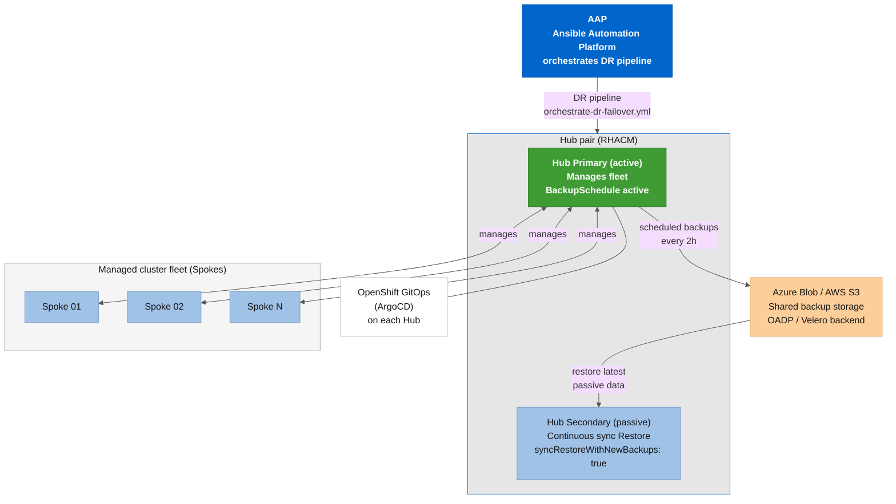

# 🛡️ RHACM DR Collection

[](https://galaxy.ansible.com/ui/repo/published/dfmateus/acm_dr/)
[](https://github.com/dfmateus/acm_dr/actions/workflows/ci.yml)
[](https://www.gnu.org/licenses/gpl-3.0)
[](https://docs.ansible.com/ansible/latest/)

Multi-cluster Disaster Recovery orchestration for Red Hat Advanced Cluster Management for Kubernetes (RHACM 2.10+).

> **What is RHACM?** Red Hat Advanced Cluster Management for Kubernetes offers management, visibility, and control of your entire Kubernetes fleet from a single console. See [*`docs/architecture/rhacm.md`*](docs/architecture/rhacm.md) for a full overview, or visit the official [product page](https://www.redhat.com/en/technologies/management/advanced-cluster-management) and [datasheet](https://www.redhat.com/en/resources/advanced-cluster-management-kubernetes-datasheet).

## 📖 Overview

This automation suite, built for **`ansible-core` (CLI)** and the **Red Hat Ansible Automation Platform (AAP)**, orchestrates **Business Continuity** for fleets managed by **RHACM 2.10+**. It covers **Disaster Recovery (DR)**, **Failover**, **Failback**, **Planned Maintenance Failover** (zero-downtime Hub upgrades via DR switchover), **DR Readiness Drills**, and **Fleet Lifecycle Management** (Spoke onboarding and detachment across any Kubernetes distribution). Validated against the [RHACM 2.17 Business Continuity](https://docs.redhat.com/en/documentation/red_hat_advanced_cluster_management_for_kubernetes/2.17/html-single/business_continuity/index#active-passive-config) official documentation (GA: June 16, 2026) following the Red Hat supported [active-passive hub cluster architecture](https://docs.redhat.com/en/documentation/red_hat_advanced_cluster_management_for_kubernetes/2.17/html-single/business_continuity/index#active-passive-config).

The solution has two distinct layers with different distribution requirements:

* **Hub Clusters (DR Nodes)**: always **Red Hat OpenShift**, provisioned and managed via OCP-native APIs (OLM, Routes, ConsoleLinks). Hub infrastructure storage is currently Azure-based (Azure Blob Storage for OADP/Velero backups and Thanos Observability).
* **Spoke/Managed Clusters**: **any Kubernetes distribution**. The fleet management, onboarding, failover reconnection, and detachment workflows are distribution-agnostic. Validated distributions include Azure Red Hat OpenShift (ARO), Azure Kubernetes Service (AKS), Amazon Elastic Kubernetes Service (Amazon EKS), Google Kubernetes Engine (GKE), IBM Cloud Kubernetes Service (IKS), and vanilla Kubernetes 1.24+.

Key capabilities: **Split-Brain Prevention** (logical fencing via BackupSchedule pausing), **Zero-Trust Automation** (ServiceAccount-based, no expirable human logins), native mitigation of known RHACM bugs ([KCS 7039710](https://access.redhat.com/solutions/7039710), [KCS 5950901](https://access.redhat.com/solutions/5950901)), **Safe Rehearsal via Dry-Run** (full pipeline with **`check_mode`**/**`diff`** against real clusters), and explicit backup resolution by **`clusterID`** to prevent silent failures on shared storage. For the full architecture and compliance alignment with the official RHACM documentation, see [*`docs/architecture/architecture.md`*](docs/architecture/architecture.md).



---

## Requirements

* **RHACM**: 2.10 through 2.17
* **OpenShift Container Platform**: 4.13 through 4.23 (see the [version compatibility matrix](docs/architecture/architecture.md#rhacmocp-version-compatibility-matrix))
* **Ansible**: >= 2.16.0
* **Python**: >= 3.11
* **Collection dependencies**:
  * [`kubernetes.core`](https://docs.ansible.com/ansible/latest/collections/kubernetes/core/index.html) >= 6.5.0
  * [`azure.azcollection`](https://docs.ansible.com/ansible/latest/collections/azure/azcollection/index.html) >= 3.20.0
  * [`community.general`](https://docs.ansible.com/ansible/latest/collections/community/general/index.html) >= 13.2.0
  * [`amazon.aws`](https://docs.ansible.com/ansible/latest/collections/amazon/aws/index.html) >= 9.0.0 (required for ROSA HCP / AWS S3 Hub path)
* **CLI tools**: **`oc`**, **`az`**, **`jq`**
* **Hub storage**: Azure Blob Storage (for OADP/Velero backups and Thanos metrics)
* **Spoke distributions supported**: ARO, AKS, EKS, GKE, IKS, vanilla Kubernetes 1.24+

---

## Installation

**From Ansible Galaxy** (when published):

```bash
ansible-galaxy collection install dfmateus.acm_dr
```

**From a git clone**:

```bash
git clone https://github.com/dfmateus/acm_dr.git
cd acm_dr

# Install collection dependencies
ansible-galaxy collection install -r collections/requirements.yml
```

---

## Quick start

For the full step-by-step walkthrough, see [*`docs/onboarding/getting-started.md`*](docs/onboarding/getting-started.md).

### 1. Setup the primary Hub

```bash
ansible-playbook playbooks/setup-acm-dr-hub.yml \
  -e "k8s_target_context=acm-primary-hub-sa" \
  -e "is_primary_hub=true"
```

### 2. Setup the DR Hub

```bash
ansible-playbook playbooks/setup-acm-dr-hub.yml \
  -e "k8s_target_context=acm-dr-hub-sa" \
  -e "is_primary_hub=false" \
  -e "acm_dr_hub_setup_azure_storage_allow_reuse=true"
```

### 3. Rehearse the failover in dry-run

```bash
ansible-playbook playbooks/orchestrate-dr-failover.yml \
  -e "failover_direction=acm-primary-hub-sa_to_acm-dr-hub-sa" \
  -e "acm_dr_failover_manager_dry_run=true" \
  -e "skip_gates=true"
```

---

## Included roles

| Role | Description |
|------|-------------|
| [*`acm_dr_hub_setup`*](roles/acm_dr_hub_setup) | Provisions Hub DR infrastructure: Azure Storage, MultiClusterHub, OADP/DPA, Observability, GitOps/ArgoCD, BackupSchedule, and Zero-Trust automation RBAC |
| [*`acm_dr_hub_cleanup`*](roles/acm_dr_hub_cleanup) | Inverse of **`acm_dr_hub_setup`**: deactivates a DR node by removing ACM, DR-scoped GitOps/OADP config, and Observability while preserving generic operators and Azure backup data. Has safety gates against accidental active Hub teardown |
| [*`acm_dr_failover_manager`*](roles/acm_dr_failover_manager) | DR failover/failback orchestration engine (9 stages: preflight, discover fleet, logical fencing, restore, sanitize [KCS 7039710](https://access.redhat.com/solutions/7039710), verify Spokes, protect new leader, detach old Hub, postflight) |
| [*`acm_dr_spoke_manager`*](roles/acm_dr_spoke_manager) | Spoke lifecycle management: onboarding (auto-import secret injection, bootstrap SA) and graceful detach ([KCS 5950901](https://access.redhat.com/solutions/5950901)). Distribution-agnostic (ARO, AKS, EKS, GKE, IKS, vanilla K8s) |
| [*`acm_dr_cluster_onboard`*](roles/acm_dr_cluster_onboard) | Bootstraps the **`ansible-dr-orchestrator`** ServiceAccount and its long-lived token Secret on a cluster, then exports a self-contained kubeconfig for AAP credential creation |
| [*`acm_dr_msa_provisioner`*](roles/acm_dr_msa_provisioner) | Manages the **ManagedServiceAccount** (MSA) token lifecycle on a Hub for each Spoke: creates the MSA, mirrors the token Secret to the Spoke's namespace, and reconciles expiry |
| [*`acm_dr_readiness_check`*](roles/acm_dr_readiness_check) | Read-only health check: validates **BackupSchedule**, **BackupStorageLocation**, backup freshness (RPO), Spoke fleet count, and passive sync **Restore** before a failover or as a scheduled gate |
| [*`acm_dr_upgrade_manager`*](roles/acm_dr_upgrade_manager) | Patches the ACM OLM Subscription to a new channel and waits for the **MultiClusterHub** to reach `Running` at the target version. Used in planned maintenance switchovers |
| [*`acm_argocd_instance_setup`*](roles/acm_argocd_instance_setup) | Provisions N parametric ArgoCD instances (namespace, repo secret, ApplicationSet generator, RBAC, ConsoleLink). Fully parameterizable and additive |
| [*`acm_argocd_instance_cleanup`*](roles/acm_argocd_instance_cleanup) | Inverse of **`acm_argocd_instance_setup`**: removes ArgoCD instances in the correct order (prevents orphaned finalizers) while preserving the shared Operator |
| [*`acm_dr_kubeconfig_resolver`*](roles/acm_dr_kubeconfig_resolver) | Pre-tasks role that detects per-cluster env vars, builds a runtime kubeconfig, and sets **`acm_dr_kubeconfig_path`**. No-op when no per-cluster vars are found (backward compatible with monolithic kubeconfig) |

For detailed stage-by-stage breakdowns of each role, see [*`docs/architecture/architecture.md`*](docs/architecture/architecture.md#technical-role-details).

---

## Included playbooks

| Playbook | Purpose |
|----------|---------|
| [*`setup-acm-dr-hub.yml`*](playbooks/setup-acm-dr-hub.yml) | Hub DR infrastructure provisioning (primary or passive) |
| [*`cleanup-acm-dr-hub.yml`*](playbooks/cleanup-acm-dr-hub.yml) | Deactivate a cluster from the DR topology |
| [*`orchestrate-dr-failover.yml`*](playbooks/orchestrate-dr-failover.yml) | Failover/failback orchestration (dry-run or production) |
| [*`check-dr-readiness.yml`*](playbooks/check-dr-readiness.yml) | Read-only DR readiness health check (BackupSchedule, BSL, RPO, Spoke count, passive Restore) |
| [*`bootstrap-cluster.yml`*](playbooks/bootstrap-cluster.yml) | Creates the **`ansible-dr-orchestrator`** ServiceAccount on a cluster from a temporary kubeadmin token, then exports the SA kubeconfig |
| [*`manage-spoke.yml`*](playbooks/manage-spoke.yml) | Spoke onboarding (**`spoke_prep`**) and graceful detach (**`spoke_detach`**) |
| [*`upgrade-hub-acm-channel.yml`*](playbooks/upgrade-hub-acm-channel.yml) | Patches the ACM Subscription channel and waits for the **MultiClusterHub** to reach Running |
| [*`manage-argocd-instance.yml`*](playbooks/manage-argocd-instance.yml) | Provision parametric ArgoCD instances |
| [*`cleanup-argocd-instance.yml`*](playbooks/cleanup-argocd-instance.yml) | Remove parametric ArgoCD instances |
| [*`diagnose-failover-state.yml`*](playbooks/diagnose-failover-state.yml) | Read-only diagnostic: dumps Hub DR state (BackupSchedule, Restores, MSA tokens, fleet health) without modifying anything |
| [*`check-approval-outcome.yml`*](playbooks/check-approval-outcome.yml) | Queries a running Workflow job for the outcome of an approval gate node (timed out vs. approved) |
| [*`notify-workflow-event.yml`*](playbooks/notify-workflow-event.yml) | Sends a structured event notification at the start or end of a Workflow (webhook, Slack, or AAP notification) |

Every playbook runs **`hosts: localhost`** and selects the real target via **`-e`** variables (kubeconfig context), not inventory. See [*`docs/testing/e2e-command-reference.md`*](docs/testing/e2e-command-reference.md) for the complete parameter reference.

---

## Scripts

Standalone Bash utilities organized by purpose, not called from any role:

* 📁 **[`examples/scripts/cluster-onboarding/`](examples/scripts/cluster-onboarding/)**: Day-0 cluster registration and SA provisioning.
  * [*`01_register_cluster.sh`*](examples/scripts/cluster-onboarding/01_register_cluster.sh): Interactive login/context-registration wizard for a new cluster (ARO/AKS/Kubernetes).
  * [*`02_provision_automation_sa.sh`*](examples/scripts/cluster-onboarding/02_provision_automation_sa.sh): Idempotent Zero-Trust SA + `*-sa` kubeconfig context provisioning.
  * [*`03_build_spoke_fleet.sh`*](examples/scripts/cluster-onboarding/03_build_spoke_fleet.sh): (Optional) Builds a local multi-context fleet kubeconfig file. Not required for failover. **`spoke_prep`** creates the per-spoke mirrored Secrets that the failover orchestrator uses.

* 📁 **[`examples/scripts/lib/`](examples/scripts/lib/)**: Shared helper libraries.
  * [*`load_cluster_env.sh`*](examples/scripts/lib/load_cluster_env.sh): Reads a per-cluster **`.env`** file and re-exports its values with the appropriate role prefix.

* 📁 **[`examples/scripts/dr-orchestrator/`](examples/scripts/dr-orchestrator/)**: DR workflow wrappers.
  * [*`run_failover.sh`*](examples/scripts/dr-orchestrator/run_failover.sh): Interactive wrapper around [*`orchestrate-dr-failover.yml`*](playbooks/orchestrate-dr-failover.yml) (dry-run is the default).

* 📁 **[`examples/scripts/break-glass/`](examples/scripts/break-glass/)**: Emergency finalizer and namespace cleanup.
  * [*`force_purge_managed_cluster.sh`*](examples/scripts/break-glass/force_purge_managed_cluster.sh) / [*`force_delete_namespace.sh`*](examples/scripts/break-glass/force_delete_namespace.sh): Force-remove stuck finalizers/namespaces in **`Terminating`** state.

* 📁 **[`examples/scripts/deep-cleanup/`](examples/scripts/deep-cleanup/)**: Deep-clean operations outside the role's scoped removal.
  * [*`purge_acm_observability.sh`*](examples/scripts/deep-cleanup/purge_acm_observability.sh) / [*`purge_gitops.sh`*](examples/scripts/deep-cleanup/purge_gitops.sh): Deep-clean the Observability/Thanos stack or the ArgoCD/GitOps ecosystem.

---

## AAP integration

This automation runs on **both** **`ansible-core`** CLI **and** Red Hat Ansible Automation Platform (AAP 2.7+) without code changes. AAP uses per-cluster credential types (Source Hub, Destination Hub, Target Cluster, Spoke Cluster) so each Job Template receives only the credentials it needs. All AAP objects (credential types, EE, inventory, project, Job Templates, Workflow Templates, and schedules) are imported in one command using [*`examples/playbooks/setup-aap-from-casc.yml`*](examples/playbooks/setup-aap-from-casc.yml) and the **`infra.controller_configuration`** collection. The [*`JT - ACM DR - LAB - Cluster Bootstrap`*](playbooks/bootstrap-cluster.yml) Job Template creates the permanent automation ServiceAccount on each cluster from a temporary kubeadmin token, eliminating local CLI prerequisites. The Bootstrap Job Template also creates the **`ACM DR - Target Cluster`** credential type (type 36) automatically. After Bootstrap completes, create **`ACM DR - Spoke Cluster`** credentials (type 37) manually for each Spoke; see [*`docs/aap/aap-setup.md`*](docs/aap/aap-setup.md) Section 7. See [*`docs/aap/aap-setup.md`*](docs/aap/aap-setup.md) for the complete Day 1 setup procedure.

For the complete Job Template and Survey reference for all playbooks, see [*`docs/aap/aap.md`*](docs/aap/aap.md). CasC definitions live in [*`examples/aap/`*](examples/aap/).

---

## Configuration

* 📄 [*`ansible.cfg`*](ansible.cfg): Ansible Engine execution parameters and connection optimizations.
* 📄 [*`examples/config/env-setup.sh.example`*](examples/config/env-setup.sh.example): Environment variable template. Copy to **`.local/cloud/azure/env-setup.sh`** (Azure) or **`.local/cloud/aws/env-setup.sh`** (AWS) and fill in your credentials.
* 📄 [*`collections/requirements.yml`*](collections/requirements.yml): Ansible Galaxy collection dependencies.
* 📄 [*`examples/rbac/ansible-dr-orchestrator-rbac.yaml`*](examples/rbac/ansible-dr-orchestrator-rbac.yaml): RBAC manifest for ServiceAccount provisioning and cluster-admin permissions.
* 📄 [*`examples/ee/execution-environment.yml`*](examples/ee/execution-environment.yml): Ansible Builder v3 definition for the AAP Execution Environment.

---

## Documentation

| Document | Description |
|----------|-------------|
| [*`docs/onboarding/getting-started.md`*](docs/onboarding/getting-started.md) | Step-by-step guide from install to first failover |
| [*`docs/architecture/architecture.md`*](docs/architecture/architecture.md) | Technical reference: role internals, pipeline stages, auth model, KCS mitigations, dry-run, planned maintenance, version matrix |
| [*`docs/aap/aap-setup.md`*](docs/aap/aap-setup.md) | Complete Day 1 guide: EE build and push, CasC import, cluster bootstrap, credential setup, setup sequence |
| [*`docs/aap/aap.md`*](docs/aap/aap.md) | AAP Job Template and Survey reference for all playbooks |
| [*`docs/testing/e2e-command-reference.md`*](docs/testing/e2e-command-reference.md) | Complete **`ansible-playbook`** commands for every test scenario |
| [*`docs/testing/e2e-validation-matrix.md`*](docs/testing/e2e-validation-matrix.md) | E2E validation matrix: 83 test cases across 12 phases, cloud-agnostic |
| [*`docs/testing/e2e-validation-azure.md`*](docs/testing/e2e-validation-azure.md) | E2E validation: ARO (Classic + HCP) and AKS Spoke onboarding paths |
| [*`docs/testing/e2e-validation-aws.md`*](docs/testing/e2e-validation-aws.md) | E2E validation: ROSA HCP Hub + EKS and multi-cloud Spoke fleet |
| [*`docs/testing/e2e-validation-aap.md`*](docs/testing/e2e-validation-aap.md) | AAP integration validation: 3 rounds, CasC gotchas, AAP 2.7 API bugs, AKS AAD-only auth |
| [*`docs/architecture/official-compliance.md`*](docs/architecture/official-compliance.md) | Field-by-field cross-reference with the official RHACM Business Continuity documentation |
| [*`docs/architecture/rhacm.md`*](docs/architecture/rhacm.md) | RHACM product overview and what it provides |
| [*`docs/architecture/spoke.md`*](docs/architecture/spoke.md) | ManagedCluster architecture and connectivity lifecycle |

---

## Validation & Test Coverage

The collection was validated end-to-end under production conditions before publication. Every failover path, Spoke distribution, and credential model ran against real clusters. No mocks. The table below maps the evidence to the documents in [`docs/testing/`](docs/testing/).

| Scope | Cloud / Platform | Test Cases | Document |
|-------|-----------------|-----------|---------|
| Full lifecycle (setup, failover, failback, upgrade, drill, spoke, cleanup) | Azure / ARO | 83 cases across 12 phases | [*`e2e-validation-matrix.md`*](docs/testing/e2e-validation-matrix.md) |
| ARO Classic + ARO HCP Hub; ARO Classic, ARO HCP, AKS Spokes | Azure | Azure-specific paths | [*`e2e-validation-azure.md`*](docs/testing/e2e-validation-azure.md) |
| ROSA HCP Hub; EKS, GKE, IKS, vanilla K8s Spokes | AWS (ROSA HCP) + multi-cloud | AWS-specific paths | [*`e2e-validation-aws.md`*](docs/testing/e2e-validation-aws.md) |
| Full lifecycle executed exclusively via AAP Job Templates (no CLI) | Azure / ARO | 3-hub topology, 7 Spokes, 6 distributions, 4 clouds | [*`e2e-validation-aap.md`*](docs/testing/e2e-validation-aap.md) |
| Copy-paste command reference for every scenario | All | All test cases | [*`e2e-command-reference.md`*](docs/testing/e2e-command-reference.md) |

---

## Official Red Hat references

This automation is validated against the **RHACM 2.17** official documentation (GA: June 16, 2026).
For the complete cross-reference between every field, procedure, and configuration in this
automation and the official docs, see [*`docs/architecture/official-compliance.md`*](docs/architecture/official-compliance.md).

* **RHACM 2.17 Business Continuity** (primary reference): [Active-passive configuration design](https://docs.redhat.com/en/documentation/red_hat_advanced_cluster_management_for_kubernetes/2.17/html-single/business_continuity/index#active-passive-config) | [Full chapter](https://docs.redhat.com/en/documentation/red_hat_advanced_cluster_management_for_kubernetes/2.17/html-single/business_continuity/index)
* **RHACM 2.17 Documentation Hub**: [All chapters](https://docs.redhat.com/en/documentation/red_hat_advanced_cluster_management_for_kubernetes/2.17)
* **Cluster Backup Operator** (upstream): [stolostron/cluster-backup-operator](https://github.com/stolostron/cluster-backup-operator)
* **Red Hat Knowledgebase**: [KCS 7039710: failed to update the token secret of the managedserviceaccount auto-import-account after restore](https://access.redhat.com/solutions/7039710)
* **Red Hat Knowledgebase**: [KCS 5950901: Graceful Removal and Detach of ManagedClusters](https://access.redhat.com/solutions/5950901)
* **Red Hat blog**: [Backup and Restore Hub Clusters with RHACM](https://www.redhat.com/en/blog/backup-and-restore-hub-clusters-with-red-hat-advanced-cluster-management-for-kubernetes)
* **Red Hat blog**: [Standalone to Active/Passive migration](https://www.redhat.com/en/blog/how-to-move-from-standalone-rhacm-to-an-active/passive-setup)
* **Red Hat blog**: [RHACM HA and DR (part 3)](https://www.redhat.com/en/blog/rhacm-high-availability-and-disaster-recovery-part-3)
* **Red Hat Ansible Certified Content**: [kubernetes.core collection documentation](https://docs.ansible.com/ansible/latest/collections/kubernetes/core/index.html)

---

## License

GPL-3.0-or-later

---

Copyright (c) 2025-2026, Diego Felipe Mateus. Licensed under [GPL-3.0-or-later](LICENSE).

Created and maintained by [Diego Felipe Mateus](https://github.com/dfmateus). See [CONTRIBUTORS.md](CONTRIBUTORS.md) for the full list of contributors.
