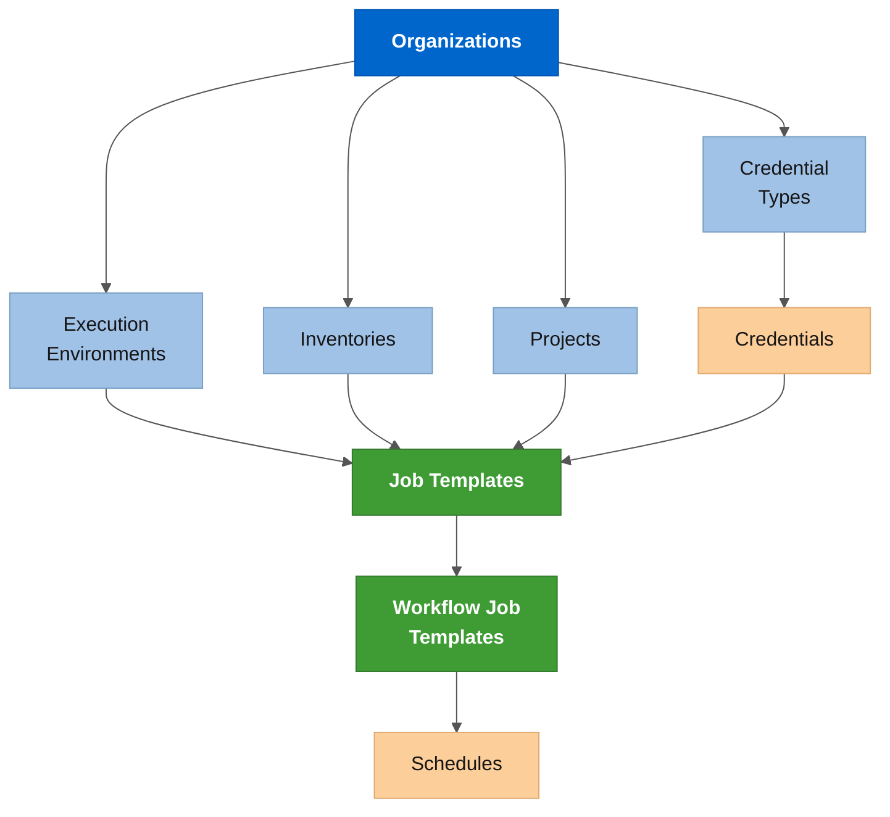
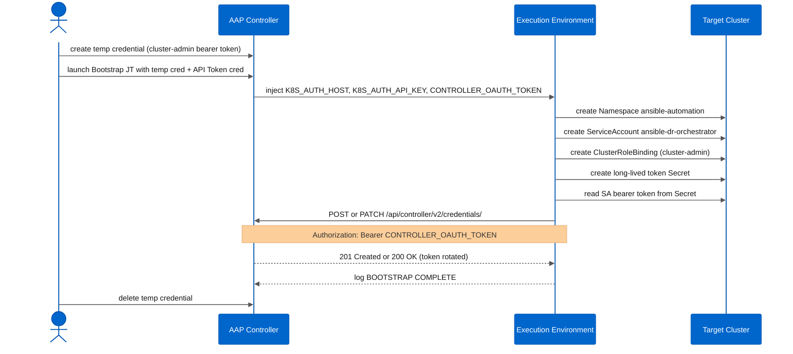
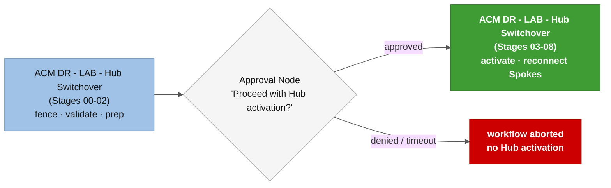

# Setting up dfmateus.acm_dr on Ansible Automation Platform

This guide covers the complete Day 1 procedure for deploying the **`dfmateus.acm_dr`** collection on AAP: building the Execution Environment, loading the collection into AAP, importing all objects via CasC, bootstrapping the automation identity on each cluster, and running the setup-and-validation sequence.

**Before starting:**

Tools on your workstation:

- **`ansible-core`** >= 2.16: **`pip install ansible-core`**
- **`ansible-builder`** >= 3.0: **`pip install ansible-builder`**
- **`podman`** (or Docker): **`dnf install podman`**
- **`oc`** (OpenShift CLI): download from your cluster console under **?  > Command line tools**
- **`infra.controller_configuration`** >= 3.4: **`ansible-galaxy collection install infra.controller_configuration`**

Access required:

- AAP Gateway URL and an API token for a user with org-admin on the target organization. Step 0 below covers token generation. Never use the AAP admin password directly; always use the token from this step.
- A cluster-admin bearer token for each cluster: API URL and the token from **`oc whoami -t`**. Any user with a **`cluster-admin`** ClusterRoleBinding works: kubeadmin, an HTPasswd user, an OIDC/OAuth identity, or a break-glass service account. Production clusters frequently have kubeadmin disabled for security; use whatever admin identity your organization provisioned.
- A container registry that AAP can pull images from (OCP internal registry or an external registry)

AAP must be installed and the subscription activated before running any step here. The subscription activation step is the **Settings > Subscription** page in the AAP web UI; the API returns errors on every call until it is done.

---

## Table of contents

0. [Generate an AAP API token](#step-0-generate-an-aap-api-token)
1. [Build the Execution Environment](#1-build-the-execution-environment)
2. [Push the EE to a registry AAP can reach](#2-push-the-ee-to-a-registry-aap-can-reach)
3. [Load the collection into AAP](#3-load-the-collection-into-aap)
4. [Import AAP objects via CasC](#4-import-aap-objects-via-casc)
5. [Verify the project sync](#5-verify-the-project-sync)
6. [Bootstrap the automation SA on each cluster](#6-bootstrap-the-automation-sa-on-each-cluster)
7. [Create remaining credentials](#7-create-remaining-credentials)
8. [Run the setup sequence](#8-run-the-setup-sequence)

---



```mermaid
%%{init: {"theme": "base", "themeVariables": {"lineColor": "#555555"}, "flowchart": {"htmlLabels": true}}}%%
flowchart LR
    classDef primary   fill:#3f9c35,stroke:#357a2e,color:#fff,font-weight:bold
    classDef secondary fill:#a1c2e7,stroke:#7a9fc4,color:#151515
    classDef tertiary  fill:#fcce9a,stroke:#e0aa70,color:#151515
    classDef header    fill:#06c,stroke:#0055b3,color:#fff,font-weight:bold
    classDef warn      fill:#fcce9a,stroke:#e0aa70,color:#151515,font-weight:bold
    classDef success   fill:#3f9c35,stroke:#357a2e,color:#fff,font-weight:bold
    EE["<b>Step 0</b><br/>Build + push EE<br/>to OCP registry"]:::header
    TOKEN["<b>Step 1</b><br/>Generate AAP token<br/>save to .local/aap/"]:::secondary
    CASC["<b>Step 2-4</b><br/>CasC import<br/>setup-aap-from-casc.yml"]:::primary
    BOOTSTRAP["<b>Step 5</b><br/>Bootstrap clusters<br/>SA + RBAC per Hub/Spoke"]:::primary
    SETUP["<b>Step 6</b><br/>Hub Setup + Spoke prep<br/>setup-acm-dr-hub.yml"]:::primary
    DRILL["<b>Step 7</b><br/>DR Readiness Check<br/>+ Full DR Drill"]:::secondary
    DONE(["✅ AAP operational<br/>DR validated"]):::success
    STOP1["⛔ STOP<br/>Verify subscription<br/>active before proceeding"]:::warn
    STOP2["⛔ STOP<br/>Verify project synced<br/>before CasC import"]:::warn
    EE --> STOP1 --> TOKEN --> STOP2 --> CASC --> BOOTSTRAP --> SETUP --> DRILL --> DONE
```

## Step 0: Generate an AAP API token

The CasC import playbook and the Bootstrap Job Template authenticate to the AAP REST API with an API token, not with admin username and password. A token is narrower: it belongs to one user account, is revocable without touching passwords, and is safe to store in a local gitignored file. This step runs once per AAP installation.

**Who the token belongs to:** The token must come from a user with org-admin on the organization you are importing into. In a lab with the **`Default`** org, the **`admin`** user already works. In production, create a dedicated service account (e.g., **`svc-aap-casc`**), assign it org-admin on the target org, and generate the token from that account. Either way, the token goes into a single local file and never appears in playbook commands or job logs.

**Generate the token in the AAP UI:**

Go to **Access Management > Users > \<your-user\> > Tokens > Create**:

| Field | Value |
| :--- | :--- |
| **Application** | leave blank (personal access token, not an OAuth app) |
| **Scope** | Write |
| **Expiration date** | optional; set one if your security policy requires rotation |

Copy the token value immediately. The UI shows it only once at creation time.

**Store the token in two local files (both gitignored):**

```bash
# .local/aap/import-vars.yml  (gitignored via .local/)
controller_oauthtoken: "<paste-token-here>"

# .local/aap/aap_token.env  (gitignored via .local/)
AAP_URL="https://aap-ansible-automation-platform.apps.<cluster-domain>"
AAP_TOKEN="<paste-token-here>"
```

The `.local/aap/import-vars.yml` token drives every CasC import run. The `.local/aap/aap_token.env` file lets you source a quick shell environment for local API calls (`curl -H "Authorization: Bearer ${AAP_TOKEN}" ...`).

> ⚠️ If you rotate the token, update both files and re-run the credential import (`--tags credentials`) so the **`AAP Bootstrap Automation (API Token)`** credential stored in AAP is updated as well.

The diagram below shows where the token flows: from a single creation point in the UI through the local files into the AAP credential that the Bootstrap JT uses to auto-register cluster SA credentials.

```mermaid
%%{init: {"theme": "base", "themeVariables": {"lineColor": "#555555"}, "flowchart": {"htmlLabels": true}}}%%
flowchart LR
    classDef primary   fill:#3f9c35,stroke:#357a2e,color:#fff,font-weight:bold
    classDef secondary fill:#a1c2e7,stroke:#7a9fc4,color:#151515
    classDef tertiary  fill:#fcce9a,stroke:#e0aa70,color:#151515
    classDef header    fill:#06c,stroke:#0055b3,color:#fff,font-weight:bold
    classDef success   fill:#3f9c35,stroke:#357a2e,color:#fff,font-weight:bold
    subgraph step0["Step 0 - one time per AAP installation"]
        U[Operator]:::header
        A["AAP UI<br/>Access Management > Users > Tokens<br/>scope: write"]:::secondary
        U -->|"generate"| A
    end
    A -->|"copy token once"| vars
    A -->|"copy token once"| env
    subgraph local["Local files - gitignored"]
        vars[".local/aap/import-vars.yml<br/>controller_oauthtoken: ..."]:::tertiary
        env[".local/aap/aap_token.env<br/>AAP_TOKEN=..."]:::tertiary
    end
    vars -->|"step 4 - setup-aap-from-casc.yml<br/>--tags credentials"| cred
    subgraph aap["AAP objects"]
        cred["<b>AAP Bootstrap Automation</b> (API Token)<br/>CONTROLLER_OAUTH_TOKEN injected into EE"]:::primary
        jt["ACM DR - LAB - Cluster Bootstrap<br/>permanently attached"]:::secondary
        cred -->|attached to| jt
    end
    jt -->|"CONTROLLER_OAUTH_TOKEN<br/>Bearer auth to /api/controller/v2/credentials/"| sa["cluster-name (SA)<br/>ACM DR - Target Cluster<br/>auto-registered on each bootstrap run"]:::success
    style step0 fill:#e6e6e6,stroke:#ccc,color:#151515
    style local fill:#f5f5f5,stroke:#aaa,color:#151515
    style aap fill:#e6e6e6,stroke:#ccc,color:#151515
```



---

## 1. Build the Execution Environment

The EE packages all collections, Python libraries, and CLI tools (**`az`**, **`oc`**, **`jq`**) that the playbooks need inside a container image. Build it once; rebuild only when [`examples/ee/execution-environment.yml`](../../examples/ee/execution-environment.yml) changes.

```bash
ansible-builder build \
  -t acm-dr-orchestrator-ee:1.0.0 \
  -f examples/ee/execution-environment.yml \
  --context .local/ee-build

# The build context is not needed after the image is built
rm -rf .local/ee-build
```

---

## 2. Push the EE to a registry AAP can reach

Choose the registry your AAP instance can pull from. Production deployments use an external registry; for lab and air-gapped environments the OCP internal registry works well.

### Option A: OCP internal registry

Use this when AAP runs on the same OCP cluster that hosts the internal image registry.

```bash
# Expose the default route (one-time per cluster; skip if already done)
oc patch configs.imageregistry.operator.openshift.io/cluster \
  --type merge -p '{"spec":{"defaultRoute":true}}'

REGISTRY=$(oc get route default-route -n openshift-image-registry \
  -o jsonpath='{.spec.host}')

# Authenticate with a short-lived SA token.
# 'oc whoami -t' fails when the kubeconfig uses client certificates instead of tokens.
# Create a fresh token directly instead.
SA_TOKEN=$(oc create token default -n ansible-automation-platform --duration=1h)
podman login "$REGISTRY" -u unused -p "$SA_TOKEN"

# Tag and push
podman tag acm-dr-orchestrator-ee:1.0.0 \
  "$REGISTRY/ansible-automation-platform/acm-dr-orchestrator-ee:1.0.0"
podman push "$REGISTRY/ansible-automation-platform/acm-dr-orchestrator-ee:1.0.0"
```

⚠️ If the push returns HTTP 401 after login succeeds, the **`default`** SA is missing image-builder rights. Run the following and then retry the push:

```bash
oc policy add-role-to-user system:image-builder \
  system:serviceaccount:ansible-automation-platform:default \
  -n ansible-automation-platform
```

Use this URL as **`aap_ee_image`** in step 4:

```
image-registry.openshift-image-registry.svc:5000/ansible-automation-platform/acm-dr-orchestrator-ee:1.0.0
```

### Option B: External registry (production)

```bash
podman login <your-registry>
podman tag acm-dr-orchestrator-ee:1.0.0 <your-registry>/acm-dr-orchestrator-ee:1.0.0
podman push <your-registry>/acm-dr-orchestrator-ee:1.0.0
```

After pushing, register the EE in AAP at **Administration > Execution Environments > Add**:

| Field           | Value                                |
| :-------------- | :----------------------------------- |
| **Name**  | **`EE - ACM DR 1.0.0`**      |
| **Image** | full pull URL (internal or external) |
| **Pull**  | Always (or On Missing for lab)       |

---

## 3. Load the collection into AAP

AAP's project syncs from a git repository. Choose the option that matches your environment.

### Option A: GitHub or GitLab (production)

Point the AAP project directly at the git URL. No local commands needed.

In the AAP UI, go to **Projects > Add**:

| Field                                      | Value                                                                               |
| :----------------------------------------- | :---------------------------------------------------------------------------------- |
| **Name**                             | **`ACM DR Collection (main)`**                                              |
| **Organization**                     | **`ACM DR Operations`**                                                     |
| **Source Control Type**              | Git                                                                                 |
| **Source Control URL**               | **`https://github.com/<your-org>/dfmateus.acm_dr.git`** (or your GitLab URL)   |
| **Source Control Branch/Tag/Commit** | **`main`**                                                                  |
| **Source Control Credential**        | A GitHub PAT or GitLab token credential, required only if the repository is private |

The **`aap_scm_url`** variable for step 4 is this git URL.

### Option B: Bare repo in controller pod (lab or air-gapped)

Use this when the AAP controller pod has no outbound access to an external git server. The collection is packaged into a bare git repository and pushed directly into the controller pod's persistent storage.

**Why the bare-repo approach?** The controller pod has no **`tar`** binary, so **`oc cp`** and **`oc rsync --strategy=tar`** both fail. The procedure below builds the bare repo locally in **`/tmp`** and pipes it into the pod via Python3 stdin, with no tar needed on the container side.

```bash
COLLECTION_DIR="$(pwd)"    # run from the dfmateus.acm_dr root
BARE_REPO=".local/tmp/acm_dr_orchestrator.git"
WORK_TREE=".local/tmp/acm_dr_orchestrator_work"

# The collection directory has no .git/ (by design - it ships without commits).
# Build a bare repo under .local/tmp/ using GIT_DIR/GIT_WORK_TREE override.
mkdir -p .local/tmp
rm -rf "$BARE_REPO" "$WORK_TREE"
git init --bare "$BARE_REPO"
mkdir "$WORK_TREE"
rsync -a \
  --exclude='.local/' \
  --exclude='*.pyc' \
  --exclude='__pycache__/' \
  "$COLLECTION_DIR/" "$WORK_TREE/"
GIT_DIR="$BARE_REPO" GIT_WORK_TREE="$WORK_TREE" git config user.email "lab@local"
GIT_DIR="$BARE_REPO" GIT_WORK_TREE="$WORK_TREE" git config user.name "lab"
GIT_DIR="$BARE_REPO" GIT_WORK_TREE="$WORK_TREE" \
  git -c init.defaultBranch=main symbolic-ref HEAD refs/heads/main
GIT_DIR="$BARE_REPO" GIT_WORK_TREE="$WORK_TREE" git add -A
GIT_DIR="$BARE_REPO" GIT_WORK_TREE="$WORK_TREE" \
  git commit -m "collection: snapshot $(date +%Y%m%d-%H%M%S)"
rm -rf "$WORK_TREE"

# Find the controller task pod (name changes on restart)
TASK_POD=$(oc get pods -n ansible-automation-platform \
  --no-headers | grep "controller-task" | awk '{print $1}' | head -1)
echo "Task pod: $TASK_POD"

# Push bare repo into the pod via Python3 stdin pipe.
# The Python code removes the old repo first; overwriting existing objects fails with PermissionError.
tar -czf .local/tmp/acm_dr_orchestrator_git.tar.gz \
  -C .local/tmp acm_dr_orchestrator.git
oc exec -i "$TASK_POD" -n ansible-automation-platform -c aap-controller-task \
  -- python3 -c "
import sys, tarfile, io, shutil, os
data = sys.stdin.buffer.read()
# Remove the old repo if it exists; re-push over existing files fails with PermissionError
target = '/var/lib/awx/projects/acm_dr_orchestrator.git'
if os.path.exists(target):
    shutil.rmtree(target)
tarfile.open(fileobj=io.BytesIO(data), mode='r:gz').extractall('/var/lib/awx/projects/')
print('extracted OK, size=%d bytes' % len(data))
" < .local/tmp/acm_dr_orchestrator_git.tar.gz

# Verify the repo landed at the correct path
oc exec "$TASK_POD" -n ansible-automation-platform -c aap-controller-task \
  -- python3 -c "
import subprocess
r = subprocess.run(
  ['git', '--git-dir', '/var/lib/awx/projects/acm_dr_orchestrator.git',
   'log', '--oneline', '-3'],
  capture_output=True, text=True)
print(r.stdout)
"

# Clean up local temp files
rm -rf "$BARE_REPO" .local/tmp/acm_dr_orchestrator_git.tar.gz
```

The **`aap_scm_url`** for step 4:

```
file:///var/lib/awx/projects/acm_dr_orchestrator.git
```

To update the collection after making changes, repeat this procedure and then trigger a Project sync in the AAP UI.

---

## 4. Import AAP objects via CasC

One command creates all AAP objects: EE registration, inventory, project, credential types, job templates, workflow templates, and schedules. Credentials and notification templates are skipped on first run.

> **Note:** ansible-core 2.19+ changed how `-e "key=value with spaces"` is parsed. Values containing spaces must be passed via a vars file, not inline `-e`. Always use the vars file approach below.

**Step 1:** Copy the example vars file to `.local/aap/` and fill in your values.

```bash
cp examples/aap/import-vars.yml .local/aap/import-vars.yml
# Edit .local/aap/import-vars.yml: set controller_hostname, controller_oauthtoken, aap_organization, etc.
```

Key variables in [`examples/aap/import-vars.yml`](../../examples/aap/import-vars.yml):

| Variable | Description | Default |
| :--- | :--- | :--- |
| **`controller_hostname`** | Full AAP Gateway URL (`https://...`) | - |
| **`controller_oauthtoken`** | API token of a user with org-admin on the target organization. Generated in Step 0. Never commit this file. | - |
| **`aap_organization`** | Set to `Default` to use the built-in org (recommended). Set to a custom name (e.g., `ACM DR Operations`) to create a new organization. | `Default` |
| **`aap_project`** | Project display name. Convention: `ACM DR Collection (main)` | - |
| **`aap_inventory`** | Inventory label. Use `ACM DR - LAB`, `ACM DR - DEV`, `ACM DR - QAS`, or `ACM DR - PRD`. | - |
| **`aap_execution_environment`** | EE display name. Convention: `EE - ACM DR 1.0.0` | - |
| **`aap_ee_image`** | Full EE pull URL including tag. OCP internal registry: `image-registry.openshift-image-registry.svc:5000/ansible-automation-platform/acm-dr-orchestrator-ee:1.0.0`. External registry: the full pull path. | - |
| **`aap_scm_url`** | Git URL the project syncs from. Bare repo in pod: `file:///var/lib/awx/projects/acm_dr_orchestrator.git`. GitHub: `https://github.com/<org>/dfmateus.acm_dr.git`. | - |
| **`cred_aap_host`** | AAP Gateway URL stored in the **`AAP Bootstrap Automation (API Token)`** credential. Defaults to `controller_hostname` when set to the same value. | - |
| **`cred_aap_oauth_token`** | The same API token value as `controller_oauthtoken`. Stored inside the **`AAP Bootstrap Automation (API Token)`** credential so the Bootstrap JT can call the AAP REST API during cluster onboarding. | - |

**Step 2:** Run the import.

```bash
ansible-playbook examples/playbooks/setup-aap-from-casc.yml \
  -e @.local/aap/import-vars.yml
```

The wrapper playbook at [`examples/playbooks/setup-aap-from-casc.yml`](../../examples/playbooks/setup-aap-from-casc.yml) reads all CasC definitions from [`examples/aap/`](../../examples/aap/) and runs **`infra.controller_configuration`** roles in the correct dependency order. Re-running after a partial failure is safe: all operations are idempotent.

The import order enforced by the playbook:

1. Organizations
2. Execution Environments
3. Inventories
4. Projects (triggers first SCM sync)
5. Credential Types
6. ~~Credentials~~ (skipped on first run; use **`--tags credentials`** after bootstrap)
7. Job Templates
8. Workflow Job Templates
9. Schedules (all **`enabled: false`** by default)
10. Notification Templates (if any are defined)



---

## 5. Verify the project sync

Open **Projects** in the AAP UI and confirm **`ACM DR Collection (main)`** shows **Successful**. The sync runs automatically on first import. If it stays in **Pending** for more than a few minutes, click the sync icon to trigger it manually.

> ❌ **STOP. Do not proceed until the project sync shows Successful.**
> Job Templates run against stale or missing playbooks if the sync never completed. Bootstrap, credential creation, and Hub Setup all depend on a clean project sync. Do not move to section 6 until this status is green.

### Troubleshooting a failed sync

#### If using a bare repo (file:// URL)

The most common cause is the repo landing at the wrong path in the pod. Verify:

```bash
TASK_POD=$(oc get pods -n ansible-automation-platform \
  -o jsonpath='{.items[?(@.metadata.name matches "aap-controller-task")].metadata.name}' \
  | awk '{print $1}')

# Confirm the bare repo directory exists under /var/lib/awx/projects/
oc exec "$TASK_POD" -n ansible-automation-platform -c aap-controller-task \
  -- ls -la /var/lib/awx/projects/

# Confirm at least one commit is visible
oc exec "$TASK_POD" -n ansible-automation-platform -c aap-controller-task \
  -- git --git-dir /var/lib/awx/projects/acm_dr_orchestrator.git log --oneline -3
```

If the repo is missing or the path is wrong, re-run the push procedure from step 3 Option B. The **`extractall`** target must be **`/var/lib/awx/projects/`**, not **`/var/lib/awx/`**.

#### If using GitHub or GitLab

- Confirm the SCM credential (GitHub PAT or GitLab token) is attached to the project and has read access to the repository.
- Confirm the branch name matches exactly (**`main`**, not **`master`** or a typo).
- Test network egress from the AAP controller pod:

```bash
TASK_POD=$(oc get pods -n ansible-automation-platform \
  -o jsonpath='{.items[?(@.metadata.name matches "aap-controller-task")].metadata.name}' \
  | awk '{print $1}')
oc exec "$TASK_POD" -n ansible-automation-platform -c aap-controller-task \
  -- curl -sI https://github.com | head -5
```

If the **`curl`** times out, the AAP pods lack outbound internet access. Use Option B (bare repo in pod) or configure an egress proxy.

---

## 6. Bootstrap the automation SA on each cluster

AAP needs a permanent bearer token to connect to clusters, but creating that token requires existing cluster access. The **`ACM DR - LAB - Cluster Bootstrap`** Job Template breaks this loop: it accepts a temporary cluster-admin credential, creates the **`ansible-dr-orchestrator`** ServiceAccount and token Secret, then calls back into AAP via Bearer token auth to register the permanent credential automatically. The SA token never appears in job logs.

Repeat the steps below for each cluster: Hub 01, Hub 02, and each Spoke.



### Step 6.1: Get a temporary cluster-admin token

Any user with a **`cluster-admin`** ClusterRoleBinding works: kubeadmin, an HTPasswd user, an OIDC/OAuth identity, or a break-glass ServiceAccount. Production clusters frequently have kubeadmin disabled; use whatever admin identity your organization provisioned.

```bash
# Log in with any cluster-admin identity. Run login and token capture separately
# so oc login output does not contaminate the token value.
oc login \
  -u <CLUSTER_ADMIN_USER> \
  -p <CLUSTER_ADMIN_PASSWORD> \
  --server=https://api.<CLUSTER_DOMAIN>:6443 \
  --insecure-skip-tls-verify=true > /dev/null 2>&1

oc whoami -t
```

> ⚠️ **Token capture:** Run `oc login` and `oc whoami -t` as two separate commands. If you chain them with `&&` inside `$()`, the login output (warnings and confirmation text) gets captured together with the token and corrupts it. The example above redirects login output to `/dev/null`; `oc whoami -t` then runs clean.

> ⚠️ **Token lifetime:** Bearer tokens from **`oc login`** expire. kubeadmin tokens typically last 24 hours; OIDC and HTPasswd session tokens may be shorter depending on your OAuth server configuration. Complete steps 6.2 through 6.4 for this cluster before the token expires. If the token expires mid-procedure, re-run **`oc login`** and update the temporary credential in AAP with the new token.

> **AKS with Azure AD authentication (local accounts disabled):** If the cluster has `--disable-local-accounts` set, `az aks get-credentials --admin` fails. The kubeconfig that `az aks get-credentials` produces uses an `exec` credential plugin (kubelogin or Azure CLI) that does not run inside the AAP execution environment. Use an Azure AD access token instead:
>
> ```bash
> # Azure AD server app ID for AKS in Azure public cloud (the same for every AKS cluster)
> AKS_SERVER_ID="6dae42f8-4368-4678-94ff-3960e28e3630"
>
> az account get-access-token \
>   --subscription "<AZURE_SUBSCRIPTION_ID>" \
>   --resource "${AKS_SERVER_ID}" \
>   --query accessToken \
>   -o tsv
> ```
>
> This token uses the same mechanism that `kubelogin` uses internally, but without the `exec` plugin dependency. It is valid for approximately 1 hour; complete steps 6.2 through 6.4 before it expires. See step 6.2 for the AKS-specific credential type to use.

### Step 6.2: Create a temporary credential in AAP

In the AAP UI, go to **Credentials > Add**:

| Field                                          | Value                                                                                           |
| :--------------------------------------------- | :---------------------------------------------------------------------------------------------- |
| **Name**                                 | **`temp-kubeadmin-<cluster-name>`** (e.g., **`temp-kubeadmin-hub-01`**) |
| **Credential Type**                      | OpenShift or Kubernetes API Bearer Token (built-in)                                             |
| **OpenShift or Kubernetes API Endpoint** | **`https://api.<CLUSTER_DOMAIN>:6443`**                                                 |
| **API Authentication Bearer Token**      | paste the token from step 6.1                                                                   |
| **Verify SSL**                           | unchecked                                                                                       |

> **AKS clusters:** Use **`ACM DR - Target Cluster`** (the custom credential type, not the built-in OpenShift/Kubernetes type). Set **API Endpoint** to the AKS API FQDN from `az aks show --resource-group <RG> --name <AKS_NAME> --query fqdn -o tsv` prefixed with `https://` (e.g., `https://your-cluster.hcp.eastus.azmk8s.io`), paste the AAD token from step 6.1 as **API Key**, and leave **CA Data** empty. AKS public API endpoints use a certificate signed by a well-known CA that the EE already trusts; populating CA Data with the inline base64 bundle from the kubeconfig causes the EE connection to fail.

### Step 6.3: Run the Bootstrap Job Template

Go to **Templates > ACM DR - LAB - Cluster Bootstrap > Launch**.

When prompted for credentials, select the temporary credential from step 6.2. The **`AAP Bootstrap Automation (API Token)`** credential is already permanently attached to the template; it injects `CONTROLLER_OAUTH_TOKEN` into the EE so the job can register the permanent SA credential without any additional input from you.

Fill in the survey:

| Survey question                                   | Value                                                                                                       |
| :------------------------------------------------ | :---------------------------------------------------------------------------------------------------------- |
| **Permanent Credential Name in AAP (Required)**   | the credential to create or update in AAP (e.g., **`ARO Hub 01 (SA)`**) |
| Cluster Display Name (Optional)                   | short label used as the kubeconfig context name (e.g., **`hub-01`**)    |
| AAP Organization (Optional)                       | **`Default`** (leave unless you created a dedicated org)                         |
| ServiceAccount Name (Optional)                    | **`ansible-dr-orchestrator`** (leave default unless your policy differs)         |
| Automation Namespace (Optional)                   | **`ansible-automation`** (leave default unless your namespace policy differs)    |

When the job completes successfully, go to **Credentials** and confirm the permanent credential (e.g., **`ARO Hub 01 (SA)`**) now exists with type **`ACM DR - Target Cluster`**. No manual `oc get secret` or credential creation needed.

> **Token rotation:** Re-running the Bootstrap JT for the same cluster with the same credential name updates the stored token (PATCH on the existing credential). Use this when an SA token expires or needs rotation.

### Step 6.4: Delete the temporary credential

In AAP, delete the **`temp-kubeadmin-<cluster-name>`** credential you created in step 6.2. It served its purpose and the permanent SA credential is now in place.

---

## 7. Create remaining credentials

After bootstrapping all clusters, the **`ACM DR - Target Cluster`** credentials for each cluster already exist (created automatically in step 6.3). The remaining credentials use those same SA tokens but under different credential types to model the failover role each cluster plays.

| Credential name                               | Credential type                        | When to attach it                                      |
| :-------------------------------------------- | :------------------------------------- | :----------------------------------------------------- |
| **`ARO Hub 01 (SA)`**         | **`ACM DR - Target Cluster`**  | Hub Setup and Cleanup, targeting Hub 01          |
| **`ARO Hub 02 (SA)`**       | **`ACM DR - Target Cluster`**  | Hub Setup and Cleanup, targeting Hub 02        |
| **`ARO Spoke 01 (SA)`**               | **`ACM DR - Target Cluster`**  | Spoke Lifecycle, targeting the Spoke                  |
| **`ARO Hub 01 (Source)`**    | **`ACM DR - Source Hub`**      | Failover JTs when Hub 01 is the active hub        |
| **`ARO Hub 02 (Dest)`**    | **`ACM DR - Destination Hub`** | Failover JTs when Hub 02 is the passive hub     |
| **`ACM DR Spoke 01`**                 | **`ACM DR - Spoke Cluster`**   | Spoke Manager and onboarding JTs                       |

> **`ACM DR - Spoke Cluster`** credentials are not created automatically by the Bootstrap JT. Bootstrap creates the **`ACM DR - Target Cluster`** credential for each cluster, but Spoke Lifecycle needs the **`ACM DR - Spoke Cluster`** type so the EE injects `ACM_DR_SPOKE_*` environment variables at launch time. Create it manually after bootstrapping each Spoke:
>
> 1. Extract the long-lived SA token that Bootstrap created on the Spoke cluster:
>
>    ```bash
>    oc get secret ansible-dr-orchestrator-token \
>      -n ansible-automation \
>      --context <SPOKE_CONTEXT> \
>      -o jsonpath='{.data.token}' | base64 -d
>    ```
>
>    For AKS clusters with local accounts disabled, use `az aks command invoke` or re-acquire an AAD token (see step 6.1) to authenticate, then run the same `kubectl get secret` command.
>
> 2. In AAP, go to **Credentials > Add**, select **`ACM DR - Spoke Cluster`** as the type, and fill in:
>
>    | Field | Value |
>    | :---- | :---- |
>    | **Name** | Follow the cluster credential pattern (e.g., **`ARO Spoke 01 (SA)`** or **`AKS Spoke 01 (SA)`**) |
>    | **API Endpoint (Required)** | Spoke cluster API URL |
>    | **API Key (Required)** | long-lived SA token from the Secret above |
>    | **CA Data (Optional)** | leave empty for public-CA clusters (ARO, AKS); provide for on-premises with a custom CA |
>    | **Context Name (Required)** | short label used as kubeconfig context (e.g., **`aro-spoke-01`** or **`aks-spoke-01`**); use hyphens, not underscores |
>
> 3. Attach this credential to the **Spoke Lifecycle** job template when running `action=prep` for this Spoke. The `action=prep` job mirrors the SA token to the Hub, enabling Operation C reconnection during failover without a fleet kubeconfig.

Each credential type injects a distinct set of environment variables into the EE container. See [`examples/aap/controller_credential_types.yml`](../../examples/aap/controller_credential_types.yml) for the exact field definitions and injector templates.

### Azure cloud provider credential (Hub Setup)

Hub Setup needs a cloud credential to provision the object storage account (Stage 01), configure Thanos (Stage 03), and set up the Velero backup backend (Stage 05). This is a **single shared credential** - both Hub 01 and Hub 02 attach the same Azure credential at launch because they share one storage account. You do not create one credential per hub.

#### What is an Azure Service Principal?

An **Azure Service Principal (SP)** is a non-interactive identity in Azure Active Directory (Azure AD / Microsoft Entra ID) used by applications, automation scripts, and services to authenticate against Azure APIs without requiring a user login. It is the Azure equivalent of a service account. Every SP consists of three identifiers:

- **Application (Client) ID**: the unique ID of the app registration in Azure AD
- **Client Secret** (or certificate): the SP's password, used to obtain an access token
- **Tenant ID**: the Azure AD directory that owns the app registration

An SP is scoped to specific Azure subscriptions and resource groups through **RBAC role assignments**. The SP does not inherit permissions by default - you explicitly grant it a role (e.g., `Owner`, `Contributor`) on a resource group or subscription.

To create a service principal:

```bash
# Creates an SP with Contributor on the target subscription (adjust scope as needed)
az ad sp create-for-rbac \
  --name "sp-acmdr-lab-hub-setup" \
  --role "Owner" \
  --scopes "/subscriptions/<SUBSCRIPTION_ID>/resourceGroups/<RG_NAME>"
```

The output provides `appId` (Client ID), `password` (Client Secret), and `tenant` (Tenant ID).

#### Create the AAP credential

Create one credential using the built-in **Microsoft Azure Resource Manager** type:

| Field | Value |
| :---- | :---- |
| **Name** | **`Azure <id> (SP)`** (e.g. **`Azure RHDP (SP)`** for a Red Hat Demo Platform environment) |
| **Credential Type** | **Microsoft Azure Resource Manager** (built-in, no custom type needed) |
| **Subscription ID** | Azure subscription that contains the storage resource group |
| **Client ID** | App registration (service principal) client ID (`appId` from `az ad sp create-for-rbac`) |
| **Client Secret** | SP client secret (`password` from `az ad sp create-for-rbac`) |
| **Tenant ID** | Azure AD tenant ID (`tenant` from `az ad sp create-for-rbac`) |

> ⚠️ **RBAC requirement:** The SP must have **`Owner`** or **`User Access Administrator`** on the resource group where the storage account lives (or will be created). `Contributor` is not enough. Stage 01 calls `Microsoft.Authorization/roleAssignments/write` to grant **`Storage Blob Data Contributor`** to the Velero workload identity, and `Contributor` excludes that permission. Grant **`Owner`** or **`User Access Administrator`** at the resource group scope before running Hub Setup. If the SP cannot be elevated, pre-assign **`Storage Blob Data Contributor`** to the Velero SP manually and pass `acm_dr_hub_setup_azure_storage_allow_reuse=true` to skip the automated role assignment step.

```bash
# Pre-assign Storage Blob Data Contributor to the Velero SP when the Hub Setup SP cannot do RBAC writes
az role assignment create \
  --assignee "<VELERO_SP_CLIENT_ID>" \
  --role "Storage Blob Data Contributor" \
  --scope "/subscriptions/<SUBSCRIPTION_ID>/resourceGroups/<RG_NAME>/providers/Microsoft.Storage/storageAccounts/<SA_NAME>"
```

After creating credentials, you can import them into AAP via CasC (keeping them tracked in version control with token values stored outside the repository). Update [`examples/aap/controller_credentials.yml`](../../examples/aap/controller_credentials.yml) with real token values (sourced from a vault, not committed to git), then run:

```bash
ansible-playbook examples/playbooks/setup-aap-from-casc.yml \
  -e @.local/aap/import-vars.yml \
  --tags credentials
```

### Fill in Source Hub and Destination Hub credentials

The CasC import creates **`ARO Hub 01 (Source)`** and **`ARO Hub 02 (Dest)`** with placeholder values in all three fields. Fill them in after bootstrap completes on both hub clusters.

In the AAP UI, go to **Credentials > ARO Hub 01 (Source) > Edit**:

| Field | Value |
| :---- | :---- |
| **OpenShift or Kubernetes API Endpoint (Required)** | Hub 01 API URL, e.g. `https://api.<cluster-domain>:6443` |
| **API Authentication Bearer Token (Required)** | SA bearer token from Hub 01 (see below) |
| **CA Certificate (Optional)** | Omit when the cluster uses a self-signed certificate and your environment skips TLS verification |
| **Context Name (Required)** | Must match the "Cluster Display Name" typed in the Bootstrap JT survey for Hub 01 (e.g. `ARO Hub 01`). The failover role builds a kubeconfig with this context identifier. |

Repeat for **`ARO Hub 02 (Dest)`** using Hub 02's values.

**Retrieve the SA token from the hub cluster:**

```bash
# The secret name is always ansible-dr-orchestrator-token, created by the Bootstrap JT.
# Replace the --kubeconfig path with your hub's admin kubeconfig.
oc get secret ansible-dr-orchestrator-token \
  -n ansible-automation \
  --kubeconfig .local/clusters/<hub-cluster-name>/kubeconfig-admin \
  -o jsonpath='{.data.token}' | base64 -d
```

The token is the same one stored inside the SA credential created during bootstrap. You are reusing the same SA identity under a different credential type (Source Hub / Dest Hub) so the failover role can inject distinct environment variable prefixes (`ACM_DR_SOURCE_*` vs. `ACM_DR_DEST_*`) from a single job launch.

---

## 8. Run the setup sequence

Run these Job Templates in order. Hub Setup must complete before Spoke registration; Spoke registration must complete before DR readiness checks.

| # | Job Template                                    | Credentials to attach                                      | Key survey or extra-var values                                                                                                                               |
| :- | :---------------------------------------------- | :--------------------------------------------------------- | :----------------------------------------------------------------------------------------------------------------------------------------------------------- |
| 1 | **`ACM DR - LAB - Hub Setup`**          | Hub 01 (SA), Azure SP (shared)                   | Target: Hub 01; **`is_primary_hub=true`**; **`Enable OpenShift GitOps = false`** (unless you need ArgoCD) |
| 2 | **`ACM DR - LAB - Hub Setup`**          | Hub 02 (SA), Azure SP (shared)               | Target: Hub 02; **`is_primary_hub=false`**; **`acm_dr_hub_setup_azure_storage_allow_reuse=true`** (reuses storage account from step 1); **`Enable OpenShift GitOps = false`** |
| 3 | **`ACM DR - LAB - Spoke Lifecycle`**    | Hub 01 (SA), Spoke (Spoke credential)                 | Hub target: Hub 01; **`action=prep`**; **`acm_dr_spoke_manager_cluster_name=<spoke-name>`**. Note: Spoke credential must be type **`ACM DR - Spoke Cluster`** (not **`ACM DR - Target Cluster`**); the SA credential created by Bootstrap is type **`ACM DR - Target Cluster`** and cannot be used directly here. The **`ACM DR - Spoke Cluster`** credential injects `ACM_DR_SPOKE_HOST` and `ACM_DR_SPOKE_TOKEN` into the execution; `action=prep` uses these to mirror the permanent SA token to `ansible-automation/acm-dr-<spoke-name>-sa-token` on the Hub with the OADP backup label. This Secret enables Stage 07 Operation C to reconnect the Spoke after failover without a pre-staged fleet kubeconfig. Wait for at least one OADP BackupSchedule cycle after this step before running the DR Failover (row 6), so the mirrored Secret replicates to the passive Hub. |
| 4 | **`ACM DR - LAB - DR Readiness Check`** | Source Hub (Hub 01), Dest Hub (Hub 02)         | Attach credentials at launch; the JT has `ask_credential_on_launch: true`. All 5 checks must return ✅ before proceeding.                                    |
| 5 | **`WF - ACM DR - LAB - Full DR Drill`** | Assigned at WF node level (see subsection above)           | Survey: **`Failover Direction = failover`**; **`Skip Version Gate = true`** in lab environments with mixed OCP versions. Dry-run only; no cluster mutations.  |
| 6 | **`WF - ACM DR - LAB - Hub Switchover`** | Assigned at WF node level (same pattern as DR Drill)       | `acm_dr_failover_action=failover`; live switchover hub-01 → hub-02. Review Stages 00-02 output before approving the Approval Node.                          |
| 7 | **`WF - ACM DR - LAB - Hub Switchover`** | Same credential assignments as step 6 - do not swap        | `acm_dr_failover_action=failback`; the role inverts the direction internally. Credential assignments on WF nodes never change between failover and failback.  |

### Assign credentials to Workflow nodes (one-time, after step 7)

The Full DR Drill workflow ships with empty credential lists on all job nodes. The CasC comment in [`examples/aap/controller_workflow_job_templates.yml`](../../examples/aap/controller_workflow_job_templates.yml) marks each node with `# attach after bootstrap`. This is intentional: credential IDs are not stable across AAP installations, so the workflow definition cannot hard-code them. Assign them once through the Workflow Visualizer before the first drill launch.

In the AAP UI, go to **Templates > WF - ACM DR - LAB - Full DR Drill > Workflow Visualizer**. For each of the three job nodes (skip the approval gate node, which has no credential input), click the node and open the **Credentials** tab. Attach **`ARO Hub 01 (Source)`** and **`ARO Hub 02 (Dest)`**:

| Node | Job Template | Credentials to attach |
| :--- | :--- | :--- |
| dr-readiness-check | ACM DR - LAB - DR Readiness Check | Source Hub, Dest Hub |
| dryrun-failover | ACM DR - LAB - Hub Switchover | Source Hub, Dest Hub |
| notify-drill-complete | ACM DR - LAB - Hub Switchover | Source Hub, Dest Hub |

The same step applies to the **Hub Switchover** and **Planned Maintenance Switchover** workflows. Open each workflow in the Visualizer and attach credentials at the node level before launching.

> **Note:** The **DR Readiness Check** Job Template also runs as a standalone JT (row 4 in the table above). When launched directly, pass **`ARO Hub 01 (Source)`** and **`ARO Hub 02 (Dest)`** as additional credentials at launch time. The JT has `ask_credential_on_launch: true` for exactly this reason.

**OpenShift GitOps (ArgoCD) is optional.** The Hub Setup survey includes an **`Enable OpenShift GitOps / ArgoCD setup`** field (default: `false`). Set it to `true` only if you need ArgoCD to manage ACM policies via GitOps. When `false`, Stage 04 is skipped and the **`ACM DR - GitHub PAT`** credential is not required. When `true`, attach the GitHub PAT credential at launch and ensure the `GITHUB_USER`, `GITHUB_PAT`, and `GITHUB_REPO` variables are set.

**Re-running Hub Setup on an existing cluster:** If the cluster already has DR artifacts deployed (BackupSchedule, DPA, BSL), the topology safety guard blocks re-runs by default. Pass **`acm_dr_hub_setup_allow_existing_dr=true`** to override. Combine it with **`acm_dr_hub_setup_azure_storage_allow_reuse=true`** to skip storage account creation as well.

**Approval Node gate:** The **Hub Switchover** workflow pauses between Stage 02 (fencing the active Hub's **BackupSchedule**) and Stage 03 (activating the passive Hub). An operator must approve the transition in the AAP UI. This is the point of no return: once Hub 02 is activated, Hub 01's backup schedule stays paused until a failback. Review the Stage 00-02 output before approving.



For the complete Job Template and Survey reference (all survey variables, credential dependency maps, and workflow node diagrams) see [`docs/aap.md`](aap.md).

---

## Credential types reference

This collection ships four custom credential types:

| Credential Type                        | Injected env vars                                                                                                                             | Used by                                   |
| :------------------------------------- | :-------------------------------------------------------------------------------------------------------------------------------------------- | :---------------------------------------- |
| **`ACM DR - Source Hub`**      | **`ACM_DR_SOURCE_HOST`**, **`ACM_DR_SOURCE_TOKEN`**, **`ACM_DR_SOURCE_CA_DATA`**, **`ACM_DR_SOURCE_CONTEXT`** | Failover Orchestrator (failover origin)   |
| **`ACM DR - Destination Hub`** | **`ACM_DR_DEST_HOST`**, **`ACM_DR_DEST_TOKEN`**, **`ACM_DR_DEST_CA_DATA`**, **`ACM_DR_DEST_CONTEXT`**         | Failover Orchestrator (failover target)   |
| **`ACM DR - Target Cluster`**  | **`ACM_DR_TARGET_HOST`**, **`ACM_DR_TARGET_TOKEN`**, **`ACM_DR_TARGET_CA_DATA`**, **`ACM_DR_TARGET_CONTEXT`** | Hub Setup, Cleanup, Spoke Manager, ArgoCD |
| **`ACM DR - Spoke Cluster`**   | **`ACM_DR_SPOKE_HOST`**, **`ACM_DR_SPOKE_TOKEN`**, **`ACM_DR_SPOKE_CA_DATA`**, **`ACM_DR_SPOKE_CONTEXT`**     | Spoke Manager, Spoke Onboarding           |

Three additional types are available for specific use cases:

| Credential Type | Purpose |
| :--- | :--- |
| **`ACM DR - Multi-Context Kubeconfig`** | Legacy monolithic kubeconfig. Use per-cluster types for all new JTs. |
| **`ACM DR - GitHub PAT`** | GitHub Personal Access Token used by Hub Setup Stage 04 to create the ArgoCD repository Secret. Required only when **`Enable OpenShift GitOps = true`** in the Hub Setup survey. Leave unattached when GitOps is disabled. |
| **`ACM DR - AAP Automation Token`** | API token of a user with org-admin. Attached permanently to the Bootstrap JT. Injects `CONTROLLER_OAUTH_TOKEN`, `CONTROLLER_HOST`, and `CONTROLLER_VERIFY_SSL` into the EE so the Bootstrap JT can call `/api/controller/v2/credentials/` to register SA credentials after each cluster bootstrap run. One instance per AAP installation: **`AAP Bootstrap Automation (API Token)`**. |

---

## Break-glass and maintenance scripts

These scripts handle emergency situations outside normal AAP workflows. They run locally; no AAP Job Templates correspond to them.

| Script                                                                                                                                        | Purpose                                        |
| :-------------------------------------------------------------------------------------------------------------------------------------------- | :--------------------------------------------- |
| [`examples/scripts/break-glass/force_purge_managed_cluster.sh`](../../examples/scripts/break-glass/force_purge_managed_cluster.sh) | Force-remove a stuck ManagedCluster object     |
| [`examples/scripts/break-glass/force_delete_namespace.sh`](../../examples/scripts/break-glass/force_delete_namespace.sh)           | Remove a namespace blocked by stuck finalizers |
| [`examples/scripts/deep-cleanup/purge_acm_observability.sh`](../../examples/scripts/deep-cleanup/purge_acm_observability.sh)       | Wipe Observability components                  |
| [`examples/scripts/deep-cleanup/purge_gitops.sh`](../../examples/scripts/deep-cleanup/purge_gitops.sh)                             | Wipe GitOps and ArgoCD components              |
