# AAP job template and survey reference

> **Audience**: Platform Engineers and SREs setting up this automation on **Red Hat Ansible Automation Platform (AAP) 2.5+**. This guide provides copy-paste-ready Job Template definitions and Survey variable specifications for every playbook in the collection.

This document complements the [AAP setup guide](aap-setup.md),
which covers the foundational AAP setup (Execution Environment, Credential Types, kubeconfig
strategy, interactive gates, and Day-0 prerequisites). **Complete that setup first** before
creating the Job Templates described here.

For machine-importable YAML definitions, see the [`examples/aap/`](../../examples/aap/) directory.

---

## Table of contents

1. [Prerequisites](#1-prerequisites)
2. [Credential strategies](#2-credential-strategies)
3. [Job template 1: ACM DR failover orchestrator](#3-job-template-1-acm-dr-failover-orchestrator)
4. [Job template 2: ACM DR lab setup](#4-job-template-2-acm-dr-lab-setup)
5. [Job template 3: ACM Spoke manager](#5-job-template-3-acm-spoke-manager)
6. [Job template 4: ACM DR lab cleanup](#6-job-template-4-acm-dr-lab-cleanup)
7. [Job template 5: ACM ArgoCD instance setup](#7-job-template-5-acm-argocd-instance-setup)
8. [Job template 6: ACM ArgoCD instance cleanup](#8-job-template-6-acm-argocd-instance-cleanup)
9. [Job template 7: ACM DR Spoke Onboarding](#9-job-template-7-acm-dr-spoke-onboarding)
10. [Job template 8: ACM DR Readiness Check](#10-job-template-8-acm-dr-readiness-check)
11. [Workflow templates](#11-workflow-templates)
12. [Importing via controller-as-code](#12-importing-via-controller-as-code)
13. [Standardizing AAP object names](#13-standardizing-aap-object-names)

---

## 1. Prerequisites

Before creating Job Templates, ensure the following are in place:

| Prerequisite | Reference | Status |
|:---|:---|:---|
| Execution Environment built and pushed | [AAP Setup: EE](aap-setup.md#execution-environment-ee) | Required |
| Multi-context KUBECONFIG Credential Type created | [AAP Setup: KUBECONFIG](aap-setup.md#kubeconfig-strategy-for-aap) | Required |
| Azure Resource Manager Credential configured | [AAP Setup: credentials](aap-setup.md#additional-credential-types) | For Lab Setup/Cleanup (Azure Hubs) |
| Amazon Web Services Credential configured (built-in type) | [AAP Setup: credentials](aap-setup.md#additional-credential-types) | For Lab Setup/Cleanup (AWS/ROSA HCP Hubs) |
| GitHub PAT Credential configured | [AAP Setup: credentials](aap-setup.md#additional-credential-types) | For Lab Setup |
| Day-0 scripts executed (SA provisioning) | [AAP Setup: Day-0](aap-setup.md#day-0-prerequisites-cli-only-steps) | Required |
| Project synced in AAP (pointing to this Git repo) | AAP docs | Required |
| **`localhost`** Inventory created | AAP docs | Required |

> **Inventory**: All playbooks use **`hosts: localhost`** / **`connection: local`**. Create a simple
> **`localhost`** inventory with a single host entry (**`localhost`**, connection type **`local`**).

---

## 2. Credential strategies

AAP's built-in "OpenShift or Kubernetes API Bearer Token" credential type injects a single-cluster kubeconfig per credential ([AWX #15574](https://github.com/ansible/awx/issues/15574) tracks the limitation). This automation needs multiple cluster contexts in a single job run, so two credential models are supported.

### 2.1 Legacy model (monolithic KUBECONFIG)

The "ACM DR - Multi-Context Kubeconfig" [custom credential type](https://docs.redhat.com/en/documentation/red_hat_ansible_automation_platform/2.5/html/using_automation_execution/assembly-controller-custom-credentials) (defined in [*`examples/aap/controller_credential_types.yml`*](../../examples/aap/controller_credential_types.yml) and documented in the [AAP Setup: KUBECONFIG strategy](aap-setup.md#kubeconfig-strategy-for-aap)) injects a single file containing every cluster's context. It works and remains supported for backward compatibility, but it has operational downsides:

- **Blast radius**: rotating one cluster's token means re-pasting the entire file into AAP, touching every cluster's credentials at once.
- **Rotation coordination**: every SA token renewal (expiry, cluster rebuild, SA re-provisioning) forces an update to the same AAP credential object, which creates a bottleneck when multiple teams manage different clusters.
- **Auditability**: AAP's credential-usage log shows "Multi-Context KUBECONFIG was used" with no distinction about which cluster was actually targeted.

### 2.2 Per-cluster credential model (recommended)

Five [custom credential types](https://docs.redhat.com/en/documentation/red_hat_ansible_automation_platform/2.5/html/using_automation_execution/assembly-controller-custom-credentials) replace the monolithic file with one AAP credential per cluster. Each type injects a role-prefixed set of env vars (`*_HOST`, `*_TOKEN`, `*_CA_DATA`, `*_CONTEXT`):

| Credential Type | Env Var Prefix | Used By |
|:---|:---|:---|
| **ACM DR Target Cluster** | **`ACM_DR_TARGET_*`** | Single-target operations (Lab Setup, Lab Cleanup, ArgoCD, Spoke Manager Hub-side) |
| **ACM DR Source Hub** | **`ACM_DR_SOURCE_*`** | Failover Orchestrator (origin Hub, currently ACTIVE) |
| **ACM DR Destination Hub** | **`ACM_DR_DEST_*`** | Failover Orchestrator (destination Hub, currently PASSIVE) |
| **ACM DR Spoke Cluster** | **`ACM_DR_SPOKE_*`** | Spoke Manager (direct Spoke-side connectivity) |
| **Spoke Fleet KUBECONFIG** | **`ACM_DR_SPOKE_FLEET_KUBECONFIG`** | Internal - built automatically by `spoke_prep`. Customers do not create this credential. |

The full set also includes a legacy multi-context KUBECONFIG type and a GitHub PAT type:

| # | Credential Type | Env Vars Injected | Injection Method | Used By |
|:--|:---|:---|:---|:---|
| 1 | Multi-Context KUBECONFIG (legacy) | **`K8S_AUTH_KUBECONFIG`**, **`KUBECONFIG`** | **`tower.filename`** (tempfile) | Any Job Template (backward-compatible) |
| 2 | ACM DR Source Hub | **`ACM_DR_SOURCE_HOST`**, **`_TOKEN`**, **`_CA_DATA`**, **`_CONTEXT`** | env vars | Failover Orchestrator (origin Hub) |
| 3 | ACM DR Destination Hub | **`ACM_DR_DEST_HOST`**, **`_TOKEN`**, **`_CA_DATA`**, **`_CONTEXT`** | env vars | Failover Orchestrator (destination Hub) |
| 4 | ACM DR Target Cluster | **`ACM_DR_TARGET_HOST`**, **`_TOKEN`**, **`_CA_DATA`**, **`_CONTEXT`** | env vars | Lab Setup, Lab Cleanup, ArgoCD, Spoke Manager (Hub-side) |
| 5 | ACM DR Spoke Cluster | **`ACM_DR_SPOKE_HOST`**, **`_TOKEN`**, **`_CA_DATA`**, **`_CONTEXT`** | env vars | Spoke Manager (Spoke-side) |
| 6 | Spoke Fleet KUBECONFIG | **`ACM_DR_SPOKE_FLEET_KUBECONFIG`** | **`tower.filename`** (tempfile) | Internal - built automatically by `spoke_prep`. Customers do not create this credential. The failover orchestrator uses per-spoke `acm-dr-<spoke>-sa-token` Secrets (Operation C); no fleet kubeconfig credential is attached to AAP job templates. |
| 7 | GitHub PAT | **`GITHUB_USER`**, **`GITHUB_PAT`** | env vars | Lab Setup (Stage 04), ArgoCD Instance Setup |

Each per-cluster credential (types 2-5) exposes four fields in the AAP UI: **API Host** (cluster endpoint URL), **API Bearer Token** (from [*`02_provision_automation_sa.sh`*](../../examples/scripts/cluster-onboarding/02_provision_automation_sa.sh)), **CA Certificate Data** (base64, optional for clusters with publicly trusted certificates like ARO), and **Context Name** (the **`-sa`** context name, e.g. **`acm-primary-hub-sa`**). Type 6 (Spoke Fleet KUBECONFIG) is internal: the `spoke_prep` action creates it automatically during Spoke onboarding and it is not a customer-managed AAP credential.

All seven types are defined in [*`examples/aap/controller_credential_types.yml`*](../../examples/aap/controller_credential_types.yml). AAP's built-in OpenShift token type cannot be used here because it injects a single-context kubeconfig with a fixed structure that overwrites **`KUBECONFIG`** ([AWX #15574](https://github.com/ansible/awx/issues/15574)).

The [*`acm_dr_kubeconfig_resolver`*](../roles/acm_dr_kubeconfig_resolver) role runs in every playbook's **`pre_tasks`** and assembles a runtime kubeconfig from whichever env vars it finds. If no per-cluster env vars are detected, it falls back to the legacy **`K8S_AUTH_KUBECONFIG`** / **`KUBECONFIG`** path automatically. No playbook or role code changes between the two models.

AAP supports [attaching multiple credentials to a single Job Template](https://docs.redhat.com/en/documentation/red_hat_ansible_automation_platform/2.4/html/automation_controller_administration_guide/assembly-multi-credential-assignment), so each template gets exactly the credential instances it needs (see the matrix below).

### 2.3 Credential-to-Job-Template matrix

All ACM DR Job Templates have **`ask_credential_on_launch: true`**. Credentials are divided into two categories:

- **Permanent on template**: attached once during setup; present on every job run. Reserved for credentials that are needed regardless of which cluster or cloud provider the job targets.
- **Provided at launch**: the operator selects them when launching the job. These change on every run (different Hub, different Spoke, different cloud provider).

**Permanent credentials on template (attached once):**

| Job Template | GitHub PAT |
|:---|:---:|
| ACM DR - LAB - Hub Setup | ✅ (Stage 04 ArgoCD always needs GITHUB_USER/GITHUB_PAT) |
| ACM DR - LAB - Hub Switchover | - |
| ACM DR - LAB - Spoke Lifecycle | - |
| ACM DR - LAB - Hub Cleanup | - |
| ACM DR - LAB - Spoke Onboarding | - |
| ACM DR - LAB - ArgoCD Setup | - |
| ACM DR - LAB - ArgoCD Cleanup | - |

**Credentials provided at launch (operator selects per job):**

| Job Template | ACM DR Target (36) | ACM DR Source (34) | ACM DR Dest (35) | ACM DR Spoke (37) | Azure RM **or** AWS IAM |
|:---|:---:|:---:|:---:|:---:|:---:|
| ACM DR - LAB - Hub Setup | ✅ | - | - | - | ✅ |
| ACM DR - LAB - Hub Switchover | - | ✅ | ✅ | - | - |
| ACM DR - LAB - Spoke Lifecycle | ✅ | - | - | ✅ | - |
| ACM DR - LAB - Hub Cleanup | ✅ | - | - | - | ✅ |
| ACM DR - LAB - Spoke Onboarding | ✅ | - | - | ✅ | - |
| ACM DR - LAB - ArgoCD Setup | ✅ | - | - | - | - |
| ACM DR - LAB - ArgoCD Cleanup | ✅ | - | - | - | - |

**Cloud credential selection rule**: use **Azure Resource Manager** (built-in type, AAP ID 10) for ARO Hubs and **Amazon Web Services** (built-in type, AAP ID 9) for ROSA HCP Hubs. The cloud credential is only needed on Hub Setup and Hub Cleanup. Both roles read cloud SDK credentials from env vars injected by these credential types and skip cloud-storage tasks when no cloud credential is present.

> ⚠️ The legacy "ACM DR - Multi-Context Kubeconfig" credential is **not listed** because it replaces all per-cluster types, not complements them. Use one model or the other on a given Job Template, not both.

### 2.4 Day-0 setup procedure

> **Credential type creation - auto vs. manual**: two credential types have different setup paths.
>
> | Credential Type | AAP Type ID | Creation method |
> |:---|:---:|:---|
> | **ACM DR - Target Cluster** | 36 | Created **automatically** by the Bootstrap Job Template. No manual action needed. |
> | **ACM DR - Spoke Cluster** | 37 | Must be created **manually** after Bootstrap completes. Extract the `ansible-dr-orchestrator` SA token from the `ansible-dr-orchestrator-token` Secret in the `ansible-automation` namespace on the Spoke, then create this credential with the Spoke's API endpoint, the bearer token, and (optionally) the CA certificate. See [`docs/aap/aap-setup.md`](aap-setup.md) Section 7 for the full procedure. |

1. **Create the custom credential types.** Import from [*`examples/aap/controller_credential_types.yml`*](../../examples/aap/controller_credential_types.yml) via the **`infra.controller_configuration`** collection (see [Section 10](#10-importing-via-controller-as-code)) or create them manually in **Administration > Credential Types** using the input/injector definitions in that file.
2. **Create one credential instance per cluster.** For each Hub and Spoke, create a credential of the matching type and fill in the API host, bearer token (from [*`02_provision_automation_sa.sh`*](../../examples/scripts/cluster-onboarding/02_provision_automation_sa.sh)), CA data (leave empty for public-CA clusters like ARO), and context name (the **`-sa`** convention, e.g. **`acm-primary-hub-sa`**). The fleet Secret (`spoke-fleet-kubeconfig`) is built automatically by the Spoke Lifecycle Job Template (`action=prep`) and does not require a customer-created credential.
3. **Attach the GitHub PAT to Hub Setup.** On the **ACM DR - LAB - Hub Setup** template only, attach your GitHub PAT credential. All other ACM DR templates start with no permanent credentials.
4. **Enable ask_credential_on_launch.** Confirm that every ACM DR template has this flag set (it is set by the CasC definition). This allows operators to select target-cluster and cloud credentials at launch without being constrained by a hardcoded default.
5. **At launch**, follow the matrix above to select the correct combination for the job at hand. AAP's [multi-credential assignment](https://docs.redhat.com/en/documentation/red_hat_ansible_automation_platform/2.4/html/automation_controller_administration_guide/assembly-multi-credential-assignment) allows attaching multiple credentials of different types in a single launch.

### 2.5 Local CLI usage (same credentials, no AAP)

The per-cluster env vars work identically outside AAP. [*`examples/scripts/lib/load_cluster_env.sh`*](../../examples/scripts/lib/load_cluster_env.sh) reads a per-cluster **`.env`** file (generated by [*`02_provision_automation_sa.sh`*](../../examples/scripts/cluster-onboarding/02_provision_automation_sa.sh)) and re-exports its values with the appropriate role prefix:

```bash
# Single-target playbook (Lab Setup)
source examples/scripts/lib/load_cluster_env.sh target ~/.kube/clusters/acm-primary-hub-sa.env
ansible-playbook playbooks/setup-acm-dr-hub.yml \
  -e k8s_target_context=acm-primary-hub-sa -e is_primary_hub=true

# Multi-cluster playbook (Failover Orchestrator: source + destination Hubs)
source examples/scripts/lib/load_cluster_env.sh source ~/.kube/clusters/acm-primary-hub-sa.env
source examples/scripts/lib/load_cluster_env.sh dest   ~/.kube/clusters/acm-dr-hub-sa.env
# ACM_DR_SPOKE_FLEET_KUBECONFIG is optional - the failover orchestrator uses
# per-spoke acm-dr-<spoke>-sa-token Secrets (Operation C) for Spoke reconnection.
# export ACM_DR_SPOKE_FLEET_KUBECONFIG=~/.kube/spoke-fleet.kubeconfig
ansible-playbook playbooks/orchestrate-dr-failover.yml \
  -e failover_direction=acm-primary-hub-sa_to_acm-dr-hub-sa
```

The [*`acm_dr_kubeconfig_resolver`*](../roles/acm_dr_kubeconfig_resolver) role detects these env vars the same way it does on AAP and assembles the runtime kubeconfig automatically.

---

## 3. Job template 1: ACM DR failover orchestrator

### Template details

| Field | Value |
|:---|:---|
| **Name** | **`ACM DR - LAB - Hub Switchover`** |
| **Description** | Multi-stage DR failover/failback pipeline for RHACM Hub clusters. Executes 9 sequential stages: preflight safety checks, fleet discovery, logical fencing (BackupSchedule pause), OADP Restore activation, Spoke reconnection ([KCS 7039710](https://access.redhat.com/solutions/7039710) mitigation), verification, new leader protection, old Hub detach, and postflight compliance audit. Supports dry-run simulation and Planned Maintenance Switchover with target version validation. |
| **Playbook** | **`playbooks/orchestrate-dr-failover.yml`** |
| **Inventory** | **`localhost Inventory`** |
| **Credentials** | Multi-context KUBECONFIG (Custom) |
| **Execution Environment** | **`acm-dr-orchestrator-ee`** |
| **Verbosity** | **`1 (Verbose)`** recommended |

#### End-to-end flow

[`playbooks/orchestrate-dr-failover.yml`](../../playbooks/orchestrate-dr-failover.yml) runs nine sequential stages. Any stage failure writes a diagnostic report and halts the pipeline.

```mermaid
flowchart LR
    S00["Stage 00<br/>Preflight + version gates"] -->|"✅ success"| S01["Stage 01<br/>Fleet discovery<br/>(spoke topology map)"]
    S01 -->|"✅ success"| S02["Stage 02<br/>Logical fencing<br/>(BackupSchedule pause)"]
    S02 -->|"✅ success"| S02a["Stage 02a<br/>Pre-restore cleanup<br/>(stale Restore CR on dest)"]
    S02a -->|"✅ success"| S03["Stage 03<br/>Activate dest Hub<br/>(OADP Restore CR)"]
    S03 -->|"✅ success"| S04b["Stage 04b<br/>Repair addon certs<br/>(delete+recreate CA-mismatched addons)"]
    S04b -->|"✅ success"| S05["Stage 05<br/>Verify Spokes<br/>(reconnection wait)"]
    S05 -->|"✅ success"| S06["Stage 06<br/>Protect new leader<br/>(BackupSchedule enable)"]
    S06 -->|"✅ success"| S07["Stage 07<br/>Isolate old Hub<br/>(detach from fleet + sanitize)"]
    S07 -->|"✅ success"| S08["Stage 08<br/>Postflight audit + report"]
```

### Survey variables

#### 1. Failover action

| Field | Value |
|:---|:---|
| **Question name** | Failover Action (Required) |
| **Description** | The direction of the DR state transition. **`failover`** treats the Source Hub credential as the active hub and promotes the Destination Hub. **`failback`** reverses the mapping. The cluster contexts come from the attached Source Hub and Destination Hub credentials, not from this variable. |
| **Variable** | **`acm_dr_failover_action`** |
| **Type** | **`multiplechoice`** |
| **Required** | **`true`** |
| **Choices** | **`failover`**, **`failback`** |
| **Default** | **`failover`** |

#### 2. Execution mode (dry-run)

| Field | Value |
|:---|:---|
| **Question name** | Execution Mode - Dry-Run Simulation |
| **Description** | When 'true', the entire pipeline runs against real clusters using Kubernetes API-native **`dryRun=All`** and **`check_mode`**; no real changes are applied. **Always run in dry-run first** before a production failover. |
| **Variable** | **`acm_dr_failover_manager_dry_run`** |
| **Type** | **`multiplechoice`** |
| **Required** | **`true`** |
| **Choices** | **`true`**, **`false`** |
| **Default** | **`true`** |

#### 3. Skip interactive gates

| Field | Value |
|:---|:---|
| **Question name** | Skip Interactive Confirmation Gates |
| **Description** | When 'true', bypasses the in-playbook "Point of No Return" interactive pause. **Must be 'true' on AAP** to prevent the job from hanging. Use AAP Workflow Approval Nodes for human-in-the-loop control instead (see Workflow Templates section). |
| **Variable** | **`skip_gates`** |
| **Type** | **`multiplechoice`** |
| **Required** | **`true`** |
| **Choices** | **`true`**, **`false`** |
| **Default** | **`true`** |

#### 4. Allow fenced origin (failback)

| Field | Value |
|:---|:---|
| **Question name** | Allow Fenced Origin (Required for Failback) |
| **Description** | When 'true', allows failover even when the source Hub is already in PASSIVE mode (BackupSchedule paused). **Required for failback** operations or to re-execute an interrupted failover. Leave 'false' for initial failover. |
| **Variable** | **`acm_dr_failover_manager_allow_fenced_origin`** |
| **Type** | **`multiplechoice`** |
| **Required** | **`true`** |
| **Choices** | **`true`**, **`false`** |
| **Default** | **`false`** |

#### 5. Target RHACM version (planned maintenance)

| Field | Value |
|:---|:---|
| **Question name** | Target RHACM Version for Upgrade Validation (Optional) |
| **Description** | For Planned Maintenance Switchover: specify the RHACM version you intend to upgrade to (e.g., '2.17'). The preflight validates that the upgrade is feasible: target not already installed, in the supported list, OCP compatible on both Hubs, and all Spokes in range. Leave empty for standard DR failover without upgrade validation. |
| **Variable** | **`acm_dr_failover_manager_target_acm_version`** |
| **Type** | **`text`** |
| **Required** | **`false`** |
| **Default** | (empty) |
| **Max** | **`10`** |

#### 6. Skip version compatibility gate

| Field | Value |
|:---|:---|
| **Question name** | Skip Version Compatibility Gates |
| **Description** | When 'true', bypasses all blocking version compatibility gates (RHACM version support, OCP compatibility, fleet compatibility). Use only when you have manually validated cross-version compatibility and accept the risk. |
| **Variable** | **`acm_dr_failover_manager_skip_version_gate`** |
| **Type** | **`multiplechoice`** |
| **Required** | **`true`** |
| **Choices** | **`true`**, **`false`** |
| **Default** | **`false`** |

### Credentials

**Provided at launch**: ACM DR Source Hub (type 34) + ACM DR Dest Hub (type 35).

No permanent credential; source and destination change on every failover or failback.

---

## 4. Job template 2: ACM DR lab setup

### Template details

| Field | Value |
|:---|:---|
| **Name** | **`ACM DR - LAB - Hub Setup`** |
| **Description** | Provisions the Hub infrastructure for DR readiness: cloud storage (Azure Storage Accounts or AWS S3 buckets), MultiClusterHub (RHACM operator), OADP/Velero DataProtectionApplication, Thanos Observability, OpenShift GitOps/ArgoCD instances, and the Zero-Trust automation RBAC. Supports Azure (ARO) and AWS (ROSA HCP) via the **`cloud_provider`** survey variable. Idempotent (safe to re-run). |
| **Playbook** | **`playbooks/setup-acm-dr-hub.yml`** |
| **Inventory** | **`localhost Inventory`** |
| **Permanent credential** | GitHub PAT (Custom): always present; Stage 04 (ArgoCD) injects **`GITHUB_USER`**/**`GITHUB_PAT`** |
| **At-launch credentials** | ACM DR Target Cluster (type 36) + Azure RM **or** AWS IAM depending on **`cloud_provider`** |
| **Execution Environment** | **`acm-dr-orchestrator-ee`** |
| **Verbosity** | **`1 (Verbose)`** recommended |

#### End-to-end flow

[`playbooks/setup-acm-dr-hub.yml`](../../playbooks/setup-acm-dr-hub.yml) runs seven stages. Stages 00-03 provision the cluster-level infrastructure; stages 04-06 configure the DR-specific layer.

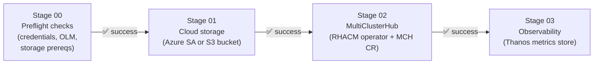

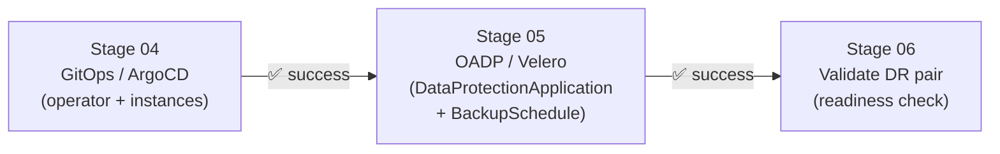

### Survey variables

#### 1. Target cluster context

| Field | Value |
|:---|:---|
| **Question name** | Target Cluster Kubeconfig Context (Required) |
| **Description** | The kubeconfig context name of the cluster to provision as a DR-ready Hub. Must follow the **`-sa`** suffix convention injected by the ACM DR Target Cluster credential (e.g., **`acmdr-lab-hub-01-sa`**). |
| **Variable** | **`k8s_target_context`** |
| **Type** | **`text`** |
| **Required** | **`true`** |
| **Max** | **`128`** |

#### 2. Primary Hub flag

| Field | Value |
|:---|:---|
| **Question name** | Is this the Primary Hub? (Required) |
| **Description** | When **`true`**, configures the cluster as the PRIMARY Hub (active leader with BackupSchedule enabled). When **`false`**, configures it as the DR/PASSIVE Hub (BackupSchedule paused, ready for failover activation). |
| **Variable** | **`is_primary_hub`** |
| **Type** | **`multiplechoice`** |
| **Required** | **`true`** |
| **Choices** | **`true`**, **`false`** |
| **Default** | **`true`** |

#### 3. MCH channel

| Field | Value |
|:---|:---|
| **Question name** | MCH Operator Channel (Required) |
| **Description** | The OLM subscription channel for the MultiClusterHub (RHACM) operator (e.g., **`release-2.17`**). Must match the RHACM version already installed or the version you intend to install. Downgrading the channel is rejected by OLM and will cause the job to hang. |
| **Variable** | **`acm_dr_hub_setup_mch_channel`** |
| **Type** | **`text`** |
| **Required** | **`true`** |
| **Default** | **`release-2.17`** |
| **Max** | **`32`** |

#### 4. Cloud provider

| Field | Value |
|:---|:---|
| **Question name** | Cloud Provider (Required) |
| **Description** | The cloud platform for this Hub cluster. Selects the storage backend: **`azure`** creates an Azure Storage Account for OADP; **`aws`** creates an S3 bucket. |
| **Variable** | **`acm_dr_hub_setup_cloud_provider`** |
| **Type** | **`multiplechoice`** |
| **Required** | **`true`** |
| **Choices** | **`azure`**, **`aws`** |
| **Default** | **`azure`** |

#### 5. Azure Storage Account name (Azure only)

| Field | Value |
|:---|:---|
| **Question name** | Azure Storage Account Name (Optional) |
| **Description** | Name of the Azure Storage Account for OADP backups. Leave empty to use the value from the **`AZURE_STORAGE_ACCOUNT`** environment variable or the auto-generated default (**`acmsa<GUID>`**). |
| **Variable** | **`acm_dr_hub_setup_azure_storage_account_name`** |
| **Type** | **`text`** |
| **Required** | **`false`** |
| **Max** | **`24`** |

#### 6. Azure Resource Group (Azure only)

| Field | Value |
|:---|:---|
| **Question name** | Azure Resource Group (Optional) |
| **Description** | Azure Resource Group where the Storage Account lives. Leave empty to read from the **`RESOURCEGROUP`** environment variable. |
| **Variable** | **`acm_dr_hub_setup_azure_resource_group`** |
| **Type** | **`text`** |
| **Required** | **`false`** |
| **Max** | **`90`** |

#### 7. Allow reuse of existing Azure storage (Azure only)

| Field | Value |
|:---|:---|
| **Question name** | Allow Reuse of Existing Azure Storage (Optional) |
| **Description** | When **`true`**, the role skips creation if the Storage Account already exists and reuses it. Set to **`true`** when running Hub Setup a second time (idempotency / DR Hub setup that shares the same storage). |
| **Variable** | **`acm_dr_hub_setup_azure_storage_allow_reuse`** |
| **Type** | **`multiplechoice`** |
| **Required** | **`false`** |
| **Choices** | **`false`**, **`true`** |
| **Default** | **`false`** |

#### 8. AWS S3 bucket (backups, AWS only)

| Field | Value |
|:---|:---|
| **Question name** | AWS S3 Bucket for OADP Backups (Optional) |
| **Description** | Name of the S3 bucket for OADP/Velero backups. Required when **`cloud_provider=aws`**. Leave empty for Azure deployments. |
| **Variable** | **`acm_dr_hub_setup_aws_s3_bucket_backup`** |
| **Type** | **`text`** |
| **Required** | **`false`** |
| **Max** | **`63`** |

#### 9. AWS S3 bucket (observability, AWS only)

| Field | Value |
|:---|:---|
| **Question name** | AWS S3 Bucket for Observability (Optional) |
| **Description** | Name of the S3 bucket for Thanos Observability metrics. Required when **`cloud_provider=aws`**. Leave empty for Azure deployments. |
| **Variable** | **`acm_dr_hub_setup_aws_s3_bucket_observability`** |
| **Type** | **`text`** |
| **Required** | **`false`** |
| **Max** | **`63`** |

### Credentials

**Permanent on template**: GitHub PAT (Custom): injects **`GITHUB_USER`** and **`GITHUB_PAT`** used by Stage 04 to create the ArgoCD repository Secret. Required for all Hub targets regardless of cloud provider.

**Provided at launch**:
- **ACM DR Target Cluster** (type 36): injects **`ACM_DR_TARGET_HOST`**, **`_TOKEN`**, **`_CA_DATA`**, **`_CONTEXT`** for the Hub being provisioned.
- **Azure Resource Manager** (built-in) for ARO Hubs: injects **`AZURE_SUBSCRIPTION_ID`**, **`AZURE_TENANT`**, **`AZURE_CLIENT_ID`**, **`AZURE_SECRET`**. Used by Stage 01 (Storage Account) and Stage 03 (Observability role assignment).
- **Amazon Web Services** (built-in) for ROSA HCP Hubs: injects **`AWS_ACCESS_KEY_ID`**, **`AWS_SECRET_ACCESS_KEY`**. Used by Stage 01 (S3 bucket) and Stage 03 (Thanos store).

> Role variables for cloud credentials are read via **`lookup('ansible.builtin.env', ...)`** in **`defaults/main.yml`**. You can also override them with extra-vars if needed outside AAP.

---

## 5. Job template 3: ACM Spoke manager

### Template details

| Field | Value |
|:---|:---|
| **Name** | **`ACM DR - LAB - Spoke Lifecycle`** |
| **Description** | Lifecycle management for Spoke/Managed Clusters: onboarding (auto-import secret injection, [KCS 7039710](https://access.redhat.com/solutions/7039710) mitigation) and graceful detachment ([KCS 5950901](https://access.redhat.com/solutions/5950901)). Supports any Kubernetes distribution: ARO, AKS, EKS, GKE, IKS, and vanilla Kubernetes 1.24+. |
| **Playbook** | **`playbooks/manage-spoke.yml`** |
| **Inventory** | **`localhost Inventory`** |
| **Permanent credential** | (none) |
| **At-launch credentials** | ACM DR Target Cluster (type 36) for Hub-side ops + ACM DR Spoke Cluster (type 37) for Spoke-side ops |
| **Execution Environment** | **`acm-dr-orchestrator-ee`** |
| **Verbosity** | **`1 (Verbose)`** recommended |

#### End-to-end flow

[`playbooks/manage-spoke.yml`](../../playbooks/manage-spoke.yml) branches on the `acm_dr_spoke_manager_action` survey variable. The two paths do not share tasks.

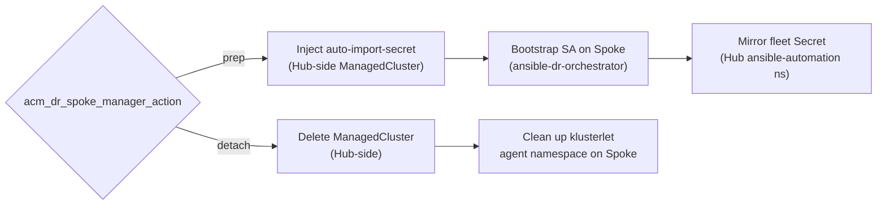

### Survey variables

#### 1. Hub cluster context

| Field | Value |
|:---|:---|
| **Question name** | Hub Cluster Kubeconfig Context (Required) |
| **Description** | The kubeconfig context of the RHACM Hub that will manage this Spoke. Must follow the '-sa' suffix convention. |
| **Variable** | **`k8s_target_context`** |
| **Type** | **`text`** |
| **Required** | **`true`** |
| **Default** | **`acm-primary-hub-sa`** |
| **Max** | **`128`** |

#### 2. Spoke cluster name

| Field | Value |
|:---|:---|
| **Question name** | Spoke/Managed Cluster Name (Required) |
| **Description** | The name of the ManagedCluster object in RHACM. This becomes the namespace on the Hub and the cluster identifier in the fleet (e.g., 'aro-spoke-01', 'aks-spoke-01', 'eks-spoke-01'). |
| **Variable** | **`acm_dr_spoke_manager_cluster_name`** |
| **Type** | **`text`** |
| **Required** | **`true`** |
| **Max** | **`128`** |

#### 3. Spoke kubeconfig context

| Field | Value |
|:---|:---|
| **Question name** | Spoke Cluster Kubeconfig Context |
| **Description** | The kubeconfig context name for the Spoke cluster (e.g., 'aro-spoke-01-sa'). Required for onboarding (prep) operations to inject credentials directly on the Spoke. |
| **Variable** | **`acm_dr_spoke_manager_spoke_k8s_context`** |
| **Type** | **`text`** |
| **Required** | **`false`** |
| **Max** | **`128`** |

#### 4. Action

| Field | Value |
|:---|:---|
| **Question name** | Action to Perform |
| **Description** | 'prep' = Onboard/re-import the Spoke (inject auto-import-secret, bootstrap SA). 'detach' = Gracefully remove the Spoke from the Hub ([KCS 5950901](https://access.redhat.com/solutions/5950901); clean up agent namespace and manifests before deletion). |
| **Variable** | **`acm_dr_spoke_manager_action`** |
| **Type** | **`multiplechoicesingleselect`** |
| **Required** | **`true`** |
| **Choices** | **`prep`**, **`detach`** |
| **Default** | **`prep`** |

#### 5. Cloud provider label (non-OCP Spokes)

| Field | Value |
|:---|:---|
| **Question name** | Cloud Provider Label (Non-OCP Spokes Only) |
| **Description** | For non-OpenShift Spokes (AKS, EKS, GKE, IKS, vanilla K8s), set the RHACM 'cloud' label manually. OpenShift Spokes auto-detect this from the Infrastructure CR. Leave empty for OpenShift Spokes. |
| **Variable** | **`acm_dr_spoke_manager_cluster_cloud`** |
| **Type** | **`multiplechoicesingleselect`** |
| **Required** | **`false`** |
| **Choices** | (empty), **`Azure`**, **`Amazon`**, **`Google`**, **`IBM`**, **`Other`** |
| **Default** | (empty) |

### Tags

| Tag | Action | Notes |
|:---|:---|:---|
| **`spoke_prep`** | Onboard/re-import | Also requires **`acm_dr_spoke_manager_action=prep`** |
| **`spoke_detach`** | Graceful detach | Also requires **`acm_dr_spoke_manager_action=detach`** |

> **Important**: Tags alone do not select the action. The **`acm_dr_spoke_manager_action`** variable
> must also be set. On AAP, set the matching tag in the Job Template's **Job Tags** field.

### Credentials

**Permanent on template**: (none).

**Provided at launch**: ACM DR Target Cluster (type 36) for Hub-side operations + ACM DR Spoke Cluster (type 37) for direct Spoke-side connectivity during prep operations.

---

## 6. Job template 4: ACM DR lab cleanup

### Template details

| Field | Value |
|:---|:---|
| **Name** | **`ACM DR - LAB - Hub Cleanup`** |
| **Description** | Decommissions a cluster that was elected as a DR node, removing only what pertains to that role: full ACM/operator removal, DR-scoped GitOps/OADP config, Observability. Preserves the generic GitOps/OADP operators and cloud backup data (Azure Storage or AWS S3) by default. Supports Azure (ARO) and AWS (ROSA HCP) via the **`cloud_provider`** survey variable. Has built-in safety gates to prevent accidental teardown of an active production Hub. |
| **Playbook** | **`playbooks/cleanup-acm-dr-hub.yml`** |
| **Inventory** | **`localhost Inventory`** |
| **Permanent credential** | (none) |
| **At-launch credentials** | ACM DR Target Cluster (type 36) + Azure RM **or** AWS IAM depending on **`cloud_provider`** |
| **Execution Environment** | **`acm-dr-orchestrator-ee`** |
| **Verbosity** | **`1 (Verbose)`** recommended |

#### End-to-end flow

[`playbooks/cleanup-acm-dr-hub.yml`](../../playbooks/cleanup-acm-dr-hub.yml) opens with a safety gate that blocks the entire pipeline when the Hub is still ACTIVE or the confirmation variable is absent.

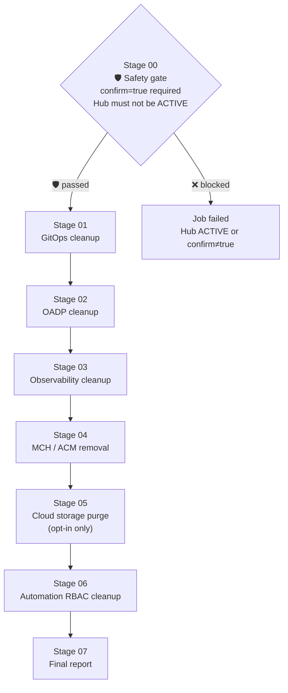

### Survey variables

#### 1. Target cluster context

| Field | Value |
|:---|:---|
| **Question name** | Target Cluster Kubeconfig Context (Required) |
| **Description** | The kubeconfig context of the cluster to decommission as a DR node. Must follow the '-sa' suffix convention. |
| **Variable** | **`k8s_target_context`** |
| **Type** | **`text`** |
| **Required** | **`true`** |

#### 2. Explicit confirmation

| Field | Value |
|:---|:---|
| **Question name** | Explicit Cleanup Confirmation (MANDATORY) |
| **Description** | **SAFETY GATE**: Must be set to 'true' to proceed. The playbook refuses to execute without this explicit confirmation. This prevents accidental teardown via misconfigured Job Templates or unintended launches. |
| **Variable** | **`acm_dr_hub_cleanup_confirm`** |
| **Type** | **`multiplechoice`** |
| **Required** | **`true`** |
| **Choices** | **`true`**, **`false`** |
| **Default** | **`false`** |

#### 3. Dry-run mode

| Field | Value |
|:---|:---|
| **Question name** | Execution Mode - Dry-Run Simulation |
| **Description** | When 'true', the entire cleanup pipeline runs in **`check_mode`**/**`diff`**; changes are validated by the API server but never persisted. **Recommended** for the first run against a new cluster. |
| **Variable** | **`acm_dr_hub_cleanup_dry_run`** |
| **Type** | **`multiplechoice`** |
| **Required** | **`true`** |
| **Choices** | **`true`**, **`false`** |
| **Default** | **`true`** |

#### 4. Force cleanup (active Hub override)

| Field | Value |
|:---|:---|
| **Question name** | Force Cleanup of Active Hub |
| **Description** | **DANGER**: When 'true', allows cleanup even if the Hub appears to be ACTIVE in production (BackupSchedule present and not paused). Only use when you are certain the Hub should be decommissioned despite its active state. |
| **Variable** | **`acm_dr_hub_cleanup_force`** |
| **Type** | **`multiplechoice`** |
| **Required** | **`true`** |
| **Choices** | **`true`**, **`false`** |
| **Default** | **`false`** |

#### 5. Cloud provider

| Field | Value |
|:---|:---|
| **Question name** | Cloud Provider (Required) |
| **Description** | The cloud platform for this Hub cluster. Selects which storage cleanup path runs: **`azure`** targets Azure Storage cleanup; **`aws`** targets AWS S3 cleanup. Must match the value used during Hub Setup. |
| **Variable** | **`acm_dr_hub_cleanup_cloud_provider`** |
| **Type** | **`multiplechoice`** |
| **Required** | **`true`** |
| **Choices** | **`azure`**, **`aws`** |
| **Default** | **`azure`** |

#### 6. Purge Azure storage (Azure only)

| Field | Value |
|:---|:---|
| **Question name** | Purge Azure Storage (Backup Data) (Optional) |
| **Description** | When **`true`**, also deletes the Azure Storage Account and Containers (backup data). Disabled by default because the primary Hub typically still depends on the same shared storage. Only enable after confirming no other Hub needs these backups. |
| **Variable** | **`acm_dr_hub_cleanup_purge_azure_storage`** |
| **Type** | **`multiplechoice`** |
| **Required** | **`false`** |
| **Choices** | **`false`**, **`true`** |
| **Default** | **`false`** |

#### 7. Azure Storage Account name (Azure only)

| Field | Value |
|:---|:---|
| **Question name** | Azure Storage Account Name (Optional) |
| **Description** | Name of the Azure Storage Account to target for deletion. Required only when **`purge_azure_storage=true`**. Leave empty to derive the name from the **`AZURE_STORAGE_ACCOUNT`** environment variable. |
| **Variable** | **`acm_dr_hub_cleanup_azure_storage_account_name`** |
| **Type** | **`text`** |
| **Required** | **`false`** |
| **Max** | **`24`** |

#### 8. Azure Resource Group (Azure only)

| Field | Value |
|:---|:---|
| **Question name** | Azure Resource Group (Optional) |
| **Description** | Azure Resource Group where the Storage Account lives. Leave empty to read from the **`RESOURCEGROUP`** environment variable. |
| **Variable** | **`acm_dr_hub_cleanup_azure_resource_group`** |
| **Type** | **`text`** |
| **Required** | **`false`** |
| **Max** | **`90`** |

#### 9. Purge AWS S3 storage (AWS only)

| Field | Value |
|:---|:---|
| **Question name** | Purge AWS S3 Storage (Backup Data) (Optional) |
| **Description** | When **`true`**, also deletes the S3 buckets used for OADP backups and Observability. Disabled by default. Only enable after confirming the data is no longer needed by any Hub. |
| **Variable** | **`acm_dr_hub_cleanup_purge_aws_storage`** |
| **Type** | **`multiplechoice`** |
| **Required** | **`false`** |
| **Choices** | **`false`**, **`true`** |
| **Default** | **`false`** |

### Credentials

**Permanent on template**: (none).

**Provided at launch**:
- **ACM DR Target Cluster** (type 36): injects **`ACM_DR_TARGET_*`** for the Hub being decommissioned.
- **Azure Resource Manager** (built-in) for ARO Hubs: required when **`cloud_provider=azure`** and **`purge_azure_storage=true`**. Not needed otherwise (the role skips the storage stage if no Azure env vars are present).
- **Amazon Web Services** (built-in) for ROSA HCP Hubs: required when **`cloud_provider=aws`** and **`purge_aws_storage=true`**. Not needed otherwise.

---

## 7. Job template 5: ACM ArgoCD instance setup

### Template details

| Field | Value |
|:---|:---|
| **Name** | **`ACM DR - LAB - ArgoCD Setup`** |
| **Description** | Provisions N parametric ArgoCD instances on a target cluster: namespace, repository secret, ApplicationSet generator (static list or fan-out by Placement), RBAC, and ConsoleLink. Additive; coexists with acm_dr_hub_setup Stage 04 ArgoCD instances. |
| **Playbook** | **`playbooks/manage-argocd-instance.yml`** |
| **Inventory** | **`localhost Inventory`** |
| **Credentials** | Multi-context KUBECONFIG (Custom) |
| **Execution Environment** | **`acm-dr-orchestrator-ee`** |
| **Verbosity** | **`1 (Verbose)`** recommended |
| **Survey** | **Not used** (complex list input) |

#### End-to-end flow

[`playbooks/manage-argocd-instance.yml`](../../playbooks/manage-argocd-instance.yml) provisions each entry in `acm_argocd_instances` as an independent pipeline. Steps run per-instance in declaration order.

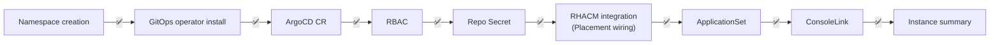

### Extra variables (YAML)

This template requires a complex list variable (**`acm_argocd_instances`**) that cannot be
represented as Survey questions. Pass it as **Extra Variables** (YAML format) in the Job
Template configuration:

```yaml
k8s_target_context: acm-primary-hub-sa

acm_argocd_instances:
  - name: argocd-policies
    namespace: openshift-gitops-policies
    manage_operator: true
    cluster_admin_rbac: true
    repo_url: "https://github.com/your-org/ocp-policies.git"
    repo_username: "git-user"
    repo_pat: "{{ github_pat }}"
    repo_target_revision: main
    managed_namespaces:
      - policies-ns
    generator_type: list
    applications:
      - name: cluster-policies
        path: policies/
        destination_namespace: policies-ns
    console_link_enabled: true
    console_link_text: "ArgoCD Policies"

  - name: argocd-apps
    namespace: openshift-gitops-apps
    manage_operator: false
    cluster_admin_rbac: false
    repo_url: "https://github.com/your-org/app-manifests.git"
    repo_target_revision: main
    generator_type: none
    applications:
      - name: demo-app
        path: apps/demo/
        destination_namespace: demo
```

#### Instance object fields

| Key | Type | Required | Default | Description |
|:---|:---|:---|:---|:---|
| **`name`** | str | **Yes** | -- | ArgoCD instance name |
| **`namespace`** | str | **Yes** | -- | Namespace for the ArgoCD instance |
| **`manage_operator`** | bool | No | **`true`** | Install/manage the GitOps operator |
| **`cluster_admin_rbac`** | bool | No | **`false`** | Grant cluster-admin to the ArgoCD SA |
| **`repo_url`** | str | No | **`""`** | Git repository URL |
| **`repo_username`** | str | No | **`""`** | Git username for repo authentication |
| **`repo_pat`** | str | No | **`""`** | Git PAT/token for repo authentication |
| **`repo_target_revision`** | str | No | **`"main"`** | Git branch/tag/revision |
| **`managed_namespaces`** | list | No | **`[]`** | Additional namespaces to create |
| **`resource_exclusions`** | list | No | **`[]`** | ArgoCD resource exclusions |
| **`generator_type`** | str | No | **`"none"`** | ApplicationSet generator type |
| **`applications`** | list | No | **`[]`** | List of Application definitions |
| **`wire_rhacm_integration`** | bool | No | **`false`** | Wire RHACM Placement integration |
| **`cluster_set`** | str | No | **`"default"`** | ManagedClusterSet name |
| **`console_link_enabled`** | bool | No | **`false`** | Create OCP ConsoleLink |
| **`console_link_text`** | str | No | **`""`** | ConsoleLink display text |

### Credentials

**Permanent on template**: (none). **Provided at launch**: ACM DR Target Cluster (type 36).

---

## 8. Job template 6: ACM ArgoCD instance cleanup

### Template details

| Field | Value |
|:---|:---|
| **Name** | **`ACM DR - LAB - ArgoCD Cleanup`** |
| **Description** | Removes ArgoCD instances and their managed namespaces without touching the shared GitOps operator. Removes Applications/ApplicationSet, RBAC, ConsoleLink, and the ArgoCD instance in the correct order to prevent orphaned finalizers. Has dry-run support. |
| **Playbook** | **`playbooks/cleanup-argocd-instance.yml`** |
| **Inventory** | **`localhost Inventory`** |
| **Permanent credential** | (none) |
| **At-launch credentials** | ACM DR Target Cluster (type 36) |
| **Execution Environment** | **`acm-dr-orchestrator-ee`** |
| **Verbosity** | **`1 (Verbose)`** recommended |
| **Survey** | **Not used** (complex list input) |

#### End-to-end flow

[`playbooks/cleanup-argocd-instance.yml`](../../playbooks/cleanup-argocd-instance.yml) removes each entry in `acm_argocd_instances_cleanup` in declaration order. Finalizers are handled before CR deletion to avoid orphaned resources.

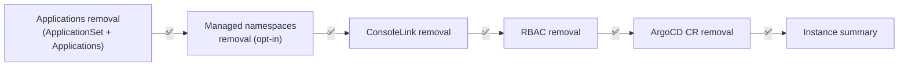

### Extra variables (YAML)

```yaml
k8s_target_context: acm-primary-hub-sa

acm_argocd_instance_cleanup_confirm: true
acm_argocd_instance_cleanup_dry_run: true

acm_argocd_instances_cleanup:
  - name: argocd-policies
    namespace: openshift-gitops-policies
    managed_namespaces:
      - policies-ns
    remove_managed_namespaces: true

  - name: argocd-apps
    namespace: openshift-gitops-apps
    managed_namespaces:
      - demo
    remove_managed_namespaces: true
```

#### Cleanup instance object fields

| Key | Type | Required | Default | Description |
|:---|:---|:---|:---|:---|
| **`name`** | str | **Yes** | -- | ArgoCD instance name to remove |
| **`namespace`** | str | **Yes** | -- | Namespace of the ArgoCD instance |
| **`managed_namespaces`** | list | No | **`[]`** | Namespaces to also remove |
| **`remove_managed_namespaces`** | bool | No | **`true`** | Whether to delete managed namespaces |

#### Global variables (set as extra-vars, not per-instance)

| Variable | Type | Default | Description |
|:---|:---|:---|:---|
| **`acm_argocd_instance_cleanup_confirm`** | bool | **`false`** | **MANDATORY**: must be **`true`** to proceed |
| **`acm_argocd_instance_cleanup_dry_run`** | bool | **`false`** | Dry-run mode (check_mode/diff) |

### Credentials

**Permanent on template**: (none). **Provided at launch**: ACM DR Target Cluster (type 36).

---

## 9. Job template 7: ACM DR Spoke Onboarding

### Template details

| Field | Value |
|:---|:---|
| **Name** | **`ACM DR - LAB - Spoke Onboarding`** |
| **Description** | Full Spoke onboarding pipeline: provisions the **`ansible-dr-orchestrator`** ServiceAccount on the Spoke, updates the fleet Secret on the Hub, and runs the Hub-side RHACM registration (ManagedCluster, KlusterletAddonConfig, auto-import-secret). No separate fleet kubeconfig credential is needed for failover. The Spoke Lifecycle Job Template (`action=prep`) creates a per-spoke mirrored Secret (`acm-dr-<spoke>-sa-token`) in the Hub's `ansible-automation` namespace. During failover, Stage 07 reads these individual Secrets (Operation C) to reconnect each Spoke without a combined fleet kubeconfig. |
| **Playbook** | **`playbooks/manage-spoke.yml`** |
| **Inventory** | **`localhost Inventory`** |
| **Permanent credential** | (none) |
| **At-launch credentials** | ACM DR Target Cluster (type 36) for Hub-side ops + ACM DR Spoke Cluster (type 37) for Spoke-side SA provisioning |
| **Execution Environment** | **`acm-dr-orchestrator-ee`** |
| **Verbosity** | **`1 (Verbose)`** recommended |

> **Difference from JT3 (Spoke Lifecycle)**: JT3 supports both **`prep`** (onboard) and **`detach`** actions and exposes all action choices in the survey. JT7 is dedicated to new Spoke onboarding only: the **`acm_dr_spoke_manager_action: onboard`** and **`acm_dr_spoke_manager_debug_no_log: true`** are preset as extra vars on the template, and the survey collects only the three Spoke identification fields. Use JT7 for WF-03 node automation; use JT3 for ad-hoc detach/re-attach operations.

#### End-to-end flow

[`playbooks/manage-spoke.yml`](../../playbooks/manage-spoke.yml) with `action=onboard` runs five steps. Steps 2-3 run on the Spoke directly; steps 4-5 run on the Hub.

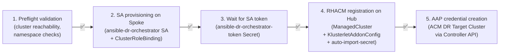

### Preset extra vars

```yaml
acm_dr_spoke_manager_action: "onboard"
acm_dr_spoke_manager_debug_no_log: true   # set to false in production to mask SA tokens in job output
```

### Survey variables

#### 1. Spoke cluster name

| Field | Value |
|:---|:---|
| **Question name** | Spoke Cluster Name (Required) |
| **Description** | The name that identifies this Spoke in RHACM (ManagedCluster object name). Use lowercase alphanumeric characters and hyphens only (e.g., **`aro-spoke-01`**, **`eks-prod-us-east`**). This name also determines the fleet kubeconfig context (**`<name>-sa`**). |
| **Variable** | **`acm_dr_spoke_manager_cluster_name`** |
| **Type** | **`text`** |
| **Required** | **`true`** |
| **Min** | **`3`** |
| **Max** | **`63`** |

#### 2. Environment label

| Field | Value |
|:---|:---|
| **Question name** | Environment Label (Required) |
| **Description** | The environment label applied to the ManagedCluster object in RHACM. Controls policy placement and Spoke grouping in the ACM console. |
| **Variable** | **`acm_dr_spoke_manager_cluster_environment`** |
| **Type** | **`multiplechoice`** |
| **Required** | **`true`** |
| **Choices** | **`lab`**, **`dev`**, **`hml`**, **`prd`** |
| **Default** | **`lab`** |

#### 3. Cloud provider

| Field | Value |
|:---|:---|
| **Question name** | Cloud Provider (Optional) |
| **Description** | The cloud provider label applied to the ManagedCluster object. For OpenShift Spokes this is auto-detected from **`Infrastructure.status.platform`**. For non-OCP Spokes (AKS, EKS, GKE, IKS, vanilla Kubernetes), select the matching provider. |
| **Variable** | **`acm_dr_spoke_manager_cluster_cloud`** |
| **Type** | **`multiplechoice`** |
| **Required** | **`false`** |
| **Choices** | (empty), **`Amazon`**, **`Azure`**, **`Google`**, **`IBMCloud`**, **`VSphere`**, **`BareMetal`**, **`OpenStack`**, **`Nutanix`**, **`Alibaba`**, **`Other`** |
| **Default** | (empty) |

### Credentials

**Permanent on template**: (none). **Provided at launch**: ACM DR Target Cluster (type 36) for Hub-side operations + ACM DR Spoke Cluster (type 37) for direct Spoke-side connectivity during SA provisioning.

---

## 10. Job template 8: ACM DR Readiness Check

### Template details

| Field | Value |
|:---|:---|
| **Name** | **`ACM DR - LAB - DR Readiness Check`** |
| **Description** | Read-only health verification of both Hub clusters before a failover or DR drill. Checks BackupSchedule active on Source Hub, BackupStorageLocation available, latest backup within RPO threshold, passive sync Restore present on Destination Hub, and Spoke fleet count. Produces a ✅/⚠️ summary per check. No cluster state is modified. |
| **Playbook** | **`playbooks/check-dr-readiness.yml`** |
| **Inventory** | **`localhost Inventory`** |
| **Permanent credential** | (none) |
| **At-launch credentials** | ACM DR Source Hub (type 34) + ACM DR Destination Hub (type 35) |
| **Execution Environment** | **`acm-dr-orchestrator-ee`** |
| **Verbosity** | **`1 (Verbose)`** recommended |

#### End-to-end flow

[`playbooks/check-dr-readiness.yml`](../../playbooks/check-dr-readiness.yml) runs five checks in sequence and produces a per-check ✅/⚠️/❌ summary. No cluster state is modified.

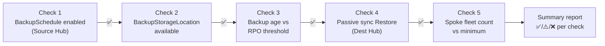

> **When to run**: before any production failover to confirm DR posture; as a scheduled AAP job (weekly or daily) to detect backup staleness or a missing passive Restore before they become an incident; after any Hub or OADP maintenance.
>
> **Exit codes**: **`0`** when all blocking checks pass; **`1`** on the first blocking check failure, with a specific remediation hint in the job output.

### Survey variables

#### 1. RPO threshold

| Field | Value |
|:---|:---|
| **Question name** | RPO Threshold in Seconds (Optional) |
| **Description** | Maximum acceptable age of the last successful backup, in seconds. The check warns (or fails if Fail on Stale Backup is **`true`**) when the backup is older than this value. Default is 25200 (7 hours). |
| **Variable** | **`acm_dr_readiness_check_rpo_seconds`** |
| **Type** | **`integer`** |
| **Required** | **`false`** |
| **Default** | **`25200`** |
| **Min** | **`3600`** |
| **Max** | **`86400`** |

#### 2. Minimum expected Spoke count

| Field | Value |
|:---|:---|
| **Question name** | Minimum Expected Spoke Count (Optional) |
| **Description** | Minimum number of ManagedClusters expected on the Source Hub, excluding **`local-cluster`**. The check prints a non-blocking warning when the actual count falls below this value. Set to **`0`** to skip the count check. |
| **Variable** | **`acm_dr_readiness_check_min_spoke_count`** |
| **Type** | **`integer`** |
| **Required** | **`false`** |
| **Default** | **`0`** |
| **Min** | **`0`** |
| **Max** | **`500`** |

#### 3. Fail on stale backup

| Field | Value |
|:---|:---|
| **Question name** | Fail on Stale Backup (Optional) |
| **Description** | When **`true`**, the job fails if the latest backup exceeds the RPO threshold instead of issuing a non-blocking warning. Use **`true`** for pre-failover gates; use **`false`** for routine scheduled monitoring. |
| **Variable** | **`acm_dr_readiness_check_fail_on_stale_backup`** |
| **Type** | **`multiplechoice`** |
| **Required** | **`false`** |
| **Choices** | **`true`**, **`false`** |
| **Default** | **`false`** |

#### 4. Fail on missing passive Restore

| Field | Value |
|:---|:---|
| **Question name** | Fail on Missing Passive Restore (Optional) |
| **Description** | When **`true`**, the job fails if no passive sync Restore CR (**`syncRestoreWithNewBackups=true`**) is found on the Destination Hub. Default **`true`** because an absent passive Restore means the DR Hub is not pre-positioned and failover will be slower or incomplete. |
| **Variable** | **`acm_dr_readiness_check_fail_on_missing_restore`** |
| **Type** | **`multiplechoice`** |
| **Required** | **`false`** |
| **Choices** | **`true`**, **`false`** |
| **Default** | **`true`** |

### Credentials

**Permanent on template**: (none). **Provided at launch**: ACM DR Source Hub (type 34, injects **`ACM_DR_SOURCE_CONTEXT`**) + ACM DR Destination Hub (type 35, injects **`ACM_DR_DEST_CONTEXT`**). Context values are resolved automatically by the **`acm_dr_kubeconfig_resolver`** pre-tasks role; no **`-e k8s_source_context`** flag is needed at the CLI when using AAP credentials.

---

## 11. Workflow templates

### DR failover pipeline with approval node

For production environments, use an **AAP Workflow Template** to add human-in-the-loop approval
between the fencing stage and the Hub activation:

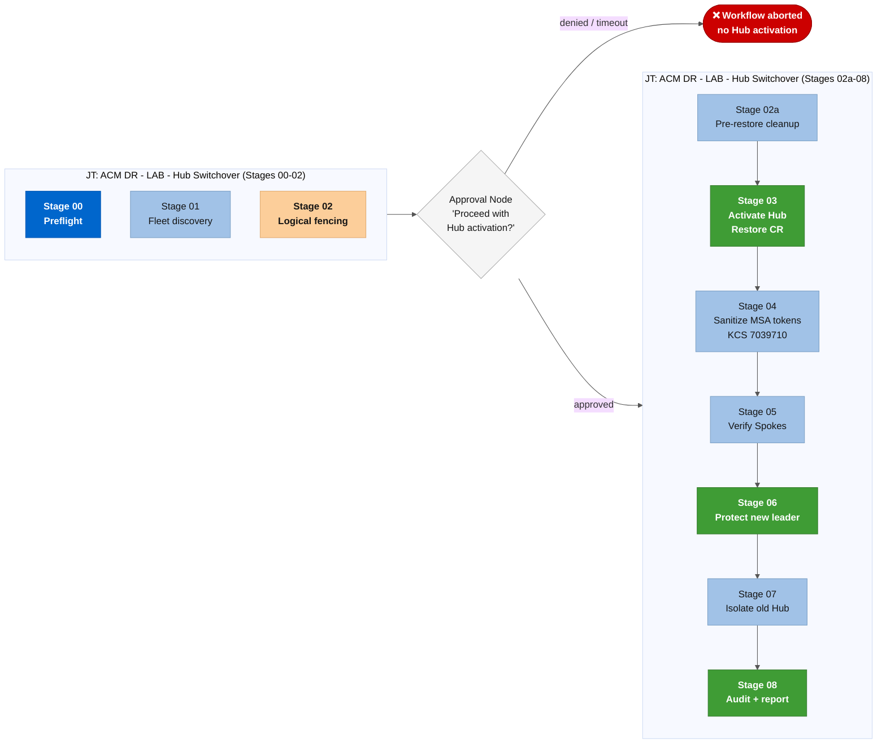

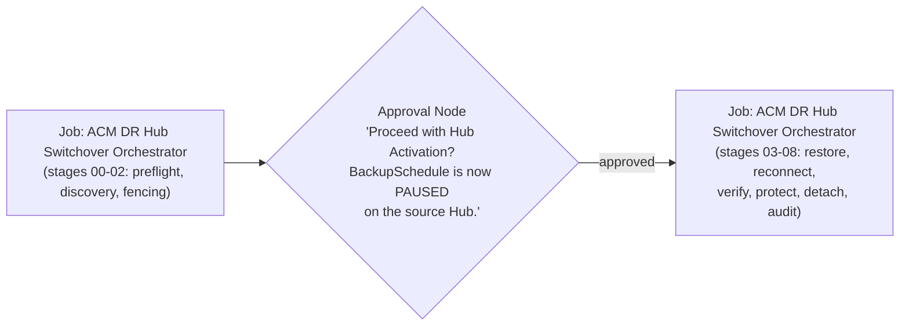

> **Note**: This requires splitting the pipeline into two Job Templates (stages 00-02 and 03-08) or using a single template with **`skip_gates=true`** and placing the Approval Node before it. The simpler approach is the single template with **`skip_gates=true`**. The Workflow Approval Node replaces the in-playbook interactive pause with AAP's native approval UI (audit trail, email notifications, time-based auto-rejection).

### Planned maintenance switchover (WF-19)

**WF - ACM DR - LAB - Planned Maintenance Switchover** orchestrates a zero-downtime rolling Hub upgrade. The workflow fails the fleet away from Hub A, then triggers the Hub A upgrade automatically after operator approval. It validates the failback with a dry-run before executing production failback, and finishes by upgrading Hub B to the same target version.

#### End-to-end flow

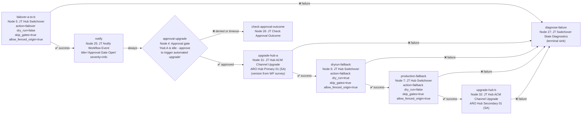

#### Node breakdown

| Node | AAP node ID | Job Template | Fixed `extra_data` | Credentials (node-level) |
|:---|:---:|:---|:---|:---|
| **`failover-a-to-b`** | 5 | JT - ACM DR - LAB - Hub Switchover | `action=failover`, `dry_run=false`, `skip_gates=true`, `allow_fenced_origin=true` | ARO Hub Primary 01 (Source) + ARO Hub Secondary 01 (Dest) |
| **`notify`** | 25 | JT - ACM DR - LAB - Notify Workflow Event | `notification_title="Planned Maintenance: Approval Gate Open"`, `notification_severity=info` | (per WF node config) |
| **`approval-upgrade`** | 4 | Approval gate | (none) | (none) |
| **`upgrade-hub-a`** | 31 | JT - ACM DR - LAB - Hub ACM Channel Upgrade | (none - target version from WF survey) | ARO Hub Primary 01 (SA) |
| **`dryrun-failback`** | 6 | JT - ACM DR - LAB - Hub Switchover | `action=failback`, `dry_run=true`, `skip_gates=true`, `allow_fenced_origin=true` | ARO Hub Primary 01 (Source) + ARO Hub Secondary 01 (Dest) |
| **`production-failback`** | 7 | JT - ACM DR - LAB - Hub Switchover | `action=failback`, `dry_run=false`, `skip_gates=true`, `allow_fenced_origin=true` | ARO Hub Primary 01 (Source) + ARO Hub Secondary 01 (Dest) |
| **`upgrade-hub-b`** | 32 | JT - ACM DR - LAB - Hub ACM Channel Upgrade | (none - same survey version) | ARO Hub Secondary 01 (SA) |
| **`check-approval-outcome`** | 26 | JT - ACM DR - LAB - Check Approval Outcome | `wf_name="WF - ACM DR - LAB - Planned Maintenance Failover"` | (none) |
| **`diagnose-failure`** | 27 | JT - ACM DR - LAB - Switchover State Diagnostics | (none - terminal sink, no outgoing edges) | (none) |

**Hub ACM Channel Upgrade** runs [`playbooks/upgrade-hub-acm-channel.yml`](../../playbooks/upgrade-hub-acm-channel.yml) and performs three steps:
1. Patches the ACM Subscription channel to `release-<major.minor>` using the survey value.
2. Waits up to 30 minutes for the MultiClusterHub phase to reach `Running` at the target version.
3. Waits up to 5 minutes for `MultiClusterHub Complete=True` (all sub-components stable).

**Credential note for failback nodes:** the failback nodes use the same Hub credentials as the failover node. `action=failback` instructs the playbook to invert the SOURCE/DEST context mapping internally. No separate reversed credentials are needed.

#### How to run WF-19

1. **Resources → Templates → WF - ACM DR - LAB - Planned Maintenance Switchover** → open the Workflow Visualizer and attach credentials to each JT node as shown in the table above. AAP 2.7 Gateway does not inherit WJT-level credentials on workflow nodes; per-node attachment is required.

2. Click **Launch**. Fill the survey:
   - **Target RHACM Version (Required)**: the minor version to upgrade to, e.g. `2.16`.
   - **Additional Passive Hubs (Optional)**: leave empty for a standard 2-hub pair.

3. The `failover-a-to-b` node runs a production failover to Hub B. On success, `notify` sends a webhook event and the `approval-upgrade` gate opens.

4. During the approval window: confirm Hub A is fully idle (BackupSchedule paused, no incoming spoke connections). Then approve the gate in **Views → Workflow Approvals**. The `upgrade-hub-a` node triggers automatically, patches Hub A's MCH subscription channel, and waits for the operator to reach `Running` at the target version.

5. After Hub A upgrade completes: `dryrun-failback` validates the failback path (version gap must be no more than one minor version). When the dry-run passes, `production-failback` executes the real failback to Hub A.

6. After failback: `upgrade-hub-b` patches Hub B's MCH subscription channel to the same target version, completing the rolling upgrade of both Hubs.

#### Interrupting and resuming

If the approval gate times out or is denied, `check-approval-outcome` (Node 26) records the outcome. Hub A remains fenced (BackupSchedule paused) and the fleet stays on Hub B. To resume: fix whatever blocked the approval, then re-launch WF-19 with `allow_fenced_origin=true` as an extra variable at launch.

If any JT node fails, `diagnose-failure` (Node 27, JT Switchover State Diagnostics) runs as a terminal sink and captures diagnostic output. The workflow ends; no automatic retry occurs.

#### Survey fields

| Field | Variable | Type | Required | Purpose |
|:---|:---|:---|:---:|:---|
| Target RHACM Version | `acm_dr_failover_manager_target_acm_version` | text | **Yes** | Target RHACM minor version, e.g. `2.16`. Used by both Hub ACM Channel Upgrade nodes. |
| Additional Passive Hubs | `acm_dr_failover_manager_additional_passive_hubs` | text | No | JSON list of extra passive hub contexts for multi-hub topologies. Leave empty for standard 2-hub pair. |

### Full lab rebuild (WF-03)

Four-node sequential workflow: **`setup-primary-hub → onboard-spokes → setup-passive-hub → validation-dryrun`**. Provisions both Hubs and one Spoke from scratch, then validates the full DR state with a dry-run failover. Idempotent; safe to run against an already-provisioned lab (**`acm_dr_hub_setup_allow_existing_dr=true`**).

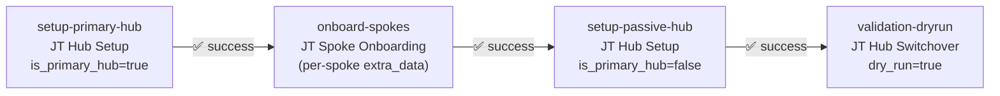

The **`setup-primary-hub`** and **`setup-passive-hub`** nodes have **`REPLACE_WITH_*`** placeholders in their **`extra_data`** that must be filled with the actual Azure Resource Group and Storage Account name (or AWS bucket names) before first use. See the **`extra_data`** blocks in [*`controller_workflow_job_templates.yml`*](../../examples/aap/controller_workflow_job_templates.yml).

### Spoke onboarding batch (WF-04)

Seven-slot linear chain for batching up to seven Spoke onboarding runs in sequence. Each slot is an "ACM DR - LAB - Spoke Onboarding" JT node with its own **`extra_data`** block for the Spoke cluster name and context. Unused slots remain inactive.

**Single-Spoke caveat**: removing a node from its predecessor's **`success_nodes`** makes the next node a root node (no predecessor), which AAP starts automatically when the WJT launches. For onboarding a single Spoke, run the "ACM DR - LAB - Spoke Onboarding" JT directly rather than through WF-04.

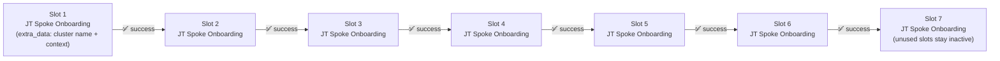

### Full DR drill (WF-05)

Four-node rehearsal pipeline: readiness check, dry-run failover, approval gate, and notification. Tied to the weekly Schedule (**`ACM DR - LAB - DR Drill - Weekly`**). Does not apply any changes to the clusters.

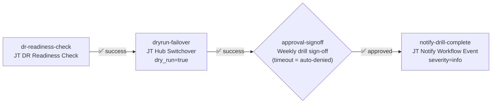

Node-level credential requirement: AAP 2.7 Gateway does not inherit WJT-level credentials on **`simplified_workflow_nodes`**. Every JT node must have credentials attached explicitly:

| Node | Required credentials |
|---|---|
| **`dr-readiness-check`** | ARO Hub 01 (Source), ARO Hub 02 (Dest) |
| **`dryrun-failover`** | ARO Hub 01 (Source), ARO Hub 02 (Dest) |
| **`notify-drill-complete`** | ARO Hub 01 (Source), ARO Hub 02 (Dest) |

**API launch**: WF-05 has **`acm_dr_failover_action`** as a required survey field with a default of **`failover`**. The AAP API requires this field explicitly even when a default is defined. The UI fills it automatically but API callers must pass it:

```bash
curl -X POST .../api/controller/v2/workflow_job_templates/<ID>/launch/ \
  -H "Content-Type: application/json" \
  -d '{"extra_vars": {"acm_dr_failover_action": "failover"}}'
```

### Machine-importable definitions

The five Workflow Templates above are defined as CasC YAML in [*`examples/aap/controller_workflow_job_templates.yml`*](../../examples/aap/controller_workflow_job_templates.yml). Import them with the same **`infra.controller_configuration`** collection or REST API workflow used for Job Templates (see [Section 10](#10-importing-via-controller-as-code) below).

---

## 12. Importing via controller-as-code

The [*`examples/aap/`*](../../examples/aap/) directory contains 10 machine-readable YAML files that cover every AAP object type this collection needs. Import them once on a fresh AAP instance and every Job Template, Workflow, Credential Type, Schedule, and Notification is ready without touching the UI. For the short version, see [*`examples/aap/README.md`*](../../examples/aap/README.md).

### CasC files and import order

AAP objects reference each other by name, so the order matters:

| Order | File | Object type |
| --- | --- | --- |
| 1 | [*`controller_organizations.yml`*](../../examples/aap/controller_organizations.yml) | Organization |
| 2 | [*`controller_execution_environments.yml`*](../../examples/aap/controller_execution_environments.yml) | Execution Environment |
| 3 | [*`controller_inventories.yml`*](../../examples/aap/controller_inventories.yml) | Inventory + Host |
| 4 | [*`controller_projects.yml`*](../../examples/aap/controller_projects.yml) | Project |
| 5 | [*`controller_credential_types.yml`*](../../examples/aap/controller_credential_types.yml) | Credential Type (×7) |
| 6 | [*`controller_credentials.yml`*](../../examples/aap/controller_credentials.yml) | Credential (REDACTED placeholders; fill before importing) |
| 7 | [*`controller_job_templates.yml`*](../../examples/aap/controller_job_templates.yml) | Job Template (×8, including DR Readiness Check) |
| 8 | [*`controller_workflow_job_templates.yml`*](../../examples/aap/controller_workflow_job_templates.yml) | Workflow Job Template (×5) |
| 9 | [*`controller_schedules.yml`*](../../examples/aap/controller_schedules.yml) | Schedule (disabled by default) |
| 10 | [*`controller_notifications.yml`*](../../examples/aap/controller_notifications.yml) | Notification Template (×2 Slack) |

### Placeholder variables

All 10 files share four Jinja2 placeholder variables resolved at import time via **`-e`** flags:

| Placeholder | Description | Example |
| :--- | :--- | :--- |
| **`{{ aap_organization }}`** | AAP Organization name | **`Default`** |
| **`{{ aap_project }}`** | AAP Project name (this Git repo) | **`ACM DR Collection (main)`** |
| **`{{ aap_inventory }}`** | Localhost Inventory name | **`ACM DR - LAB`** |
| **`{{ aap_execution_environment }}`** | Execution Environment name | **`EE - ACM DR 1.0.0`** |
| **`{{ aap_scm_url }}`** | Git URL for the collection SCM Project (controller_projects.yml) | **`https://github.com/dfmateus/acm_dr.git`** |
| **`{{ aap_github_pat_credential }}`** | Name of the GitHub PAT credential permanently attached to Hub Setup | **`ACM DR - GitHub PAT`** |

### Customizing cluster context names

The **`k8s_target_context`** survey question on Hub Setup uses a **`text`** type. Enter the context name matching your cluster's **`-sa`** context (e.g., **`acmdr-lab-hub-01-sa`**). The failover action is selected via the **`acm_dr_failover_action`** choice (**`failover`** or **`failback`**), which is direction-agnostic; the actual clusters come from the Source Hub and Destination Hub credentials attached at launch. If your clusters use different context names, update the **`cluster_context`** field in [*`controller_credentials.yml`*](../../examples/aap/controller_credentials.yml) rather than editing survey choices.

### Method 1: Using **`infra.controller_configuration`** collection

```bash
# Install the collection (one-time)
ansible-galaxy collection install infra.controller_configuration

# Common connection + placeholder vars
COMMON="-e controller_hostname=https://aap.example.com \
        -e controller_username=admin \
        -e controller_password=changeme \
        -e aap_organization=Default \
        -e aap_project='ACM DR Collection (main)' \
        -e aap_inventory='ACM DR - LAB' \
        -e aap_execution_environment='EE - ACM DR 1.0.0'"

# Import in order - each line is idempotent (safe to re-run)
ansible-playbook ${COMMON} -e @examples/aap/controller_organizations.yml          infra.controller_configuration.organizations
ansible-playbook ${COMMON} -e @examples/aap/controller_execution_environments.yml infra.controller_configuration.execution_environments
ansible-playbook ${COMMON} -e @examples/aap/controller_inventories.yml            infra.controller_configuration.inventories
ansible-playbook ${COMMON} -e @examples/aap/controller_inventories.yml            infra.controller_configuration.hosts
ansible-playbook ${COMMON} -e @examples/aap/controller_projects.yml               infra.controller_configuration.projects
ansible-playbook ${COMMON} -e @examples/aap/controller_credential_types.yml       infra.controller_configuration.credential_types
ansible-playbook ${COMMON} -e @examples/aap/controller_credentials.yml            infra.controller_configuration.credentials
ansible-playbook ${COMMON} -e @examples/aap/controller_job_templates.yml          infra.controller_configuration.job_templates
ansible-playbook ${COMMON} -e @examples/aap/controller_workflow_job_templates.yml infra.controller_configuration.workflow_job_templates
ansible-playbook ${COMMON} -e @examples/aap/controller_schedules.yml              infra.controller_configuration.schedules
ansible-playbook ${COMMON} -e @examples/aap/controller_notifications.yml          infra.controller_configuration.notification_templates
```

> **Credentials**: [*`controller_credentials.yml`*](../../examples/aap/controller_credentials.yml) uses **`REPLACE_WITH_...`** placeholders for all sensitive fields. Pass the real values via additional **`-e cred_*`** flags at import time. Never commit real tokens to this file.

### Method 2: REST API direct import

```bash
# Export the YAML to JSON and POST to the Controller API
# (requires yq >= 4.x and a valid AAP OAuth token)

# Create a Job Template via API
curl -X POST "https://aap.example.com/api/controller/v2/job_templates/" \
  -H "Authorization: Bearer $AAP_TOKEN" \
  -H "Content-Type: application/json" \
  -d @<(yq -o json '.controller_job_templates[0]' examples/aap/controller_job_templates.yml)
```

### Method 3: AAP UI manual creation

Use the Survey variable tables in Sections 3-8 above to manually create each Job Template and its Survey in the AAP web UI:

1. **Automation Execution > Templates > Add > Job Template**
2. Fill in the template details from the "Template Details" table
3. Navigate to the **Survey** tab and add each variable from the Survey table
4. Save and test with a dry-run launch

---

## 13. Standardizing AAP object names

[*`examples/playbooks/configure-aap-objects.yml`*](../../examples/playbooks/configure-aap-objects.yml) renames every ACM DR object on an AAP instance to follow the naming convention in the project's Ansible standards, and updates their descriptions with real operational context.

### What it does

The playbook iterates five object types in dependency order (Credential Types, Credentials, Projects, Inventories, Job Templates) and for each object:

1. Searches the Controller REST API for the object by its old name.
2. If found, renames it to the canonical new name and updates the description.
3. If the new name already exists (subsequent runs), only patches the description if it has drifted.

The result is idempotent: running it twice produces no changes on the second pass.

It uses **`ansible.builtin.uri`** against the **`/api/controller/v2/`** endpoint directly, so no **`ansible.controller`** or **`awx.awx`** collection is required in the Execution Environment.

### When to use it

- After importing the CasC files on a fresh AAP instance, when object names were auto-generated by the import tool or derived from old naming patterns.
- When names drift from the convention after manual updates through the UI.
- During a lab reset, to restore canonical names without re-importing every object from scratch.

### Prerequisites

```bash
export CONTROLLER_HOST="https://aap-aap.apps.<cluster>.aroapp.io"
export CONTROLLER_PASSWORD="<admin password>"
# CONTROLLER_USERNAME defaults to "admin" if not set
```

Retrieve the admin password from the cluster if needed:

```bash
oc get secret aap-admin-password -n aap \
  --context <AAP_HUB_CONTEXT>-sa \
  -o jsonpath='{.data.password}' | base64 -d
```

### Usage

```bash
# Preview every rename without applying it (check mode)
ansible-playbook examples/playbooks/configure-aap-objects.yml --check -v

# Apply all renames and description updates
ansible-playbook examples/playbooks/configure-aap-objects.yml -v

# Override the admin username if your instance uses a different account
ansible-playbook examples/playbooks/configure-aap-objects.yml \
  -e configure_aap_controller_username=myuser \
  -v
```

### Object inventory

The playbook covers these object groups:

| Group | Count | Naming pattern |
|-------|-------|----------------|
| Credential Types | 7 | **`ACM DR - <Schema description>`** |
| Credentials | 14 | **`<Distro> <Role> <id> (<auth>)`** for clusters; **`<System> <id> (<auth type>)`** for services |
| Projects | 1 | **`ACM DR Collection (main)`** |
| Inventories | 1 | **`ACM DR - LAB`** |
| Job Templates | 7 | **`ACM DR - LAB - <Action>`** |

All object definitions live inline in [*`examples/playbooks/configure-aap-objects.yml`*](../../examples/playbooks/configure-aap-objects.yml) under the playbook's **`vars`** block. To add a new object to the rename set, append an entry to the appropriate list (**`configure_aap_credential_types`**, **`configure_aap_credentials`**, **`configure_aap_projects`**, **`configure_aap_inventories`**, or **`configure_aap_job_templates`**) following the existing entry format.
