# Architecture and technical reference

Detailed technical documentation for the RHACM DR automation suite. For installation and first steps, see the [README](../../README.md) or the [getting started guide](../onboarding/getting-started.md).

## Table of contents

- [Official RHACM compliance alignment](#official-rhacm-compliance-alignment)
  - [Official Red Hat architecture reference](#official-red-hat-architecture-reference)
  - [Extensions beyond official documentation](#extensions-beyond-official-documentation)
- [Technical role details](#technical-role-details)
  - [acm_dr_hub_setup](#a-role-acm_dr_hub_setup)
  - [acm_dr_failover_manager](#b-role-acm_dr_failover_manager)
  - [acm_dr_spoke_manager](#c-role-acm_dr_spoke_manager)
  - [acm_dr_hub_cleanup](#d-role-acm_dr_hub_cleanup)
  - [acm_dr_readiness_check](#e-role-acm_dr_readiness_check)
  - [acm_dr_kubeconfig_resolver](#f-role-acm_dr_kubeconfig_resolver)
  - [acm_argocd_instance_setup](#g-role-acm_argocd_instance_setup)
  - [acm_argocd_instance_cleanup](#h-role-acm_argocd_instance_cleanup)
- [Zero-Trust authentication model](#-zero-trust-authentication-model-serviceaccount--bearer-token)
- [Complete failover and failback pipeline flow](#-complete-failover-and-failback-pipeline-flow)
- [KCS 7039710 mitigation](#-failover-technical-mitigation-and-kcs-7039710-bug-resolution)
- [GitOps labeling governance](#-gitops-labeling-governance-argo-cd)
- [Dry-run mode](#-dry-run-mode-safe-rehearsal-of-the-complete-pipeline)
- [Explicit backup resolution by clusterID](#-real-world-finding-why-we-do-not-blindly-trust-acms-latest)
- [Planned Maintenance Switchover](#-planned-maintenance-failover-zero-downtime-hub-upgrades)
- [Playbook and role map](#playbook-and-role-map)
- [RHACM/OCP version compatibility matrix](#rhacmocp-version-compatibility-matrix)

---

## Playbook and role map

This diagram shows how each playbook in the collection relates to the roles it invokes,
the shared [acm_dr_kubeconfig_resolver](../../roles/acm_dr_kubeconfig_resolver) pre-task that runs in every playbook,
and the key variables that control behavior.

```mermaid
%%{init: {"theme": "base", "themeVariables": {"lineColor": "#555555"}, "flowchart": {"htmlLabels": true}}}%%
flowchart TB
    classDef primary   fill:#3f9c35,stroke:#357a2e,color:#fff,font-weight:bold
    classDef secondary fill:#a1c2e7,stroke:#7a9fc4,color:#151515
    classDef tertiary  fill:#fcce9a,stroke:#e0aa70,color:#151515
    classDef header    fill:#06c,stroke:#0055b3,color:#fff,font-weight:bold
    KR["<b>acm_dr_kubeconfig_resolver</b><br/>(pre_tasks - every playbook)"]:::header
    subgraph PB["Playbooks"]
        ODF["orchestrate-dr-failover.yml<br/><i>dry_run · allow_fenced_origin · skip_gates</i>"]
        CKR["check-dr-readiness.yml<br/><i>additional_passive_hubs · rpo_threshold</i>"]
        SETUP["setup-acm-dr-hub.yml<br/><i>is_primary_hub · cloud_provider · tags</i>"]
        MSP["manage-spoke.yml<br/><i>action: prep|detach|onboard · cluster_name</i>"]
        MGO["manage-argocd-instance.yml<br/><i>acm_argocd_instances list</i>"]
        BST["bootstrap-cluster.yml<br/><i>cluster context · controller_oauth_token</i>"]
        DIAG["diagnose-failover-state.yml<br/><i>notify_webhook · message_format</i>"]
    end
    subgraph ROLES["Roles"]
        FM["acm_dr_failover_manager"]:::primary
        RC["acm_dr_readiness_check"]:::secondary
        LS["acm_dr_hub_setup"]:::secondary
        SM["acm_dr_spoke_manager"]:::secondary
        AI["acm_argocd_instance_setup"]:::tertiary
        CO["acm_dr_cluster_onboard"]:::tertiary
    end
    ODF --> KR & FM
    CKR --> KR & RC
    SETUP --> KR & LS
    MSP --> KR & SM
    MGO --> KR & AI
    BST --> KR & CO
    DIAG --> KR
    style PB fill:#e6e6e6,stroke:#ccc,color:#151515
    style ROLES fill:#f0f5ff,stroke:#06c,color:#151515
```

---

## Official RHACM compliance alignment

This automation follows the **active-passive configuration** defined in the
[RHACM 2.17 Business Continuity](https://docs.redhat.com/en/documentation/red_hat_advanced_cluster_management_for_kubernetes/2.17/html-single/business_continuity/index#active-passive-config)
official documentation (GA: **June 16, 2026**).

| Official requirement                                                           | Status      | Implementation                                                                                                                              |
| ------------------------------------------------------------------------------ | ----------- | ------------------------------------------------------------------------------------------------------------------------------------------- |
| Active-passive hub architecture (1:N)                                          | ✅ Aligned  | [*`acm_dr_hub_setup`*](../../roles/acm_dr_hub_setup) provisions both hub types with identical infrastructure                             |
| **`BackupSchedule`** with **`useManagedServiceAccount: true`** | ✅ Aligned  | [*`oadp_backupschedule.yml.j2`*](../../roles/acm_dr_hub_setup/templates/oadp/oadp_backupschedule.yml.j2) + failover engine Stage 06      |
| Passive sync Restore (**`syncRestoreWithNewBackups: true`**)           | ✅ Aligned  | [*`acm_dr_hub_setup`*](../../roles/acm_dr_hub_setup) task 5.2.4, configurable via **`acm_dr_hub_setup_passive_restore_enabled`** |
| **`DataProtectionApplication`** with shared storage                    | ✅ Aligned  | [*`oadp_dpa.yml.j2`*](../../roles/acm_dr_hub_setup/templates/oadp/oadp_dpa.yml.j2) with Azure BSL                                        |
| Failover procedure (fence, restore, reactivate)                                | ✅ Aligned  | [*`acm_dr_failover_manager`*](../../roles/acm_dr_failover_manager) Stages 00-08                                                          |
| **`BackupSchedule`** on new primary after failover                     | ✅ Aligned  | Stage 06 ([*`05_create_schedule.yml`*](../../roles/acm_dr_failover_manager/tasks/05_create_schedule.yml))                                |
| **`cleanupBeforeRestore: CleanupRestored`**                            | ✅ Aligned  | Stage 03 ([*`03_activate_hub.yml`*](../../roles/acm_dr_failover_manager/tasks/03_activate_hub.yml))                                      |
| DPA resource limits for large fleets                                           | ✅ Optional | Configurable via**`acm_dr_hub_setup_dpa_resource_requests`** / **`acm_dr_hub_setup_dpa_resource_limits`**                         |
| Backup storage encryption                                                      | ✅ Aligned  | Azure SSE encrypts at rest by default (Microsoft-managed keys)                                                                              |

For the complete cross-reference between the official documentation and this automation (per-field
**`BackupSchedule`**/**`Restore`** compliance, failover procedure step-by-step comparison, backup label
convention validation, and gap analysis), see
[*`docs/official-compliance.md`*](official-compliance.md).

### Official Red Hat architecture reference

The official architecture supports **1 active Hub cluster** and **N passive Hub clusters** (Hub 2, 3, ... N), all connected to the same shared storage:

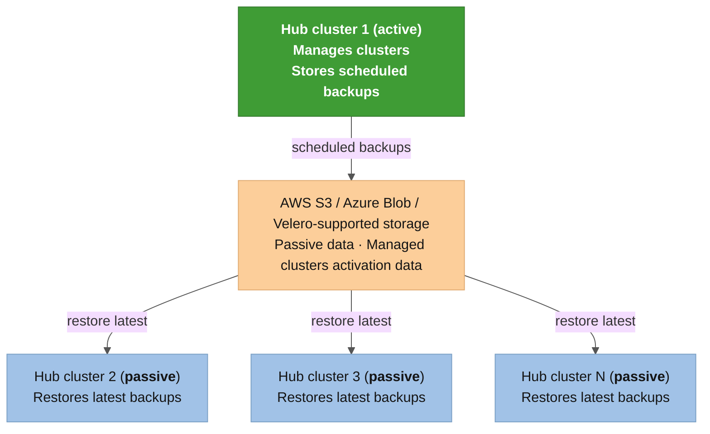

> **Source**: [RHACM 2.17 Business Continuity, &#34;Active passive configuration design&#34;](https://docs.redhat.com/en/documentation/red_hat_advanced_cluster_management_for_kubernetes/2.17/html-single/business_continuity/index#active-passive-config)
> ([official diagram](https://access.redhat.com/webassets/avalon/d/Red_Hat_Advanced_Cluster_Management_for_Kubernetes-2.17-Business_continuity-en-US/images/369a605ec39f04aa262c13a535f2d159/active_passive_config_design.png)).

**What this automation covers**: all **`BackupSchedule`**, **`Restore`**, **`DataProtectionApplication`**,
**`MultiClusterHub`**, and **`ManagedCluster`** reconnection procedures follow the official RHACM Business
Continuity architecture. The pipeline currently operates on a **hub pair** (1 active + 1 passive);
the 1:N multi-passive architecture is supported at the protocol level but has not been tested with
3+ nodes. Where this suite goes beyond the official documentation (explicit backup resolution by
**`clusterID`** instead of **`latest`**, [KCS 7039710](https://access.redhat.com/solutions/7039710) MSA
token sanitization, version compatibility validation, postflight compliance auditing), the
extensions are additive and do not replace or contradict any supported procedure.

### Extensions beyond official documentation

| Capability                                                                       | Description                                                                                              |
| -------------------------------------------------------------------------------- | -------------------------------------------------------------------------------------------------------- |
| Explicit backup resolution by**`clusterID`**                                   | Prevents silent failure after failover+failback cycles when**`latest`** resolves to wrong Hub's backup |
| [KCS 7039710](https://access.redhat.com/solutions/7039710) MSA token sanitization | Discovers and fixes corrupted**`ManagedServiceAccount`** tokens after OADP Restore                     |
| [KCS 5950901](https://access.redhat.com/solutions/5950901) graceful detach        | Clean agent removal on Spoke before Hub-side**`ManagedCluster`** deletion                              |
| Version compatibility validation                                                 | OCP/RHACM version matrix enforcement with skew warnings at Stage 00                                      |
| Convergence wait (Stage 07a)                                                     | Policies and ArgoCD Applications settle before the compliance report                                     |
| Postflight compliance report (Stage 08)                                          | Split-brain detection, policy compliance, GitOps health, add-on verification                             |
| Planned Maintenance Switchover                                                   | Zero-downtime Hub upgrades via DR switchover (failover, upgrade, failback)                               |
| DR Readiness Drills (dry-run)                                                    | Full pipeline with**`check_mode`**/**`diff`** against real clusters, no mutations              |
| Multi-distribution Spoke support                                                 | ARO, AKS, EKS, GKE, IKS, vanilla Kubernetes 1.24+                                                        |

---

## Technical role details

### A. Role [*`acm_dr_hub_setup`*](../../roles/acm_dr_hub_setup)

Ensures declarative installation and desired state of the Hub infrastructure.

* [*`00_preflight.yml`*](../../roles/acm_dr_hub_setup/tasks/00_preflight.yml): Parameter validation, local binaries (**az**, **oc**), **Kubernetes** connectivity, and **ServiceAccount** **RBAC** deployment via the [*`ansible_dr_orchestrator_rbac.yml.j2`*](../../roles/acm_dr_hub_setup/templates/rbac/ansible_dr_orchestrator_rbac.yml.j2) template.
* [*`azure/01_storage.yml`*](../../roles/acm_dr_hub_setup/tasks/azure/01_storage.yml) / [*`aws/01_storage.yml`*](../../roles/acm_dr_hub_setup/tasks/aws/01_storage.yml): Provisioning of cloud storage for OADP backup and Thanos metrics (Azure Storage Accounts or AWS S3 buckets depending on **`acm_dr_hub_setup_cloud_provider`**).
* [*`02_mch_install.yml`*](../../roles/acm_dr_hub_setup/tasks/02_mch_install.yml): Deployment and validation of the **RHACM** operator (**MultiClusterHub**).
* [*`03_observability.yml`*](../../roles/acm_dr_hub_setup/tasks/03_observability.yml): Configuration of **MultiClusterObservability** and **Thanos** secrets.
* [*`04_gitops_argocd.yml`*](../../roles/acm_dr_hub_setup/tasks/04_gitops_argocd.yml): Installation of **Red Hat OpenShift GitOps** and creation of managed **Argo CD** instances.
* [*`05_oadp_dpa.yml`*](../../roles/acm_dr_hub_setup/tasks/05_oadp_dpa.yml): Installation of the **OADP** operator, creation of the **DataProtectionApplication** (**DPA**) resource, and backup scheduling.
* [*`06_validate_hubs.yml`*](../../roles/acm_dr_hub_setup/tasks/06_validate_hubs.yml): Final readiness audit of the Hub infrastructure.

### B. Role [*`acm_dr_failover_manager`*](../../roles/acm_dr_failover_manager)

Core DR orchestration engine for state switching and data protection.

* [*`00_preflight_check.yml`*](../../roles/acm_dr_failover_manager/tasks/00_preflight_check.yml): Initial Hub audit and eligibility verification.
* [*`01_discover_fleet.yml`*](../../roles/acm_dr_failover_manager/tasks/01_discover_fleet.yml): Dynamic discovery of **ManagedCluster** objects linked to the active Hub.
* [*`02_pause_schedule.yml`*](../../roles/acm_dr_failover_manager/tasks/02_pause_schedule.yml): Application of **Logical Fencing** (pausing the **BackupSchedule** on the source Hub to prevent **Split-Brain**).
* [*`03_activate_hub.yml`*](../../roles/acm_dr_failover_manager/tasks/03_activate_hub.yml): Triggering the **OADP/ACM** **Restore** resource on the destination Hub.
* [*`04_verify_spokes.yml`*](../../roles/acm_dr_failover_manager/tasks/04_verify_spokes.yml): Polls until each Spoke reports the **ManagedClusterConditionAvailable: True** condition on the new Hub, confirming **Klusterlet** agent reconnection.
* [*`05_create_schedule.yml`*](../../roles/acm_dr_failover_manager/tasks/05_create_schedule.yml): Activation and creation of the new **BackupSchedule** on the new leader Hub.
* [*`06_detach_old_hub.yml`*](../../roles/acm_dr_failover_manager/tasks/06_detach_old_hub.yml): Removal (**`state: absent`**) of residual **ManagedCluster** objects and forced removal of **finalizers** (ManagedCluster, ObservabilityAddon, ManifestWork, KlusterletAddonConfig) on the old Hub, including unblocking namespaces stuck in **Terminating**.
* [*`07_sanitize_passive_hub.yml`*](../../roles/acm_dr_failover_manager/tasks/07_sanitize_passive_hub.yml): Purges the orphaned **ManagedServiceAccount** and **Secret** (**`auto-import-account`**) per Spoke on the destination Hub and invokes the [*`acm_dr_spoke_manager`*](../../roles/acm_dr_spoke_manager) role to reconnect the fleet. This is the **[KCS 7039710](https://access.redhat.com/solutions/7039710)** mitigation.
* [*`08_postflight_check.yml`*](../../roles/acm_dr_failover_manager/tasks/08_postflight_check.yml): Final compliance report and operational audit.

### C. Role [*`acm_dr_spoke_manager`*](../../roles/acm_dr_spoke_manager)

Isolated lifecycle management of member clusters. Supports **any Kubernetes distribution**: **ARO**, **AKS**, **EKS**, **GKE**, **IKS**, and vanilla **Kubernetes 1.24+**.

* [*`01_spoke_prep.yml`*](../../roles/acm_dr_spoke_manager/tasks/01_spoke_prep.yml): Prepares the **Spoke** for import by injecting the auto-import secret (defined inline in the task) and certificate authority credentials. Auto-detects the Spoke's vendor (OpenShift vs Kubernetes) and cloud provider via the **`Infrastructure`** CR (OCP) or configurable extra vars (non-OCP). Uses **`kubectl`** (not **`oc`**) for Spoke-facing operations, so there is no OCP CLI dependency on the Spoke side.
* [*`02_spoke_detach.yml`*](../../roles/acm_dr_spoke_manager/tasks/02_spoke_detach.yml): Executes graceful **Spoke** removal (**[KCS 5950901](https://access.redhat.com/solutions/5950901)**), removing manifests and cleaning up the **open-cluster-management-agent** namespace on the edge cluster. Distribution-agnostic: uses only standard RHACM and Kubernetes APIs.

### D. Role [*`acm_dr_hub_cleanup`*](../../roles/acm_dr_hub_cleanup)

Inverse of [*`acm_dr_hub_setup`*](../../roles/acm_dr_hub_setup): deactivates a cluster that was elected as a DR node, removing only what pertains to that role, not a blind uninstallation of everything.

* [*`00_preflight.yml`*](../../roles/acm_dr_hub_cleanup/tasks/00_preflight.yml): Safety gates: mandatory explicit confirmation (**`acm_dr_hub_cleanup_confirm=true`**) and protection against accidentally deactivating a Hub that appears to be ACTIVE in production (**BackupSchedule** present and not paused).
* [*`01_gitops_cleanup.yml`*](../../roles/acm_dr_hub_cleanup/tasks/01_gitops_cleanup.yml): Removes Governance/AppDemo **ArgoCD** instances, ApplicationSets, RHACM integration, and RBAC. The Red Hat OpenShift GitOps **Operator** is **preserved**.
* [*`02_oadp_cleanup.yml`*](../../roles/acm_dr_hub_cleanup/tasks/02_oadp_cleanup.yml): Removes **BackupSchedule** and **DataProtectionApplication**. The OADP **Operator** and its namespace are **preserved**.
* [*`03_observability_cleanup.yml`*](../../roles/acm_dr_hub_cleanup/tasks/03_observability_cleanup.yml): Removes **MultiClusterObservability** and its namespace.
* [*`04_mch_acm_cleanup.yml`*](../../roles/acm_dr_hub_cleanup/tasks/04_mch_acm_cleanup.yml): Removes the **MultiClusterHub** and fully uninstalls the **RHACM** operator (Subscription/CSV/OperatorGroup). This is the only operator removed entirely, since ACM is the reason the cluster was a DR node.
* [*`azure/05_storage_cleanup.yml`*](../../roles/acm_dr_hub_cleanup/tasks/azure/05_storage_cleanup.yml) / [*`aws/05_storage_cleanup.yml`*](../../roles/acm_dr_hub_cleanup/tasks/aws/05_storage_cleanup.yml): Optional purge (disabled by default) of cloud storage for OADP backups. Backups are preserved by default because the primary Hub typically still depends on the same shared storage.
* [*`06_automation_rbac_cleanup.yml`*](../../roles/acm_dr_hub_cleanup/tasks/06_automation_rbac_cleanup.yml): Removes the Zero-Trust automation identity (**ansible-automation**/**ansible-dr-orchestrator**), intentionally executed last.

> 📖 See the role's README for the full "what is removed vs. what stays" table and the rationale behind each decision: [*`roles/acm_dr_hub_cleanup`*](../../roles/acm_dr_hub_cleanup).

### E. Role [*`acm_dr_readiness_check`*](../../roles/acm_dr_readiness_check)

Read-only pre-failover gate. Validates both Hub clusters are ready for a failover before any pipeline stage runs a mutation. All five checks are API reads; no cluster state changes. Safe to run on production at any time, including via an AAP scheduled job.

* [*`tasks/main.yml`*](../../roles/acm_dr_readiness_check/tasks/main.yml): Runs the five checks in sequence and emits a one-line summary at the end.
* [*`defaults/main.yml`*](../../roles/acm_dr_readiness_check/defaults/main.yml): All configurable thresholds and pass/fail behavior flags.

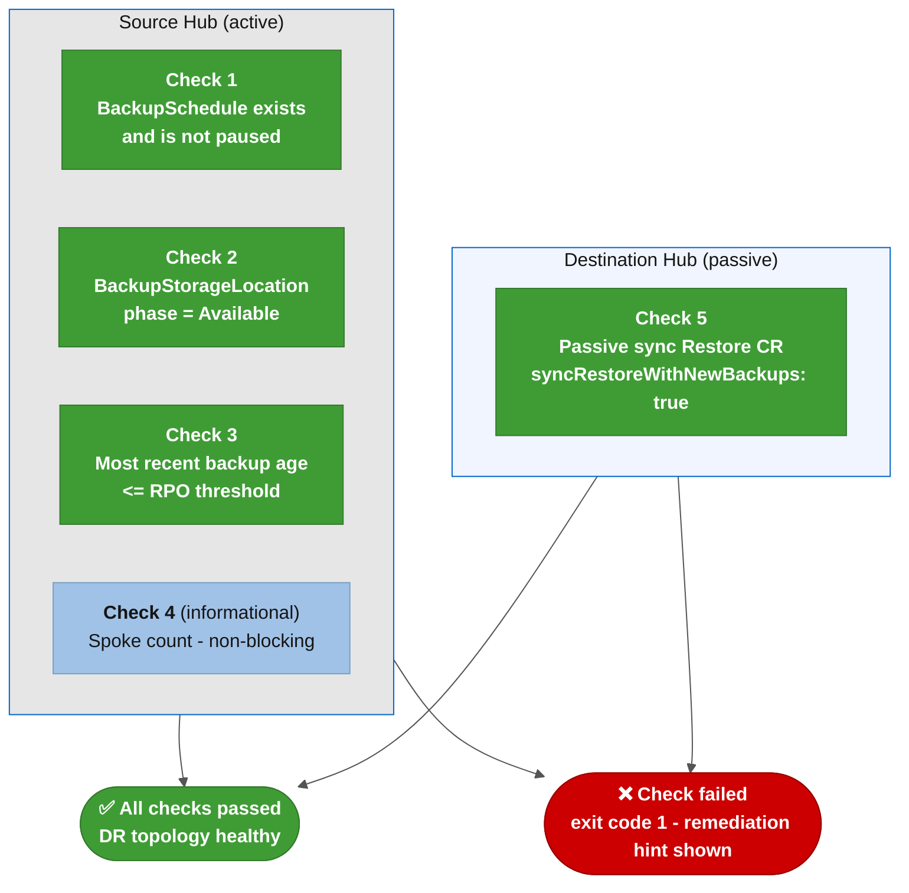

| Check               | What it tests                                                                       | Blocking?                                                           |
| ------------------- | ----------------------------------------------------------------------------------- | ------------------------------------------------------------------- |
| 1: BackupSchedule   | Exists in**`open-cluster-management-backup`** and **`spec.paused=false`** | ❌ Always blocking                                                  |
| 2: BSL availability | At least one BSL is**`phase=Available`**                                          | ❌ Always blocking                                                  |
| 3: Backup freshness | Latest completed backup age ≤**`acm_dr_readiness_check_rpo_seconds`**      | Controlled by**`acm_dr_readiness_check_fail_on_stale_backup`**    |
| 4: Spoke count      | Fleet size vs.**`acm_dr_readiness_check_min_spoke_count`**                  | ⚠️ Always non-blocking                                            |
| 5: Passive Restore  | Sync Restore with**`syncRestoreWithNewBackups: true`** on destination Hub         | Controlled by**`acm_dr_readiness_check_fail_on_missing_restore`** |

**Inputs**: **`k8s_source_context`**, **`k8s_dest_context`** (from AAP credential injection or **`-e`** flags); RPO and fleet thresholds from the AAP Survey or **`-e`** extra-vars.

**Output**: exit 0 when all blocking checks pass; exit 1 with a specific remediation hint on the first failing check.

---

### F. Role [*`acm_dr_kubeconfig_resolver`*](../../roles/acm_dr_kubeconfig_resolver)

Transparent pre-tasks role that assembles a runtime multi-context kubeconfig from per-cluster environment variables injected by AAP custom credential types (or exported locally via [*`examples/scripts/lib/load_cluster_env.sh`*](../../examples/scripts/lib/load_cluster_env.sh)). Every playbook in this collection includes this role in its **`pre_tasks`** block with **`tags: always`**. When no per-cluster env vars are detected, the role does nothing and the playbook falls back to the legacy monolithic **`KUBECONFIG`** / **`K8S_AUTH_KUBECONFIG`** env var.

* [*`tasks/main.yml`*](../../roles/acm_dr_kubeconfig_resolver/tasks/main.yml): Scans env var prefixes, reads the fleet kubeconfig (from file or Hub Secret), renders the runtime kubeconfig, and sets the **`acm_dr_kubeconfig_path`** fact.
* [*`defaults/main.yml`*](../../roles/acm_dr_kubeconfig_resolver/defaults/main.yml): Cluster prefixes to scan, tempfile path, TLS verification behavior, and Hub Secret coordinates.
* [*`templates/runtime_kubeconfig.yml.j2`*](../../roles/acm_dr_kubeconfig_resolver/templates/runtime_kubeconfig.yml.j2): Merges per-cluster entries and fleet contexts into a valid multi-context kubeconfig written to **`/tmp/acm_dr_runtime_kubeconfig.yml`** (mode **`0600`**, **`no_log: true`** on every task that touches tokens).

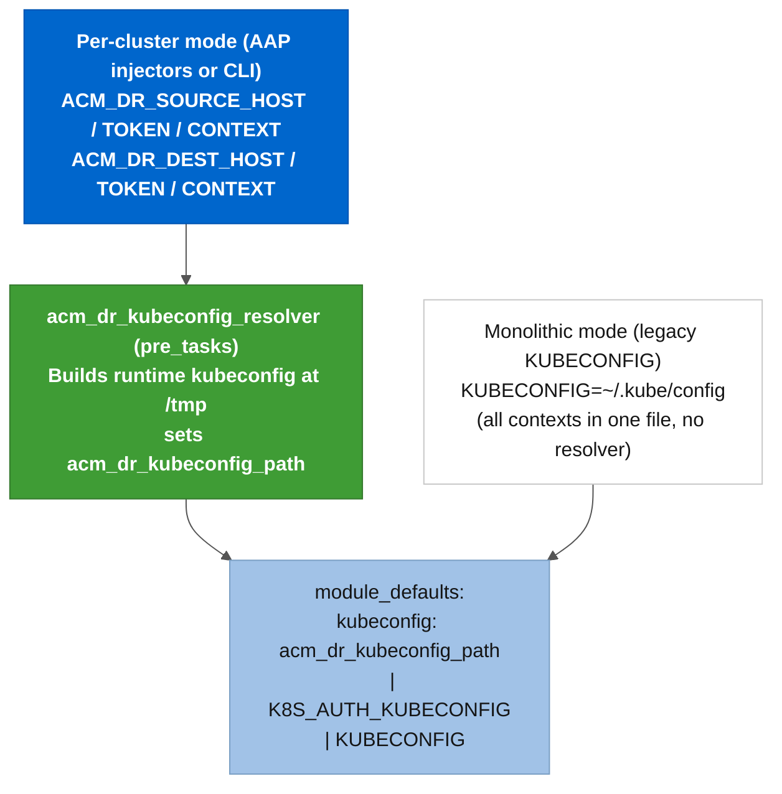

Supported env var prefixes: **`ACM_DR_SOURCE_`** (active Hub), **`ACM_DR_DEST_`** (passive Hub), **`ACM_DR_TARGET_`** (single-target operations), **`ACM_DR_SPOKE_`** (individual Spoke). Each prefix maps to a **`_HOST`**, **`_TOKEN`**, **`_CA_DATA`** (optional), and **`_CONTEXT`** tuple.

The **`spoke-fleet-kubeconfig`** Secret in the Source Hub's **`ansible-automation`** namespace is an internal artifact built automatically by **`spoke_prep`** (task 1.6.2) during initial Spoke onboarding. This role reads it to assemble the orchestrator's runtime kubeconfig from per-cluster contexts. Spoke reconnection during failover uses **Operation C** (Stage 07): the orchestrator reads each Spoke's **`acm-dr-<spoke>-sa-token`** Secret from the Hub's **`ansible-automation`** namespace to obtain the Spoke API endpoint and long-lived **`ansible-dr-orchestrator`** SA bearer token, then reconnects the Spoke via **`auto-import-secret`**. No customer-managed fleet kubeconfig file is needed. The **`ACM_DR_SPOKE_FLEET_KUBECONFIG`** env var is optional and allows overriding the Secret with a pre-built local file for CLI or testing use.

This role has no dependencies outside **`ansible.builtin.*`** and **`kubernetes.core.k8s_info`**. No direct invocation is needed; the **`pre_tasks`** block in every playbook handles it.

---

### G. Role [*`acm_argocd_instance_setup`*](../../roles/acm_argocd_instance_setup)

Fully generic Red Hat OpenShift GitOps (ArgoCD) instance provisioner on an RHACM Hub. Unlike the GitOps setup in Stage 04 of [*`acm_dr_hub_setup`*](../../roles/acm_dr_hub_setup), which creates two fixed instances with hardcoded names and application lists, this role accepts an arbitrary list of instance definitions and creates exactly what the caller describes. No names, namespaces, repositories, or applications are hardcoded in the role.

* [*`tasks/main.yml`*](../../roles/acm_argocd_instance_setup/tasks/main.yml): Conditional dispatcher that runs each provisioning stage only when the relevant variables are provided.
* [*`defaults/main.yml`*](../../roles/acm_argocd_instance_setup/defaults/main.yml): Complete variable dictionary with inline documentation for every parameter.
* [*`templates/`*](../../roles/acm_argocd_instance_setup/templates/): All Kubernetes manifests are parameterized Jinja2 templates. No instance name, namespace, application, or RBAC scope is hardcoded.

The calling playbook passes **`acm_argocd_instances`** as a list and the role loops over it. Each item defines one independent instance:

| Variable                                                       | Required?                 | Description                                                                                                                                |
| -------------------------------------------------------------- | ------------------------- | ------------------------------------------------------------------------------------------------------------------------------------------ |
| **`acm_argocd_instance_setup_name`**                   | Yes                       | Instance name, used as a prefix for all derived resources                                                                                  |
| **`acm_argocd_instance_setup_namespace`**              | Yes                       | Instance namespace                                                                                                                         |
| **`acm_argocd_instance_setup_generator_type`**         | No (default**`none`**)  | **`none`** (instance only), **`list`** (static app list), or **`cluster_decision`** (fan-out via RHACM Placement)  |
| **`acm_argocd_instance_setup_wire_rhacm_integration`** | No (default**`false`**) | Creates**`GitOpsCluster`** and **`ManagedClusterSetBinding`**; required when using the **`cluster_decision`** generator  |
| **`acm_argocd_instance_setup_cluster_admin_rbac`**     | No (default**`false`**) | Grants**`cluster-admin`** to this instance's application controller when the Applications' destination is outside the instance namespace |
| **`acm_argocd_instance_setup_console_link_enabled`**   | No (default**`false`**) | Publishes a shortcut in the OCP Console application menu                                                                                   |

Used by [*`playbooks/manage-argocd-instance.yml`*](../../playbooks/manage-argocd-instance.yml) (JT5) and the **`setup-argocd`** node in WF-03.

---

### H. Role [*`acm_argocd_instance_cleanup`*](../../roles/acm_argocd_instance_cleanup)

Inverse of [*`acm_argocd_instance_setup`*](../../roles/acm_argocd_instance_setup). Removes a named ArgoCD instance from an RHACM Hub without affecting the OpenShift GitOps operator (shared by other instances) or any other existing instance on the cluster.

* [*`tasks/main.yml`*](../../roles/acm_argocd_instance_cleanup/tasks/main.yml): Runs five stages in strict order. The order is not optional; reversing it causes the namespace to get stuck in **`Terminating`**.

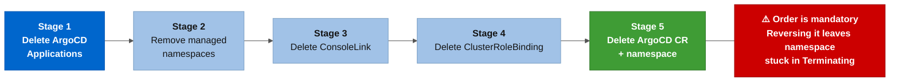

If the ArgoCD CR and its Applications are deleted at the same time, the **`application-controller`** terminates before it can process the **`resources-finalizer.argocd.argoproj.io`** finalizer on the Application objects. The namespace then gets stuck in **`Terminating`** indefinitely. This ordering was discovered and fixed during validation on a real test instance (see [*`roles/acm_argocd_instance_cleanup`*](../../roles/acm_argocd_instance_cleanup) for the full finding).

**Safety gates**: the role requires **`acm_argocd_instance_cleanup_confirm: true`** as an explicit opt-in. **`acm_argocd_instance_cleanup_dry_run: true`** runs the full pipeline via **`check_mode`**/**`diff`**, validating the manifest deletions against the API server without persisting any change.

---

## 🔐 Zero-Trust authentication model (ServiceAccount & Bearer Token)

To prevent failures in scheduled executions or **CI/CD** pipelines caused by human token expiration, the automation establishes the **Zero-Trust** pattern:

* **Dedicated Namespace**: All automation objects reside in the **ansible-automation** namespace.
* **Persistent Identity**: The **ServiceAccount** **ansible-dr-orchestrator** is created and bound to the **ClusterRoleBinding** **ansible-dr-orchestrator-admin** with **cluster-admin** privileges.
* **Long-Lived Secret**: An authentication token of type **kubernetes.io/service-account-token** is generated and associated with the **ServiceAccount** (**ansible-dr-orchestrator-token**).
* **Context Taxonomy**: The provisioning script generates contexts in the local **KUBECONFIG** using the **`-sa`** suffix (e.g., **acm-primary-hub-sa**, **acm-dr-hub-sa**, **aro-spoke-01-sa**, **aks-spoke-01-sa**, **eks-spoke-01-sa**, **gke-spoke-01-sa**).

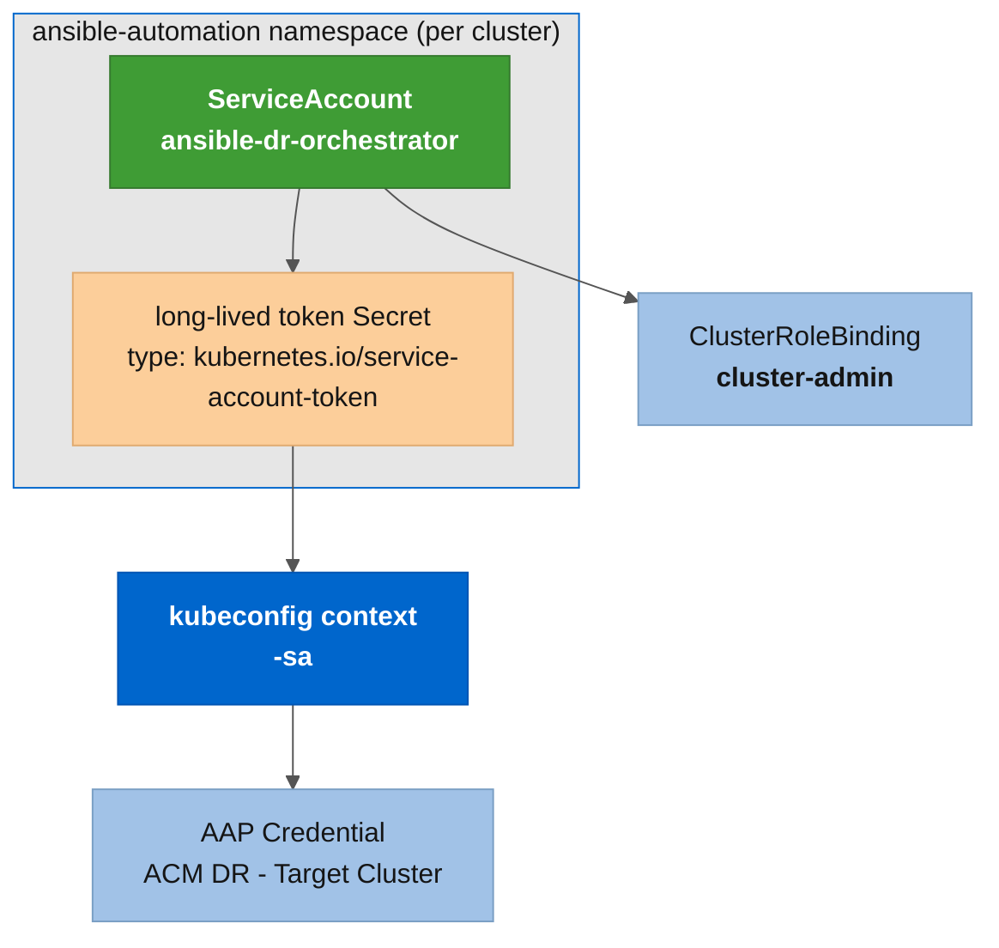

---

## 🌐 Complete failover and failback pipeline flow

The [*`orchestrate-dr-failover.yml`*](../../playbooks/orchestrate-dr-failover.yml) orchestrator executes a unified pipeline across 9 chained stages (00-08), with a **manual confirmation gate** between Fencing and the destination Hub Activation:

```mermaid
%%{init: {"theme": "base", "themeVariables": {"lineColor": "#555555"}, "flowchart": {"htmlLabels": true}}}%%
flowchart LR
    classDef primary   fill:#3f9c35,stroke:#357a2e,color:#fff,font-weight:bold
    classDef secondary fill:#a1c2e7,stroke:#7a9fc4,color:#151515
    classDef tertiary  fill:#fcce9a,stroke:#e0aa70,color:#151515
    classDef header    fill:#06c,stroke:#0055b3,color:#fff,font-weight:bold
    classDef decision  fill:#f5f5f5,stroke:#aaaaaa,color:#151515
    classDef external  fill:#ffffff,stroke:#c8c8c8,color:#151515
    classDef success   fill:#3f9c35,stroke:#357a2e,color:#fff,font-weight:bold
    classDef danger    fill:#cc0000,stroke:#990000,color:#fff,font-weight:bold
    classDef warn      fill:#fcce9a,stroke:#e0aa70,color:#151515,font-weight:bold
    S00["<b>Stage 00</b><br/>Preflight<br/>Safety guard"]:::header
    S01["<b>Stage 01</b><br/>Discover fleet<br/>ManagedCluster list"]:::secondary
    S02["<b>Stage 02</b><br/>Logical fencing<br/>BackupSchedule paused"]:::warn
    GATE{"POINT OF NO RETURN<br/>Interactive approval<br/>(skip_gates=true to bypass)"}:::decision
    S02a["<b>Stage 02a</b><br/>Pre-restore cleanup<br/>Terminating NS + stale Restore CRs"]:::secondary
    S03["<b>Stage 03</b><br/>Activate Hub<br/>Restore CR - OP-11 rollback on fail"]:::primary
    S04["<b>Stage 04</b><br/>Sanitize MSA tokens<br/>KCS 7039710 purge"]:::secondary
    S05["<b>Stage 05</b><br/>Verify Spokes<br/>ManagedClusterAvailable poll"]:::secondary
    S06["<b>Stage 06</b><br/>Protect new leader<br/>BackupSchedule + collision guard"]:::primary
    S06a["<b>Stage 06a</b><br/>Recycle additional hubs<br/>N-passive topology"]:::tertiary
    S07["<b>Stage 07</b><br/>Isolate old Hub<br/>Detach + force finalizers"]:::secondary
    S07a["<b>Stage 07a</b><br/>Convergence wait<br/>Policies + ArgoCD"]:::secondary
    S08["<b>Stage 08</b><br/>Integrity audit<br/>Compliance report"]:::success
    S00 --> S01 --> S02 --> GATE
    GATE -->|approved| S02a
    GATE -->|denied / timeout| ABORT(["❌ Aborted<br/>no Hub activation"]):::danger
    S02a --> S03 --> S04 --> S05 --> S06
    S06 --> S06a
    S06 --> S07 --> S07a --> S08
```

* **STAGE 00 - Preflight & Safety Guard**: Validates connectivity, **cluster-admin** permissions, and analyzes **BackupSchedule** health. Prevents execution if the source Hub is isolated or if the destination Hub does not have the DR infrastructure provisioned. Also warns (without blocking) if there are ArgoCD Applications or custom Grafana Dashboards on the source without the backup label.
* **STAGE 01 - Discover Fleet**: Dynamically discovers all active **ManagedCluster** objects on the source Hub.
* **STAGE 02 - Logical Fencing**: Pauses the **BackupSchedule** (**`spec.paused: true`**) on the source Hub, freezing the backup state in storage and preventing **Split-Brain**.
* **🚦 GATE - Manual Confirmation Point**: Interactive pause ("POINT OF NO RETURN") before proceeding with DR Hub activation. Skippable via **`-e skip_gates=true`** for CI/CD automation.
* **STAGE 03 - Activate Hub / Restore**: Explicitly resolves (by **`clusterID`**, not the **`latest`** string) the credentials/resources/managed-clusters backups genuinely originating from the source Hub, purges old restores on the destination Hub, and applies the **Restore** Custom Resource (**`cleanupBeforeRestore: CleanupRestored`**), restoring the **RHACM** control plane. See [explicit backup resolution](#-real-world-finding-why-we-do-not-blindly-trust-acms-latest) below for the rationale.
* **STAGE 04 - Verify Spokes**: Polls until each Spoke reports the **`ManagedClusterConditionAvailable: True`** condition on the new Hub, confirming reconnection before protecting the new leader.
* **STAGE 05 - Protect New Leader**: Enables and activates the **BackupSchedule** resource (**`paused: false`**) on the new leader Hub.
* **STAGE 06 - Detach Old Hub**: Removes (**`state: absent`**) residual **ManagedCluster** objects on the source and forces removal of **finalizers** (**`ManagedCluster`**, **`ObservabilityAddon`**, **`ManifestWork`**, **`KlusterletAddonConfig`**), as well as unblocking namespaces stuck in **`Terminating`** on the old Hub.
* **STAGE 07 - Sanitize Passive Hub & Reconnect Fleet**: Dynamically discovers (by **`TokenReported: False`** condition, not by fixed name) and purges the corrupted **ManagedServiceAccount** and **Secret** per Spoke on the destination Hub ([KCS 7039710](https://access.redhat.com/solutions/7039710) mitigation). The orchestrator then reads each Spoke's **`acm-dr-<spoke>-sa-token`** Secret from the **`ansible-automation`** namespace on the Hub to obtain the Spoke API endpoint and long-lived **`ansible-dr-orchestrator`** SA bearer token, then invokes the [*`acm_dr_spoke_manager`*](../../roles/acm_dr_spoke_manager) role to reconnect the Spoke via **`auto-import-secret`** (Operation C). No fleet kubeconfig file is needed by the customer.
* **STAGE 08 - Postflight Audit & Report**: Analyzes the final fleet state (Add-ons, governance **Policies**, ArgoCD/GitOps **Applications**, **PlacementDecisions**, and custom Grafana **Dashboards**), detects residual **Split-Brain** scenarios, and generates the consolidated compliance report.

---

## 🔍 Failover state diagnostic (`diagnose-failover-state.yml`)

[*`playbooks/diagnose-failover-state.yml`*](../../playbooks/diagnose-failover-state.yml) runs automatically as a failure branch in the **WF - ACM DR - LAB - Full Failover Drill** workflow. It probes both Hub clusters and classifies the system into one of six mutually exclusive states, then POSTs a structured report to the configured webhook (Slack, Teams, or generic JSON).

The playbook is read-only and always exits `rc=0`. It never attempts remediation, so it is safe to run against clusters in any state, including mid-failover.

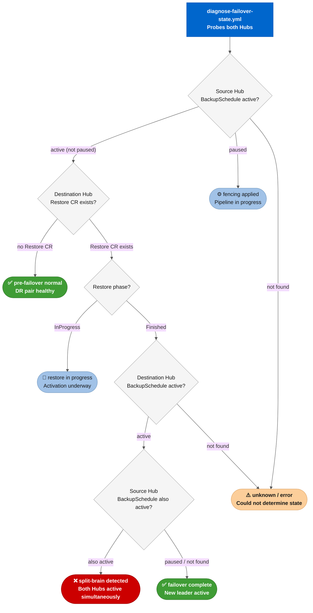

| State                          | Condition                                                                      | Recommended action                                                                                       |
| ------------------------------ | ------------------------------------------------------------------------------ | -------------------------------------------------------------------------------------------------------- |
| **pre-failover normal**  | Source**BackupSchedule** active; no **Restore** on Dest            | No action needed. DR pair is healthy.                                                                    |
| **fencing applied**      | Source**BackupSchedule** paused; no completed **Restore** on Dest  | Pipeline stopped mid-flight after fencing. Inspect the failed job node before retrying. Do not re-fence. |
| **restore in progress**  | Source fenced;**Restore** CR on Dest with phase `InProgress`           | Wait for the**Restore** to complete before any intervention.                                       |
| **failover complete**    | Source fenced;**Restore** complete; Dest **BackupSchedule** active | Failover succeeded. Post-restore stages (Spoke reconnection, audit) may still need attention.            |
| **split-brain detected** | Both Hubs have an active**BackupSchedule** simultaneously                | Critical. Stop both pipelines, fence one Hub manually, and run the diagnostic again before proceeding.   |
| **unknown / error**      | None of the above patterns matched                                             | Review the raw probe results in the webhook notification and consult the runbook for manual assessment.  |

---

## ⚡ Failover technical mitigation and [KCS 7039710](https://access.redhat.com/solutions/7039710) bug resolution

### The known issue ([KCS 7039710](https://access.redhat.com/solutions/7039710))

During the restoration of the **RHACM** control plane on the Secondary Hub via **OADP/Velero**, the **ManagedServiceAccount** resources (e.g., **auto-import-account**) are restored on the new Hub. However, the communication token renewal with the **Spoke** clusters fails critically with the following error message:

```text
message: 'failed to update the token secret: secrets "auto-import-account" is forbidden: cannot set an ownerRef on a resource you can''t delete: , <nil>'
reason: TokenReportFailed
status: "False"
type: TokenReported
```

### Root cause

The **Secret** restored by **Velero** on the new Hub carries backup annotations and **ownerReferences** containing the **UID** of the **old Primary Hub's** API server. The **RHACM** controller on the new Hub lacks authority to overwrite or delete a resource whose **ownerRef** points to a **UID** that does not exist in the current cluster, resulting in token renewal being blocked and the **Spoke** fleet becoming isolated.

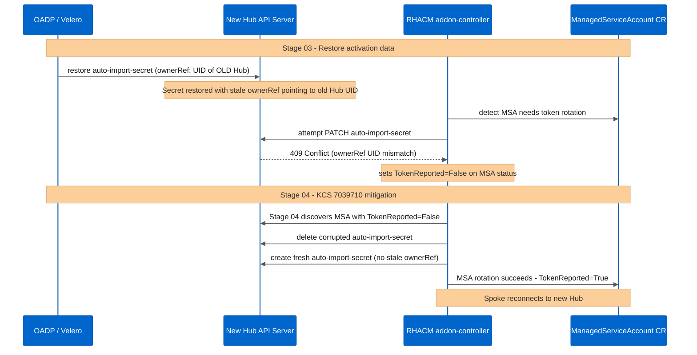

> **Scope**: the bug affects all cluster types (OCP, ARO, AKS, EKS, GKE, IKS), not only non-OCP clusters - confirmed by live lab testing on 2026-08-23.
>
> **Fix availability**: ACM 2.17.1 is the only version that contains the fix. Red Hat has **not** backported it to ACM 2.14, 2.15, or 2.16. If you hit this bug on any of those versions, you must upgrade to at least ACM 2.17 (and then apply 2.17.1). On ACM < 2.17.1, Stage 07 of this automation is the only protection. See the dedicated runbook at [*`docs/runbook/acm-38215-auto-import-account.md`*](../runbook/acm-38215-auto-import-account.md) for diagnosis, manual suppression, and upgrade steps.

### Solution strategy implemented in code

The automation resolves this issue through two complementary mechanisms, executed during **STAGE 07 (Sanitize Passive Hub & Reconnect Fleet)** of the pipeline:

1. **Dynamic Purge of the Corrupted Token in [*`acm_dr_failover_manager`*](../../roles/acm_dr_failover_manager) (Task [*`07_sanitize_passive_hub.yml`*](../../roles/acm_dr_failover_manager/tasks/07_sanitize_passive_hub.yml))**:
   The role **does not assume a fixed name** (the object may be called **`auto-import-account`**, **`auto-import-account-pair`**, or something else depending on the RHACM/MSA addon version; we have observed this in practice). Instead, it discovers all **`ManagedServiceAccount`** objects in each Spoke namespace on the destination Hub and purges (along with the corresponding **`Secret`**) exactly those exhibiting the **`status.conditions[type=TokenReported].status: "False"`** condition, the exact symptom of [KCS 7039710](https://access.redhat.com/solutions/7039710), eliminating the broken **ownerRef** before any reconnection attempt.
2. **Clean Kubeconfig Re-injection via [*`acm_dr_spoke_manager`*](../../roles/acm_dr_spoke_manager) (Task [*`01_spoke_prep.yml`*](../../roles/acm_dr_spoke_manager/tasks/01_spoke_prep.yml))**:
   The automation provisions a temporary **`cluster-admin`** **ServiceAccount** directly on the Spoke, extracts its token, and publishes a new **`auto-import-secret`** Secret on the destination Hub (defined inline in the task, without depending on a template):

```yaml
apiVersion: v1
kind: Secret
metadata:
  name: auto-import-secret
  namespace: {{ acm_dr_spoke_manager_cluster_name }}
type: Opaque
stringData:
  autoImportRetry: "5"
  kubeconfig: |
    apiVersion: v1
    kind: Config
    clusters:
    - cluster:
        insecure-skip-tls-verify: true
        server: {{ acm_dr_spoke_manager_api_url }}
      name: {{ acm_dr_spoke_manager_cluster_name }}
    users:
    - name: {{ acm_dr_spoke_manager_cluster_name }}-admin
      user:
        token: {{ acm_dr_spoke_manager_api_token }}
```

By applying this new Secret, **RHACM** re-executes the auto-import flow using valid, freshly issued Spoke credentials, re-establishing the **Klusterlet** agent connection with the activated Hub and clearing the **TokenReportFailed** status.

---

## 🏷 GitOps labeling governance (Argo CD)

To ensure that restoration on the DR Hub occurs without synchronization conflicts in **Red Hat OpenShift GitOps**, apply the labeling policy below to corporate manifests:

* **Velero Exclusion Removal**: Ensure that the **`velero.io/exclude-from-backup: true`** label is **NOT** present on essential resources that need to be recovered during DR.
* **On-Demand Sync Label (**`cluster-activation`**)**: Apply **`cluster.open-cluster-management.io/backup: cluster-activation`** to **Application** and **ApplicationSet** objects. These objects will be restored on the DR Hub **only** during the failover event, preventing premature passive restores.
* **Passive Sync Label (**`cluster`**)**: Apply **`cluster.open-cluster-management.io/backup: cluster`** to **Secrets** and infrastructure credentials. These objects are continuously synchronized to keep the DR Hub pre-positioned.

> 🛡️ **Automatic validation**: Stage 00 of [*`acm_dr_failover_manager`*](../../roles/acm_dr_failover_manager) checks the source Hub for ArgoCD Applications **without** the **`cluster-activation`** label and warns before failover. It does not wait for you to discover this after the fact, with an empty GitOps on the new Hub.

### Observability and custom Grafana dashboards

The **default RHACM dashboards** (cluster overview, alerts, resource usage, etc.) **require no special DR handling**. They are automatically recreated by the **MultiClusterObservability** operator as soon as Observability is installed on any Hub (via the [*`acm_dr_hub_setup`*](../../roles/acm_dr_hub_setup) role). We confirmed this in practice: the DR Hub already had the complete set of default dashboards before any Restore had been executed to it.

**Custom dashboards created by the customer are a different matter.** There are three possible scenarios:

1. **Created directly in the Grafana UI**: resides only in Grafana's internal database, **is not a Kubernetes object**, and therefore **is not captured by Velero at all**. It will be lost in any failover, without exception. No automation can resolve this after the fact; the only solution is not to create important dashboards solely through the UI.
2. **Created as a ConfigMap, but without the backup label**: it is a real Kubernetes object, but Velero only captures what is labeled. Without the correct label, it will also be lost.
3. **Created as a ConfigMap with the correct backup label**: survives failover normally, along with the rest of the resource backup. **We tested this scenario end-to-end against real clusters** (creation, backup, real failover, confirmation on the new Hub) and confirmed that it works, but only after we fixed a real issue in resolving which backup to use. See [explicit backup resolution](#-real-world-finding-why-we-do-not-blindly-trust-acms-latest) for the details.

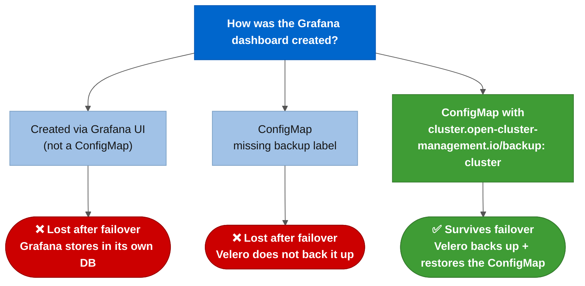

**Convention observed in real customer environments**: custom dashboards use the **`grafana-custom-dashboard: "true"`** label in the Observability namespace (e.g., **`open-cluster-management-observability`**) to differentiate themselves from operator default dashboards. The ConfigMap name itself can be anything. **To ensure they survive DR, also apply**:

```yaml
apiVersion: v1
kind: ConfigMap
metadata:
  name: custom-dashboard-<descriptive-name>
  namespace: open-cluster-management-observability
  labels:
    grafana-custom-dashboard: "true"
    cluster.open-cluster-management.io/backup: "cluster"
data:
  <filename>.json: |
    { ... Grafana dashboard JSON ... }
```

> 🛡️ **Automatic validation**: Stage 00 of [*`acm_dr_failover_manager`*](../../roles/acm_dr_failover_manager) checks the source Hub for how many custom Dashboards (via the **`grafana-custom-dashboard=true`** label) exist and how many **do not** have the backup label, warning before failover. Stage 08 audits the same on the destination Hub after failover.

---

## 🔎 Dry-run mode: safe rehearsal of the complete pipeline

By passing **`-e acm_dr_failover_manager_dry_run=true`**, the entire pipeline (00-08) is executed against real clusters **without applying any changes**:

* **Mutating tasks run in **`check_mode`** (**`kubernetes.core.k8s`**, **`kubernetes.core.k8s_json_patch`**, **`shell`**/**`command`** tasks), using Kubernetes API-native **`dryRun=All`**. The change is validated by the server and the **diff** is displayed in the output, but never persisted.
* **The "SAFE AGAINST REVERSAL" validation (Stage 00) runs identically in dry-run and real execution.** No safety check is weakened in simulation mode; if the specified direction is wrong (source Hub already paused), the dry-run fails exactly as it would in a real execution.
* **Steps that depend on state that would only exist after a real change** (waiting for the **`Restore`** to complete, waiting for the Spoke to reconnect, reconnecting the fleet via **`acm_dr_spoke_manager`**) are not executed. Instead, they print a **`🔎 [DRY-RUN]`** message explaining exactly what would happen.
* **The final report (Stage 08)** identifies the execution mode at the top (**`🔎 DRY-RUN`** or **`🔥 PRODUCTION`**) and does not report as an anomaly the fact that the old Hub still has its Spokes registered. In dry-run this is expected, since nothing was actually removed.

```bash
ansible-playbook playbooks/orchestrate-dr-failover.yml \
  -e "failover_direction=acm-primary-hub-sa_to_acm-dr-hub-sa" \
  -e "acm_dr_failover_manager_dry_run=true" \
  -e "skip_gates=true"
```

The interactive script [*`examples/scripts/dr-orchestrator/run_failover.sh`*](../../examples/scripts/dr-orchestrator/run_failover.sh) also prompts for the execution mode. **Dry-run is the default option when pressing ENTER**, requiring explicit confirmation (**`n`**) to run in production.

> **Recommendation**: always run in dry-run mode before a real failover, especially after any changes to the role or OADP/Velero manifests.

---

## 🔬 Real-world finding: why we do not blindly trust ACM's **`latest`**

**What**: the RHACM **`Restore`** accepts **`veleroCredentialsBackupName`**/**`veleroResourcesBackupName`**/**`veleroManagedClustersBackupName`** as **`latest`**, **`skip`**, or an explicit name. By default, everyone uses **`latest`**, including us, until we tested thoroughly.

**Why this is a real problem**: **`latest`** selects the most recent backup **across the entire shared storage** (Azure Blob, in our case), without distinguishing which Hub produced it. This works perfectly in the most common use case (Primary Hub always active, DR Hub in cold-standby that never produced its own backup), but **breaks silently** as soon as both sides of the pair have produced backups at some point (i.e., after the first failover **and** failback, or during frequent DR drills): the "most recent" backup may be a self-backup from **the destination Hub itself**, from a period when it was active, not a backup from the source Hub that you actually want to restore.

**How we validated this in practice** (this is not theoretical; we reproduced and fixed it live against real clusters):

1. We created a custom dashboard **`ConfigMap`**, correctly labeled with **`cluster.open-cluster-management.io/backup: cluster`**, on the active Hub.
2. We confirmed via **the Velero pod's own logs** that the backup captured the object correctly (the labeling works).
3. We confirmed, via a raw Velero **`Restore`** referencing a specific backup by name, that **the restore mechanism works perfectly** when you point to the correct backup.
4. We isolated and reproduced the problem: an ACM **`Restore`** with **`veleroCredentialsBackupName: latest`** resolved to a backup that **did not contain** the ConfigMap, because that backup, despite being the most recent in storage, had been produced by the destination Hub itself, not by the source.
5. We implemented the fix (explicit resolution, below), ran the **same test again, end-to-end, in real production**, and confirmed that the dashboard survived the failover and appeared correctly audited in the final report as **`🟢 SAFE`**.

**The fix, explicit resolution by **`clusterID`**: before creating the `Restore`**, Stage 03 now:

1. Reads the **`ClusterVersion.spec.clusterID`** from the source Hub (the stable OpenShift cluster identifier. We discovered through testing that **this** is the field the ACM backup controller uses in the **`cluster.open-cluster-management.io/backup-cluster`** label, not the **`kube-system`** namespace UID as we initially assumed).
2. Searches, for each category (credentials/resources/managed-clusters), the **`Backup`** objects whose **`cluster.open-cluster-management.io/backup-cluster`** label matches this **`clusterID`**. That is, **backups genuinely produced by the source**, not merely synchronized to shared storage.
3. Sorts by **`creationTimestamp`** and uses the explicit name of the most recent **`Completed`** backup in each category, instead of the **`latest`** string.
4. If nothing is found (new environment, no bidirectional history yet), falls back to **`latest`** automatically, without breaking compatibility with ACM's default behavior.

Controllable via **`acm_dr_failover_manager_resolve_explicit_backup`** (default **`true`**).

---

## 🔄 Planned Maintenance Switchover: zero-downtime Hub upgrades

The same failover/failback pipeline used for disaster recovery can be used as a **zero-downtime upgrade strategy** for Hub clusters. Instead of upgrading the active Hub in-place (with maintenance windows, risk of a failed upgrade leaving the fleet unmanaged, and rollback complexity), failover the fleet to the standby Hub, upgrade the now-idle Hub at leisure, validate it, then failback. The fleet never loses its managing Hub.

This is the same pattern used by banks, telcos, and critical infrastructure operators for control-plane upgrades. The collection already supports both directions of the switchover. No additional roles, playbooks, or configuration changes are needed.

> **Planned Maintenance Switchover in practice**: to upgrade a Hub without downtime, run the standard failover pipeline ([*`orchestrate-dr-failover.yml`*](../../playbooks/orchestrate-dr-failover.yml)) to move the fleet to the DR Hub, perform the ACM/OCP upgrade on the now-idle Hub through normal channels (operator channel switch, **`oc adm upgrade`**, etc.), validate the upgraded Hub is healthy, then run the failback pipeline. The collection handles the fleet state transfer, Spoke reconnection, and backup schedule management. The upgrade itself is performed through standard Red Hat tooling, keeping concerns cleanly separated.

### Pre-conditions

Before executing a Planned Maintenance Switchover upgrade:

1. **Both Hubs are DR-ready**: provisioned via [*`setup-acm-dr-hub.yml`*](../../playbooks/setup-acm-dr-hub.yml), with MCH **`Running`**, OADP/DPA configured, and BSL **`Available`**.
2. **Shared backup storage is accessible** from both Hubs (Azure Blob Storage in the current architecture).
3. **At least one successful failover/failback cycle validated** (either dry-run or real), so the DR pipeline is proven for your environment.
4. **RHACM/OCP version compatibility verified** against the [matrix below](#rhacmocp-version-compatibility-matrix). The new RHACM version must support the OCP version running on BOTH Hubs and all Spoke clusters.
5. **Stage 00 preflight version checks are enabled** (**`acm_dr_failover_manager_version_check: true`**, the default). The pipeline now automatically queries and displays OCP/RHACM versions on both Hubs and warns about version skew before proceeding.

### The 5-step workflow

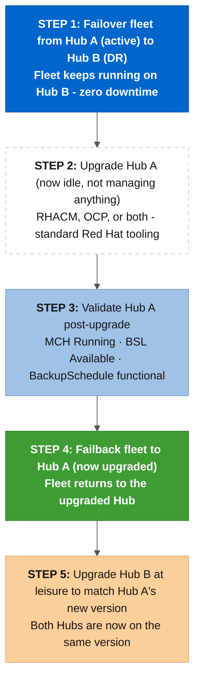

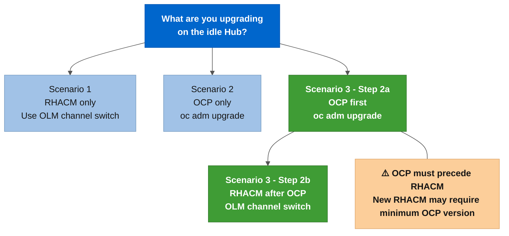

### Scenario 1: RHACM-only upgrade (e.g., 2.14 to 2.15, same OCP)

```bash
# Step 1: Failover fleet from Hub A to Hub B
ansible-playbook playbooks/orchestrate-dr-failover.yml \
  -e "failover_direction=acm-primary-hub-sa_to_acm-dr-hub-sa" \
  -e "acm_dr_failover_manager_dry_run=false" \
  -e "skip_gates=true"

# Step 2: Upgrade RHACM on Hub A (now idle), change the operator channel
#   Option A: Via CLI
#   oc patch Subscription advanced-cluster-management \
#     -n open-cluster-management --type merge \
#     -p '{"spec":{"channel":"release-2.15"}}' \
#     --context=acm-primary-hub-sa
#
#   Option B: Via OCP Console → Operators → Installed Operators → ACM → Subscription → Channel

# Step 3: Validate Hub A is healthy post-upgrade
#   oc get mch -A --context=acm-primary-hub-sa
#   → Verify status.phase: Running, status.currentVersion: 2.15.x
#   oc get backupstoragelocation -n open-cluster-management-backup --context=acm-primary-hub-sa
#   → Verify status.phase: Available

# Step 4: Failback fleet to Hub A (now upgraded)
ansible-playbook playbooks/orchestrate-dr-failover.yml \
  -e "failover_direction=acm-dr-hub-sa_to_acm-primary-hub-sa" \
  -e "acm_dr_failover_manager_dry_run=false" \
  -e "skip_gates=true" \
  -e "allow_fenced_origin=true"

# Step 5: Upgrade Hub B to RHACM 2.15 at leisure (same process as Step 2)
```

### Scenario 2: OCP-only upgrade (e.g., 4.18 to 4.20, same RHACM)

```bash
# Step 1: Failover (same as Scenario 1)
ansible-playbook playbooks/orchestrate-dr-failover.yml \
  -e "failover_direction=acm-primary-hub-sa_to_acm-dr-hub-sa" \
  -e "acm_dr_failover_manager_dry_run=false" \
  -e "skip_gates=true"

# Step 2: Upgrade OCP on Hub A (now idle)
#   oc adm upgrade --to=4.20.x --context=acm-primary-hub-sa
#   (or use the OCP Console → Administration → Cluster Settings → Update)

# Step 3: Validate (oc get clusterversion --context=acm-primary-hub-sa)
# Step 4: Failback (same as Scenario 1, Step 4)
# Step 5: Upgrade Hub B OCP at leisure
```

### Scenario 3: both OCP + RHACM upgrade

When upgrading **both** OCP and RHACM on the same Hub, the order matters: upgrade OCP **first**, then RHACM, because the new RHACM version may require a minimum OCP version (e.g., RHACM 2.15 requires at least OCP 4.18).

```bash
# Step 1: Failover (same as above)

# Step 2a: Upgrade OCP on Hub A first
#   oc adm upgrade --to=4.20.x --context=acm-primary-hub-sa
#   Wait for ClusterVersion to report Completed

# Step 2b: Then upgrade RHACM on Hub A
#   oc patch Subscription advanced-cluster-management \
#     -n open-cluster-management --type merge \
#     -p '{"spec":{"channel":"release-2.15"}}' \
#     --context=acm-primary-hub-sa
#   Wait for MCH status.phase: Running

# Steps 3-5: Same as above
```

### RHACM/OCP version compatibility matrix

Before planning a Planned Maintenance Switchover upgrade, verify that the target RHACM version supports the OCP versions running on **both Hubs** and all **Spoke** clusters:

|    RHACM Version    | Supported OCP (Hub & Managed Clusters) | MCE Version | Support Matrix                                                                               |
| :------------------: | :------------------------------------- | :---------: | :------------------------------------------------------------------------------------------- |
|    **2.10**    | 4.13, 4.14, 4.15, 4.16                 |     2.5     | [KCS 7055998](https://access.redhat.com/articles/7055998)                                     |
| **2.11** (EUS) | 4.14, 4.15, 4.16, 4.17                 |     2.6     | [KCS 7073065](https://access.redhat.com/articles/7073065)                                     |
|    **2.12**    | 4.15, 4.16, 4.17, 4.18                 |     2.7     | [KCS 7086905](https://access.redhat.com/articles/7086905)                                     |
|    **2.13**    | 4.16, 4.17, 4.18, 4.19                 |     2.8     | [KCS 7099672](https://access.redhat.com/articles/7099672)                                     |
|    **2.14**    | 4.17, 4.18, 4.19, 4.20                 |     2.9     | [KCS 7120842](https://access.redhat.com/articles/7120842)                                     |
|    **2.15**    | 4.18, 4.19, 4.20, 4.21                 |    2.10    | [KCS 7133095](https://access.redhat.com/articles/7133095)                                     |
|    **2.16**    | 4.19, 4.20, 4.21, 4.22                 |    2.11    | [KCS 7136928](https://access.redhat.com/articles/7136928)                                     |
|    **2.17**    | 4.20, 4.21, 4.22, 4.23                 |    2.12    | [ACM lifecycle](https://access.redhat.com/support/policy/updates/advanced-cluster-management) |

**Key rules**:

* Each RHACM version supports the most recent OCP version + 2 previous versions.
* Each RHACM version also supports **the very next OCP version** released after the RHACM GA date.
* RHACM is **not supported** on OCP versions that have reached end-of-life.
* Hub and managed clusters share the same supported OCP version range.
* Full lifecycle dates: [Red Hat ACM Lifecycle &amp; Update Policy](https://access.redhat.com/support/policy/updates/advanced-cluster-management).

### Real-world version skew scenarios

These scenarios illustrate why version compatibility matters during a Planned Maintenance Switchover, and why the pipeline checks and warns about version skew at Stage 00:

| Scenario    | Hub OCP | Hub RHACM |  Spoke OCP  |   Supported?   | Why                                                                                              |
| :---------- | :-----: | :-------: | :---------: | :-------------: | :----------------------------------------------------------------------------------------------- |
| **A** |  4.18  |   2.13   |    4.20    | ❌**No** | RHACM 2.13 only supports managed clusters up to OCP 4.19. Cannot manage 4.20 Spokes.             |
| **B** |  4.18  |   2.14   |    4.20    | ✅**Yes** | RHACM 2.14 supports managed clusters up to OCP 4.20. No Hub OCP upgrade needed.                  |
| **C** |  4.20  |   2.14   | 4.18 + 4.20 | ✅**Yes** | RHACM 2.14 supports OCP 4.17-4.20 for both Hub and managed clusters. Mixed fleet is fine.        |
| **D** |  4.18  |   2.14   | 4.18 + 4.20 | ✅**Yes** | Same as B. The Hub's own OCP version does not need to match the Spokes. RHACM 2.14 manages both. |
| **E** |  4.16  |   2.14   |    4.20    | ❌**No** | RHACM 2.14 supports Hub OCP 4.17-4.20. OCP 4.16 is below the minimum Hub OCP for RHACM 2.14.     |

> **Takeaway**: the Hub's OCP version does not need to match the Spokes' OCP version. What matters is that the **RHACM version** supports **both** the Hub OCP and the managed cluster OCP range. Always check the support matrix before upgrading.

### Cross-version backup/restore caveat

During a Planned Maintenance Switchover, there is a temporary period where the two Hubs run different RHACM (and possibly OCP) versions. The failover/failback pipeline performs OADP Restore operations that cross this version boundary:

* **Forward restore** (newer RHACM restoring an older backup): Generally supported. RHACM 2.15 restoring a backup produced by RHACM 2.14 is the expected upgrade path.
* **Backward restore** (older RHACM restoring a newer backup): Requires caution. If Hub B still runs RHACM 2.14 and Hub A has been upgraded to 2.15, a failback to Hub A is forward (safe), but a disaster failover from Hub A back to Hub B would be backward. **Complete Step 5 (upgrade Hub B) promptly** to eliminate this risk window.

> 🛡️ **Automatic validation**: Stage 00 of [*`acm_dr_failover_manager`*](../../roles/acm_dr_failover_manager) now queries OCP (**`ClusterVersion`**) and RHACM (**`MultiClusterHub`**) versions on both Hubs and displays a version comparison banner. When versions differ, it warns prominently about the version skew and references the compatibility matrix, before any mutation occurs. Controllable via **`acm_dr_failover_manager_version_check`** (default **`true`**).
