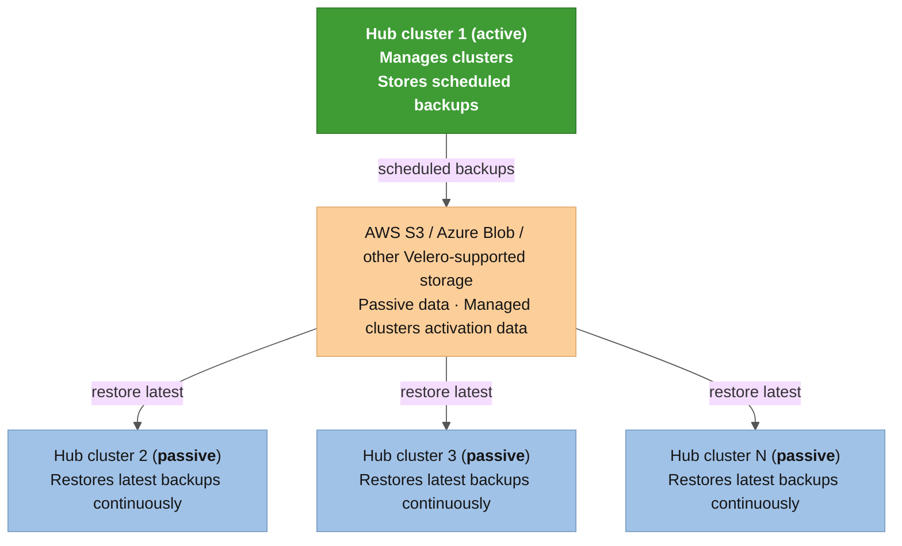

# Official Red Hat documentation compliance and cross-reference

This document validates the automation suite against the [Red Hat Advanced Cluster Management for Kubernetes (RHACM) 2.17 Business Continuity](https://docs.redhat.com/en/documentation/red_hat_advanced_cluster_management_for_kubernetes/2.17/html-single/business_continuity/index#active-passive-config) official documentation, confirming that every procedure, resource, and configuration follows Red Hat's supported architecture. RHACM 2.17.0 reached General Availability (GA) on **June 16, 2026**.

> This automation suite is designed and validated against the official Red Hat documentation. Every **`BackupSchedule`**, **`Restore`**, **`DataProtectionApplication`**, **`MultiClusterHub`**, ManagedCluster reconnection procedure, and backup label convention implemented here follows the architecture, API, and operational workflow described in the [RHACM Business Continuity](https://docs.redhat.com/en/documentation/red_hat_advanced_cluster_management_for_kubernetes/2.17/html-single/business_continuity/index) chapter. Where this suite goes **beyond** the official documentation (explicit backup resolution by **`clusterID`**, KCS bug mitigations, version compatibility validation), the extensions are additive and do not replace or contradict any supported procedure.

---

## 1. Official active-passive architecture

The official RHACM Business Continuity documentation defines the following architecture:

> **Source**: [RHACM 2.17 Business Continuity, "Active passive configuration design"](https://docs.redhat.com/en/documentation/red_hat_advanced_cluster_management_for_kubernetes/2.17/html-single/business_continuity/index#active-passive-config). The [official diagram](https://access.redhat.com/webassets/avalon/d/Red_Hat_Advanced_Cluster_Management_for_Kubernetes-2.17-Business_continuity-en-US/images/369a605ec39f04aa262c13a535f2d159/active_passive_config_design.png) explicitly shows **Hub cluster 2, 3, ... N** as passive nodes.

### Architecture rules from the official documentation

| Rule | Official docs reference | This automation |
|---|---|---|
| Exactly **1 active Hub** at any time | "An active hub cluster is also considered the primary hub cluster, which manages clusters and backs up resources at defined time intervals" | Enforced: Stage 02 pauses **`BackupSchedule`** on source before activation; Stage 08 detects split-brain if both Hubs have an unpaused **`BackupSchedule`** |
| **1 or more passive Hubs** | Diagram shows Hub 2, 3, ... N (passive) | This automation currently operates on a **hub pair** (1 active + 1 passive). The 1:N architecture is supported at the protocol level (shared storage, **`Restore`** CRs) but has not been tested with 3+ nodes. See [Multi-passive hub note](#multi-passive-hub-1-active--n-passive) |
| Active and passive Hubs share the **same storage location** | "Active and passive hub clusters are connected to the same storage location" | Enforced: both Hubs' **`DataProtectionApplication`** point to the same Azure Blob Storage container (**`acm-backup`**), configured in [*`acm_dr_hub_setup`*](../../roles/acm_dr_hub_setup) |
| Passive Hubs restore **passive data continuously** | "Passive hub clusters continuously retrieve the latest backups and restore the passive data" using **`syncRestoreWithNewBackups: true`** | ✅ Automated: [*`acm_dr_hub_setup`*](../../roles/acm_dr_hub_setup) task 5.2.4 creates a passive sync **`Restore`** CR with **`syncRestoreWithNewBackups: true`** and **`veleroManagedClustersBackupName: skip`** on non-primary hubs. Controllable via **`acm_dr_hub_setup_passive_restore_enabled`** (default **`true`**) |
| Activation data restored **only during failover** | "**`veleroManagedClustersBackupName`** must be set to **`skip`** initially" on passive hubs; set to **`latest`** only to activate | Enforced: the failover engine ([*`03_activate_hub.yml`*](../../roles/acm_dr_failover_manager/tasks/03_activate_hub.yml)) creates a one-shot **`Restore`** with **`veleroManagedClustersBackupName`** set to the resolved backup name (or **`latest`** as fallback) |
| **Primary must be shut down or fenced** before activation | "make sure the old hub from where the backups have been created is shut down" | Enforced: Stage 02 pauses **`BackupSchedule`** on the source Hub (logical fencing). Stage 00 blocks if source is already fenced (wrong direction guard) unless **`allow_fenced_origin=true`** |
| After activation, **create **`BackupSchedule`** on new primary** | "a backup is activated on the new primary hub cluster by creating a **`BackupSchedule`** resource" | Enforced: Stage 06 ([*`05_create_schedule.yml`*](../../roles/acm_dr_failover_manager/tasks/05_create_schedule.yml)) creates `BackupSchedule`** on new leader |

---

## 2. Backup data classification compliance

The official documentation classifies backup data into two types. Our automation handles both correctly:

### Passive data (continuously synced)

| Official requirement | Automation implementation |
|---|---|
| Credentials, ConfigMaps, apps, policies, and managed cluster CRs that do not activate the connection | Backed up by **`acm-credentials-schedule`** and **`acm-resources-schedule`**. The **`BackupSchedule`** CR created by [*`acm_dr_hub_setup`*](../../roles/acm_dr_hub_setup) and [*`acm_dr_failover_manager`*](../../roles/acm_dr_failover_manager) uses the same **`veleroSchedule`** cron (**`0 */2 * * *`**) and **`veleroTtl`** (**`120h`**) |
| Resources with **`cluster.open-cluster-management.io/backup: ""`** or custom value | Stage 00 preflight warns if ArgoCD Applications or custom Grafana dashboards are missing this label |
| Restore via **`veleroCredentialsBackupName: latest`** and **`veleroResourcesBackupName: latest`** with **`veleroManagedClustersBackupName: skip`** | Our activation restore uses all three fields (not **`skip`** for managed clusters) because it is a **failover activation**, not a passive sync |

### Managed clusters activation data (failover only)

| Official requirement | Automation implementation |
|---|---|
| Resources with **`cluster.open-cluster-management.io/backup: cluster-activation`** label | Stage 00 preflight checks ArgoCD Applications for this label and warns if missing |
| Restoring this data transfers cluster management to the new Hub | Stage 03 creates **`Restore`** with **`veleroManagedClustersBackupName`** set to the resolved backup (or **`latest`**) |
| **`cleanupBeforeRestore`** controls pre-restore cleanup | Our **`Restore`** uses **`CleanupRestored`** (recommended by official docs over **`CleanupAll`**) |

---

## 3. BackupSchedule configuration compliance

| Parameter | Official recommendation | This automation | Status |
|---|---|---|---|
| **`apiVersion`** | **`cluster.open-cluster-management.io/v1beta1`** | Same | ✅ |
| **`veleroSchedule`** | Cron expression (e.g., **`0 */6 * * *`**) | **`0 */2 * * *`** (every 2 hours) | ✅ More frequent than the 6-hour example |
| **`veleroTtl`** | Optional, default **`720h`** | **`120h`** (5 days) | ✅ Shorter TTL, appropriate for active DR |
| **`useManagedServiceAccount`** | **`true`** for auto-import | **`true`** in both creation points ([*`oadp_backupschedule.yml.j2`*](../../roles/acm_dr_hub_setup/templates/oadp/oadp_backupschedule.yml.j2) and [*`05_create_schedule.yml`*](../../roles/acm_dr_failover_manager/tasks/05_create_schedule.yml)) | ✅ |
| **`managedServiceAccountTTL`** | Optional, default **`2 * veleroTtl`** | Not explicitly set (uses default **`2 * 120h = 240h`**) | ✅ Default is correct |
| **`paused`** | Not in official examples | Explicitly set to **`false`** to ensure the schedule starts immediately | ✅ Defensive |

---

## 4. Restore CR configuration compliance

| Parameter | Official pattern | This automation (Stage 03) | Status |
|---|---|---|---|
| **`apiVersion`** | **`cluster.open-cluster-management.io/v1beta1`** | Same | ✅ |
| **`cleanupBeforeRestore`** | **`CleanupRestored`** (recommended) or **`None`** (new hub) | **`CleanupRestored`** | ✅ |
| **`veleroCredentialsBackupName`** | **`latest`** or explicit name | Resolved by **`clusterID`** with **`latest`** fallback | ✅ Exceeds official (safer) |
| **`veleroResourcesBackupName`** | **`latest`** or explicit name | Resolved by **`clusterID`** with **`latest`** fallback | ✅ Exceeds official (safer) |
| **`veleroManagedClustersBackupName`** | **`latest`** for activation, **`skip`** for passive | Resolved by **`clusterID`** with **`latest`** fallback | ✅ Exceeds official (safer) |

### Why we resolve explicitly instead of using **`latest`**

The official documentation uses **`latest`** in all examples. Our automation resolves backup names explicitly by matching **`ClusterVersion.spec.clusterID`** against the **`cluster.open-cluster-management.io/backup-cluster`** label on Velero **`Backup`** objects. This prevents a real, validated failure mode where **`latest`** resolves to a self-backup from the destination Hub after a failover+failback cycle (see [architecture.md: explicit backup resolution](architecture.md#-real-world-finding-why-we-do-not-blindly-trust-acms-latest) for the full root-cause analysis and reproduction steps). The fallback to **`latest`** preserves compatibility with new environments that have no bidirectional history.

---

## 5. Passive hub prerequisites compliance

The official documentation requires that passive Hubs be configured identically to the primary before running any restore. Our [*`acm_dr_hub_setup`*](../../roles/acm_dr_hub_setup) role provisions both Primary and DR Hubs with the same pipeline:

| Official prerequisite | How this automation satisfies it |
|---|---|
| Same RHACM operator, same namespace | [*`acm_dr_hub_setup`*](../../roles/acm_dr_hub_setup) Stage 02 installs MultiClusterHub in **`open-cluster-management`** on both Hubs |
| Same **`MultiClusterHub`** configuration including **`cluster-backup: true`** | Stage 02 enables **`cluster-backup`** component on both Hubs |
| **`DataProtectionApplication`** configured with same storage | Stage 05 creates DPA pointing to the shared Azure Blob Storage on both Hubs |
| **`BackupStorageLocation`** status **`Available`** | Stage 00 preflight validates BSL status on the destination Hub |
| Additional operators installed (GitOps, cert-manager, etc.) | Stage 04 installs OpenShift GitOps on both Hubs; Stage 03 installs Observability on both |
| Same namespace names | All namespace defaults are shared between roles via **`defaults/main.yml`** |

---

## 6. Failover procedure compliance

The official failover procedure, compared step-by-step with our pipeline:

| Official step | Our stage | Notes |
|---|---|---|
| 1. Verify backup schedule is enabled on primary | Stage 00, task 0.1.6-0.1.7 | Asserts **`BackupSchedule`** exists and is not paused |
| 2. Verify last backup completed | Stage 00 (implicit: BSL **`Available`**) | Backup completion is implicit in the BSL health check |
| 3. Shut down or fence primary hub | Stage 02 (logical fencing) | Pauses **`BackupSchedule`** (**`spec.paused: true`**) instead of full shutdown. This is a softer form of fencing that preserves the cluster for failback |
| 4. Delete passive sync Restore on standby | Stage 03, tasks 3.1.1-3.1.2 | Discovers and deletes old **`Restore`** objects on destination |
| 5. Create activation Restore | Stage 03, task 3.1.3 | Creates **`Restore`** with resolved backup names and **`cleanupBeforeRestore: CleanupRestored`** |
| 6. Wait for restore to complete | Stage 03, task 3.1.4 | Polls **`Restore.status.phase`** until **`Finished`**/**`Completed`**/**`FinishedWithErrors`** (60 retries x 20s = 20 min max) |
| 7. Create **`BackupSchedule`** on new primary | Stage 06 | Creates identical **`BackupSchedule`** with **`useManagedServiceAccount: true`** |
| 8. Other passive hubs restore from new primary | Partially automated | Each passive hub's continuous **`Restore`** (**`syncRestoreWithNewBackups: true`**) automatically picks up the new primary's backups from shared storage. See [Multi-passive hub note](#multi-passive-hub-1-active--n-passive) |

### Additional steps this automation performs beyond the official procedure

| Extra stage | Purpose |
|---|---|
| Stage 01 (discover fleet) | Dynamically discovers all **`ManagedCluster`** objects to drive per-Spoke operations |
| Stage 02a (pre-restore cleanup) | Removes **`Terminating`** namespaces and stale **`Restore`** CRs that could block the activation |
| Stage 07 (sanitize + reconnect, [KCS 7039710](https://access.redhat.com/solutions/7039710)) | Purges corrupted **`ManagedServiceAccount`** tokens and re-injects clean **`auto-import-secret`** per Spoke |
| Stage 04 (verify Spokes) | Polls **`ManagedClusterConditionAvailable`** per Spoke until reconnection is confirmed |
| Stage 06 (detach old Hub) | Removes residual **`ManagedCluster`** objects and forces stuck finalizers on the old Hub |
| Stage 07a (convergence wait) | Waits for Governance Policies and ArgoCD Applications to converge before the compliance report |
| Stage 08 (postflight audit) | Full compliance report covering split-brain detection, policy status, GitOps health, and add-on verification |

---

## 7. ManagedServiceAccount and auto-import compliance

The official documentation describes the **`useManagedServiceAccount`** feature on **`BackupSchedule`**:

| Official behavior | This automation |
|---|---|
| When **`useManagedServiceAccount: true`**, backup controller creates **`ManagedServiceAddon`**, **`ManagedServiceAccount`**, and **`ManifestWork`** per managed cluster | Our **`BackupSchedule`** sets **`useManagedServiceAccount: true`** in both creation points |
| After restore, controller finds clusters in **`Pending Import`** state and uses **`auto-import-account`** token to reconnect | Our Stage 07 goes further: it discovers MSAs with **`TokenReported: False`** condition (corrupted by [KCS 7039710](https://access.redhat.com/solutions/7039710)), purges them, and re-injects a clean **`auto-import-secret`** |
| Non-OCP clusters require manual **`managedClusterClientConfigs.url`** on **`ManagedCluster`** | Our [*`acm_dr_spoke_manager`*](../../roles/acm_dr_spoke_manager) handles both OCP and non-OCP Spokes, extracting the API server URL from **`kubectl config view`** |
| Token TTL defaults to **`2 * veleroTtl`** | We use the default (not setting **`managedServiceAccountTTL`**), which gives **`2 * 120h = 240h`** (10 days) |

### Official auto-import limitations acknowledged

The official docs list four limitations. Our automation addresses each:

1. **API server URL required**: handled by [*`01_spoke_prep.yml`*](../../roles/acm_dr_spoke_manager/tasks/01_spoke_prep.yml) task 1.1.6 (extracts from kubeconfig)
2. **Cluster must be accessible**: Stage 05 polls for **`ManagedClusterConditionAvailable`** and reports unreachable Spokes in the postflight report
3. **Backup timing vs label application**: Stage 00 warns if MSA secrets lack the backup label (ArgoCD/dashboard coverage check)
4. **Token expiration**: mitigated by the KCS 7039710 token re-injection in Stage 07 (fresh token, not the potentially expired backup copy)

ACM 2.17.1 fixes this natively. On ACM < 2.17.1 the Stage 07 mitigation is the only protection. The bug affects all cluster types (OCP, ARO, AKS, EKS, GKE), not only non-OCP.

---

## 8. Split-brain prevention compliance

| Official mechanism | This automation |
|---|---|
| **`BackupCollision`** state on **`BackupSchedule`** when two Hubs write to the same storage | Stage 02 prevents this by pausing the source Hub's **`BackupSchedule`** before activation. Stage 08 detects it post-hoc if both Hubs have an unpaused **`BackupSchedule`** |
| Manual decision: administrator must verify which hub should be primary | Stage 00 "reverse direction guard" blocks execution if the source Hub is already fenced (passive). The interactive gate (POINT OF NO RETURN) forces manual confirmation |
| No automated split-brain protection | Our pipeline adds logical fencing (pause) + postflight detection + hard assertion on dual-active state |

---

## 9. Backup label convention compliance

| Label | Official purpose | This automation |
|---|---|---|
| **`cluster.open-cluster-management.io/backup: ""`** or custom value | Resource included in **`acm-resources-generic-schedule`**, restored with passive data | Used on Secrets and infrastructure credentials |
| **`cluster.open-cluster-management.io/backup: cluster-activation`** | Resource included in activation data only, restored when **`veleroManagedClustersBackupName`** is not **`skip`** | Required on ArgoCD **`Application`**/**`ApplicationSet`** objects. Stage 00 warns if missing |
| **`cluster.open-cluster-management.io/backup: cluster`** | Equivalent to empty string for backup inclusion | Used on Secrets, ConfigMaps, and custom Grafana dashboards |
| **`velero.io/exclude-from-backup: "true"`** | Resource excluded from all backups | Documented in official docs for hub-specific policies |
| **`grafana-custom-dashboard: "true"`** | Project-specific: identifies custom dashboards that need the backup label | Stage 00 and Stage 08 check this label coverage |

---

## 10. Built-in validation policy awareness

The official documentation includes a **`backup-restore-enabled`** Policy with 13-16 validation templates that check backup infrastructure health. This automation does not deploy or reference these templates directly, but covers equivalent checks through its own preflight (Stage 00) and postflight (Stage 08) validation:

| Official template | Covered by this automation? | How |
|---|---|---|
| **`acm-backup-pod-running`** | ✅ | Stage 08 collects OADP/Velero pod status |
| **`oadp-pod-running`** | ✅ | Stage 08 collects OADP pod status |
| **`velero-pod-running`** | ✅ | Stage 08 collects Velero pod status |
| **`data-protection-application-available`** | ✅ | Stage 00 validates DPA exists on destination |
| **`backup-storage-location-available`** | ✅ | Stage 00 validates BSL **`Available`** on destination |
| **`acm-backup-clusters-collision-report`** | ✅ | Stage 08 split-brain detection (dual-active **`BackupSchedule`**) |
| **`acm-backup-phase-validation`** | ✅ | Stage 00 validates **`BackupSchedule`** not paused/failed on source |
| **`backup-schedule-cron-enabled`** | ✅ | Stage 06 creates **`BackupSchedule`** on new leader |
| **`acm-managed-clusters-schedule-backups-available`** | Partial | Implicit through BSL **`Available`** check |
| **`oadp-channel-validation`** | ❌ | Not validated by this automation |
| **`acm-backup-in-progress-report`** | ❌ | Not checked |
| **`auto-import-account-secret`** | ✅ | Stage 07 discovers and fixes corrupted MSA secrets |
| **`auto-import-backup-label`** | Partial | Stage 00 warns about missing backup labels |

---

## 11. Resolved gaps and remaining items

### Passive sync Restore (syncRestoreWithNewBackups)

The official architecture expects passive Hubs to run a continuous **`Restore`** with **`syncRestoreWithNewBackups: true`**, **`veleroManagedClustersBackupName: skip`**, and **`restoreSyncInterval: 10m-30m`**. This keeps passive Hubs pre-positioned with up-to-date credentials and resources, reducing failover time.

**Status**: ✅ **Automated** (default enabled). Task 5.2.4 in [*`acm_dr_hub_setup/tasks/05_oadp_dpa.yml`*](../../roles/acm_dr_hub_setup/tasks/05_oadp_dpa.yml) creates the passive sync **`Restore`** CR on non-primary hubs using the [*`oadp_passive_restore.yml.j2`*](../../roles/acm_dr_hub_setup/templates/oadp/oadp_passive_restore.yml.j2) template. The Restore CR uses:

* **`syncRestoreWithNewBackups: true`** (continuous pull from shared storage)
* **`veleroManagedClustersBackupName: skip`** (never activates clusters prematurely)
* **`restoreSyncInterval: 30m`** (configurable via **`acm_dr_hub_setup_passive_restore_sync_interval`**)
* **`cleanupBeforeRestore: CleanupRestored`** (recommended by official docs)

Controllable via:

* **`acm_dr_hub_setup_passive_restore_enabled`** (default **`true`**, set to **`false`** to disable)
* **`acm_dr_hub_setup_passive_restore_name`** (default **`restore-passive-sync`**)
* **`acm_dr_hub_setup_passive_restore_sync_interval`** (default **`30m`**)

**Failover compatibility**: Stage 03 of [*`acm_dr_failover_manager`*](../../roles/acm_dr_failover_manager) (tasks 3.1.1-3.1.2) already discovers and deletes ALL `Restore`** objects on the destination hub before creating the activation Restore. The passive sync Restore CR is automatically cleaned up by this existing code, no changes needed in the failover engine.

**Validation**: Stage 06 task 6.1.7 audits the Restore CR presence, and the assert at 6.2.1 validates that passive hubs with the feature enabled have at least one Restore CR.

### Multi-passive hub (1 active + N passive)

The official architecture diagram shows **Hub cluster 2, 3, ... N** as passive nodes. This automation currently operates on a **hub pair** (1 active + 1 passive).

**What works today for N passive hubs**:

* The [*`acm_dr_hub_setup`*](../../roles/acm_dr_hub_setup) role can provision any number of Hubs with identical infrastructure, including the passive sync `Restore`** CR (task 5.2.4) which is automatically created on every non-primary hub.
* The **`BackupSchedule`** and **`Restore`** APIs are standard RHACM resources; the same shared storage is accessible by any number of Hubs.
* The failover engine ([*`acm_dr_failover_manager`*](../../roles/acm_dr_failover_manager)) accepts **`active_hub`** and **`passive_hub`** as **`-e`** variables, so it can target any hub pair.
* Each passive hub's continuous **`Restore`** (**`syncRestoreWithNewBackups: true`**) automatically pulls from whatever active hub is currently writing backups to the shared storage.

**What would need to be added for full N-passive orchestration**:

* After failover, the remaining passive hubs' **`Restore`** CRs automatically pick up the new primary's backups (since they restore **`latest`** from shared storage). However, an explicit re-sync step could be added for immediate reconciliation.
* Postflight validation should check all passive hubs, not just the previous primary.

### DPA resource limits for large fleets

The official documentation recommends increased resource limits on the **`DataProtectionApplication`** Velero pod for fleets with 2000+ managed clusters (up to **`cpu: 4`**, **`memory: 8Gi`** for 3500+ clusters).

**Status**: ✅ **Configurable** via optional variables:

* **`acm_dr_hub_setup_dpa_resource_requests`** -- dict, e.g. **`{ cpu: "2", memory: "4Gi" }`** for 2000+ clusters
* **`acm_dr_hub_setup_dpa_resource_limits`** -- dict, e.g. **`{ cpu: "4", memory: "8Gi" }`** for 3500+ clusters

When both are empty **`{}`** (the default), no **`podConfig.resourceAllocations`** is added to the DPA, preserving backward compatibility for deployments with fewer managed clusters. The [*`oadp_dpa.yml.j2`*](../../roles/acm_dr_hub_setup/templates/oadp/oadp_dpa.yml.j2) template conditionally renders the **`podConfig`** block only when at least one dict is populated.

### Server-side encryption for backup storage

The official documentation "strongly recommends" encrypting backup data at its destination using server-side encryption.

**Status**: ✅ **Handled by Azure SSE by default**. Azure Storage Service Encryption (SSE) encrypts all data at rest automatically using Microsoft-managed keys for every Azure Storage account. No additional OADP/Velero configuration is needed. For organizations requiring customer-managed keys (CMK), Azure Key Vault encryption can be configured at the storage account level per Azure documentation. A comment documenting this is present in [*`defaults/main.yml`*](../../roles/acm_dr_hub_setup/defaults/main.yml) Section 2 (Azure Blob Storage settings).

---

## 12. Where this automation exceeds official documentation

These capabilities are additive improvements that do not contradict any official procedure:

| Capability | Description | Official coverage |
|---|---|---|
| Explicit backup resolution by **`clusterID`** | Resolves backup names by **`ClusterVersion.spec.clusterID`** and **`cluster.open-cluster-management.io/backup-cluster`** label instead of trusting **`latest`**. Prevents silent failure after failover+failback cycles | Official docs use **`latest`** in all examples |
| [KCS 7039710](https://access.redhat.com/solutions/7039710) MSA token sanitization | Discovers and purges corrupted **`ManagedServiceAccount`** tokens by **`TokenReported: False`** condition (not by hardcoded name), then re-injects clean **`auto-import-secret`** | Official docs describe auto-import but do not document post-restore token corruption |
| Version compatibility matrix | Validates RHACM and OCP versions on both Hubs against a compatibility matrix, blocks backward restores, and enforces max version gap | Not covered in official docs |
| Pre-restore cleanup (Stage 02a) | Removes **`Terminating`** namespaces and stale **`Restore`** CRs on the destination Hub before activation | Not covered in official docs |
| Convergence wait (Stage 07a) | Polls Governance Policies and ArgoCD Applications until converged before the compliance report | Not covered in official docs |
| Postflight compliance report | Full report covering split-brain detection, policy compliance, GitOps health, add-on status, placement decisions, and custom dashboard coverage | Official docs provide the **`backup-restore-enabled`** Policy but no equivalent post-failover audit |
| Planned Maintenance Switchover | Uses the DR pipeline for zero-downtime Hub upgrades (failover, upgrade idle hub, failback) | Not described as a use case in official docs |
| DR Readiness Drills (dry-run) | Full pipeline execution with **`check_mode`**/**`diff`** against real clusters without applying changes | Not covered in official docs |
| Multi-distribution Spoke support | ARO, AKS, EKS, GKE, IKS, vanilla K8s 1.24+ with auto-detected cloud/vendor labels | Official docs focus on OCP and Hive-created clusters |
| [KCS 5950901](https://access.redhat.com/solutions/5950901) graceful detach | Clean agent removal on Spoke before Hub-side detach, including stuck finalizer cleanup | Referenced in official docs but not automated |

---

## 13. Official documentation links

| Resource | URL |
|---|---|
| RHACM 2.17 Business Continuity (official docs) | [docs.redhat.com/.../business_continuity](https://docs.redhat.com/en/documentation/red_hat_advanced_cluster_management_for_kubernetes/2.17/html-single/business_continuity/index) |
| Active-passive configuration design | [docs.redhat.com/.../active-passive-config](https://docs.redhat.com/en/documentation/red_hat_advanced_cluster_management_for_kubernetes/2.17/html-single/business_continuity/index#active-passive-config) |
| Official architecture diagram | [active_passive_config_design.png](https://access.redhat.com/webassets/avalon/d/Red_Hat_Advanced_Cluster_Management_for_Kubernetes-2.17-Business_continuity-en-US/images/369a605ec39f04aa262c13a535f2d159/active_passive_config_design.png) |
| Cluster Backup Operator (upstream) | [github.com/stolostron/cluster-backup-operator](https://github.com/stolostron/cluster-backup-operator) |
| KCS 7039710 (MSA token restore failure) | [access.redhat.com/solutions/7039710](https://access.redhat.com/solutions/7039710) |
| KCS 5950901 (graceful managed cluster removal) | [access.redhat.com/solutions/5950901](https://access.redhat.com/solutions/5950901) |
| Red Hat blog: Backup and Restore Hub Clusters | [redhat.com/en/blog/backup-and-restore-hub-clusters...](https://www.redhat.com/en/blog/backup-and-restore-hub-clusters-with-red-hat-advanced-cluster-management-for-kubernetes) |
| Red Hat blog: Standalone to Active/Passive migration | [redhat.com/en/blog/how-to-move-from-standalone-rhacm...](https://www.redhat.com/en/blog/how-to-move-from-standalone-rhacm-to-an-active/passive-setup) |
| Red Hat blog: RHACM HA and DR (part 3) | [redhat.com/en/blog/rhacm-high-availability-and-disaster-recovery-part-3](https://www.redhat.com/en/blog/rhacm-high-availability-and-disaster-recovery-part-3) |

---

Created and maintained by [Diego Felipe Mateus](https://github.com/dfmateus). See [CONTRIBUTORS.md](../../CONTRIBUTORS.md) for the list of contributors.
