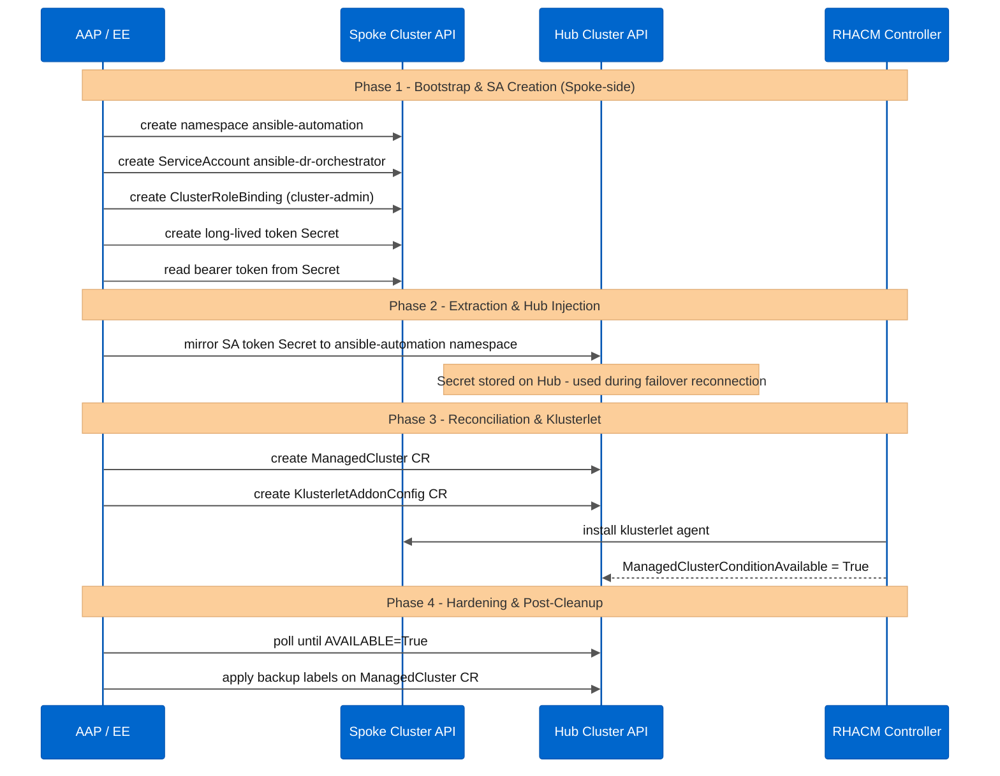
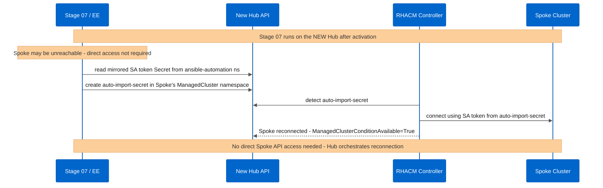

# spoke.md - Operational guide for onboarding and multi-context management in RHACM DR

**Last Updated:** July 25, 2026
**Maintained by:** [Diego Felipe Mateus](https://github.com/dfmateus)

---

## 1. Purpose and architecture

This document covers the architecture and operational procedures for standardizing **kubeconfig** contexts, automated onboarding, and surgical removal of **Spoke** clusters in **Red Hat Advanced Cluster Management for Kubernetes (RHACM) 2.10+**.

The solution implements the **Temporary Auto-Import with Automated Hardening (Zero-Trust Bootstrap)** architecture pattern and incorporates advanced Disaster Recovery (DR) sanitization practices:

* **Phase 1 (Bootstrap & SA Creation):** The **Ansible Automation Platform** accesses the Spoke context and creates the **`spoke-automation`** namespace, a temporary ServiceAccount with a **`cluster-admin`** ClusterRoleBinding, and an explicit Secret (mandatory for Kubernetes 1.24+).
* **Phase 2 (Extraction & Hub Injection):** The automation extracts the API server URL and JWT token, generating the **`auto-import-secret`** Secret in the Spoke's namespace on the Hub cluster.
* **Phase 3 (Reconciliation & Klusterlet Deployment):** The controller consumes the Secret to connect to the Spoke and injects the CRDs and Klusterlet agents.
* **Phase 4 (Hardening & Post-Cleanup):** Once membership conditions are met, the automation purges the ClusterRoleBinding, ServiceAccount, and namespace from the managed cluster.



### Failover reconnection path (Operation C)

During failover, the orchestrator does NOT need direct access to the Spoke. Stage 07 (`07_sanitize_passive_hub.yml`) reads the `acm-dr-<spoke>-sa-token` Secret from the `ansible-automation` namespace on the Hub. This Secret is created by `spoke_prep` (task 1.6.2) and contains:

- The Spoke's API endpoint
- The long-lived `ansible-dr-orchestrator` SA bearer token

The orchestrator calls `spoke_manager action=prep` using these Hub-side credentials, reconnecting the Spoke via an `auto-import-secret`. No Spoke kubeconfig context is needed on the control node during failover.



---

## 2. Infrastructure context mapping (taxonomy)

To ensure idempotent execution of automations in hybrid cloud environments, the infrastructure requires the following strict context taxonomy in the **`~/.kube/config`** file:

| Cluster | Context | Role |
|---------|---------|------|
| Primary Hub | **`acm-primary-hub`** | Active Hub, manages the fleet |
| DR Hub | **`acm-dr-hub`** | Cold standby, passive |
| Spoke 1 (OCP/ARO) | **`aro-spoke-01`** | Managed Spoke |
| Spoke 2 (AKS/K8s) | **`aks-spoke-01`** | Managed Spoke |

---

## 3. Local workstation configuration (kubeconfig)

Run the following commands on your Bastion host or local control machine to sanitize and standardize the **kubeconfig** aliases:

```bash
# 1. Authenticate to the Primary Hub and rename context
oc login <URL_API_HUB_PRIMARY> -u <ADMIN_USER> -p <HUB_PRIMARY_PASSWORD>
oc config rename-context $(oc config current-context) acm-primary-hub

# 2. Authenticate to the Secondary Hub (DR) and rename context
oc login <URL_API_HUB_DR> -u <ADMIN_USER> -p <HUB_DR_PASSWORD>
oc config rename-context $(oc config current-context) acm-dr-hub

# 3. Authenticate to the OCP/ARO Spoke and rename context
oc login <URL_API_SPOKE_01> -u <ADMIN_USER> -p <SPOKE_01_PASSWORD>
oc config rename-context $(oc config current-context) aro-spoke-01

# 4. Download credentials for the native K8S / Azure Kubernetes Service (AKS) Spoke and set a secure alias
az aks get-credentials \
  --resource-group <RESOURCE_GROUP_AKS> \
  --name <CLUSTER_NAME_AKS> \
  --context aks-spoke-01 \
  --file ~/.kube/config \
  --overwrite-existing
```

---

## 4. Operational management via Ansible (playbooks)

With the contexts standardized, isolated Spoke management can be performed using the **acm_dr_spoke_manager** role through the dedicated playbook.

### Scenario A: Onboarding / re-importing a Spoke

```bash
ansible-playbook playbooks/manage-spoke.yml \
  -e k8s_target_context="acm-primary-hub" \
  -e acm_dr_spoke_manager_spoke_k8s_context="aro-spoke-01" \
  -e acm_dr_spoke_manager_cluster_name="aro-spoke-01" \
  --tags "spoke_prep"
```

### Scenario B: Graceful detach

```bash
ansible-playbook playbooks/manage-spoke.yml \
  -e k8s_target_context="acm-primary-hub" \
  -e acm_dr_spoke_manager_spoke_k8s_context="aro-spoke-01" \
  -e acm_dr_spoke_manager_cluster_name="aro-spoke-01" \
  -e acm_dr_spoke_manager_action="detach" \
  --tags "spoke_detach"
```

> **Note**: the **`spoke_detach`** tag alone does not trigger the workflow. The task in the role's [*`tasks/main.yml`*](../../roles/acm_dr_spoke_manager/tasks/main.yml) is conditional on **`acm_dr_spoke_manager_action == 'detach'`**, so this variable must be passed explicitly via **`-e`**.

> 🔎 **Dry-Run**: the **`acm_dr_spoke_manager`** role does not have its own simulation mode, but the full failover pipeline ([roles/acm_dr_failover_manager](../../roles/acm_dr_failover_manager)), which includes Spoke reconnection as one of its stages, can be rehearsed via **`-e acm_dr_failover_manager_dry_run=true`** before any real execution.

---

## 5. Advanced troubleshooting and residual resource purging

In scenarios involving network failures or abnormal interruptions during DR, **RHACM** resources may retain **finalizers**, causing namespaces to become stuck in the **Terminating** state.

### Recommended procedure (purge scripts)
Never manually edit Custom Resources via the API. Use the support script instead:

```bash
# Execute stuck finalizer purge for a cluster on the Primary Hub
./examples/scripts/break-glass/force_purge_managed_cluster.sh acm-primary-hub aro-spoke-01
```

The script will perform a forced removal of the namespace associated with the cluster and clean up the agents locally on the Spoke.

---

## 6. Technical note on Kubernetes 1.24+ (AKS / native K8s auto-import)

For modern Kubernetes versions, automatic **Secret** generation has been deprecated. To maintain RHACM import flow compatibility, the **acm_dr_spoke_manager** role declaratively creates the following manifest before collecting the token:

```yaml
apiVersion: v1
kind: Secret
metadata:
  name: spoke-admin-sa-token
  namespace: spoke-automation
  annotations:
    kubernetes.io/service-account.name: spoke-admin-sa
type: kubernetes.io/service-account-token
```

---

## 7. Official Red Hat references
* [Red Hat KCS 7039710: ManagedServiceAccount token restore failure after OADP Restore](https://access.redhat.com/solutions/7039710)
* The MSA token update failure after restore affects all cluster types (OCP, ARO, AKS) on ACM < 2.17.1. ACM 2.17.1 fixes it natively.
* [Red Hat KCS 5950901: Graceful Removal and Detach of ManagedClusters](https://access.redhat.com/solutions/5950901)
* [RHACM Documentation - Importing a Target Managed Cluster](https://docs.redhat.com/en/documentation/red_hat_advanced_cluster_management_for_kubernetes)

---

Created and maintained by [Diego Felipe Mateus](https://github.com/dfmateus). See [CONTRIBUTORS.md](../../CONTRIBUTORS.md) for the list of contributors.
