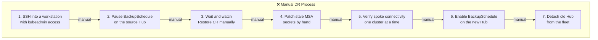
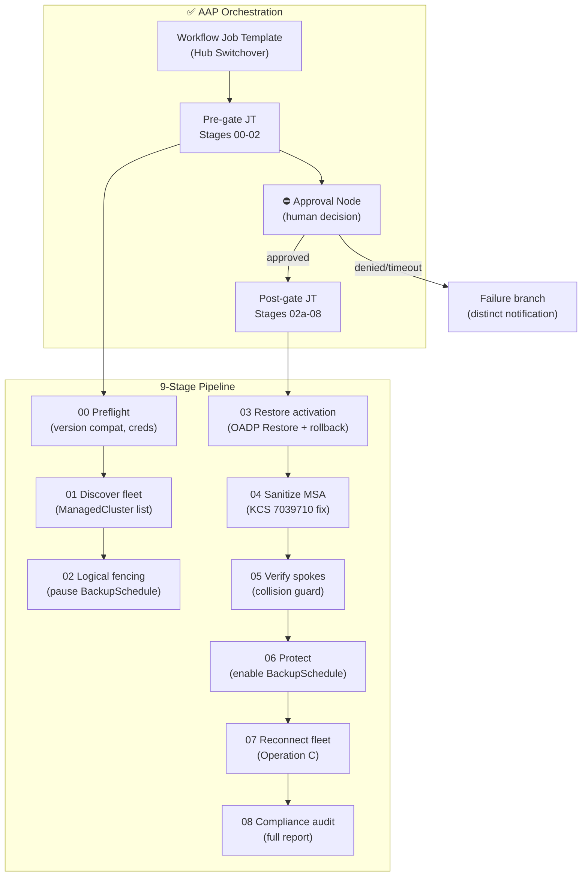
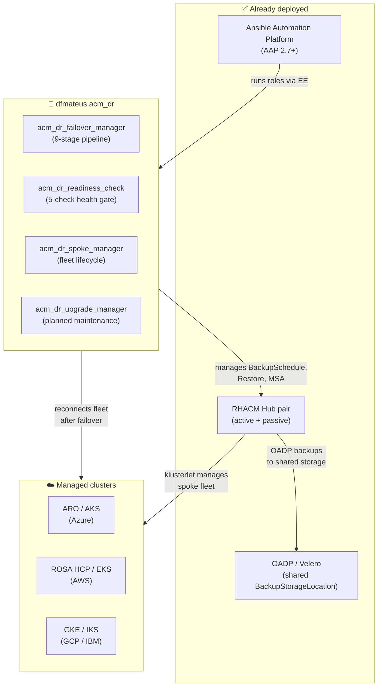

# 🛡️ Automated Multi-Cluster Disaster Recovery for RHACM

## Executive summary

The `dfmateus.acm_dr` collection replaces manual DR runbooks with a nine-stage, human-gated failover/failback pipeline driven by Ansible Automation Platform. Instead of copy-pasting `oc` commands under pressure at 3 a.m. with no rehearsal path and no audit trail, the automation handles preflight validation, logical fencing, OADP restore activation, fleet reconnection, and compliance reporting in a single idempotent workflow with a mandatory approval gate.

> 🛡️ **Key outcome:** Manual runbook with 15+ error-prone steps -> **1 automated pipeline** with dry-run rehearsals. Failover time from 45-90 min -> **under 15 min**. DR drill frequency from "never" -> **monthly, with zero risk**. Hub upgrades from "fleet offline" -> **zero downtime**.

---

## ❌ Current state: manual DR runbooks

In the traditional approach, Hub disaster recovery is a wiki page full of sequential `oc` commands that an operator executes manually during an incident. Each step assumes the previous one succeeded, with no built-in validation.

This model creates risks that grow with fleet size and incident pressure:

- ❌ **No rehearsal path:** Testing the runbook requires touching production state. In practice, most organizations never rehearse a Hub failover.
- ❌ **No split-brain detection:** If both Hubs end up with an active `BackupSchedule`, the operator discovers it when data starts diverging, not when it happens.
- ❌ **No rollback on failure:** If the OADP `Restore` fails mid-process, the operator must manually re-enable the `BackupSchedule` on the source Hub and clean up the failed `Restore` CR.
- ❌ **Stale MSA tokens go unnoticed:** After restore, `ManagedServiceAccount` secrets carry stale `ownerRef` entries from the old Hub ([KCS 7039710](https://access.redhat.com/solutions/7039710)). Token rotation silently fails with `409 Conflict`, and spokes may appear healthy while their automation credentials are broken.
- ❌ **Approval ambiguity:** A runbook has no formal approval checkpoint. After the fact, there is no way to distinguish "someone approved the failover" from "someone ran the script without asking."
- ❌ **Hub upgrades require downtime:** Upgrading a Hub means taking the fleet offline during the maintenance window because there is no tested failover path to shift traffic to the DR Hub first.

> ⚠️ **Critical risk:** In a fleet with 30 managed clusters, a manual Hub failover under incident pressure means 15+ sequential steps with no validation between them, no dry-run, and no audit trail. The operator is one missed step away from split-brain or data loss.

---

## ✅ Proposed state: automated DR pipeline

The collection turns the entire DR lifecycle into a single pipeline with built-in safety gates:

What changes in operations:

- ✅ **Rehearsals are safe and routine:** `dry_run=true` runs the entire pipeline against real clusters, reading actual `BackupSchedule`, `Restore`, and `ManagedCluster` state, without mutating anything.
- 🔄 **Split-brain detection is automatic:** `diagnose-failover-state.yml` classifies the Hub pair into one of six mutually exclusive states, including explicit split-brain detection.
- ⚡ **Restore failure triggers automatic rollback:** If Stage 03 fails, the pipeline re-enables the `BackupSchedule` on the source Hub, polls until `Enabled`, and deletes the failed `Restore` CR before surfacing the failure.
- 🛡️ **KCS 7039710 is fixed in the pipeline:** Stage 04 detects any MSA with `TokenReported=False`, deletes the corrupted secret, and lets RHACM create a fresh one with no stale owner reference.
- ⛔ **Approval gates are explicit and traceable:** A denied approval and a timed-out approval produce distinct notifications. The AAP audit trail records who approved, when, and from which session.
- 🔄 **Hub upgrades have zero downtime:** Failover to the DR Hub, upgrade the idle Hub, validate, failback. Same pipeline, no separate "upgrade mode."

> ✅ **Differentiator:** The same 30-cluster fleet now fails over in under 15 minutes with a full audit trail, monthly dry-run drills with zero risk, and zero-downtime Hub upgrades by failing over instead of taking the fleet offline.

---

## 📊 Quantified impact

| Metric | ❌ Manual runbook (current) | ✅ With this collection |
|---|---|---|
| ⏱️ Failover execution time | 45-90 min (sequential manual steps) | **Under 15 min** (automated pipeline) |
| 🔄 DR drill frequency | Rarely or never (too risky to test) | **Monthly** (dry-run, zero mutations) |
| 🧠 Split-brain detection | Manual, discovered after data diverges | **Automatic** (6-state diagnostic) |
| ⛔ Approval traceability | Wiki notes, Slack messages, verbal | **AAP audit trail** (who, when, approved vs denied vs timeout) |
| 🔁 Restore failure recovery | Manual re-fencing under pressure | **Automatic rollback** (unfence + cleanup) |
| 🐛 KCS 7039710 mitigation | Manual token cleanup per spoke | **Built into Stage 04** (automatic per pipeline run) |
| 🧪 Test coverage | Runbook in a wiki, untested | **172 e2e test cases** across 13 phases, 4 cloud providers |
| 🔑 Credential model | Shared kubeadmin or static tokens | **Zero-trust per-cluster ServiceAccounts** |
| 🌐 Spoke reconnection | Manual per-spoke re-import | **Automatic** via mirrored SA tokens (Operation C) |
| 🔧 Hub upgrade path | Fleet offline during maintenance | **Zero downtime** (failover → upgrade → failback) |
| 📋 Compliance reporting | Manual checklist after the fact | **Automatic Stage 08 report** per run |

---

## 🛡️ Safety architecture

### Pipeline safety gates

The pipeline is built around the principle that **every destructive action is preceded by a validation step**:

| Gate | What it checks | What happens on failure |
|---|---|---|
| 🛡️ **Preflight (Stage 00)** | RHACM/OCP version compatibility, credential validity, BSL availability | Pipeline stops before touching any cluster state |
| ⛔ **Approval (between 02 and 03)** | Human decision: proceed with Hub activation? | Denial or timeout routes to failure branch with distinct notification |
| 🔁 **Restore rollback (Stage 03)** | OADP `Restore` succeeds within timeout | Auto-unfences source Hub, deletes failed `Restore` CR |
| 🐛 **MSA sanitize (Stage 04)** | All MSA tokens report `TokenReported=True` | Deletes corrupted secrets, lets RHACM recreate them |
| 🔀 **Collision guard (Stage 05)** | No `BackupCollision` state on the new leader | Auto-resolves collision (expected after failback) |
| 🔎 **Backup identity (Stage 03)** | Backups resolved by `ClusterVersion` UID, not "latest" | Blocks `Restore` CR creation if any category resolves to bare "latest" |

### Zero-trust credential model

Every cluster carries a dedicated `ansible-dr-orchestrator` ServiceAccount in the `ansible-automation` namespace. No shared kubeadmin session, no expiring OAuth token. The bootstrap step self-registers its own AAP credential over the Controller API, so onboarding a new Hub or Spoke requires no manual token copy.

### Operation C: unreachable Spoke reconnect

During onboarding, the `spoke_manager` mirrors permanent SA tokens to Hub-side Secrets with OADP backup labels. After failover, Stage 07 reads these Secrets to reconnect Spokes behind firewalls or NSGs that block direct probes, without manual re-import.

---

## 📋 Operational scenarios

### Scenario 1: Unplanned Hub failure at 3 a.m.

| | ❌ Without the collection | ✅ With the collection |
|---|---|---|
| Process | On-call opens wiki runbook, SSHs into a workstation, executes 15+ manual steps under time pressure | On-call launches the Hub Switchover WJT from AAP, reviews the approval prompt, clicks Approve |
| ⏱️ Time | 45-90 min (assuming no mistakes) | **Under 15 min** (automated pipeline + approval) |
| ⚠️ Error risk | High (pressure, fatigue, no validation between steps) | Low (preflight validates before any mutation, rollback on failure) |
| 📋 Audit trail | Slack thread, maybe a post-mortem doc | **AAP job log** with per-stage timing, approval record, compliance report |

### Scenario 2: Monthly DR drill

| | ❌ Without the collection | ✅ With the collection |
|---|---|---|
| Process | Skip it (too risky to test against production) or build a separate test environment | Run `dry_run=true` against the real DR pair |
| ⏱️ Time | Not done, or days to set up a test environment | **Same pipeline**, zero mutations, full Stage 08 report |
| 🧪 Confidence | Unknown (the runbook has never been tested) | **Validated monthly** against real cluster state |

### Scenario 3: Planned Hub upgrade (RHACM minor version)

| | ❌ Without the collection | ✅ With the collection |
|---|---|---|
| Process | Schedule maintenance window, take fleet offline, upgrade Hub, hope nothing breaks | Failover to DR Hub → upgrade idle Hub → validate → failback |
| ⏱️ Downtime | 2-4 hours (full fleet offline) | **Zero** (fleet stays managed throughout) |
| 🔁 Rollback path | "Restore from backup and hope" | **Failback** with the same pipeline |

### Scenario 4: New Hub or Spoke joins the topology

| | ❌ Without the collection | ✅ With the collection |
|---|---|---|
| Process | Manual ServiceAccount creation, RBAC binding, token extraction, AAP credential registration | Run `bootstrap-cluster.yml` — self-registers its own AAP credential |
| ⏱️ Time | 10-15 min per cluster | **Under 2 min** per cluster |
| 🔒 Credential hygiene | Static token, no rotation, no traceability | **Long-lived auditable token** in a dedicated namespace |

---

## 🔗 Integration with existing investment

> ✅ **No new infrastructure required.** The collection connects three platforms already part of the environment: RHACM Hub pair, OADP/Velero, and AAP.

Requirements:

- 🔴 **RHACM** 2.10+ on both Hubs (validated against **RHACM 2.17**).
- 🔴 **AAP** 2.7+ for the full CasC and Workflow integration, or `ansible-core >= 2.16` for CLI-only execution.
- 🔴 **OADP** installed and configured with a shared `BackupStorageLocation` accessible by both Hubs.
- 📦 The collection installs via `ansible-galaxy collection install dfmateus.acm_dr`. Dependencies: `kubernetes.core`.

---

## ☁️ Platform coverage

The collection works with any Kubernetes distribution imported as a ManagedCluster on the ACM Hub. Fleet reconnection after failover uses the klusterlet agent, with no dependency on OpenShift-specific APIs on the spoke.

| Platform | Validation status |
|---|---|
| OpenShift Container Platform (OCP) | ✅ Full |
| Azure Red Hat OpenShift (ARO Classic) | ✅ Full (primary test platform) |
| ROSA / ROSA HCP | ✅ Full |
| Azure Kubernetes Service (AKS) | ✅ Full |
| Amazon Elastic Kubernetes Service (EKS) | ✅ Full |
| Google Kubernetes Engine (GKE) | ✅ Full |
| IBM Kubernetes Service (IKS) | ✅ Full |
| Vanilla Kubernetes | ✅ Full (with active klusterlet) |

---

## 📎 Next steps

For the technical team responsible for implementation:

| Document | Content |
|---|---|
| 📖 [Getting started](../onboarding/getting-started.md) | Prerequisites, collection install, first failover walkthrough |
| 🏗️ [Architecture](../architecture/architecture.md) | Pipeline design, data flow, state machine |
| ✅ [Official compliance](../architecture/official-compliance.md) | Field-by-field validation against RHACM 2.17 Business Continuity docs |
| 🧪 [E2E validation matrix](../testing/e2e-validation-matrix.md) | 172 test cases across 13 phases and 4 cloud providers |
| 🎛️ [AAP CasC import](../aap/) | Ready-to-import YAML for all AAP objects |
| 📋 [README](../../README.md) | Variable reference, role documentation, project structure |
