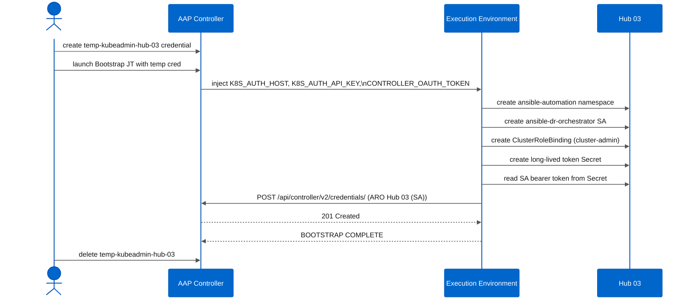

# Add a hub cluster: AAP-only onboarding

This guide covers the full path from a freshly provisioned cluster to a validated DR node with no local Ansible commands. The only local step is a one-time token capture before AAP has cluster access. Everything after that runs inside AAP.

**When to use this guide:**

- You have an existing DR pair (Hub 01 + Hub 02) and want to add a third cluster as an additional passive hub (Hub 03, Hub 04, ...).
- You just finished a Terraform apply for a new cluster and want to onboard it.
- A customer who just downloaded the collection and needs to add any hub cluster to an existing AAP setup.

**Not covered here:** initial AAP setup (EE build, CasC import, day-1 credential types). Those are in [**`docs/aap/aap-setup.md`**](../aap/aap-setup.md). This guide assumes AAP is already configured with the collection imported and the Bootstrap Job Template ready to run.

---

## Table of contents

- [Prerequisites](#prerequisites)
- [What Terraform delivers](#what-terraform-delivers)
- [Step 1: Capture a temporary cluster-admin token (local, one-time)](#step-1-capture-a-temporary-cluster-admin-token-local-one-time)
- [Step 2: Bootstrap the automation SA (AAP)](#step-2-bootstrap-the-automation-sa-aap)
- [Step 3: Run Hub Setup as an additional passive hub (AAP)](#step-3-run-hub-setup-as-an-additional-passive-hub-aap)
- [Step 4: Register the Passive Hub Fleet credential and validate with failover workflows (AAP)](#step-4-register-the-passive-hub-fleet-credential-and-validate-with-failover-workflows-aap)
- [Reference: naming conventions for additional hubs](#reference-naming-conventions-for-additional-hubs)

---

## Prerequisites

- AAP is running and the subscription is activated. The collection is imported and the project sync shows **Successful**. If not, start at [**`docs/aap/aap-setup.md`**](../aap/aap-setup.md).
- The **`ACM DR - LAB - Cluster Bootstrap`** Job Template exists in AAP with the **`AAP Bootstrap Automation (API Token)`** credential permanently attached. This credential injects `CONTROLLER_OAUTH_TOKEN` so the bootstrap job can register the permanent SA credential automatically.
- The existing DR pair (Hub 01, Hub 02) is healthy and both **`ARO Hub 01 (Source)`** and **`ARO Hub 02 (Dest)`** credentials are filled in with real SA tokens.
- The new cluster is running and the API endpoint is reachable from the AAP execution environment. If you provisioned it with the Terraform script, the cluster is ready when the apply finishes.
- An Azure service principal with **`Storage Blob Data Contributor`** rights on the resource group (or the storage account directly) if Hub Setup will configure backup storage for this hub. For an additional passive hub reusing existing storage, the same SP used for Hub 01 works.

---

## What Terraform delivers

If you provisioned the cluster with **`.local/cloud/azure/provision-aro-terraform.sh`**, Terraform writes two files after the apply:

```
.local/clusters/<cluster-name>/kubeconfig-admin   # cluster-admin kubeconfig
.local/clusters/<cluster-name>/kubeadmin.env      # API URL, console URL, kubeadmin password
```

Example for **`acmdr-lab-hub-03`**:

```
.local/clusters/acmdr-lab-hub-03/kubeconfig-admin
.local/clusters/acmdr-lab-hub-03/kubeadmin.env
```

These files are gitignored. They stay local and are the only source of truth for the temporary bootstrap token. For clusters provisioned outside this collection, substitute your organization's equivalent: a kubeconfig, an admin bearer token, or an OIDC session.

---

## Step 1: Capture a temporary cluster-admin token (local, one-time)

This is the only step that runs locally. AAP cannot access the cluster until the `ansible-dr-orchestrator` ServiceAccount exists, so you need a temporary cluster-admin token to bootstrap it. After step 2, AAP manages everything.

```bash
# Load API URL and kubeadmin password from the Terraform output file
source .local/clusters/acmdr-lab-hub-03/kubeadmin.env

# Log in. Redirect output to /dev/null so the token capture below stays clean.
oc login \
  -u kubeadmin \
  -p "$ARO_KUBEADMIN_PASS" \
  --server="$ARO_API_URL" \
  --insecure-skip-tls-verify=true \
  --kubeconfig .local/clusters/acmdr-lab-hub-03/kubeconfig-admin \
  > /dev/null 2>&1

# Print the bearer token. Copy the entire output line.
oc whoami -t --kubeconfig .local/clusters/acmdr-lab-hub-03/kubeconfig-admin
```

> ⚠️ Run `oc login` and `oc whoami -t` as separate commands. If you chain them with `&&` inside `$()`, the login confirmation text is captured together with the token and corrupts it. The example above redirects login output to `/dev/null`; `oc whoami -t` then runs clean.

> ⚠️ ARO kubeadmin tokens expire in approximately 24 hours. Complete steps 2.1 through 2.3 before the token expires. If it expires mid-procedure, re-run this step and update the temporary credential in AAP with the new token.

Keep the token in your clipboard. You will paste it into AAP in the next step.

---

## Step 2: Bootstrap the automation SA (AAP)

The Bootstrap Job Template creates the `ansible-dr-orchestrator` ServiceAccount on the new cluster, generates a long-lived token Secret, and registers the permanent `ACM DR - Target Cluster` credential in AAP automatically. You never need to read the SA token manually.

### 2.1 Create a temporary credential in AAP

In the AAP UI, go to **Credentials > Add**:

| Field | Value |
| :---- | :---- |
| **Name** | **`temp-kubeadmin-hub-03`** (delete after bootstrap; the name is for your reference only) |
| **Credential Type** | **`OpenShift or Kubernetes API Bearer Token`** (built-in type) |
| **OpenShift or Kubernetes API Endpoint (Required)** | the `ARO_API_URL` value from `kubeadmin.env`, e.g. `https://api.<cluster-name>.<region>.aroapp.io:6443` |
| **API Authentication Bearer Token (Required)** | the token from step 1 |
| **Verify SSL** | unchecked (ARO uses a self-signed API certificate by default) |

### 2.2 Run the Bootstrap Job Template

Go to **Templates > ACM DR - LAB - Cluster Bootstrap > Launch**.

When prompted for credentials, click **Add** next to the credential selector and choose **`temp-kubeadmin-hub-03`**. The **`AAP Bootstrap Automation (API Token)`** credential is already permanently attached to the template; do not remove it.

Fill in the survey:

| Survey field | Value for Hub 03 |
| :--- | :--- |
| **Permanent Credential Name in AAP (Required)** | `ARO Hub 03 (SA)` |
| Cluster Display Name (Optional) | `hub-03` (used as the kubeconfig context name; keep it short and hyphenated) |
| AAP Organization (Optional) | `Default` (or your org name if you created a custom one during CasC import) |
| ServiceAccount Name (Optional) | leave blank (uses `ansible-dr-orchestrator`) |
| Automation Namespace (Optional) | leave blank (uses `ansible-automation`) |

When the job finishes with **Successful**, go to **Credentials** and confirm `ARO Hub 03 (SA)` now exists with type `ACM DR - Target Cluster`. No manual `oc get secret` needed.



### 2.3 Delete the temporary credential

In AAP, go to **Credentials**, find **`temp-kubeadmin-hub-03`**, and delete it. The permanent SA credential is in place; the temporary one has no further use.

---

## Step 3: Run Hub Setup as an additional passive hub (AAP)

Hub Setup configures the cluster as a passive DR node: it installs or validates MCH, OADP, DPA, and the BackupSchedule in passive (Restore) mode. Because the shared storage already exists from Hub 01's setup, you pass `storage_allow_reuse=true` to skip storage account creation.

### 3.1 Attach the Azure SP credential (reuse the shared credential)

Hub Tertiary reuses the same storage account created by Hub 01, so attach the same Azure SP credential you used for Hub 01 and Hub 02 (e.g. **`Azure RHDP (SP)`**). Hub Setup does not create a new storage account for additional passive hubs; it only validates read access to the existing one. The SP must have at minimum **`Storage Blob Data Contributor`** on the storage account to pass the OADP stage.

If Hub Tertiary is in a different Azure subscription from the existing hubs, create a separate credential for that subscription:

In AAP, go to **Credentials > Add**, choose **Microsoft Azure Resource Manager**, and fill in the SP details for the new subscription. Name it following the `Azure <id> (SP)` convention (e.g. **`Azure acmdr-lab-eastus2 (SP)`**). The SP needs **`Owner`** or **`User Access Administrator`** on the storage resource group if it must assign RBAC roles, or at minimum **`Storage Blob Data Contributor`** if the account and role assignments already exist.

> ⚠️ If the SP used for Hub Tertiary only has `Contributor`, Hub Setup will fail during the OADP storage validation step. Either grant **`Storage Blob Data Contributor`** explicitly on the storage account or use the same SP already assigned to the account.

### 3.2 Launch Hub Setup

Go to **Templates > ACM DR - LAB - Hub Setup > Launch**.

Attach credentials at launch (the JT has `ask_credential_on_launch: true`):

| Credential to add | Purpose |
| :--- | :--- |
| **`ARO Hub 03 (SA)`** | cluster access for all Kubernetes operations |
| **`Azure RHDP (SP)`** (the shared Azure SP credential) | OADP storage access validation |

Fill in the survey:

| Survey field | Value |
| :--- | :--- |
| **Is Primary Hub (Required)** | `false` (this cluster runs as a passive DR consumer, not the active leader) |
| **Azure Storage Allow Reuse (Required)** | `true` (backup storage already created by Hub 01; do not create a new account) |
| **Enable OpenShift GitOps / ArgoCD setup (Required)** | `false` (unless your DR setup uses GitOps for policy management) |

Leave remaining fields at their defaults unless your environment differs from the lab baseline.

What Hub Setup does for an additional passive hub:

| Stage | Action |
| :---- | :----- |
| 00 Preflight | Validates connectivity, checks topology safety gate. Pass `acm_dr_hub_setup_allow_existing_dr=true` if the cluster already has DR artifacts. |
| 01 Storage | Validates access to the existing Azure Blob storage account. No new account is created. |
| 02 MCH | Installs MultiClusterHub if absent. Waits for `Running` phase. |
| 03 Observability | Configures Observability with the shared storage backend. |
| 04 GitOps | Skipped when `Enable OpenShift GitOps = false`. |
| 05 OADP/DPA | Deploys OADP operator, DPA, and a passive sync Restore CR (not a BackupSchedule). The Restore CR continuously syncs from the active Hub's backup stream. |
| 06 Validate | Confirms BackupStorageLocation is `Available` and the Restore CR is `Syncing`. |

When the job finishes, confirm in the AAP output that Stage 06 shows `BSL Available` and the passive Restore is `Syncing`.

---

## Step 4: Register the Passive Hub Fleet credential and validate with failover workflows (AAP)

Before running any failover workflow that includes Hub Tertiary, the Failover Orchestrator needs kubeconfig access to all additional passive hubs. This is handled by the **`ACM DR - Passive Hub Fleet`** custom credential type, which packs all additional hub contexts into a single credential instance. The `acm_dr_kubeconfig_resolver` role reads this credential at runtime and merges its contexts into the job's kubeconfig.

```mermaid
%%{init: {"theme": "base", "themeVariables": {"lineColor": "#555555"}, "flowchart": {"htmlLabels": true}}}%%
flowchart LR
    classDef primary   fill:#3f9c35,stroke:#357a2e,color:#fff,font-weight:bold
    classDef secondary fill:#a1c2e7,stroke:#7a9fc4,color:#151515
    classDef extra     fill:#fcce9a,stroke:#e0aa70,color:#151515
    classDef header    fill:#06c,stroke:#0055b3,color:#fff,font-weight:bold
    classDef success   fill:#3f9c35,stroke:#357a2e,color:#fff,font-weight:bold
    KCF["Local script generates<br/>fleet passive kubeconfig<br/>.local/clusters/acmdr-lab-hub-03/"]:::extra
    CRED["Create AAP credential<br/>ACM DR - Hub 03 (Fleet)<br/>type: ACM DR - Passive Hub Fleet"]:::primary
    JT["Attach credential to<br/>check-dr-readiness JT<br/>and orchestrate-dr-failover JT"]:::secondary
    DRILL["<b>check-dr-readiness.yml</b><br/>additional_passive_hubs=hub-03"]:::secondary
    FAIL["<b>orchestrate-dr-failover.yml</b><br/>additional_passive_hubs=hub-03<br/>Stage 06a recycles all Restore CRs"]:::primary
    DONE(["✅ New passive Hub<br/>integrated and validated"]):::success
    KCF --> CRED --> JT --> DRILL --> FAIL --> DONE
```



### 4.1 Build the passive hub fleet kubeconfig (local, one-time)

Run `provision_automation_sa.sh` for each additional passive hub to generate per-hub kubeconfigs with embedded SA tokens, then merge them:

```bash
# Generate a per-hub kubeconfig for Hub 03 using its SA token
KUBECONFIG_HUB3=".local/clusters/acmdr-lab-hub-03/kubeconfig-sa"
oc --kubeconfig .local/clusters/acmdr-lab-hub-03/kubeconfig-admin \
   get secret ansible-dr-orchestrator-token -n ansible-automation \
   -o jsonpath='{.data.token}' | base64 -d > /tmp/hub3_token

# Build a single-context kubeconfig for Hub Tertiary (adjust API URL as needed)
source .local/clusters/acmdr-lab-hub-03/kubeadmin.env
oc --token=$(cat /tmp/hub3_token) \
   --server="$ARO_API_URL" \
   --insecure-skip-tls-verify=true \
   config view --flatten --minify > "$KUBECONFIG_HUB3"

# Set the context name to match the bootstrap survey value
kubectl --kubeconfig "$KUBECONFIG_HUB3" \
  config rename-context "$(kubectl --kubeconfig "$KUBECONFIG_HUB3" config current-context)" \
  hub-03

# For multiple additional passive hubs, merge them:
# KUBECONFIG=hub3.kubeconfig:hub4.kubeconfig kubectl config view --flatten \
#   > .local/clusters/passive-hub-fleet.kubeconfig
```

> ⚠️ Context names in the fleet kubeconfig must match exactly the values you pass in the `additional_passive_hubs` survey field. If you named the context `hub-03` during bootstrap, use the same string here.

Print the kubeconfig content to copy into AAP:

```bash
cat "$KUBECONFIG_HUB3"
```

### 4.2 Create the Passive Hub Fleet credential in AAP

Go to **Credentials > Add**:

| Field | Value |
| :---- | :---- |
| **Name** | **`ARO Hub 03 (Passive Fleet)`** (or `Passive Hub Fleet` if covering multiple hubs) |
| **Credential Type** | **`ACM DR - Passive Hub Fleet`** |
| **Passive Hub Fleet Kubeconfig (Required)** | paste the full kubeconfig YAML from step 4.1 |

> ⚠️ This credential type must already exist in AAP before you can create an instance. If the `ACM DR - Passive Hub Fleet` type is missing from the dropdown, run the CasC import playbook to create it (see [**`docs/aap/aap-setup.md`**](../aap/aap-setup.md)) or create it manually via **Credential Types > Add** using the definition in [**`examples/aap/controller_credential_types.yml`**](../../examples/aap/controller_credential_types.yml).

### 4.3 Attach the credential to the Hub Switchover Job Template

Go to **Templates > JT - ACM DR - LAB - Hub Switchover > Edit** and add the passive hub fleet credential to the **Credentials** list. Keep the Source Hub and Destination Hub credentials already on the template. The fleet credential joins them permanently so any failover workflow launched against this JT automatically has access to all passive hub contexts.

### 4.4 Run DR Readiness Check

Go to **Templates > ACM DR - LAB - DR Readiness Check > Launch**.

Attach credentials at launch:

- **`ARO Hub 01 (Source)`** (active hub)
- **`ARO Hub 02 (Dest)`** (primary passive hub)

All five checks should pass:

```
Check 1 (BackupSchedule): ✅
Check 2 (BSL Available):   ✅
Check 3 (Backup age):      ✅
Check 4 (Spoke count):     N Spoke(s)
Check 5 (Passive Restore): ✅
```

> **Note:** The DR Readiness Check verifies the active/passive pair (Primary + Secondary). It does not check additional passive hubs. Hub Tertiary's health is confirmed by the Hub Setup Stage 06 output in step 3.2.

### 4.5 Run a failover drill with additional_passive_hubs

To verify Hub Tertiary participates when a failover runs, launch **`WF - ACM DR - LAB - Full DR Drill`** (dry-run only) with the `additional_passive_hubs` field populated.

In the workflow survey, fill in **`Additional Passive Hubs (Optional)`** with the context name set during bootstrap:

```
hub-03
```

For multiple additional hubs, enter one per line or as a JSON list:

```json
["hub-03", "hub-04"]
```

During the dry-run, Stage 05a recycles the passive Restore CR on Hub Tertiary alongside Hub 02. Confirm in the job output that the stage log shows Hub 03's Restore CR being processed.

The resolver status line in the job output confirms the passive hub fleet was loaded:

```
✅ PASSED! ... with 2 per-cluster context(s) + N spoke fleet context(s) + 1 passive hub fleet context(s) ...
```

### 4.6 Confirm Hub Tertiary syncing after the drill

After the drill completes, Hub Tertiary's passive Restore should still be in `Syncing` phase. If it went to `Finished` unexpectedly, check the OADP logs on Hub Tertiary:

```bash
oc logs -n open-cluster-management-backup \
  -l app.kubernetes.io/name=velero \
  --tail=50 \
  --kubeconfig .local/clusters/acmdr-lab-hub-03/kubeconfig-admin
```

### Updating the fleet after hub changes

When you add or remove an additional passive hub, rebuild the fleet kubeconfig and update the credential:

1. Run `provision_automation_sa.sh` for any new hub to generate its kubeconfig.
2. Merge all additional passive hub kubeconfigs as shown in step 4.1.
3. In AAP, go to **Credentials > ARO Hub 03 (Passive Fleet) > Edit** and paste the updated kubeconfig YAML.

No changes to the Job Template or playbook are needed when adding more passive hubs.

---

## Reference: naming conventions for additional hubs

When adding more passive hubs beyond the primary DR pair, follow the same naming pattern so credentials, contexts, and logs are consistently identifiable.

| Object | Pattern | Example (Hub 03) |
| :--- | :--- | :--- |
| Cluster name | `acmdr-lab-hub-NN` | `acmdr-lab-hub-03` |
| Context display name (Bootstrap survey) | `hub-NN` | `hub-03` |
| Permanent SA credential | `ARO Hub NN (SA)` | `ARO Hub 03 (SA)` |
| Azure SP credential | `Azure <id> (SP)` (shared; create a new one for a different subscription) | `Azure RHDP (SP)` |
| `additional_passive_hubs` entry | context display name from Bootstrap survey | `hub-03` |
| Cluster directory | `.local/clusters/<cluster-name>/` | `.local/clusters/acmdr-lab-hub-03/` |
| Terraform tfvars | `.local/terraform/<cluster-name>/terraform.tfvars` | `.local/terraform/acmdr-lab-hub-03/terraform.tfvars` |
| Terraform example template | `examples/terraform/azure/aro-lab-hub/hub-01/hub-01.tfvars.example` | copy and adjust `cluster_name`, `domain`, and VNet CIDR |

The `additional_passive_hubs` value must match the **Cluster Display Name** entered in the Bootstrap Job Template survey exactly. The failover orchestrator uses this name as the kubeconfig context identifier when building the multi-hub credential.

---

## What to do if the Bootstrap job fails

| Symptom | Likely cause | Fix |
| :---- | :---- | :---- |
| `401 Unauthorized` on first task | Temporary token expired or copied incorrectly | Re-run `oc login` + `oc whoami -t`, update the temporary credential in AAP, relaunch |
| `CONTROLLER_OAUTH_TOKEN is not set` | `AAP Bootstrap Automation (API Token)` credential detached from the JT | In AAP, go to **Templates > ACM DR - LAB - Cluster Bootstrap > Edit**, confirm the credential is in the permanently attached list (not just added at launch). See [**`docs/aap/aap-setup.md#step-62-create-a-temporary-credential-in-aap`**](../aap/aap-setup.md#step-62-create-a-temporary-credential-in-aap). |
| `403 Forbidden` on credential POST | The AAP user whose token is in the Bootstrap credential lacks org-admin | Confirm the token in `AAP Bootstrap Automation (API Token)` belongs to a user with org-admin on the `Default` organization |
| Permanent credential not created but job shows Successful | The job ran against a different cluster (wrong temp credential attached) | Delete any stale temp credentials, create a clean one with the correct API URL and token, relaunch |

> **Token rotation:** Re-running the Bootstrap JT for the same cluster and the same **Permanent Credential Name** updates the stored token (PATCH on the existing credential). Use this path when the SA token expires or your organization's SA rotation policy requires it.
