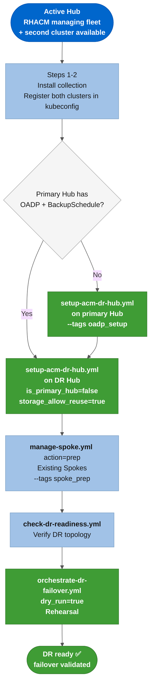
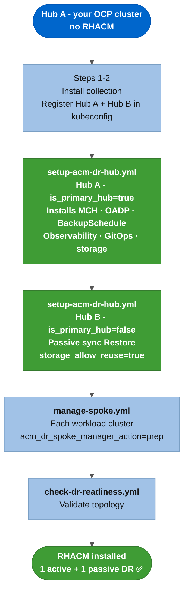
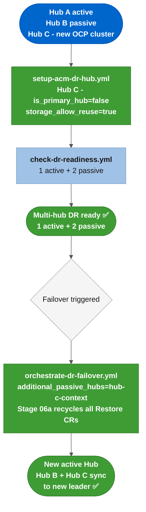
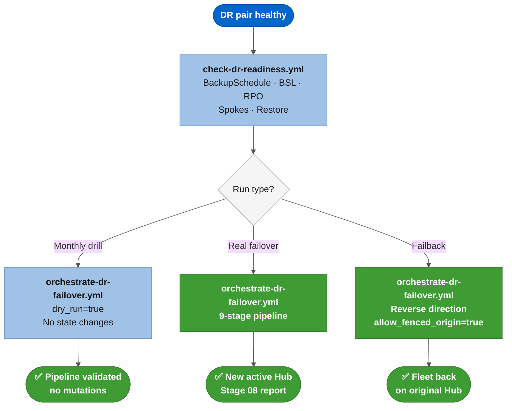
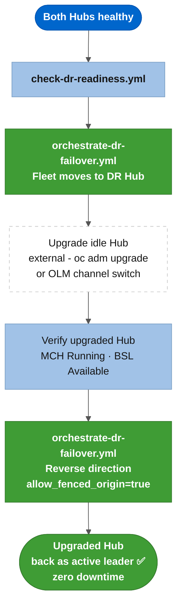
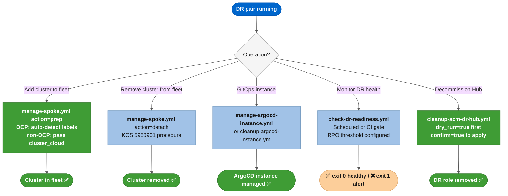
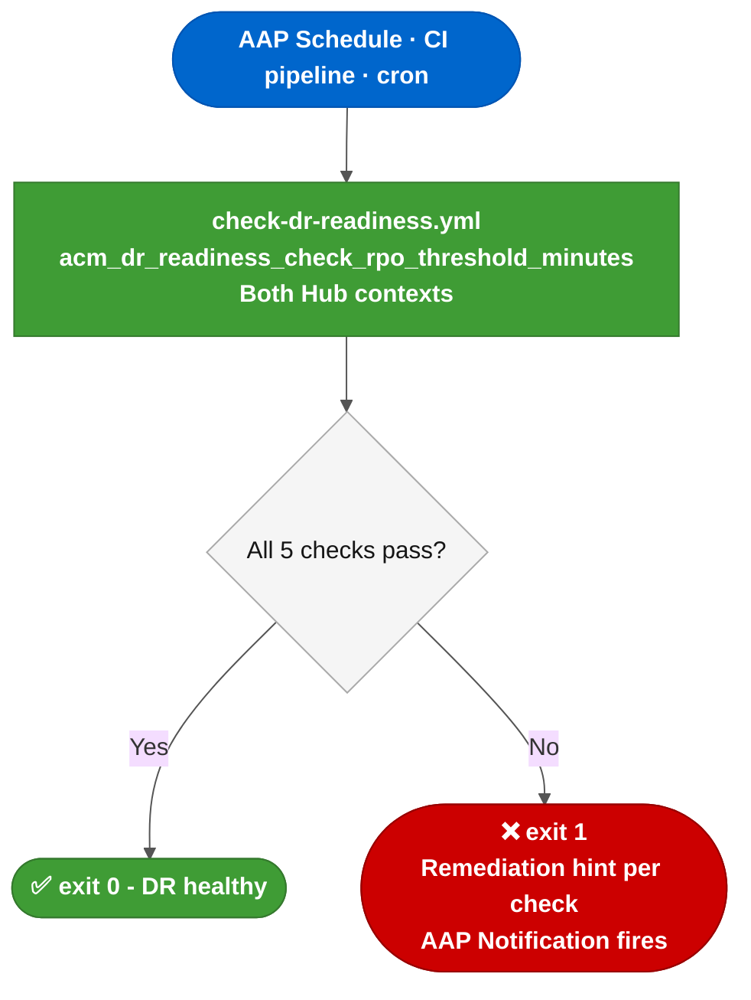
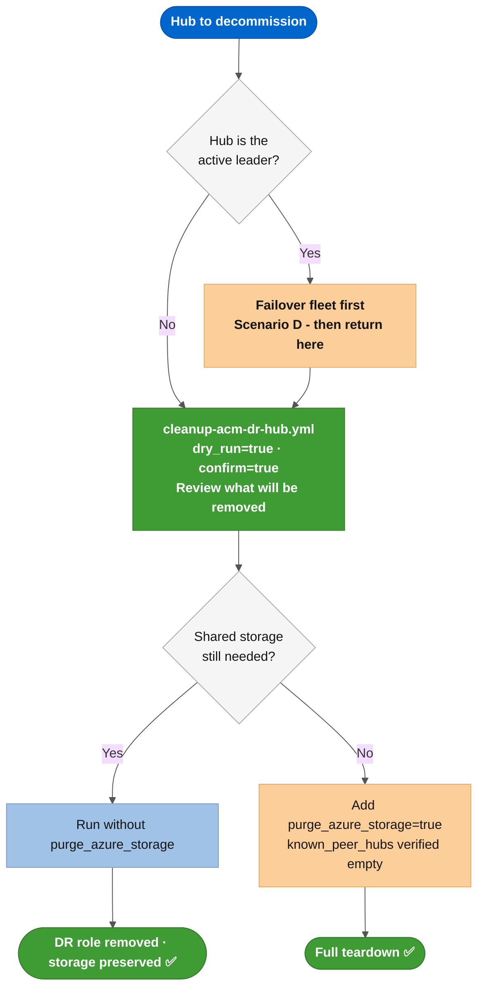
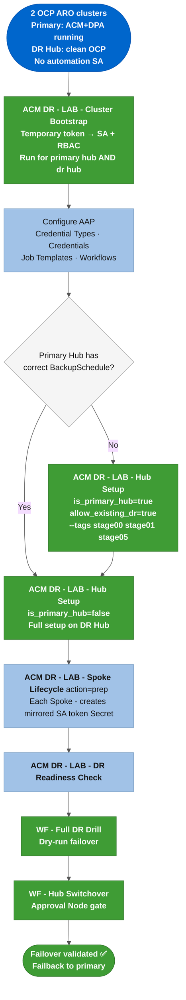

# Getting started

A step-by-step guide from collection install to a working DR setup with your first failover. For the full parameter reference, see [*`docs/testing/e2e-command-reference.md`*](../testing/e2e-command-reference.md).

---

## How to run this collection

The collection runs in two modes. Choose one before you start.

### Mode 1: local workstation

Run playbooks directly with **`ansible-playbook`** or **`ansible-navigator`**. This is the quickest way to get started.

**Requirements:**

- **`ansible-core`** >= 2.16.0, Python >= 3.11
- Collection dependencies: **`ansible-galaxy collection install -r collections/requirements.yml`** (installs **`kubernetes.core`**, **`azure.azcollection`**, **`community.general`**)
- CLI tools on PATH: **`oc`**, **`az`** (ARO) or **`aws`** (ROSA HCP), **`jq`**
- Multi-context kubeconfig at **`~/.kube/config-acm-lab-dr`**: produced by the cluster-onboarding scripts in [Step 2](#2-prepare-kubeconfig)
- Cloud credentials sourced from **`.local/cloud/azure/env-setup.sh`** before running any playbook

Optional: use **`ansible-navigator run`** with the **`acm-dr-orchestrator-ee`** Execution Environment image instead of bare **`ansible-playbook`**. The EE bundles all Python dependencies and CLI tools in a container, so the only local requirement is **`ansible-navigator`** itself. See [*`examples/ee/execution-environment.yml`*](../../examples/ee/execution-environment.yml) to build the image.

### Mode 2: Ansible Automation Platform (AAP)

The collection runs on AAP without code changes. All playbooks use **`hosts: localhost`** with **`connection: local`**; credentials are injected through AAP's native credential types. The complete Day 1 procedure is in [`docs/aap/aap-setup.md`](../aap/aap-setup.md).

| Phase | What you do |
|---|---|
| Local, once | Build the EE from [`examples/ee/execution-environment.yml`](../../examples/ee/execution-environment.yml) and push it to a registry AAP can pull from |
| Local, once | Run **`ansible-playbook examples/playbooks/setup-aap-from-casc.yml`**: imports all AAP objects in one command |
| AAP | Run the **`ACM DR - LAB - Cluster Bootstrap`** Job Template for each cluster (accepts a temporary kubeadmin token, creates the permanent **`ansible-dr-orchestrator`** SA, prints the token retrieval command) |
| AAP | Run the setup sequence: Hub Setup × 2, Spoke Lifecycle, DR Readiness Check, DR Drill, Hub Switchover (failover), Hub Switchover (failback) |

**CasC import:** [`examples/aap/`](../../examples/aap/) holds all AAP object definitions (credential types, EE, inventory, project, Job Templates, Workflow Templates, schedules). [`examples/playbooks/setup-aap-from-casc.yml`](../../examples/playbooks/setup-aap-from-casc.yml) imports them all in one **`ansible-playbook`** call using the **`infra.controller_configuration`** collection.

**Approval Node gate:** the Hub Switchover workflow pauses between Stage 02 (fencing the active Hub) and Stage 03 (activating the passive Hub). The in-playbook **`prompt:`** call hangs on AAP; the Workflow Template definitions in [`examples/aap/controller_workflow_job_templates.yml`](../../examples/aap/controller_workflow_job_templates.yml) replace it with an AAP Approval Node. Set **`skip_gates=true`** in Job Template extra-vars to bypass the gate during dry-run drills.

---

## Which scenario applies to you?

Pick the row that matches your situation and jump to that scenario.

| Your situation | Go to |
|---|---|
| Active RHACM Hub exists; need a DR Hub on a second cluster | [Scenario A](#scenario-a) |
| Two OCP clusters, no RHACM installed yet | [Scenario B](#scenario-b) |
| DR pair running; want to add a second passive Hub (multi-hub) | [Scenario C](#scenario-c) |
| DR configured; run a failover drill, a real failover, or failback | [Scenario D](#scenario-d) |
| DR configured; upgrade a Hub with zero fleet downtime | [Scenario E](#scenario-e) |
| Day-2: add or remove Spokes, manage ArgoCD, decommission | [Scenario F](#scenario-f) |
| Recurring unattended DR health monitoring with alerting | [Scenario G](#scenario-g) |
| Remove DR from a Hub or full teardown | [Scenario H](#scenario-h) |
| Existing Hub with ACM/DPA, AAP-first, no SA yet: activate DR and test failover | [Scenario I](#scenario-i) |

---

### Scenario A

> "I have an active RHACM Hub. I need a DR Hub on a second cluster."

This is the most common starting point. You have an OCP cluster running RHACM and managing a fleet of Spoke clusters. You need DR to a second OCP cluster so the fleet can fail over when needed.

What the collection does:

- On the existing Hub: checks whether OADP and BackupSchedule are present. If not, runs **`setup-acm-dr-hub.yml --tags oadp_setup`** to add them without touching the MCH configuration.
- On the new DR Hub: runs **`setup-acm-dr-hub.yml`** with **`is_primary_hub=false`** and **`acm_dr_hub_setup_azure_storage_allow_reuse=true`**. Creates a passive sync Restore CR and reuses the backup storage the primary Hub already created.
- On each existing Spoke: runs **`manage-spoke.yml --tags spoke_prep`** to provision the **`ansible-dr-orchestrator`** ServiceAccount and add it to the multi-context kubeconfig, and mirrors the Spoke's SA token to the Hub as **`acm-dr-<spoke>-sa-token`** (the Secret used by Stage 07 Operation C during failover). No disruption to running workloads.



Start at: [Step 1](#1-install-the-collection), then skip to [Step 4](#4-setup-the-dr-hub) if your primary Hub already has OADP and BackupSchedule.

---

### Scenario B

> "I have two OCP clusters. Neither has RHACM yet. I want RHACM and DR configured from scratch."

You have two OCP clusters (ARO, ROSA, bare OCP) running and reachable. The collection installs and configures the full RHACM and DR stack on both.

What the collection does:

- **`setup-acm-dr-hub.yml`** on Hub A (**`is_primary_hub=true`**): installs MultiClusterHub, OADP operator, DPA, BackupSchedule (active), Observability, GitOps/ArgoCD, creates backup storage (Azure Blob or AWS S3), and provisions the automation ServiceAccount.
- **`setup-acm-dr-hub.yml`** on Hub B (**`is_primary_hub=false`**): same pipeline; creates a passive sync Restore instead of a BackupSchedule; reuses the storage Hub A created (**`acm_dr_hub_setup_azure_storage_allow_reuse=true`**).
- **`manage-spoke.yml`** (**`acm_dr_spoke_manager_action=prep`**): onboards each workload cluster into the RHACM fleet.



Start at: [Step 1](#1-install-the-collection).

---

### Scenario C

> "I have 1 active + 1 passive Hub. I want to add a second passive Hub (1 active + 2 passive)."

The collection supports 1 active Hub plus N passive Hubs. Adding a third cluster as a second passive DR node is a single **`setup-acm-dr-hub.yml`** run on that cluster. During any failover, the collection automatically recycles the Restore CRs on all passive Hubs so they sync from the new active leader.

What the collection does:

- **`setup-acm-dr-hub.yml`** on Hub C (**`is_primary_hub=false`**, **`storage_allow_reuse=true`**): configures the third cluster as a passive DR node reusing the same shared storage.
- **`orchestrate-dr-failover.yml`** with **`acm_dr_failover_manager_additional_passive_hubs: [hub-c-context]`**: Stage 06a recycles the Restore CR on Hub C alongside Hub B on every failover.



**Running everything through AAP (no local Ansible commands)?** Follow [**`docs/onboarding/add-new-hub.md`**](add-new-hub.md) instead. It covers the complete AAP-only path: Bootstrap JT, Hub Setup, and multi-hub validation, with exact credential and survey values for each AAP screen.

Running from the CLI: start at [Step 4](#4-setup-the-dr-hub). Run for Hub C only, with **`storage_allow_reuse=true`**.

---

### Scenario D

> "I want to run a DR drill, a real failover, or failback."

The pipeline is identical for a drill and a real event. The **`acm_dr_failover_manager_dry_run`** flag is the only difference.

What the collection does:

- **`check-dr-readiness.yml`**: 5 read-only checks (BackupSchedule, BSL, RPO freshness, Spoke count, passive Restore). Exits non-zero on failure with a specific remediation hint per failing check.
- **`orchestrate-dr-failover.yml`** with **`dry_run=true`**: full 9-stage pipeline in check mode, no state changes, assertions still evaluate.
- **`orchestrate-dr-failover.yml`** real run: fences the source Hub, creates the OADP Restore on the DR Hub, sanitizes [KCS 7039710](https://access.redhat.com/solutions/7039710) tokens, reconnects the Spoke fleet, runs the Stage 08 compliance report.



Start at: [Step 6](#6-verify-dr-readiness).

---

### Scenario E

> "I want to upgrade a Hub with zero fleet downtime."

Transfer the fleet to the DR Hub so the original Hub is idle, upgrade it externally, then move the fleet back. The OCP and RHACM upgrade itself is done outside this collection.



The grey dashed node is outside this collection's scope. The collection handles fleet transfer only.

Start at: [Step 6](#6-verify-dr-readiness).

---

### Scenario F

> "Day-2: add or remove Spoke clusters, manage ArgoCD instances, or decommission a Hub."



For adding or removing Spokes, see [Step 5](#5-onboard-a-spoke-cluster). For decommission, see the cleanup playbook in [Next steps](#next-steps).

---

### Scenario G

> "I want continuous, unattended DR health monitoring with alerting."

Different from Scenario D (a one-time drill): this runs on a schedule, exits non-zero on any failing check, and fires a notification so the SRE team does not have to poll manually.

What the collection does:

- **`check-dr-readiness.yml`** with **`acm_dr_readiness_check_rpo_threshold_minutes`** set to your SLA threshold (for example, **`420`** for a 7-hour RPO window).
- Exit 0: all 5 checks pass. Exit 1: specific remediation hint per failing check.
- In AAP: a Scheduled Job on the **`check-dr-readiness.yml`** Job Template plus an AAP Notification on failure (Slack, email, or PagerDuty).



Start at: [Step 6](#6-verify-dr-readiness).

---

### Scenario H

> "I want to remove DR from a Hub or do a full teardown."

**`cleanup-acm-dr-hub.yml`** always requires a dry-run review first. The safety gate blocks teardown of an active Hub leader unless you explicitly set **`acm_dr_hub_cleanup_force=true`**. Shared storage deletion is a separate explicit flag with a peer Hub cross-check before any data is removed.

What the collection does:

- **`cleanup-acm-dr-hub.yml`** with **`acm_dr_hub_cleanup_dry_run=true`**: lists every resource that will be removed.
- **`acm_dr_hub_cleanup_confirm=true`** is mandatory to proceed with the actual run.
- **`acm_dr_hub_cleanup_purge_azure_storage=true`** plus **`known_peer_hubs`** cross-check: only deletes shared storage after verifying no other Hub depends on it.



See the cleanup playbook in [Next steps](#next-steps).

---

### Scenario I

> "I have 2 OCP ARO clusters. One already has ACM, MCE, MCH, and DPA fully configured. I want to use AAP from the start, have no existing automation SA, and want to activate DR and run a failover test."

This is the AAP-first onboarding path for teams with an existing production RHACM hub. The collection handles the bootstrap paradox (you need AAP credentials to use AAP, but you need AAP to create those credentials) through a dedicated bootstrap Job Template that only requires a temporary cluster-admin token.

What the collection does, in order:

1. **Bootstrap SA on both clusters**: **`ACM DR - LAB - Cluster Bootstrap`** JT (temporary token → permanent SA)
2. **Configure AAP**: import Credential Types, create permanent credentials, import Job Templates and Workflows
3. **Activate DR on existing primary Hub**: **`ACM DR - LAB - Hub Setup`** with selective stages to add only what's missing (BackupSchedule + SA/RBAC) without touching the existing MCH or DPA config
4. **Full setup of DR Hub**: **`ACM DR - LAB - Hub Setup`** with **`is_primary_hub=false`** on the clean cluster
5. **Onboard Spokes**: **`ACM DR - LAB - Spoke Lifecycle`** `action=prep` for each Spoke. The Spoke Lifecycle `action=prep` automatically creates the mirrored SA token Secret the failover orchestrator uses.
6. **Readiness check**: **`ACM DR - LAB - DR Readiness Check`**
7. **Dry-run failover**: **`WF - ACM DR - LAB - Full DR Drill`** (no cluster mutations)
8. **Real failover test**: **`WF - ACM DR - LAB - Hub Switchover`** with `acm_dr_failover_action=failover` (with Approval Node)
9. **Failback**: **`WF - ACM DR - LAB - Hub Switchover`** with `acm_dr_failover_action=failback` (same WF, same credentials, reversed direction)



> **Important: Stage 05 on existing hub**: Running **`ACM DR - LAB - Hub Setup`** with **`allow_existing_dr=true`** and **`--tags stage00,stage01,stage05`** re-applies the DPA CR via **`state: present`**. If the rendered template variables match your existing DPA configuration, this is a no-op. If they differ, Kubernetes patches the live DPA, which can interrupt an in-progress backup or restart Velero. Align the **`acm_dr_hub_setup_oadp_*`** variables with your current DPA spec before running, or accept that the collection takes ownership of the DPA configuration.

Start at: [Step 1](#1-install-the-collection). When you reach Step 2, follow the [Bootstrap via AAP](../aap/aap-setup.md#bootstrap-via-aap-no-local-scripts-required) path in [`docs/aap/aap-setup.md`](../aap/aap-setup.md) instead of the CLI script path. When you reach Step 3, add **`-e acm_dr_hub_setup_allow_existing_dr=true`** and **`--tags stage00,stage01,stage05`** to the command.

---

## Table of contents

- [How to run this collection](#how-to-run-this-collection)
- [Which scenario applies to you?](#which-scenario-applies-to-you)
- [1. Install the collection](#1-install-the-collection)
- [2. Prepare kubeconfig](#2-prepare-kubeconfig)
- [3. Setup the primary Hub](#3-setup-the-primary-hub)
- [4. Setup the DR Hub](#4-setup-the-dr-hub)
- [5. Onboard a Spoke cluster](#5-onboard-a-spoke-cluster)
- [6. Verify DR readiness](#6-verify-dr-readiness)
- [7. Run a dry-run failover](#7-run-a-dry-run-failover)
- [8. Run a real failover](#8-run-a-real-failover)

## Prerequisites

* Two OpenShift clusters (4.13+) designated as Hub A (primary) and Hub B (DR). If you need to provision ARO test clusters on Azure, see [*`examples/terraform/azure/aro-lab-hub/`*](../../examples/terraform/azure/aro-lab-hub/).
* RHACM 2.10 to 2.17 operator available in the OperatorHub on both Hubs (required only for [Scenario B](#scenario-b) and new Hub setup; existing RHACM installations are supported as-is).
* Cloud credentials for backup storage: Azure credentials for ARO Hubs (Storage Account provisioning) or AWS credentials for ROSA HCP Hubs (S3 bucket provisioning). Both Hubs in a DR pair must use the same cloud provider and the same storage resource.
* **`ansible-core`** >= 2.16.0, Python >= 3.11
* CLI tools: **`oc`**, **`az`** (ARO) or **`aws`** (ROSA HCP), **`jq`**

---

## 1. Install the collection

This collection is not yet published on Ansible Galaxy. Install via git clone:

```bash
git clone https://github.com/<org>/ansible-acm-dr.git
cd ansible-acm-dr

# Install collection dependencies (kubernetes.core, azure.azcollection, community.general)
ansible-galaxy collection install -r collections/requirements.yml
```

---

## 2. Prepare kubeconfig

Every playbook needs a kubeconfig with one named context per cluster. The context name is passed directly to the playbook with **`-e k8s_target_context=<name>`**. There is no hardcoded naming requirement. Any context with cluster-admin (or equivalent RBAC) on the target cluster works.

**The recommended approach** for new clusters is to use the helper scripts in **`examples/scripts/cluster-onboarding/`**. They create a dedicated **`ansible-dr-orchestrator`** ServiceAccount with a non-expiring token and register a **`<cluster>-sa`** context. If your organization already manages ServiceAccounts and kubeconfigs centrally, you can skip to [Step 2c](#2c-set-the-kubeconfig-environment-variables) and use your existing contexts. The collection does not check SA names.

### 2a. Register each cluster

Run the interactive wizard for each Hub and Spoke cluster. Pass flags to skip prompts when running from a script:

```bash
# Interactive (prompts for API URL, username, password, context name)
./examples/scripts/cluster-onboarding/01_register_cluster.sh

# Non-interactive (OCP / ARO)
export OCP_PASS=<kubeadmin-password>
./examples/scripts/cluster-onboarding/01_register_cluster.sh \
  --cloud ocp \
  --api-url https://api.<cluster>.<region>.aroapp.io:6443 \
  --username kubeadmin \
  --password-env OCP_PASS \
  --context-name <your-context-name>
```

The script logs into the cluster, audits cluster-admin privileges, and writes a named context to the kubeconfig. See **`--help`** for AKS, EKS, and GKE flags.

### 2b. Provision the automation ServiceAccount

Run this on each registered context to create the **`ansible-dr-orchestrator`** SA with a permanent token and add a **`<context>-sa`** context:

```bash
./examples/scripts/cluster-onboarding/02_provision_automation_sa.sh <context-name>
```

Skip this step if you already have a ServiceAccount with cluster-admin access and a valid kubeconfig context pointing to it.

### 2c. Set the kubeconfig environment variables

```bash
export K8S_AUTH_KUBECONFIG="${HOME}/.kube/config-acm-lab-dr"
export KUBECONFIG="${K8S_AUTH_KUBECONFIG}"
```

### 2d. Source Azure and GitHub credentials

Copy the example and fill in your values:

```bash
cp examples/config/env-setup.sh.example .local/cloud/azure/env-setup.sh
# Edit .local/cloud/azure/env-setup.sh: fill SUBSCRIPTION, TENANT, CLIENT_ID,
# PASSWORD, RESOURCEGROUP, GUID, GITHUB_USER, GITHUB_PAT
source .local/cloud/azure/env-setup.sh
```

For the credential model details and AAP integration, see [*`docs/aap/aap-setup.md`*](../aap/aap-setup.md).

---

## 3. Setup the primary Hub

Provisions the full DR infrastructure on Hub A: Azure Storage, RHACM (MultiClusterHub), OADP/DPA, Observability, GitOps/ArgoCD, BackupSchedule, and Zero-Trust automation RBAC.

```bash
ansible-playbook playbooks/setup-acm-dr-hub.yml \
  -e k8s_target_context=<HUB_A_CONTEXT>-sa \
  -e is_primary_hub=true \
  -v
```

**Key variables:**

| Variable | Required | Description |
|----------|----------|-------------|
| **`k8s_target_context`** | Yes | Kubeconfig context of the target Hub (`*-sa` context) |
| **`is_primary_hub`** | Yes | **`true`** creates BackupSchedule (active leader) |
| **`acm_dr_hub_setup_mch_channel`** | No | ACM operator channel (default: **`release-2.14`**) |

### Running against a Hub that already has ACM and DPA installed

If your Hub already has MCH, OADP, and DPA running (common when activating DR on an existing production Hub), use **`allow_existing_dr=true`** to bypass the topology safety gate, and pass **`--tags stage00,stage01,stage05`** to skip stages that don't apply:

```bash
ansible-playbook playbooks/setup-acm-dr-hub.yml \
  -e k8s_target_context=<HUB_A_CONTEXT>-sa \
  -e is_primary_hub=true \
  -e acm_dr_hub_setup_allow_existing_dr=true \
  -e acm_dr_hub_setup_azure_resource_group=<RG> \
  -e acm_dr_hub_setup_azure_storage_account_name=<SA_NAME> \
  --tags stage00,stage01,stage05 \
  -v
```

What runs (and what doesn't):

| Stage | Tags | What happens |
|---|---|---|
| 00 Preflight | **`stage00`** | Creates automation SA + RBAC (idempotent). Topology gate bypassed by **`allow_existing_dr`**. |
| 01 Storage | **`stage01`** | Provisions Azure Blob Storage (idempotent, no-ops if already exists). |
| 02 MCH | skipped | MCH is already Running; stage is not needed and is safe to omit. |
| 03 Observability | skipped | Not needed for DR activation on an existing hub. |
| 04 GitOps | skipped | Not needed for DR activation on an existing hub. |
| 05 OADP/DPA | **`stage05`** | **Re-applies** cloud credentials Secret, DPA, and BackupSchedule via **`state: present`**. If the rendered spec matches the live DPA, this is a no-op. If it differs, Kubernetes patches the running DPA, which can interrupt a backup in progress. |
| 06 Validate | skipped | Run the readiness check separately (Step 6) after setup completes. |

> ⚠️ **DPA ownership warning**: Stage 05 patches the live DPA without a resource-level guard. Before running, confirm that the **`acm_dr_hub_setup_oadp_*`** variables match your existing DPA spec, or accept that the collection will take ownership of the DPA configuration from this point forward.

After completion, verify:

```bash
# MCH is Running
oc get mch -A --context=<HUB_A_CONTEXT>-sa

# BackupSchedule exists and is not paused
oc get backupschedule -n open-cluster-management-backup --context=<HUB_A_CONTEXT>-sa

# BSL is Available
oc get backupstoragelocation -n open-cluster-management-backup --context=<HUB_A_CONTEXT>-sa
```

---

## 4. Setup the DR Hub

Same pipeline as the primary Hub, but **`is_primary_hub=false`** creates a passive sync Restore CR instead of a BackupSchedule.

```bash
ansible-playbook playbooks/setup-acm-dr-hub.yml \
  -e k8s_target_context=<HUB_B_CONTEXT>-sa \
  -e is_primary_hub=false \
  -e acm_dr_hub_setup_azure_storage_allow_reuse=true \
  -v
```

**Key variables:**

| Variable | Required | Description |
|----------|----------|-------------|
| **`k8s_target_context`** | Yes | Kubeconfig context of the DR Hub (`*-sa` context) |
| **`is_primary_hub`** | Yes | **`false`** creates passive sync Restore |
| **`acm_dr_hub_setup_azure_storage_allow_reuse`** | Yes | **`true`** because Hub A already created the Storage Account |

---

## 5. Onboard a Spoke cluster

### OpenShift Spoke (ARO, OCP)

Vendor and cloud labels are auto-detected from the **`Infrastructure`** CR:

```bash
ansible-playbook playbooks/manage-spoke.yml \
  -e k8s_target_context=<HUB_CONTEXT>-sa \
  -e acm_dr_spoke_manager_action=prep \
  -e acm_dr_spoke_manager_cluster_name=<SPOKE_NAME> \
  -e acm_dr_spoke_manager_spoke_k8s_context=<SPOKE_CONTEXT>-sa \
  --tags spoke_prep \
  -v
```

### Non-OpenShift Spoke (AKS, EKS, GKE, IKS, vanilla K8s)

Pass **`-e acm_dr_spoke_manager_cluster_cloud=<PROVIDER>`** to set the correct RHACM **`cloud`** label. Vendor is auto-detected as **`Kubernetes`**:

```bash
ansible-playbook playbooks/manage-spoke.yml \
  -e k8s_target_context=<HUB_CONTEXT>-sa \
  -e acm_dr_spoke_manager_action=prep \
  -e acm_dr_spoke_manager_cluster_name=<SPOKE_NAME> \
  -e acm_dr_spoke_manager_spoke_k8s_context=<SPOKE_CONTEXT>-sa \
  -e acm_dr_spoke_manager_cluster_cloud=Amazon \
  --tags spoke_prep \
  -v
```

**Key variables:**

| Variable | Required | Description |
|----------|----------|-------------|
| **`k8s_target_context`** | Yes | Hub context where the Spoke will be registered |
| **`acm_dr_spoke_manager_cluster_name`** | Yes | Name of the ManagedCluster object in RHACM |
| **`acm_dr_spoke_manager_spoke_k8s_context`** | Yes | Kubeconfig context of the Spoke cluster (`*-sa` context) |
| **`acm_dr_spoke_manager_cluster_cloud`** | Non-OCP only | Cloud provider label: **`Azure`**, **`Amazon`**, **`Google`**, **`IBM`**, **`Other`** |
| **`acm_dr_spoke_manager_action`** | Yes | **`prep`** to onboard |

### Graceful Spoke detach

To remove a Spoke following [KCS 5950901](https://access.redhat.com/solutions/5950901):

```bash
ansible-playbook playbooks/manage-spoke.yml \
  -e k8s_target_context=<HUB_CONTEXT>-sa \
  -e acm_dr_spoke_manager_action=detach \
  -e acm_dr_spoke_manager_cluster_name=<SPOKE_NAME> \
  -e acm_dr_spoke_manager_spoke_k8s_context=<SPOKE_CONTEXT>-sa \
  --tags spoke_detach \
  -v
```

> **Note**: the **`spoke_detach`** tag alone is not sufficient. The task only executes if **`acm_dr_spoke_manager_action=detach`** is also provided via **`-e`**.

---

## 6. Verify DR readiness

Before running any failover (dry-run or production), confirm that both Hubs are in a healthy DR posture. This step is read-only: no state changes on either cluster.

```bash
export K8S_AUTH_KUBECONFIG="${HOME}/.kube/config-acm-lab-dr"
export KUBECONFIG="${K8S_AUTH_KUBECONFIG}"

ansible-playbook playbooks/check-dr-readiness.yml \
  -e k8s_source_context=<HUB_A_CONTEXT>-sa \
  -e k8s_dest_context=<HUB_B_CONTEXT>-sa \
  -v
```

**Key variables:**

| Variable | Required | Description |
|----------|----------|-------------|
| **`k8s_source_context`** | Yes | Kubeconfig context of the active (source) Hub |
| **`k8s_dest_context`** | Yes | Kubeconfig context of the passive (DR) Hub |
| **`acm_dr_readiness_check_rpo_seconds`** | No | Max acceptable backup age in seconds (default: 25200 = 7 h) |
| **`acm_dr_readiness_check_fail_on_stale_backup`** | No | **`true`** to fail on stale backup instead of warning (default: **`false`**) |

What to look for in the output:

```
[READINESS 6.1] | Print readiness summary
  Check 1 (BackupSchedule): ✅
  Check 2 (BSL Available): ✅
  Check 3 (Backup age): ✅
  Check 4 (Spoke count): N Spoke(s)
  Check 5 (Passive Restore): ✅
```

Exit 0 means the environment is ready for a failover. Exit 1 means a blocking check failed: read the **`❌ FAILED! Oh. No! =>`** message for a specific remediation hint before proceeding.

This playbook is safe to run at any time. Re-running it never modifies cluster state.

---

## 7. Run a dry-run failover

Always run a dry-run before the first real failover. The entire 9-stage pipeline runs against real clusters using Kubernetes API-native **`check_mode`**/**`diff`** without applying any changes. Safety assertions still evaluate at full strength.

```bash
ansible-playbook playbooks/orchestrate-dr-failover.yml \
  -e failover_direction=<HUB_A_CONTEXT>-sa_to_<HUB_B_CONTEXT>-sa \
  -e acm_dr_failover_manager_dry_run=true \
  -e skip_gates=true \
  -v
```

**Key variables:**

| Variable | Required | Description |
|----------|----------|-------------|
| **`failover_direction`** | Yes | Format: **`<source-ctx>_to_<dest-ctx>`** using `*-sa` context names |
| **`acm_dr_failover_manager_dry_run`** | Yes | **`true`** for dry-run, **`false`** (or omit) for production |
| **`skip_gates`** | No | **`true`** skips the manual confirmation gate (required for non-interactive execution) |

What to look for in the output:

* ✅ Stage 00 preflight passes (both Hubs reachable, correct direction)
* 🔎 **`[DRY-RUN]`** messages where mutations would occur
* ✅ Stage 08 postflight report shows no anomalies

For details on what dry-run does and does not execute, see [dry-run mode](../architecture/architecture.md#-dry-run-mode-safe-rehearsal-of-the-complete-pipeline).

---

## 8. Run a real failover

After a successful dry-run, run the production failover. This pauses the BackupSchedule on the source Hub (logical fencing), resolves explicit backups by **`clusterID`**, creates the OADP Restore on the destination Hub, sanitizes [KCS 7039710](https://access.redhat.com/solutions/7039710) tokens, reconnects the Spoke fleet, and runs the postflight compliance report.

```bash
ansible-playbook playbooks/orchestrate-dr-failover.yml \
  -e failover_direction=<HUB_A_CONTEXT>-sa_to_<HUB_B_CONTEXT>-sa \
  -e skip_gates=true \
  -v
```

### Run the failback (return fleet to Hub A)

To reverse the failover and return the fleet to the original Hub:

```bash
ansible-playbook playbooks/orchestrate-dr-failover.yml \
  -e failover_direction=<HUB_B_CONTEXT>-sa_to_<HUB_A_CONTEXT>-sa \
  -e skip_gates=true \
  -v
```

### Post-failover verification

```bash
# Confirm Spokes are JOINED + AVAILABLE on the new active Hub
oc get managedclusters --context=<NEW_ACTIVE_HUB>-sa

# Confirm BackupSchedule is active on the new leader
oc get backupschedule -n open-cluster-management-backup --context=<NEW_ACTIVE_HUB>-sa

# Confirm old Hub only shows local-cluster
oc get managedclusters --context=<OLD_HUB>-sa
```

---

## Next steps

* **Full command reference**: [*`docs/testing/e2e-command-reference.md`*](../testing/e2e-command-reference.md) covers every playbook and parameter, including debugging tips, negative tests, and multi-hub topologies.
* **Planned Maintenance Switchover**: use the DR pipeline to upgrade Hubs with zero downtime. See [*`docs/architecture/architecture.md`*](../architecture/architecture.md#-planned-maintenance-failover-zero-downtime-hub-upgrades).
* **AAP setup**: deploy on Ansible Automation Platform with Execution Environments, Credential Types, and Job Templates. See [*`docs/aap/aap-setup.md`*](../aap/aap-setup.md).
* **ArgoCD instance management**: provision and clean up parametric ArgoCD instances with [*`playbooks/manage-argocd-instance.yml`*](../../playbooks/manage-argocd-instance.yml) and [*`playbooks/cleanup-argocd-instance.yml`*](../../playbooks/cleanup-argocd-instance.yml).
* **Lab teardown**: to decommission a cluster as a DR node and remove all DR infrastructure (RHACM, OADP, GitOps config, automation RBAC):

  ```bash
  ansible-playbook playbooks/cleanup-acm-dr-hub.yml \
    -e k8s_target_context=<HUB_CONTEXT>-sa \
    -e acm_dr_hub_cleanup_confirm=true \
    -e acm_dr_hub_cleanup_cloud_provider=azure \
    -e acm_dr_hub_cleanup_dry_run=true \   # remove --dry_run=true once verified
    -v
  ```

---

## Additional lab tooling

The [*`examples/`*](../../examples/) directory contains supplementary resources for building and operating the lab environment. None of these are required to run the collection playbooks. They document the recommended setup workflow and break-glass procedures.

| Directory | Contents |
| --- | --- |
| [*`examples/terraform/azure/aro-lab-hub/`*](../../examples/terraform/azure/aro-lab-hub/) | Terraform tfvars templates for provisioning ARO Hub and Spoke clusters on Azure |
| [*`examples/scripts/cluster-onboarding/`*](../../examples/scripts/cluster-onboarding/) | Shell scripts for registering clusters and provisioning automation ServiceAccounts |
| [*`examples/scripts/break-glass/`*](../../examples/scripts/break-glass/) | Emergency scripts for stuck namespaces and ManagedClusters |
| [*`examples/scripts/dr-orchestrator/`*](../../examples/scripts/dr-orchestrator/) | Direct failover script for environments without AAP |
| [*`examples/aap/`*](../../examples/aap/) | CasC YAML definitions for AAP objects (Job Templates, Workflows, Credential Types) |

---

## Operational runbooks

When something goes wrong after the setup is complete, the [*`docs/runbook/`*](../runbook/) directory has step-by-step procedures for the most common incidents:

| Situation | Runbook |
| --- | --- |
| Stage 03 (OADP Restore) is stuck or timed out | [*`stage03-restore-hangs.md`*](../runbook/stage03-restore-hangs.md) |
| **`kubectl`** / **`oc`** returns 401 (SA token expired) | [*`sa-token-rotation.md`*](../runbook/sa-token-rotation.md) |
| Namespace or ManagedCluster stuck in **`Terminating`** | [*`break-glass.md`*](../runbook/break-glass.md) |
| **`BackupSchedule`** shows **`phase=BackupCollision`** | [*`backup-collision-recovery.md`*](../runbook/backup-collision-recovery.md) |

Start at [*`docs/runbook/README.md`*](../runbook/README.md) for the decision tree. It routes you to the right procedure based on the symptom.
