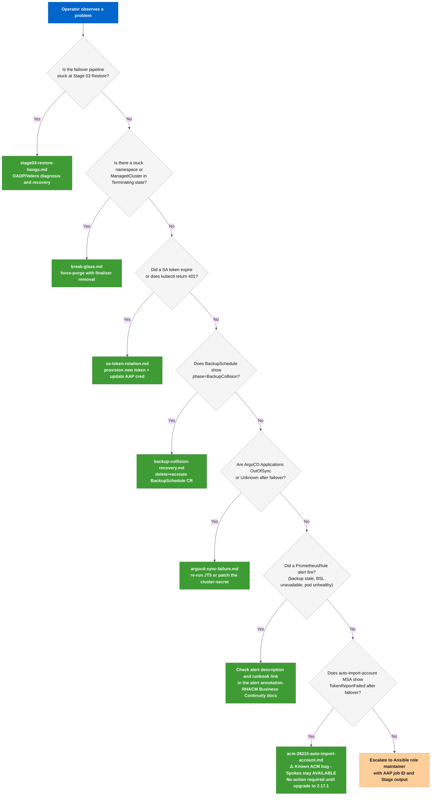

# Runbook Index: ACM DR Operations

Operational runbooks for incident response and planned maintenance. Each runbook covers a specific failure mode or operation with a diagnosis procedure, recovery steps, and rollback path.

---

## When to use which runbook

---

## Runbooks

| File | Covers | Severity |
|------|--------|----------|
| [stage03-restore-hangs.md](stage03-restore-hangs.md) | OADP Restore stuck or failed during failover Stage 03 | ❌ Critical |
| [sa-token-rotation.md](sa-token-rotation.md) | Long-lived ServiceAccount token expired (kubectl 401) | ❌ Critical |
| [break-glass.md](break-glass.md) | Namespace or ManagedCluster stuck in Terminating state | ⚠️ High |
| [backup-collision-recovery.md](backup-collision-recovery.md) | BackupSchedule shows phase=BackupCollision, Hub stops writing backups | ⚠️ High |
| [argocd-sync-failure.md](argocd-sync-failure.md) | ArgoCD Applications stuck in OutOfSync or Unknown after failover | ⚠️ High |
| [acm-38215-auto-import-account.md](acm-38215-auto-import-account.md) | `auto-import-account` MSA shows `TokenReportFailed` after failover (ACM < 2.17.1) | ⚠️ Informational |

---

## General principles

- **Check the AAP job output first.** Every stage writes **`✅`**/**`❌`**/**`⚠️`** prefixed debug messages. The failing task name and the targeted cluster context appear in the task header. Start there before running any manual command.
- **Dry-run before acting.** Most recovery steps have a **`--dry-run=server -o yaml`** or **`acm_dr_failover_manager_dry_run=true`** equivalent. Run it first.
- **Document what you ran.** During an incident, paste every command you execute and its output into the incident ticket. The timeline is reconstructable only if the commands are recorded.
- **Never bypass safety guards to make a test pass.** If a Stage 00 assertion blocks you, understand why before bypassing it. The guards exist because the condition they check has caused real outages.

---

## RTO targets (lab environment)

| Operation | Target | Notes |
|-----------|--------|-------|
| DR failover (production run) | 30 minutes | Includes Spoke reconnection |
| DR failover (dry-run) | 10 minutes | No Restore, no Spoke wait |
| SA token rotation + AAP update | 15 minutes | Per cluster |
| Stuck namespace recovery | 5 minutes | Via break-glass script |
| Stage 03 Restore recovery | 60 minutes | Depends on backup size |

---

## External references

- [RHACM 2.17 Business Continuity](https://docs.redhat.com/en/documentation/red_hat_advanced_cluster_management_for_kubernetes/2.17/html-single/business_continuity/index): official DR documentation
- [KCS 7039710: ManagedServiceAccount token restore failure](https://access.redhat.com/solutions/7039710): MSA token purge after OADP Restore
- [KCS 5950901: Graceful managed cluster removal](https://access.redhat.com/solutions/5950901): Spoke detach procedure
