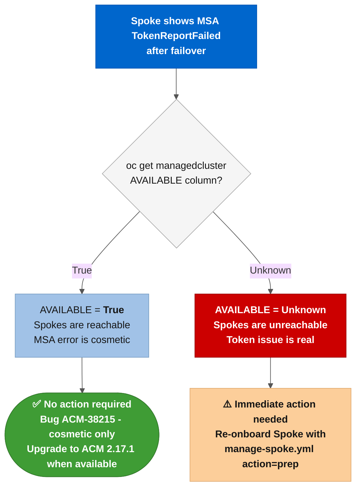

# `auto-import-account` MSA shows `TokenReportFailed` after failover

**Severity:** ⚠️ Informational - Spoke clusters stay fully operational. No DR action required.

**Affected versions:** ACM 2.14.x through 2.17.0 (all cluster types: OCP, ARO, AKS, EKS, GKE, IKS).

**Fixed in:** ACM 2.17.1. **No backport exists for ACM 2.14, 2.15, or 2.16.** If you are on any of those versions, you must upgrade to at least ACM 2.17 and apply the 2.17.1 patch to get the permanent fix.

**References:** [KCS 7039710](https://access.redhat.com/solutions/7039710)

---



---

## What you will see

Within 5-10 minutes of a successful OADP Restore on the newly active Hub, the `auto-import-account` ManagedServiceAccount (MSA) on one or more Spokes enters a `TokenReportFailed` condition:

```bash
oc get managedserviceaccount -n <spoke-namespace> -o yaml
```

```yaml
status:
  conditions:
  - lastTransitionTime: "2026-08-23T19:55:12Z"
    message: 'failed to update the token secret: secrets "auto-import-account" is
      forbidden: cannot set an ownerRef on a resource you can''t delete: , <nil>'
    reason: TokenReportFailed
    status: "False"
    type: TokenReported
```

The AAP failover job completes with ✅ `successful`. The ManagedClusters show `AVAILABLE=True` and `JOINED=True`. Only the MSA condition is unhealthy.

**This is a known ACM bug, not a sign that the failover failed.**

---

## Why the MSA fails

The OADP Restore recreates the `auto-import-account` MSA object on the passive Hub. Once the cluster transitions to active, the ACM addon-controller tries to rotate the MSA token by setting an `ownerRef` on the token Secret. On the restored Hub, the addon-controller process lacks permission to set that `ownerRef` on a pre-existing Secret, so every rotation attempt fails.

The Jira description originally said this only affected non-OCP clusters (AKS, EKS, IKS). Lab testing on 2026-08-23 confirmed it affects **all cluster types**, including ARO Classic (OCP 4.x).

The condition appears about 5 minutes after the Restore completes because that is how long the addon-controller takes to detect the MSA and attempt the first token rotation.

---

## Why your Spoke clusters stay available

This automation does not use the `auto-import-account` MSA for Spoke connectivity. The import path and the ongoing connection path are both kubeconfig-based:

| Mechanism | Created by | Used for |
| :--- | :--- | :--- |
| `auto-import-secret` (Opaque kubeconfig Secret) | Stage 01 `spoke_prep` task 1.2.2 | Initial import of the Spoke into ACM |
| `acm-dr-<spoke>-sa-token` (mirrored SA token Secret) | Stage 01 `spoke_prep` task 1.6.2 | Operation C: Spoke reconnection after failover |
| `auto-import-account` MSA | ACM addon-controller (internal) | ACM token auto-rotation (not used by this automation) |

The `ansible-dr-orchestrator` ServiceAccount token in `acm-dr-<spoke>-sa-token` is a long-lived credential that does not depend on MSA health. Spoke reconnection via Operation C reads that Secret and reconnects via `auto-import-secret`. The MSA error has no effect on the reconnection or on the Spoke's operational status.

---

## What Stage 07 does (and does not do)

Stage 07 of the failover pipeline (`07_sanitize_passive_hub.yml`) runs before reconnecting any Spoke. Tasks 7.1.1 through 7.1.1d discover all MSAs across Spoke namespaces on the newly active Hub and delete any that already have `TokenReported=False`.

```
Stage 07 runs → checks MSA status → [if already broken] deletes MSA + token Secret
             → Operation C reconnects Spoke via auto-import-secret
```

**When this mitigation triggers:** If a Hub has been passive for hours or days after a previous failover, the `auto-import-account` MSA may have already entered `TokenReportFailed` before the next failover begins. In that case, Stage 07 purges the broken MSA, and the reconnect proceeds cleanly before the MSA is recreated.

**When this mitigation is skipped:** OADP Restore resets the MSA object's STATUS to empty. Immediately after the Restore, the MSA appears healthy because the addon-controller has not yet attempted a rotation. Stage 07 sees no broken MSAs and skips tasks 7.1.1c/d. The MSA only fails ~5 minutes later, after the pipeline has already completed successfully.

**Net result in both cases:** Spokes are AVAILABLE. The MSA error appears, but it is cosmetic.

---

## Confirming the bug vs a real connectivity problem

Run these commands on the newly active Hub to distinguish the known MSA bug from an actual Spoke connectivity failure.

```bash
# 1. ManagedCluster availability - this is what matters for DR operations
oc get managedcluster --context <HUB_CONTEXT>
# Expected: AVAILABLE=True, JOINED=True for all Spokes

# 2. MSA condition - this is where the bug appears
oc get managedserviceaccount -A --context <HUB_CONTEXT>
# Expected: auto-import-account shows TokenReportFailed (the known bug)
#           ansible-dr-orchestrator-msa (if enabled) should be healthy

# 3. Klusterlet status on the Spoke itself - confirms real connectivity
oc get klusterlet klusterlet -o jsonpath='{.status.conditions}' \
  --context <SPOKE_CONTEXT>
# Expected: HubConnectionDegraded=False, Applied=True
```

If `AVAILABLE=True` and the klusterlet reports healthy, the Spoke is fully operational. The MSA error is the bug.

If `AVAILABLE=False` or the klusterlet shows `HubConnectionDegraded=True`, that is a real connectivity problem. See [`sa-token-rotation.md`](sa-token-rotation.md) and [`break-glass.md`](break-glass.md) for diagnosis paths.

---

## Suppressing the error manually (optional)

Deleting the broken MSA causes ACM to recreate it. On ACM < 2.17.1 the new MSA will fail again within minutes. This is a loop with no exit until the upgrade. Manual deletion is only useful to temporarily clear alerts or dashboards.

```bash
# Delete the broken MSA (ACM will recreate it and it will fail again on ACM < 2.17.1)
oc delete managedserviceaccount auto-import-account \
  -n <spoke-namespace> \
  --context <HUB_CONTEXT>

# Also delete the token Secret to avoid orphaned credentials
oc delete secret auto-import-account \
  -n <spoke-namespace> \
  --context <HUB_CONTEXT>
```

There is no permanent workaround. The fix is upgrading to ACM 2.17.1.

---

## Permanent fix

Upgrade RHACM to **2.17.1** (or later). It corrects how the addon-controller sets the `ownerRef` on the token Secret after an OADP Restore, so the rotation succeeds on the first attempt.

> ⚠️ **No backport to older release streams.** The fix ships only in the 2.17 stream (starting at 2.17.1). ACM 2.14, 2.15, and 2.16 will not receive this patch. If you are running any of those versions, upgrading to at least ACM 2.17 is required. On ACM < 2.17.1, Stage 07 of this automation mitigates the symptom but does not eliminate the root cause.

To upgrade MCH channel:

```bash
# Check current version
oc get mch multiclusterhub -n open-cluster-management \
  --context <HUB_CONTEXT> \
  -o jsonpath='{.status.currentVersion}'

# Switch to the 2.17 channel (adjust to the correct release channel)
oc patch mch multiclusterhub -n open-cluster-management \
  --context <HUB_CONTEXT> \
  --type merge \
  -p '{"spec":{"channel":"release-2.17"}}'
```

Monitor the upgrade in the MCH status before declaring it complete:

```bash
watch oc get mch multiclusterhub -n open-cluster-management \
  --context <HUB_CONTEXT> \
  -o jsonpath='{.status.currentVersion}'
```

---

## Summary

| Question | Answer |
| :--- | :--- |
| Do Spokes stay operational? | Yes. `AVAILABLE=True` is maintained throughout. |
| Is the failover pipeline blocked? | No. The pipeline completes before the MSA error appears. |
| Does Stage 07 fix the bug? | Partially. It purges pre-existing broken MSAs. It does not prevent the MSA from failing again after reconnect. |
| Is this a regression from a previous working state? | No. The MSA fails on every failover on ACM < 2.17.1. |
| What triggers operator action? | Only if `AVAILABLE=False` or the klusterlet reports `HubConnectionDegraded=True`. Those are real problems; this bug alone is not. |
| Permanent fix? | Upgrade to ACM 2.17.1 (ACM-39882). No backport to 2.14, 2.15, or 2.16. |

---

## Related issue: Spoke shows `Available=Unknown` due to expired auto-import token {#spoke-available-unknown}

**Severity:** ❌ Operational - Spoke clusters are unreachable from the Hub. RHACM cannot manage them. Requires immediate remediation.

**Not the same as ACM-38215.** The MSA `TokenReportFailed` bug (above) is cosmetic; spokes stay `Available=True`. The issue described here is a distinct failure mode where the spoke is genuinely disconnected from the Hub.

---

### What you will see

After a failover or failback, one or more ManagedClusters on the new active Hub show:

```bash
oc get managedcluster --context <HUB_CONTEXT>
# NAME                    HUB ACCEPTED   MANAGED CLUSTER URLS   JOINED   AVAILABLE   AGE
# aro-classic-spoke-01    true                                   True     Unknown     ...
```

Stage 08 of the failover pipeline warns:

```
⚠️ [SPOKE IMPORT] Spoke 'aro-classic-spoke-01' reports ManagedClusterImportSucceeded=False
(reason: ManagedClusterImporting) on the new Hub ...
```

---

### Why it happens

OADP backs up the `auto-import-account` ServiceAccount and its token Secret as part of the cluster snapshot. If the SA token expired before the backup ran (SA tokens have a bounded lifetime set by the cluster's API server configuration), the restored Secret carries an already-invalid token.

When the newly active Hub tries to send the klusterlet manifest to the spoke via the expired token, the spoke API server returns HTTP 401. The Hub's import controller marks `ManagedClusterImportSucceeded=False` and the spoke transitions to `Available=Unknown`.

You can confirm the token is expired by testing it directly:

```bash
# Extract the auto-import-account token from the Hub spoke namespace
IMPORT_TOKEN=$(oc get secret auto-import-account \
  -n <spoke-namespace> \
  --context <HUB_CONTEXT> \
  -o jsonpath='{.data.token}' | base64 -d)

# Test the token against the spoke API server
curl -k -H "Authorization: Bearer $IMPORT_TOKEN" \
  https://<spoke-api-url>:6443/api/v1/namespaces \
  -w "\nHTTP %{http_code}\n" -o /dev/null -s
# Expected when expired: HTTP 401
# Expected when valid:   HTTP 200 or HTTP 403
```

---

### Fix via AAP automation

Run the **Spoke Onboarding Job Template** for each affected spoke. The onboarding playbook creates a fresh `auto-import-secret` with a new short-lived kubeconfig for the initial import, updates the fleet Secret, and re-pushes the klusterlet manifest. It is fully idempotent: running it against a spoke that is already onboarded updates only what changed.

In AAP UI, go to **Templates > JT - ACM DR - LAB - Spoke Onboarding > Launch**.

Attach credentials at launch:

| Credential | Purpose |
| :--- | :--- |
| Hub credential (`ARO Hub 01 (Source)`) as **`ACM DR - Target Cluster`** type | Hub-side operations (ManagedCluster update, fleet Secret, auto-import-secret) |
| AAP Automation Token | Self-registration of any updated credentials |
| Spoke credential (`ARO Classic Spoke 01 (SA)`) | Direct spoke connectivity for klusterlet install |

Survey values:

| Field | Value |
| :--- | :--- |
| **Action (Required)** | `onboard` |
| **Spoke Cluster Name (Required)** | the ManagedCluster name shown in `oc get managedcluster` |

The job creates a fresh `auto-import-secret` in the spoke namespace on the Hub. The Hub's import controller picks it up within ~1 minute and pushes a new klusterlet manifest to the spoke. Within 2-3 minutes the spoke transitions back to `Available=True`.

---

### Prevention

**Stage 08 of the failover pipeline** (task 8.1.4k and 8.1.5c) now queries `ManagedClusterImportSucceeded` for every spoke on the new Hub immediately after failover completes. Any spoke with a non-`True` status triggers a `⚠️ [SPOKE IMPORT]` warning in the job output.

The check runs automatically on every failover. No configuration is needed. Operators should treat any `[SPOKE IMPORT]` warning as an action item: re-run the Spoke Onboarding JT for each listed spoke before declaring the failover complete.

**Root cause prevention:** The expired token issue occurs when a Hub has been passive for a long time between failovers, allowing the SA token to expire before the next backup. RHACM rotates the `auto-import-account` token on a schedule, but if the Hub was passive during that window, the rotation may not have run.

Mitigation: run the Spoke Onboarding JT on a schedule (monthly or quarterly) to refresh the auto-import Secret on any hub that has been passive for extended periods. This keeps the backup snapshot current with a valid token.

---

### How to distinguish this from ACM-38215

| Symptom | ACM-38215 (MSA bug) | Expired auto-import token |
| :--- | :--- | :--- |
| `AVAILABLE` column | `True` | `Unknown` |
| `ManagedClusterImportSucceeded` | `True` (spokes are connected) | `False` |
| MSA `TokenReported` condition | `False` (TokenReportFailed) | Healthy or also `False` |
| Spoke klusterlet status | Healthy | `HubConnectionDegraded=True` |
| Operator action required? | No | Yes - re-run Spoke Onboarding JT |
| Fix | Upgrade to ACM 2.17.1 | Run Spoke Onboarding JT (action=onboard) |
