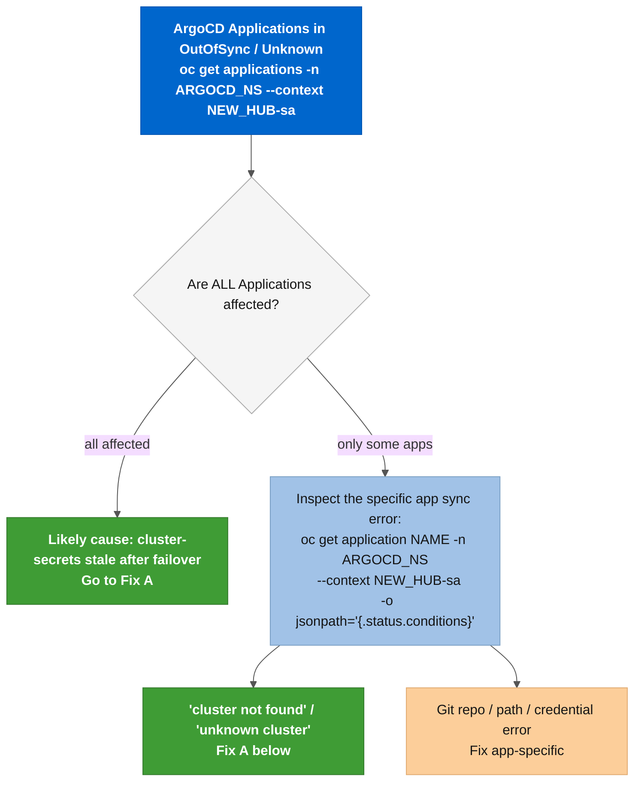

# Runbook: ArgoCD ApplicationSet sync failures after failover

**Severity:** ⚠️ High. Spoke workloads managed by GitOps stay at their pre-failover state and do not receive new policy or application changes until ArgoCD reconnects to the new Hub.

---

## Table of contents

- [Situation](#situation)
- [Diagnosis](#diagnosis)
- [Fix A: automated (re-run ArgoCD instance setup)](#fix-a-automated-re-run-argocd-instance-setup)
- [Fix B: manual cluster-secret patch (break-glass)](#fix-b-manual-cluster-secret-patch-break-glass)
- [Verification](#verification)
- [Prevention](#prevention)
- [Consequences and rollback](#consequences-and-rollback)
- [External references](#external-references)

---

## Situation

After a DR failover or failback, one or more ArgoCD Applications on the new active Hub appear in **`OutOfSync`**, **`Unknown`**, or **`Degraded`** state:

```bash
oc get applications -n <ARGOCD_NAMESPACE> --context <NEW_HUB>-sa
# NAME               SYNC STATUS   HEALTH STATUS
# my-policies        OutOfSync     Degraded
# my-app-a           Unknown       Missing
```

The root cause: the ArgoCD cluster-secrets in the instance namespace still reference the old Hub's ManagedCluster API endpoints. When the GitOpsCluster controller imported Spoke cluster-secrets during initial setup, it recorded each Spoke API URL as seen from the *previous* active Hub. After failover, the Spokes reconnect to the new Hub and appear as new ManagedCluster objects with new internal routes. ArgoCD's **`server`** field in the cluster-secret still points to the old endpoint, which is no longer reachable from the new Hub. ArgoCD marks Applications as **`Unknown`**.

This failure only occurs when:

- The ArgoCD instance was configured on the old Hub but was not re-configured on the new Hub, or
- WF-01 ran but Stage 07 was skipped (**`skip_gates`** flag or an early abort), or
- The GitOpsCluster controller on the new Hub has not yet reconciled the cluster-secrets for newly reconnected Spokes (transient, resolves within 5 minutes).

---

## Diagnosis



**Step 1: Identify which ArgoCD instances are affected:**

```bash
# List all ArgoCD instances on the new Hub
oc get argocd -A --context <NEW_HUB>-sa

# For each instance, check Application sync status
oc get applications -n <ARGOCD_NAMESPACE> --context <NEW_HUB>-sa
```

**Step 2: Inspect the cluster-secret for a failing Spoke:**

```bash
# List cluster-secrets ArgoCD uses for Spoke discovery
oc get secrets -n <ARGOCD_NAMESPACE> \
  -l argocd.argoproj.io/secret-type=cluster \
  --context <NEW_HUB>-sa \
  -o custom-columns=NAME:.metadata.name,SERVER:.data.server

# Decode the server field to check the URL
oc get secret <CLUSTER_SECRET_NAME> \
  -n <ARGOCD_NAMESPACE> \
  --context <NEW_HUB>-sa \
  -o jsonpath='{.data.server}' | base64 -d && echo
# If this URL points to the old Hub's internal address, proceed to Fix A.
```

**Step 3: Check whether the GitOpsCluster controller has reconciled:**

```bash
# GitOpsCluster status shows whether Spoke clusters were discovered on the new Hub
oc get gitopscluster -n <ARGOCD_NAMESPACE> --context <NEW_HUB>-sa -o yaml | grep -A5 'conditions:'
# Look for: reason: ReconcileComplete
# If it shows an error, the controller has not finished; wait 5 minutes and recheck.
```

---

## Fix A: automated (re-run ArgoCD instance setup)

Re-running the setup role recreates all cluster-secrets from the current RHACM ManagedCluster objects on the new Hub, which carry the correct post-failover Spoke API endpoints. The role is fully idempotent.

**Option 1: Via AAP (recommended in production):**

Launch **Job Template 5** (**`ACM DR - LAB - ArgoCD Setup`**) against the new active Hub. Pass the same **`acm_argocd_instances`** list used during initial setup. The role re-applies the ArgoCD CR, GitOpsCluster, and ApplicationSet configuration.

Alternatively, run **Workflow WF-03** (**`WF - ACM DR - LAB - ArgoCD Setup and Validation`**), which includes a post-run validation gate.

**Option 2: Via ansible-playbook:**

```bash
ansible-playbook playbooks/manage-argocd-instance.yml \
  -e k8s_target_context=<NEW_HUB>-sa \
  -e @<your-instances-vars-file>.yml \
  -v
```

Where the vars file contains the **`acm_argocd_instances`** list with the same configuration used during initial setup. If you no longer have the file, check the AAP Job Template 5's "Extra Variables" field for the original values.

---

## Fix B: manual cluster-secret patch (break-glass)

Use this only when re-running the setup role is not possible (AAP is unreachable, or the vars file is lost).

**Step 1: Get the correct Spoke API URL from RHACM on the new Hub:**

```bash
oc get managedcluster <SPOKE_NAME> \
  --context <NEW_HUB>-sa \
  -o jsonpath='{.spec.managedClusterClientConfigs[0].url}' && echo
# Example: https://api.aro-spoke-01.example.com:6443
```

**Step 2: Update the cluster-secret:**

```bash
# Encode the new server URL
NEW_URL_B64=$(oc get managedcluster <SPOKE_NAME> \
  --context <NEW_HUB>-sa \
  -o jsonpath='{.spec.managedClusterClientConfigs[0].url}' | base64 -w0)

oc patch secret <CLUSTER_SECRET_NAME> \
  -n <ARGOCD_NAMESPACE> \
  --context <NEW_HUB>-sa \
  --type merge \
  -p "{\"data\":{\"server\":\"${NEW_URL_B64}\"}}"
```

**Step 3: Trigger an ArgoCD refresh:**

```bash
oc get applications -n <ARGOCD_NAMESPACE> --context <NEW_HUB>-sa -o name | \
  xargs -I{} oc annotate {} \
    -n <ARGOCD_NAMESPACE> \
    --context <NEW_HUB>-sa \
    argocd.argoproj.io/refresh=hard
```

---

## Verification

```bash
# All Applications should return to Synced/Healthy within 2-5 minutes
oc get applications -n <ARGOCD_NAMESPACE> --context <NEW_HUB>-sa
# Expected:
# NAME               SYNC STATUS   HEALTH STATUS
# my-policies        Synced        Healthy
# my-app-a           Synced        Healthy
```

If Applications stay in **`OutOfSync`** after re-running the setup role:

```bash
# Confirm the GitOpsCluster controller finished reconciling
oc get gitopscluster -n <ARGOCD_NAMESPACE> --context <NEW_HUB>-sa -o yaml | grep -A5 'conditions:'
# Look for: reason: ReconcileComplete

# Confirm cluster-secrets now have the correct server URL
oc get secrets -n <ARGOCD_NAMESPACE> \
  -l argocd.argoproj.io/secret-type=cluster \
  --context <NEW_HUB>-sa \
  -o custom-columns=NAME:.metadata.name,SERVER:.data.server
```

---

## Prevention

**WF-01 (**`WF - ACM DR - LAB - Full Failover Drill`**) handles this automatically.** Stage 07 of the failover pipeline re-runs **`acm_argocd_instance_setup`** on the new active Hub after Spokes reconnect. Under normal conditions, cluster-secrets are up to date before WF-01 exits.

This failure appears when:

| Scenario | Root cause | Fix |
|----------|-----------|-----|
| WF-01 was skipped entirely | ArgoCD setup was never run on the new Hub | Run JT5 or WF-03 |
| WF-01 Stage 07 failed or was skipped | Check job output for Stage 07 tasks | Re-run JT5 |
| WF-01 completed but Spokes reconnected after Stage 07 | Race between Spoke reconnect and GitOpsCluster reconcile | Wait 5 minutes; re-run JT5 if still stuck |
| Failback without re-running JT5 on the returning Hub | ArgoCD on the original Hub has stale cluster-secrets from before the failover | Re-run JT5 on the original Hub |

Keep the **`acm_argocd_instances`** list in a versioned file (for example, **`examples/aap/argocd-instances.yml`**) so you can always supply the vars to JT5 without searching AAP's job history.

---

## Consequences and rollback

Re-running **`acm_argocd_instance_setup`** is safe at any time. The role is idempotent: it updates the ArgoCD CR and associated secrets in-place without removing Applications or their deployed resources on Spoke clusters. GitOps-managed workloads on Spokes are not restarted or removed.

The manual cluster-secret patch (Fix B) fixes only the **`server`** URL. If the cluster-secret is also missing CA data or a bearer token, Fix A is the only complete recovery path.

---

## External references

- [roles/acm_argocd_instance_setup](../../roles/acm_argocd_instance_setup): role that provisions cluster-secrets via GitOpsCluster
- [docs/aap/aap.md](../aap/aap.md): Job Template 5 (ArgoCD Setup) and WF-03 details
- [Red Hat OpenShift GitOps documentation](https://docs.redhat.com/en/documentation/red_hat_openshift_gitops)
- [RHACM GitOpsCluster API reference](https://access.redhat.com/documentation/en-us/red_hat_advanced_cluster_management_for_kubernetes/2.17/html-single/business_continuity/index)
