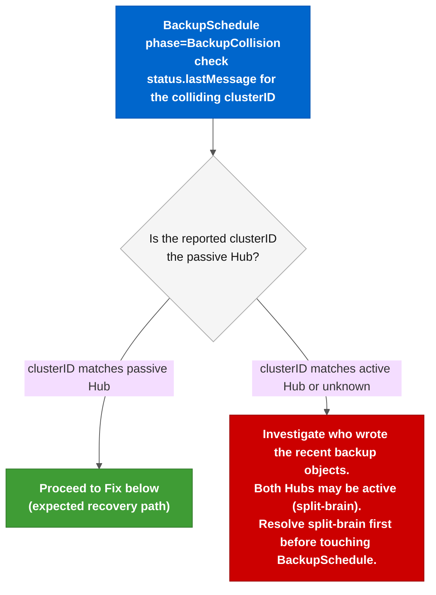

# Runbook: BackupCollision Recovery

**Severity:** ⚠️ High. The active Hub stops writing backups and the controller will not self-recover. Every minute in this state increases RPO. Resolve before the next scheduled DR drill or failover.

---

## Situation

One Hub shows **`phase=BackupCollision`** in its **`BackupSchedule`** status:

```bash
oc get backupschedule -n open-cluster-management-backup --context <HUB>-sa
# NAME                PHASE             MESSAGE
# schedule-acm-hub    BackupCollision   Backup ... was created by another cluster...
```

The RHACM backup controller sees that the most recent backup object in the shared storage location carries the **`cluster.open-cluster-management.io/backup-cluster`** label of a **different Hub**. When that happens, the controller stops running new backups on the affected Hub and sets **`phase=BackupCollision`**. It does not self-recover even if the other Hub pauses or stops writing.

Two scenarios produce this reliably:

1. **Failback (expected)**: after a failback, the returning active Hub finds backups in storage written by the former DR leader (a different clusterID). The controller correctly identifies the mismatch and enters **`BackupCollision`**. The **`acm_dr_failover_manager`** Stage 05 now handles this automatically (see [Prevention](#prevention)).

2. **Concurrent unpaused schedules**. a DR drill where the passive Hub's **`BackupSchedule`** was temporarily unpaused while the active Hub's schedule was still running, causing both Hubs to write to the same storage within the same backup window.

---

## Diagnosis



**Step 1: Identify the collision:**

```bash
# Check the controller's last message (shows the conflicting backup name and clusterID)
oc get backupschedule schedule-acm-hub \
  -n open-cluster-management-backup \
  --context <HUB>-sa \
  -o jsonpath='{.status.lastMessage}' && echo

# Example output:
# "Backup acm-resources-schedule-20260817202404 was created by cluster f3df6ee3-... 
#  and this cluster 2f6c4731-... cannot update it. To resume backups, 
#  create a new BackupSchedule resource."
```

**Step 2: Confirm the passive Hub is paused:**

```bash
# The other Hub must have spec.paused=true before you proceed.
# If it is not paused, pause it now to stop it from writing more backups.
oc get backupschedule schedule-acm-hub \
  -n open-cluster-management-backup \
  --context <OTHER_HUB>-sa \
  -o jsonpath='{.spec.paused}' && echo
# Expected: true
```

If the other Hub is also writing backups (both show **`phase=Enabled`**), you have a split-brain condition. Pause one Hub first: **`oc patch backupschedule schedule-acm-hub -n open-cluster-management-backup --context <OTHER_HUB>-sa --type merge -p '{"spec":{"paused":true}}'`**. Wait for its next backup cycle (check **`status.lastBackupTime`** stops advancing), then continue here.

---

## Fix

The controller's own status message says the only path forward: "create a new BackupSchedule resource to resume backups from this cluster." Deleting and recreating the CR resets the controller's state machine. The backup data in Azure Blob or AWS S3 is **not affected**. Only the CR is removed.

**Step 1: Save the current spec:**

```bash
oc get backupschedule schedule-acm-hub \
  -n open-cluster-management-backup \
  --context <HUB>-sa \
  -o yaml > /tmp/backupschedule-backup.yaml

# Confirm the file looks correct before continuing
cat /tmp/backupschedule-backup.yaml
```

**Step 2: Delete the BackupSchedule CR:**

```bash
oc delete backupschedule schedule-acm-hub \
  -n open-cluster-management-backup \
  --context <HUB>-sa
# backupschedule.cluster.open-cluster-management.io "schedule-acm-hub" deleted
```

**Step 3: Recreate it from the saved spec:**

Remove the **`status`** block and any server-generated fields (**`resourceVersion`**, **`uid`**, **`creationTimestamp`**, **`generation`**, **`managedFields`**) before applying, or apply the cleaned manifest directly:

```bash
# Strip server-generated fields and reapply
grep -v '^\s*\(resourceVersion\|uid\|creationTimestamp\|generation\|managedFields\|status\):' \
  /tmp/backupschedule-backup.yaml | \
  oc apply -f - --context <HUB>-sa
```

Alternatively, let the Lab Setup role recreate it:

```bash
ansible-playbook playbooks/setup-acm-dr-hub.yml \
  -e k8s_target_context=<HUB_CONTEXT>-sa \
  -e is_primary_hub=true \
  -e acm_dr_hub_setup_allow_existing_dr=true \
  -v
```

**Step 4: Verify recovery:**

```bash
# Wait ~15 seconds for the controller to pick up the new CR
oc get backupschedule schedule-acm-hub \
  -n open-cluster-management-backup \
  --context <HUB>-sa \
  -o wide
# Expected: phase=Enabled, lastBackupTime advancing
```

---

## Prevention

BackupCollision happens when two Hubs write to the same storage location concurrently. The safest rule: **pause before you unpause**.

| Action | Required sequence |
|--------|-------------------|
| DR drill (unpausing passive Hub temporarily) | Pause active Hub first → unpause passive → run drill → pause passive → unpause active |
| Failover (active to passive) | The **`acm_dr_failover_manager`** role pauses the source Hub in Stage 02 before restoring on the destination. Never skip Stage 02. |
| Failback | Same: pause the current active before enabling the original active |
| Manual BackupSchedule operations | Always confirm **`spec.paused=true`** on the other Hub before unpausing this one |

**Failback collision is now handled automatically.** Stage 05 of **`acm_dr_failover_manager`** ([`05_create_schedule.yml`](../../roles/acm_dr_failover_manager/tasks/05_create_schedule.yml)) polls the BackupSchedule phase after creation and, if it detects **`BackupCollision`**, deletes and recreates the CR automatically. No manual intervention is needed for the standard failover/failback cycle.

Manual intervention (the procedure above) is only needed if:
- The collision occurs outside an **`orchestrate-dr-failover.yml`** run (e.g., after a manual BackupSchedule operation or an aborted mid-run failover).
- The automatic recycle in Stage 05 itself fails (check the play output for task **`5.1.4b`**).

For the concurrent-unpaused-schedules scenario, Stage 02 (**`pause_backup_schedule.yml`**) prevents it during normal failover. Collision there only happens when operators bypass the role.

---

## Consequences and rollback

- **Deleting the BackupSchedule CR does not delete any backup data.** Azure Blob objects and S3 objects created by previous backup runs are unaffected.
- **The passive Hub's sync Restore CR is also unaffected.** The passive Hub reads from the same storage and will continue receiving new backups once the active Hub resumes.
- **No rollback needed.** The delete+recreate is instantaneous and the controller returns to **`Enabled`** within one reconciliation cycle (~15 seconds). If the new CR stays in **`BackupCollision`**, the other Hub is still writing. Pause it first and check **`status.lastMessage`** again for the updated clusterID.

---

## External references

- [RHACM 2.17 Business Continuity: Backup and Restore](https://docs.redhat.com/en/documentation/red_hat_advanced_cluster_management_for_kubernetes/2.17/html-single/business_continuity/index#active-passive-config): official BackupSchedule documentation
- [acm_dr_failover_manager: Stage 02 pause logic](../../roles/acm_dr_failover_manager/tasks/02_pause_schedule.yml): prevents concurrent writes during failover
- [acm_dr_failover_manager: Stage 05 collision guard](../../roles/acm_dr_failover_manager/tasks/05_create_schedule.yml): auto-recycles the BackupSchedule when **`BackupCollision`** is detected after failback
