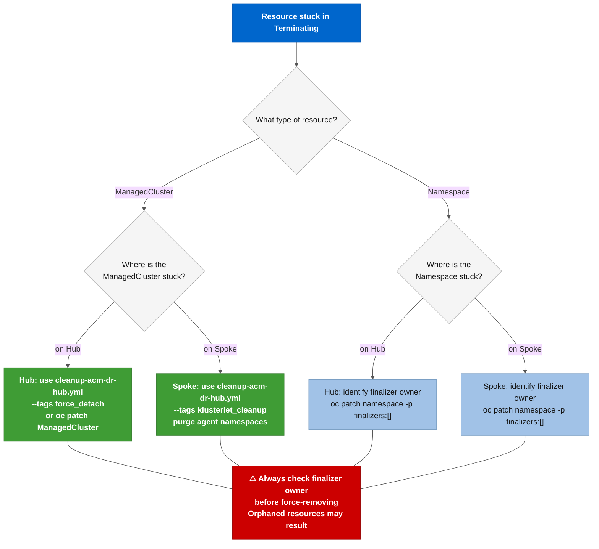

# Runbook: Break-Glass: Stuck Namespaces and ManagedClusters

**Severity:** ⚠️ High. Resources stuck in **`Terminating`** for more than 15 minutes indicate RHACM or the klusterlet left finalizers that the controller will not remove automatically.

---

## Situation

After a failed Spoke detach or Hub cleanup, one or more of these may be stuck in **`Terminating`**:

- A ManagedCluster object on the Hub
- A namespace on the Hub (**`open-cluster-management-<spoke-name>`**)
- A namespace on the Spoke (**`open-cluster-management-agent`**, **`open-cluster-management-agent-addon`**)

The controllers that own the finalizers are not running or cannot reach the Spoke, so the namespace never terminates. The Ansible role (**`acm_dr_spoke_manager`**, task **`02_spoke_detach.yml`**) attempts inline finalizer removal and retries before escalating, but in some cases RHACM's own controller re-adds the finalizer faster than Ansible removes it.

---

## Choose the right tool

| Situation | Tool |
|-----------|------|
| ManagedCluster on Hub stuck in **`Terminating`** | [examples/scripts/break-glass/force_purge_managed_cluster.sh](../../examples/scripts/break-glass/force_purge_managed_cluster.sh) |
| Namespace on Hub stuck in **`Terminating`** | [examples/scripts/break-glass/force_delete_namespace.sh](../../examples/scripts/break-glass/force_delete_namespace.sh) |
| Namespace on Spoke stuck in **`Terminating`** | [examples/scripts/break-glass/force_delete_namespace.sh](../../examples/scripts/break-glass/force_delete_namespace.sh) (run against the Spoke context) |
| Only one or two finalizers to remove manually | **`oc patch`** via the **`/finalize`** API (see Manual finalizer removal below) |

**Use the Ansible role first.** The **`acm_dr_spoke_manager`** role with **`acm_dr_spoke_manager_action=detach`** handles stuck finalizers inline (see [roles/acm_dr_spoke_manager/tasks/02_spoke_detach.yml](../../roles/acm_dr_spoke_manager/tasks/02_spoke_detach.yml)). Run the role before reaching for the break-glass scripts unless the role itself is stuck.



---

## Prerequisites

```bash
export K8S_AUTH_KUBECONFIG="${HOME}/.kube/config-acm-lab-dr"
export KUBECONFIG="${K8S_AUTH_KUBECONFIG}"
```

---

## Procedure: **`force_purge_managed_cluster.sh`**

Removes a ManagedCluster object from the Hub by stripping its finalizers via the Kubernetes **`/finalize`** API and then deleting the object. Also cleans up the associated namespace on the Hub.

```bash
# Dry-run first (default when pressing ENTER)
./examples/scripts/break-glass/force_purge_managed_cluster.sh

# When prompted:
#   Hub context: your-hub-01-sa
#   ManagedCluster name(s): aro-spoke-01 aro-spoke-02

# Confirm the plan, then enter 'y' to proceed
```

Steps performed:
1. Patches **`ManagedCluster.metadata.finalizers`** to **`[]`** via the **`/finalize`** subresource
2. Deletes the **`ManagedCluster`** object
3. Deletes the matching namespace (**`open-cluster-management-<spoke-name>`**) on the Hub

Limitations:
- It does not touch the Spoke cluster itself
- It does not remove the klusterlet from the Spoke (the Spoke's **`open-cluster-management-agent`** namespace will be orphaned; run **`force_delete_namespace.sh`** on the Spoke separately if needed)

---

## Procedure: **`force_delete_namespace.sh`**

Removes a namespace stuck in **`Terminating`** by patching its finalizers list to empty via the **`/finalize`** API.

```bash
# Run against the Hub (for Hub-side namespaces):
./examples/scripts/break-glass/force_delete_namespace.sh

# When prompted:
#   Cluster context: your-hub-01-sa
#   Namespace(s): open-cluster-management-your-spoke-01

# Run against the Spoke (for Spoke-side namespaces):
./examples/scripts/break-glass/force_delete_namespace.sh

# When prompted:
#   Cluster context: aro-spoke-01-sa
#   Namespace(s): open-cluster-management-agent open-cluster-management-agent-addon
```

---

## Manual finalizer removal (single object)

When only one finalizer needs stripping and you prefer not to run a script:

```bash
# Check current finalizers on a ManagedCluster
oc get managedcluster <SPOKE_NAME> --context <HUB_CONTEXT>-sa \
  -o jsonpath='{.metadata.finalizers}'

# Remove all finalizers via strategic merge patch
oc patch managedcluster <SPOKE_NAME> --context <HUB_CONTEXT>-sa \
  --type merge -p '{"metadata": {"finalizers": []}}'

# If oc patch returns "not found" (object is terminating and rejected by admission):
# Use the /finalize API directly (bypasses admission webhooks)
oc proxy &
PROXY_PID=$!
curl -X PUT "http://localhost:8001/apis/cluster.open-cluster-management.io/v1/managedclusters/<SPOKE_NAME>/finalize" \
  -H "Content-Type: application/json" \
  -d '{"kind":"ManagedCluster","apiVersion":"cluster.open-cluster-management.io/v1","metadata":{"name":"<SPOKE_NAME>","finalizers":[]}}'
kill "${PROXY_PID}"
```

---

## After break-glass: verify clean state

```bash
# Confirm no Terminating ManagedClusters on the Hub
oc get managedclusters --context <HUB_CONTEXT>-sa | grep Terminating

# Confirm no stuck namespaces on the Hub
oc get namespaces --context <HUB_CONTEXT>-sa | grep Terminating

# Confirm no stuck namespaces on the Spoke (if you had Spoke access)
oc get namespaces --context <SPOKE_CONTEXT>-sa 2>/dev/null | grep Terminating
```

---

## Consequences and rollback

Break-glass operations are irreversible once the ManagedCluster object is deleted:
- The Spoke is no longer visible to RHACM
- Any policies or ApplicationSets targeting that Spoke by name will show "placement not found" or similar errors
- The Spoke's klusterlet processes will keep running and trying to reconnect until manually stopped

To re-onboard the Spoke after a break-glass:

```bash
ansible-playbook playbooks/manage-spoke.yml \
  -e k8s_target_context=<HUB_CONTEXT>-sa \
  -e acm_dr_spoke_manager_action=prep \
  -e acm_dr_spoke_manager_cluster_name=<SPOKE_NAME> \
  -e acm_dr_spoke_manager_spoke_k8s_context=<SPOKE_CONTEXT>-sa \
  --tags spoke_prep \
  -v
```

---

## External references

- [KCS 5950901: Graceful managed cluster removal procedure](https://access.redhat.com/solutions/5950901). preferred path before break-glass
- [RHACM 2.17 Business Continuity](https://docs.redhat.com/en/documentation/red_hat_advanced_cluster_management_for_kubernetes/2.17/html-single/business_continuity/index): post-failover cleanup guidance
