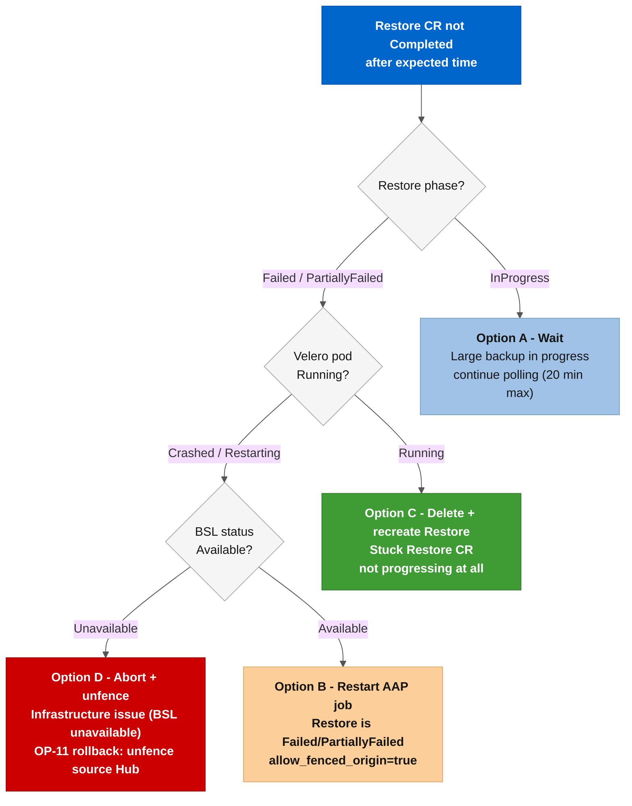

# Runbook: Stage 03 Restore Hangs or Fails

**Severity:** ❌ Critical. Hub is in a fenced state (BackupSchedule paused) but the Restore has not completed. The fleet is unmanaged on the Destination Hub until this is resolved.

---

## Situation

The ACM DR failover pipeline stopped at **Stage 03. Activate OADP Restore on Destination Hub**. The AAP job is waiting for the Restore CR to reach **`Completed`** phase and has not progressed past this point.

Possible causes:

| Symptom | Likely cause |
|---------|-------------|
| **`Restore.status.phase: InProgress`** after 30+ minutes | OADP Velero pod is hung or has OOM-killed |
| **`Restore.status.phase: Failed`** | Velero could not read from the Backup Storage Location (BSL) |
| **`Restore.status.phase: PartiallyFailed`** | Some resources restored; others failed due to API conflicts |
| No Restore CR exists on Destination Hub | Stage 03 creation task failed (check API error in AAP output) |
| Restore completed but Stage 04 still waits | MSA token purge is running (normal; give it 5 more minutes) |

---

## Prerequisites

```bash
export K8S_AUTH_KUBECONFIG="${HOME}/.kube/config-acm-lab-dr"
export KUBECONFIG="${K8S_AUTH_KUBECONFIG}"
# Use the -sa ServiceAccount contexts; they do not expire.
# Confirm contexts:
oc config get-contexts
```

---

## Step 1: Diagnose the Restore status

```bash
# Check Restore phase on the Destination Hub
oc get restore -n open-cluster-management-backup \
  --context <DEST_HUB_CONTEXT>-sa -o wide

# Get detailed status and Velero messages
oc describe restore <RESTORE_NAME> -n open-cluster-management-backup \
  --context <DEST_HUB_CONTEXT>-sa

# Check Velero pod health
oc get pods -n open-cluster-management-backup \
  --context <DEST_HUB_CONTEXT>-sa

# Check Velero pod logs for errors
oc logs -n open-cluster-management-backup \
  -l app.kubernetes.io/name=velero \
  --context <DEST_HUB_CONTEXT>-sa --tail=100
```

---

## Step 2: Check the Backup Storage Location

```bash
# BSL must be Available; if not, no Restore can read from it
oc get backupstoragelocation -n open-cluster-management-backup \
  --context <DEST_HUB_CONTEXT>-sa -o wide

# If the BSL is Unavailable, check cloud credentials:
# For Azure: verify AZURE_CLIENT_ID, AZURE_CLIENT_SECRET, AZURE_TENANT_ID are correct
# For AWS: verify AWS_ACCESS_KEY_ID, AWS_SECRET_ACCESS_KEY, AWS_DEFAULT_REGION are correct
# These come from the cloud credential attached to the Hub Setup Job Template.
oc get secret cloud-credentials -n open-cluster-management-backup \
  --context <DEST_HUB_CONTEXT>-sa -o jsonpath='{.data}' | base64 -d 2>/dev/null | head -5
# Do NOT print the full secret value - check only that the keys are present.
```

---



---

## Step 3: Decision: wait, retry, or abort

### Option A: Wait (Restore is InProgress, Velero pod is healthy)

The Restore is still running. Large fleets (20+ Spokes) or large hub state (many policies, ArgoCD apps) can take 20-40 minutes. Watch the Velero pod logs and wait for **`Restore.status.phase: Completed`**.

```bash
# Watch Restore phase until Completed or Failed
watch -n 10 'oc get restore -n open-cluster-management-backup \
  --context <DEST_HUB_CONTEXT>-sa -o wide'
```

### Option B: Restart the failed AAP job (Restore is Completed but job timed out)

If the Restore completed after the AAP job's wait window expired, re-run the Ansible job with **`allow_fenced_origin=true`**. This flag tells Stage 00 that the Source Hub being fenced is intentional (not a safety-guard violation). The job will skip the fencing step (already done) and continue from Stage 04.

In AAP: relaunch the job with extra vars:

```
allow_fenced_origin: "true"
skip_gates: "true"
```

From CLI:

```bash
ansible-playbook playbooks/orchestrate-dr-failover.yml \
  -e failover_direction=<SOURCE>-sa_to_<DEST>-sa \
  -e allow_fenced_origin=true \
  -e skip_gates=true \
  -v
```

### Option C: Delete and recreate the Restore (Restore is Failed)

```bash
# ⚠️ Confirm the Restore exists and its phase before deleting
oc get restore <RESTORE_NAME> -n open-cluster-management-backup \
  --context <DEST_HUB_CONTEXT>-sa -o jsonpath='{.status.phase}'

# Delete the failed Restore
oc delete restore <RESTORE_NAME> -n open-cluster-management-backup \
  --context <DEST_HUB_CONTEXT>-sa

# Fix the root cause first (BSL, cloud credentials, Velero pod) then re-run the job.
# Use allow_fenced_origin=true because the Source Hub is still fenced.
```

### Option D: Abort and unfence the Source Hub (recovery abandoned)

Use only when the Restore is unrecoverable and you need to return to the original state without completing the failover. The Source Hub is currently fenced (BackupSchedule paused); this step re-enables it.

```bash
# ⚠️ This unpauses the Source Hub's BackupSchedule - data will resume being backed up
# from the SOURCE Hub. The Destination Hub will NOT become active.
oc patch backupschedule acm-dr-hub-schedule \
  -n open-cluster-management-backup \
  --context <SOURCE_HUB_CONTEXT>-sa \
  --type merge \
  -p '{"spec": {"paused": false}}'

# Confirm the BackupSchedule is unpaused
oc get backupschedule -n open-cluster-management-backup \
  --context <SOURCE_HUB_CONTEXT>-sa -o wide
```

---

## Step 4: Verify recovery

```bash
# After a successful Restore:
# 1. MCH should be Running on Destination Hub
oc get mch -A --context <DEST_HUB_CONTEXT>-sa

# 2. ManagedClusters should be appearing (initially Unknown, then Available after Stage 04)
oc get managedclusters --context <DEST_HUB_CONTEXT>-sa

# 3. BackupSchedule should be active on Destination Hub (Stage 06 creates this)
oc get backupschedule -n open-cluster-management-backup \
  --context <DEST_HUB_CONTEXT>-sa -o wide
```

---

## Known pitfall: **`latest`** backup resolves to wrong side

If the Restore picks up a backup from the wrong Hub, the symptoms are: MCH starts but Spokes show wrong states, ArgoCD apps point to wrong clusters. This happens when **`Restore.spec.clusterActivationBackupName: latest`** is used instead of the explicit clusterID-based resolution in Stage 03.

Do not reintroduce **`latest`** as a value. The explicit resolution in [roles/acm_dr_failover_manager/tasks/03_activate_hub.yml](../../roles/acm_dr_failover_manager/tasks/03_activate_hub.yml) (Stage 03, task group **`acm_dr_failover_manager_resolve_explicit_backup`**) exists specifically to avoid this. See the Known-bug mitigations section in the project documentation.

---

## Escalation

If none of the options above resolves the issue within 60 minutes:
1. Capture the full **`oc describe restore`** output and Velero pod logs.
2. Capture **`oc get backup -n open-cluster-management-backup --context <DEST> -o wide`**.
3. Open a Red Hat support case referencing [RHACM Business Continuity](https://docs.redhat.com/en/documentation/red_hat_advanced_cluster_management_for_kubernetes/2.17/html-single/business_continuity/index) and the Velero error message.
