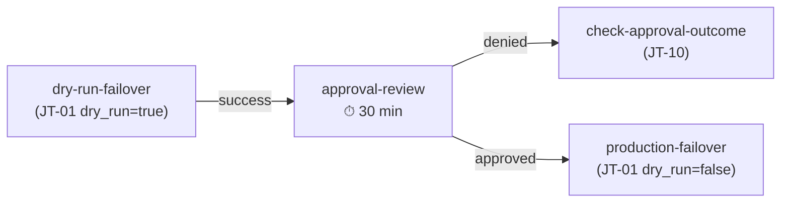

# E2E validation: AAP integration

End-to-end validation of the ACM DR collection running exclusively through AAP Job Templates and Workflow Job Templates. Covers the complete lifecycle (hub setup, spoke onboarding, failover, failback, rolling upgrade, DR drill) on AAP 2.7 Gateway, plus CasC import gotchas and AAP API issues discovered during testing.

For cloud-agnostic test cases, see the [main E2E validation matrix](e2e-validation-matrix.md). For copy-paste commands, see the [E2E command reference](e2e-command-reference.md). For cloud-specific tests, see [Azure (ARO)](e2e-validation-azure.md) and [AWS (ROSA)](e2e-validation-aws.md).

## Table of contents

<!-- markdownlint-disable MD051 -->

- [Topologies tested](#topologies-tested)
- [Workflow Job Templates](#workflow-job-templates)
- [AAP 2.7 Gateway API gotchas](#aap-27-gateway-api-gotchas)
- [CasC import gotchas](#casc-import-gotchas)
- [AKS with Azure AD-only auth](#aks-with-azure-ad-only-auth)
- [Operational findings](#operational-findings)
- [Known issues](#known-issues)
- [Consolidated results](#consolidated-results)

<!-- markdownlint-enable MD051 -->

---

## Topologies tested

Three validation rounds ran between 2026-08-11 and 2026-08-24, each targeting a different scenario.

| Round | Date | Hubs | Spokes | ACM versions | Focus |
|-------|------|------|--------|--------------|-------|
| Round 2 | 2026-08-11 | 3 ARO Classic (eastus, OCP 4.18) | 7 (ARO Classic x3, ARO HCP, AKS, EKS, GKE, IKS) - 6 distributions, 4 clouds | 2.13 → 2.14 (rolling upgrade) | Full AAP-only lifecycle, no CLI. Per-cluster credential model, 3-hub round-trip failover, rolling upgrade |
| Round 3 | 2026-08-21 | 2 ARO Classic (eastus, OCP 4.20) | 2 (ARO Classic, AKS with Azure AD-only auth) | 2.15 → 2.17 (planned maintenance) | All 5 Workflow Job Templates, fresh CasC import, AKS AAD-only |
| Round 4 | 2026-08-24 | Same as Round 3 | Same as Round 3 | 2.17 | WF-01 approval denial failure path, JT-10 Check Approval Outcome |

---

## Workflow Job Templates

Five WJTs were validated across Rounds 3 and 4. All operations in Round 2 ran via individual Job Templates.

| WJT | Name | Nodes | Validated in |
|-----|------|-------|:------------:|
| WF-01 | WF - ACM DR - LAB - Hub Switchover | 3 (dry-run → approval → production) | Round 3, 4 |
| WF-02 | WF - ACM DR - LAB - Planned Maintenance Switchover | 4 (failover → approval/upgrade → dry-run failback → production failback) | Round 3 |
| WF-03 | WF - ACM DR - LAB - Full Lab Rebuild | 4 (setup primary → onboard spokes → setup passive → validation dry-run) | Round 3 |
| WF-04 | WF - ACM DR - LAB - Spoke Onboarding Batch | 7 slots (linear chain) | Round 3 |
| WF-05 | WF - ACM DR - LAB - Full DR Drill | 4 (readiness check → dry-run → approval → notification) | Round 3 |

---

## AAP 2.7 Gateway API gotchas

Three bugs in [playbooks/check-approval-outcome.yml](../../playbooks/check-approval-outcome.yml) were discovered during Round 4. All are AAP 2.7 Gateway API shape issues not covered by prior AWX documentation. Confirmed against a live instance on 2026-08-24.

### `awx_job_id` is an Ansible extra_var, not an environment variable

AAP injects `awx_job_id` as an Ansible extra variable. `lookup('ansible.builtin.env', 'AWX_JOB_ID')` always returns empty string.

```yaml
# Wrong - always empty in AAP 2.7
_awx_job_id: "{{ lookup('ansible.builtin.env', 'AWX_JOB_ID', default='') }}"

# Correct
_awx_job_id: "{{ awx_job_id | default('') }}"
```

### Parent WFT job link is `source_workflow_job`, not `workflow_job`

`GET /api/controller/v2/jobs/<id>/` on AAP 2.7 Gateway uses `related.source_workflow_job` (not `related.workflow_job` from older AWX). Extract the numeric ID with `regex_search`:

```yaml
_wjt_job_id: >-
  {{
    (_job_detail.json.related.source_workflow_job | default(''))
    | regex_search('workflow_jobs/(\d+)/', '\1') | first | default('')
  }}
```

### `workflow_approvals` endpoint has no WFT job ID filter

`GET /api/controller/v2/workflow_approvals/?job=<wft_id>` returns an error. The endpoint accepts no filter for the parent WFT job.

Query the WFT job's nodes instead. Find the node where `summary_fields.unified_job_template.unified_job_type == 'workflow_approval'` and read `timed_out` directly from `summary_fields.job.timed_out`:

```yaml
- name: "Query WFT job nodes to find the approval node"
  ansible.builtin.uri:
    url: "{{ _controller_host }}/api/controller/v2/workflow_jobs/{{ _wjt_job_id }}/workflow_nodes/?page_size=50"
    method: GET
    headers:
      Authorization: "Bearer {{ controller_token }}"
    validate_certs: "{{ controller_verify_ssl }}"
    status_code: [200]
  register: _wft_nodes_query

- name: "Extract timed_out from the approval node"
  ansible.builtin.set_fact:
    _approval_timed_out: >-
      {{
        ((_wft_nodes_query.json.results | default([]))
        | selectattr('summary_fields.unified_job_template.unified_job_type', 'defined')
        | selectattr('summary_fields.unified_job_template.unified_job_type', 'equalto', 'workflow_approval')
        | map(attribute='summary_fields.job') | list | first | default({})
        ).get('timed_out', false) | bool
      }}
```

The correct filter key is `unified_job_type` on the `summary_fields.unified_job_template` dict, not `type`.

### Quick reference

| Gotcha | Confirmed field / endpoint | Correct approach |
|--------|---------------------------|------------------|
| `awx_job_id` is an extra_var | `{{ awx_job_id }}` | Do not use `lookup('env', ...)` |
| Parent WFT link is `source_workflow_job` | `related.source_workflow_job` | Use `regex_search` to extract numeric ID |
| `workflow_approvals` has no WFT job filter | No `?job=<id>` filter | Query WFT job nodes; filter by `unified_job_type == 'workflow_approval'` |

---

## CasC import gotchas

Found during fresh CasC import against AAP 2.7 Gateway (Round 3). All fixes are in **`examples/aap/`** - no changes to collection roles or playbooks.

### GitHub PAT credential type missing `github_repo_url`

**File**: [controller_credential_types.yml](../../examples/aap/controller_credential_types.yml)

The **`ACM DR - GitHub PAT`** credential type injected **`GITHUB_USER`** and **`GITHUB_PAT`** but not **`GITHUB_REPO`**. The Hub Setup role reads **`acm_dr_hub_setup_github_repo_url`** from **`lookup('ansible.builtin.env', 'GITHUB_REPO', default='')`**. With an empty default, the preflight assert failed.

Fix: added **`github_repo_url`** as a required field and **`GITHUB_REPO: "{{ github_repo_url }}"`** to the injector env block. Updated [controller_credentials.yml](../../examples/aap/controller_credentials.yml) to add the matching input.

### WF nodes do not inherit WJT-level credentials

**File**: [controller_workflow_job_templates.yml](../../examples/aap/controller_workflow_job_templates.yml)

AAP 2.7 does not inherit WJT-level credentials on **`simplified_workflow_nodes`** automatically. Each JT node must have explicit **`credentials:`** entries. Without them, environment variables injected by custom credential types (e.g., **`ACM_DR_SOURCE_CONTEXT`**) are never set.

### WF-03 MCH channel default triggers OLM downgrade

**File**: [controller_workflow_job_templates.yml](../../examples/aap/controller_workflow_job_templates.yml)

The Hub Setup JT survey default for **`acm_dr_hub_setup_mch_channel`** was **`release-2.14`**. Running WF-03 against Hubs already at ACM 2.17 without overriding this value attempts an OLM channel downgrade (rejected by the operator, causing the run to hang). Fix: WF-03 nodes now set the channel in **`extra_data`**. Update this value whenever the lab standard ACM version changes.

### AAP API requires explicit survey field values

The AAP API requires all survey **`required: true`** fields in the launch payload even when they have a **`default`**. The UI fills defaults automatically; API callers must pass them explicitly:

```bash
curl -X POST .../workflow_job_templates/<id>/launch/ \
  -d '{"extra_vars": {"acm_dr_failover_action": "failover"}}'
```

### Subscription API group qualifier

When upgrading ACM via **`oc patch`**, the Subscription resource must be qualified as **`subscription.operators.coreos.com`** (not bare **`subscription`**). ACM installs its own Subscription CRD under **`apps.open-cluster-management.io`**, and **`oc patch subscription`** without the API group qualifier hits the wrong resource.

---

## AKS with Azure AD-only auth

Validated in Round 3 with an AKS cluster configured with **`enableLocalAccounts: false`**.

AKS clusters with Azure AD-only auth block **`az aks get-credentials --admin`**. However, Kubernetes ServiceAccount tokens bypass the Azure AD OIDC layer entirely. The **`ansible-dr-orchestrator`** SA token works regardless because SA tokens are issued by the API server, not the Azure AD provider.

### Onboarding workflow

1. Connect with **`az aks get-credentials`** (Azure AD interactive auth, one-time)
2. Create the **`ansible-dr-orchestrator`** SA and extract the token via [02_provision_automation_sa.sh](../../examples/scripts/cluster-onboarding/02_provision_automation_sa.sh)
3. Build a static kubeconfig with the SA token and CA data embedded (use **`--raw`** flag to preserve embedded CA data). No Azure CLI dependency after this step

### Fleet Kubeconfig and heterogeneous CA handling

ARO Classic spokes use publicly trusted certificates (no CA data needed in the kubeconfig). AKS spokes require the cluster CA embedded as **`certificate-authority-data`** (base64). The Fleet Kubeconfig credential handles both correctly as long as the kubeconfig is built with the **`--raw`** flag, which preserves embedded CA data rather than collapsing it to a file reference.

---

## Operational findings

### Version gate accuracy

Validated across ACM 2.13, 2.14, 2.15, and 2.17. The **`acm_dr_failover_manager_acm_ocp_matrix`** correctly blocks Spokes outside the destination Hub's compatibility range and passes cleanly after upgrade.

| ACM version | OCP compatibility range | OCP 4.20 Spokes | `skip_version_gate` needed? |
|-------------|------------------------|------------------|-----------------------------|
| 2.13 | 4.16–4.19 | Outside range | Yes |
| 2.14 | 4.17–4.20 | Inside range | No |
| 2.15+ | 4.17+ | Inside range | No |

### 3-hub rolling upgrade timing

The Planned Maintenance Switchover pattern (failover to free a Hub, upgrade the idle Hub, failback) completed across all 3 Hubs in approximately 40 minutes: 3 failovers at ~12 minutes each plus 3 ACM upgrades at ~4 minutes each.

### Credential swap operational overhead

Job Templates without **`ask_credential_on_launch=true`** require swapping Source/Dest credentials via the AAP API before each failover direction change (two API calls per swap: disassociate old credential, associate new credential). A Workflow Template pre-wiring both directions reduces friction for repeated failover/failback cycles.

### SA provisioning idempotency

Confirmed across all rounds: the **`onboard`** action detects existing **`ansible-dr-orchestrator`** ServiceAccounts and skips re-creation without errors.

### Passive sync Restore recycling observation

After a full round-trip (Hub-01 → Hub-02 → Hub-03 → Hub-01), the intermediate Hubs retained **`restore-acm-activate`** from their time as failover destinations but did not have **`restore-passive-sync`** recycled by Stage 05a. This happens when Hubs have fenced BackupSchedules rather than clean passive state. No operational impact, but a re-run of lab setup is needed to re-establish passive sync on those Hubs.

> **Note**: The fleet kubeconfig Spoke reconnection path originally documented in Round 2 (Key Finding 5) was **superseded** by Operation C (mirrored `acm-dr-<spoke>-sa-token` Secrets). The 2026-08-23 full-cycle test confirmed Gate 1.3.4 as "0 via fleet kubeconfig context, 2 via Operation C mirrored token."

### WF-04 single-Spoke caveat

WF-04 uses a linear chain (**`spoke-01 → spoke-02 → ... → spoke-07`**). Disconnecting a node to run a subset promotes the next node to root, which auto-starts and fails immediately (no credentials or extra_data). **Use the standalone "ACM DR - LAB - Spoke Onboarding" JT for single additions.**

### WF-01 approval denial path



JT-10 (Check Approval Outcome) runs on the denial/timeout failure branch and classifies the event as "Approval Denied" or "Approval Timed Out". It exits **`rc=0`** regardless of outcome so the WFT failure path is not complicated by an additional node failure. Validated through 5 iterative runs that uncovered the 3 API bugs documented in [AAP 2.7 Gateway API gotchas](#aap-27-gateway-api-gotchas).

---

## Known issues

Discovered during Round 2 post-test console validation. Also documented in the [Known issues](e2e-validation-matrix.md#known-issues) section of the main E2E matrix.

| ID | Issue | Status | Fix / workaround |
|----|-------|--------|------------------|
| KI-01 | ACM console "All Clusters" React error after ACM 2.13 → 2.14 upgrade | Cosmetic | Hard refresh (**`Ctrl+Shift+R`**) or incognito window clears stale browser cache |
| KI-02 | ACM 2.14 console backend pipe errors (**`ERR_STREAM_UNABLE_TO_PIPE`** every ~15s) | Product bug | Not caused by DR operations. Report upstream |
| KI-03 | IKS VPC Spoke addon scheduling failures on single-node **`cx2.2x4`** (4GB RAM) | Resource constraint | Add a second node to the worker pool. 9 RHACM addons need >4GB |
| KI-04 | ManagedClusterAddon health not verified in postflight | Resolved | Added task **`8.1.5b.1`** with per-Spoke warnings. Controlled by **`acm_dr_failover_manager_warn_on_degraded_addons`** (default **`true`**) |

---

## Consolidated results

| Round | Date | Topology | Tests | Passed | Gaps/bugs fixed | Focus |
|-------|------|----------|:-----:|:------:|:---------------:|-------|
| Round 2 | 2026-08-11 | 3 Hubs, 7 Spokes (6 distros, 4 clouds) | 21 | 21 | - | Full lifecycle via AAP JTs (no CLI) |
| Round 3 | 2026-08-21 | 2 Hubs, 2 Spokes (ARO + AKS AAD-only) | 5 WFs | all ✅ | 4 CasC gaps | All 5 WJTs, fresh CasC import |
| Round 4 | 2026-08-24 | Same as Round 3 | 5 runs | 1 ✅ (final) | 3 API bugs | Approval denial failure path |
| **Total** | - | - | - | **all** | **7** | - |
