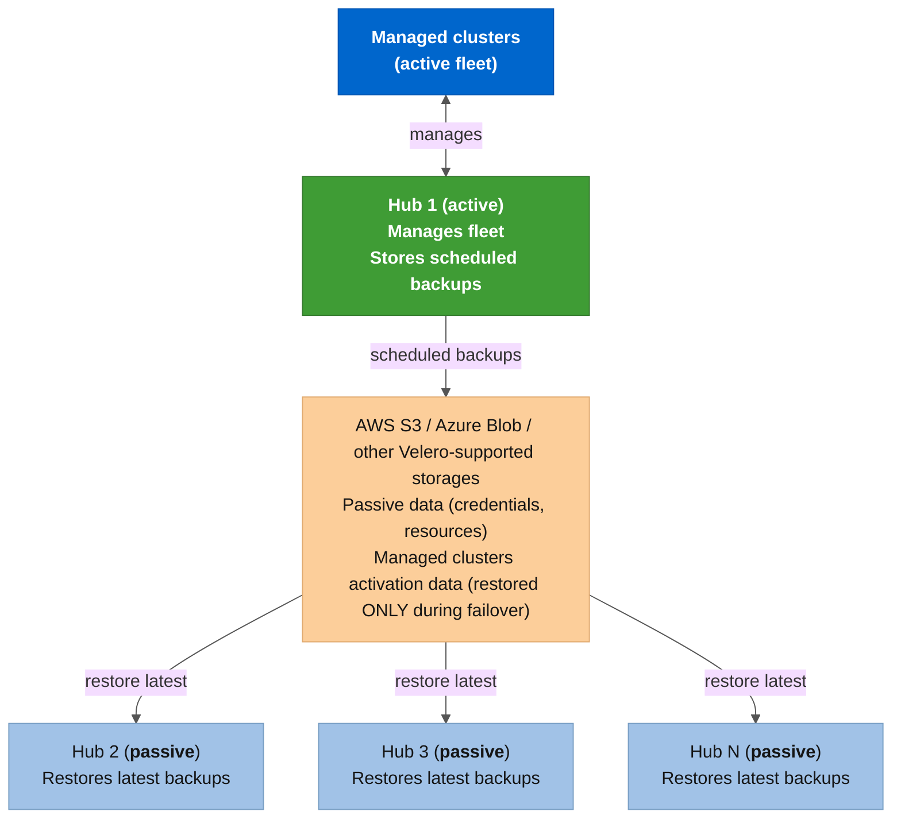
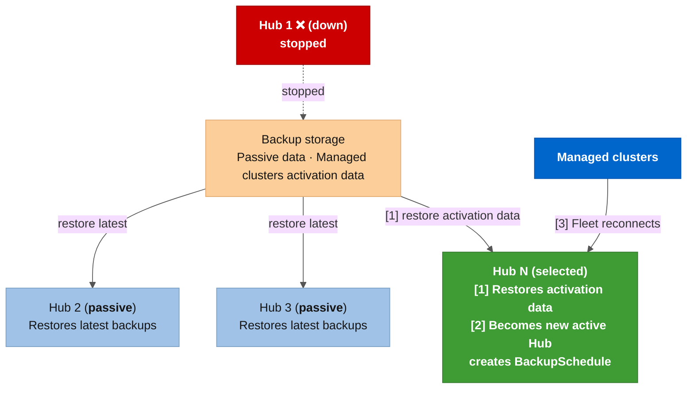

# E2E validation matrix

End-to-end validation of every cloud-agnostic automation feature (failover, failback, Spoke lifecycle, ArgoCD, safety gates). Cloud-specific tests (infrastructure provisioning, storage) live in dedicated files: [Azure (ARO)](e2e-validation-azure.md) and [AWS (ROSA)](e2e-validation-aws.md). Every test case maps to a specific role, stage, or safety gate in the collection.

> **Scope**: 3 ARO Classic Hub clusters (starting at OCP 4.18.34 / ACM 2.13, then upgraded through OCP 4.20 / ACM 2.15 and OCP 4.22 / ACM 2.17), plus 7 Spoke clusters across 6 distributions (ARO Classic, ARO HCP, AKS, EKS, GKE, IKS) and 4 clouds (Azure, AWS, Google Cloud, IBM Cloud), covering DR failover/failback, Planned Maintenance Switchover with ACM upgrade, multi-hub topology (1 active + 2 passive), Spoke lifecycle, ArgoCD instance management, cleanup, and all safety gates and negative tests.

## Table of contents

<!-- markdownlint-disable MD051 -->

- [Test infrastructure](#test-infrastructure)
- [Version strategy](#version-strategy)
- [Prerequisites](#prerequisites)
- [Phase 0: Infrastructure provisioning](#phase-0-infrastructure-provisioning)
- [Phase 1: Lab setup and topology detection](#phase-1-lab-setup-and-topology-detection)
- [Phase 2: Spoke onboarding](#phase-2-spoke-onboarding)
- [Phase 3: DR failover (standard)](#phase-3-dr-failover-standard)
- [Phase 4: Planned Maintenance Switchover with ACM upgrade](#phase-4-planned-maintenance-failover-with-acm-upgrade)
- [Phase 5: DR readiness drill](#phase-5-dr-readiness-drill)
- [Phase 6: Edge cases and negative tests](#phase-6-edge-cases-and-negative-tests)
- [Phase 7: Cleanup and decommission](#phase-7-cleanup-and-decommission)
- [Phase 8: Multi-hub topology (3-hub)](#phase-8-multi-hub-topology-3-hub)
- [Phase 9: Spoke lifecycle](#phase-9-spoke-lifecycle)
- [Phase 10: ArgoCD instance management](#phase-10-argocd-instance-management)
- [Phase 11: Scripts validation](#phase-11-scripts-validation)
- [Command reference](#command-reference)
- [Results summary](#results-summary)
- [Known issues](#known-issues)
- [Known limitations](#known-limitations)

<!-- markdownlint-enable MD051 -->

## Test infrastructure

### Cluster inventory

| Cluster | Resource Group | ARO Cluster Name | Domain | Region | OCP | ACM | Initial DR Role |
|---------|----------------|------------------|--------|--------|-----|-----|-----------------|
| Hub 01 | **`acmdr-hub-01-rg`** | **`acmdr-hub-01`** | **`hub-01`** | **`eastus`** | 4.18.34 | 2.13 | Active |
| Hub 02 | **`acmdr-hub-02-rg`** | **`acmdr-hub-02`** | **`hub-02`** | **`eastus`** | 4.18.34 | 2.13 | Passive |
| Hub 03 | **`acmdr-hub-03-rg`** | **`acmdr-hub-03`** | **`hub-03`** | **`eastus`** | 4.18.34 | 2.13 | Passive (Phase 8) |

### URLs

| Cluster | Console | API |
|---------|---------|-----|
| Hub 01 | **`console-openshift-console.apps.<hub-01-domain>.<region>.aroapp.io`** | **`api.<hub-01-domain>.<region>.aroapp.io:6443`** |
| Hub 02 | **`console-openshift-console.apps.<hub-02-domain>.<region>.aroapp.io`** | **`api.<hub-02-domain>.<region>.aroapp.io:6443`** |
| Hub 03 | **`console-openshift-console.apps.<hub-03-domain>.<region>.aroapp.io`** | **`api.<hub-03-domain>.<region>.aroapp.io:6443`** |

### Kubeconfig contexts

| Cluster | User context | Automation SA context |
|---------|--------------|-----------------------|
| Hub 01 | **`acmdr-hub-01`** | **`acmdr-hub-01-sa`** |
| Hub 02 | **`acmdr-hub-02`** | **`acmdr-hub-02-sa`** |
| Hub 03 | **`acmdr-hub-03`** | **`acmdr-hub-03-sa`** |

### Spoke cluster(s) used for testing

| Spoke | Distribution | OCP/K8s version | Region | Context (SA) | Cloud label | Notes |
|-------|-------------|-----------------|--------|--------------|-------------|-------|
| aro-classic-spoke-01 | ARO Classic | OCP 4.20.15 | eastus | **`aro-classic-spoke-01-sa`** | auto (Azure) | External auth via Microsoft Entra ID |
| aro-hcp-spoke-01 | ARO HCP | OCP 4.20.32 | canadacentral | **`aro-hcp-spoke-01-sa`** | auto (Azure) | Hosted Control Plane, cross-region test |
| aro-classic-spoke-02 | ARO Classic | OCP 4.20.15 | eastus | **`aro-classic-spoke-02-sa`** | auto (Azure) | Same-region ARO Classic Spoke |
| aks-spoke-01 | AKS | K8s 1.35.6 | eastus | **`aks-spoke-01-sa`** | Azure (manual) | Non-OCP Spoke, tests AKS onboarding path |
| eks-spoke-01 | EKS (AWS) | K8s 1.34.9 | us-east-1 | **`eks-spoke-01-sa`** | Amazon (manual) | Cross-cloud Spoke, tests EKS onboarding path |
| gke-spoke-01 | GKE Autopilot | K8s 1.35.6 | us-central1 | **`gke-spoke-01-sa`** | Google (manual) | Cross-cloud Spoke, tests GKE onboarding path |
| iks-spoke-01 | IKS VPC | K8s 1.35.7 | Dallas (us-south) | **`iks-spoke-01-sa`** | IBMCloud (manual) | Cross-cloud Spoke, tests IKS onboarding path |

## Version strategy

The [RHACM-to-OCP compatibility matrix](https://access.redhat.com/support/policy/updates/advanced-cluster-management)
encoded in [*`acm_dr_failover_manager/defaults/main.yml`*](../../roles/acm_dr_failover_manager/defaults/main.yml)
(lines 139-147) determines which ACM versions can run on which OCP versions.

| RHACM | Supported OCP versions |
|-------|------------------------|
| **2.13** | 4.16, 4.17, **4.18**, 4.19 |
| 2.14 | 4.17, **4.18**, 4.19, 4.20 |
| **2.15** | **4.18**, 4.19, **4.20**, 4.21 |
| 2.16 | 4.19, **4.20**, 4.21, **4.22** |
| **2.17** | **4.20**, 4.21, **4.22**, 4.23 |

Starting with **ACM 2.13 on OCP 4.18** and following a multi-step upgrade ladder exercises every version gate in the automation, tests cross-version backup/restore, and finishes at the latest supported level (ACM 2.17 / OCP 4.22).

### Upgrade ladder

| Step | OCP | ACM | What is tested |
|------|-----|-----|---------------|
| 1. Base install | 4.18.34 | 2.13 | Full DR test: Phases 1-8 (failover, failback, multi-hub) |
| 2. ACM upgrade | 4.18 | 2.13 → **2.15** | Planned Maintenance Switchover (Phase 4), version gates |
| 3. OCP upgrade | 4.18 → **4.20** | 2.15 | ACM 2.15 supports 4.20 ✓, re-validate DR |
| 4. ACM upgrade | 4.20 | 2.15 → **2.17** | Second Planned Maintenance Switchover |
| 5. OCP upgrade | 4.20 → **4.22** | 2.17 | ACM 2.17 supports 4.22 ✓, final DR at latest level |

### Version gate scenarios

1. **Same-version failover**: both Hubs on ACM 2.13 / OCP 4.18 (Phase 3)
2. **Adjacent upgrade failover**: one Hub on 2.13, the other upgraded to 2.15, gap = 1 (allowed)
3. **Backward restore gate**: attempt failover from ACM 2.15 back to 2.13 (blocked)
4. **Version gap gate**: Hub-01 on 2.17 with Hub-02 on 2.13, gap > 1 (blocked)

## Prerequisites

### Tooling and accounts

- [ ] **`oc`** CLI installed (matching OCP 4.18+)
- [ ] **`ansible-playbook`**, **`ansible-lint`**, **`yamllint`** installed
- [ ] Ansible collections installed: **`ansible-galaxy collection install -r collections/requirements.yml`**
- [ ] Cloud-specific prerequisites: see [Azure](e2e-validation-azure.md#azure-prerequisites) or [AWS](e2e-validation-aws.md#aws-prerequisites)

### Dedicated KUBECONFIG

All E2E testing uses a **dedicated kubeconfig** (**`~/.kube/config-acm-dr`**) separate from the default **`~/.kube/config`**, so lab contexts do not pollute the user's main configuration. The **`.local/cloud/azure/env-setup.sh`** file exports both **`KUBECONFIG`** and **`K8S_AUTH_KUBECONFIG`** pointing to this file. Always **`source .local/cloud/azure/env-setup.sh`** before running any playbook or **`oc`**/**`kubectl`** command for the E2E lab.

### Cluster provisioning and context registration

Cloud-specific cluster provisioning steps (ARO, ROSA) are documented in the per-cloud files: [Azure prerequisites](e2e-validation-azure.md#aro-cluster-provisioning-and-context-registration) and [AWS prerequisites](e2e-validation-aws.md#rosa-cluster-provisioning-and-context-registration). The SA provisioning step is cloud-agnostic and uses [*`examples/scripts/cluster-onboarding/02_provision_automation_sa.sh`*](../../examples/scripts/cluster-onboarding/02_provision_automation_sa.sh) on every distribution.

### Environment variables

**`.local/cloud/azure/env-setup.sh`** (copied from [*`examples/config/env-setup.sh.example`*](../../examples/config/env-setup.sh.example)) must export:

| Variable | Purpose |
|----------|---------|
| **`K8S_AUTH_KUBECONFIG`** / **`KUBECONFIG`** | Path to the dedicated lab kubeconfig (**`~/.kube/config-acm-dr`**) |
| **`GUID`** | Lab environment identifier (used in storage account naming) |
| **`GITHUB_USER`** | GitHub username (GitOps/ArgoCD sync) |
| **`GITHUB_PAT`** | GitHub Personal Access Token (GitOps/ArgoCD sync) |

Cloud-specific variables (Azure subscription, AWS profile) are documented in each cloud's prerequisites file.

### Final validation

Before starting Phase 1, verify the environment is ready:

```bash
source .local/cloud/azure/env-setup.sh

# All 3 Hub SA contexts must be reachable
for ctx in acmdr-hub-01-sa acmdr-hub-02-sa acmdr-hub-03-sa; do
  kubectl get nodes --context "${ctx}" -o name | wc -l
done

# RG must exist
az group show -n "${RESOURCEGROUP}" -o table

# All playbooks must pass syntax check
ansible-playbook playbooks/setup-acm-dr-hub.yml --syntax-check
ansible-playbook playbooks/orchestrate-dr-failover.yml --syntax-check
ansible-playbook playbooks/manage-spoke.yml --syntax-check
```

### Status symbols

| Symbol | Meaning |
|--------|---------|
| ✅ | PASS |
| ❌ | FAIL |
| ⚠️ | PARTIAL (passed with caveats) |
| 🔎 | SKIPPED (not applicable or deferred) |
| ⬜ | NOT RUN |

### Testing platforms

Tests marked **(AAP)** ran as AAP Job Template launches on the [AAP on Azure](https://aap-aap.apps.<spoke-domain>.<region>.aroapp.io) instance. Tests marked **(CLI + AAP)** passed on both the local **`ansible-playbook`** CLI and AAP. Tests with no platform tag ran via CLI only, the default for initial validation.

### AAP Round 2 (full AAP-only E2E cycle)

A complete end-to-end validation ran exclusively through AAP Job Templates, covering the full lifecycle from setup to rolling upgrade across 3 rounds (2026-08-11 to 2026-08-24). See [AAP integration validation](e2e-validation-aap.md) for all results, CasC gotchas, and AAP 2.7 API bugs discovered.

---

## Phase 0: Infrastructure provisioning

Cloud-specific provisioning tests (cluster creation, context registration, SA onboarding, storage prerequisites) live in the per-cloud validation files:

- **Azure (ARO)**: [E2E validation matrix: Azure-specific tests](e2e-validation-azure.md#phase-0-azure-infrastructure-provisioning) (8 tests, all ✅)
- **AWS (ROSA)**: [E2E validation matrix: AWS-specific tests](e2e-validation-aws.md#aws-prerequisites) (44 tests, 43 ✅, 1 🔎 - complete 2026-08-14)

The SA provisioning step uses [*`examples/scripts/cluster-onboarding/02_provision_automation_sa.sh`*](../../examples/scripts/cluster-onboarding/02_provision_automation_sa.sh) on every cloud provider.

---

## Phase 1: Lab setup and topology detection

Role: [*`acm_dr_hub_setup`*](../../roles/acm_dr_hub_setup).
Playbook: [*`playbooks/setup-acm-dr-hub.yml`*](../../playbooks/setup-acm-dr-hub.yml).

| ID | Test case | Command | Expected result | Status | Date | Notes |
|----|-----------|---------|-----------------|--------|------|-------|
| TC-01.1 | Setup Hub-01 as PRIMARY | **`ansible-playbook playbooks/setup-acm-dr-hub.yml -e k8s_target_context=acmdr-hub-01-sa -e is_primary_hub=true -e acm_dr_hub_setup_mch_channel=release-2.13`** | Full pipeline completes: Azure Storage, MCH 2.13 Running, Observability Ready, GitOps/ArgoCD deployed, OADP/DPA created, BackupSchedule active, BSL Available | ✅ | 2026-08-05 | ok=123 changed=28 failed=0; ClusterID=<hub-01-cluster-id> |
| TC-01.2 | Topology detection on Hub-01 after setup | Re-run TC-01.1 (topology detection runs at Stage 00) | Detected role = **`active`** (BackupSchedule present, unpaused). Safety gate blocks re-provisioning | ✅ | 2026-08-05 | Assert fires: EXISTING DR TOPOLOGY DETECTED, role=ACTIVE |
| TC-01.3 | Setup Hub-02 as PASSIVE | **`ansible-playbook playbooks/setup-acm-dr-hub.yml -e k8s_target_context=acmdr-hub-02-sa -e is_primary_hub=false -e acm_dr_hub_setup_mch_channel=release-2.13 -e acm_dr_hub_setup_azure_storage_allow_reuse=true`** | Same pipeline minus BackupSchedule, plus passive sync Restore CR created | ✅ | 2026-08-05 | **(CLI + AAP)** ok=121 changed=24 failed=0; Passive Sync ACTIVE. AAP re-validated via JT 8 Job 216 (2026-08-10): first time JT 8 ever ran through AAP |
| TC-01.4 | Topology detection on Hub-02 after setup | Re-run TC-01.3 | Detected role = **`passive`** (sync Restore with **`syncRestoreWithNewBackups: true`**). Safety gate blocks | ✅ | 2026-08-05 | Assert fires: EXISTING DR TOPOLOGY DETECTED, role=PASSIVE, 1 Restore CR |
| TC-01.5 | Re-run setup on Hub-01 WITHOUT force flag | Same as TC-01.1 | ❌ Assert fires: "EXISTING DR TOPOLOGY DETECTED" with artifact listing | ✅ | 2026-08-05 | Same behavior as TC-01.2 - gate fires with role=ACTIVE |
| TC-01.6 | Re-run setup on Hub-01 WITH force flag | **`... -e acm_dr_hub_setup_allow_existing_dr=true`** | ✅ Assert passes, idempotent re-provision completes without errors | ✅ | 2026-08-05 | Force flag accepted, idempotent re-provision ok=123 changed=0 |
| TC-01.7 | Hub type mismatch warning | **`... -e k8s_target_context=acmdr-hub-02-sa -e is_primary_hub=true -e acm_dr_hub_setup_allow_existing_dr=true`** | ⚠️ Warning: "declared PRIMARY but detected PASSIVE". Non-blocking | ✅ | 2026-08-05 | Mismatch warning emitted, execution continued |
| TC-01.8 | Validation report (Stage 06) | Check output from TC-01.1 and TC-01.3 | Report shows: MCH Running, ArgoCD ready (2 instances), Observability Ready, BSL Available, backups visible, ClusterID populated, detected DR role | ✅ | 2026-08-05 | Both Hub-01 (ACTIVE) and Hub-02 (PASSIVE) dashboards show 100% OPERATIONAL |
| TC-01.9 | Passive sync Restore on Hub-02 | **`oc get restore -n open-cluster-management-backup --context acmdr-hub-02-sa`** | Restore CR **`restore-passive-sync`** exists with **`syncRestoreWithNewBackups: true`**, **`veleroManagedClustersBackupName: skip`** | ✅ | 2026-08-05 | Confirmed: syncRestore=true, veleroManagedClusters=skip |

---

## Phase 2: Spoke onboarding

Role: [*`acm_dr_spoke_manager`*](../../roles/acm_dr_spoke_manager).
Playbook: [*`playbooks/manage-spoke.yml`*](../../playbooks/manage-spoke.yml).

| ID | Test case | Command | Expected result | Status | Date | Notes |
|----|-----------|---------|-----------------|--------|------|-------|
| TC-02.1 | Onboard ARO Classic Spoke (aro-classic-spoke-01) to Hub-01 | **`ansible-playbook playbooks/manage-spoke.yml -e k8s_target_context=acmdr-hub-01-sa -e acm_dr_spoke_manager_action=prep -e acm_dr_spoke_manager_cluster_name=aro-classic-spoke-01 -e acm_dr_spoke_manager_spoke_k8s_context=aro-classic-spoke-01-sa`** | SA created on Spoke, token extracted, auto-import-secret injected on Hub, ManagedCluster + KlusterletAddonConfig created | ✅ | 2026-08-05 | ok=29 changed=11 failed=0 |
| TC-02.2 | Spoke vendor/cloud auto-detection (OCP) | Check ManagedCluster labels after TC-02.1 | **`vendor=OpenShift`**, **`cloud=Azure`** auto-detected from Infrastructure CR on aro-classic-spoke-01 | ✅ | 2026-08-05 | vendor=OpenShift, cloud=Azure - auto-detected |
| TC-02.3 | Spoke JOINED and AVAILABLE (aro-classic-spoke-01) | **`oc get managedcluster aro-classic-spoke-01 --context acmdr-hub-01-sa -o jsonpath='{.status.conditions}'`** | **`ManagedClusterJoined=True`**, **`ManagedClusterConditionAvailable=True`** | ✅ | 2026-08-05 | Joined=True, Available=True |
| TC-02.4 | Onboard AKS Spoke (aks-spoke-01) to Hub-01 | **`ansible-playbook playbooks/manage-spoke.yml -e k8s_target_context=acmdr-hub-01-sa -e acm_dr_spoke_manager_action=prep -e acm_dr_spoke_manager_cluster_name=aks-spoke-01 -e acm_dr_spoke_manager_spoke_k8s_context=aks-spoke-01-sa -e acm_dr_spoke_manager_cluster_cloud=Azure`** | Non-OCP onboarding path: vendor auto-detected as **`Kubernetes`**, cloud via extra-var. ManagedCluster created with correct labels | ⚠️ | 2026-08-05 | Joined+Available but cloud=Other (wrong extra-var name used first run; correct is cluster_cloud). Vendor auto-detected as Kubernetes |
| TC-02.5 | AKS Spoke JOINED and AVAILABLE | **`oc get managedcluster aks-spoke-01 --context acmdr-hub-01-sa -o jsonpath='{.status.conditions}'`** | **`ManagedClusterJoined=True`**, **`ManagedClusterConditionAvailable=True`** | ✅ | 2026-08-05 | Joined=True, Available=True |
| TC-02.6 | Onboard EKS Spoke (eks-spoke-01) to Hub-01 | **`ansible-playbook playbooks/manage-spoke.yml -e k8s_target_context=acmdr-hub-01-sa -e acm_dr_spoke_manager_action=prep -e acm_dr_spoke_manager_cluster_name=eks-spoke-01 -e acm_dr_spoke_manager_spoke_k8s_context=eks-spoke-01-sa -e acm_dr_spoke_manager_cluster_cloud=Amazon`** | Cross-cloud onboarding path: AWS EKS Spoke onboarded to Azure-based Hub. Vendor auto-detected as **`Kubernetes`** | ✅ | 2026-08-05 | ok=28 changed=11; vendor=Kubernetes (auto-detected), cloud=Amazon |
| TC-02.7 | EKS Spoke JOINED and AVAILABLE | **`oc get managedcluster eks-spoke-01 --context acmdr-hub-01-sa -o jsonpath='{.status.conditions}'`** | **`ManagedClusterJoined=True`**, **`ManagedClusterConditionAvailable=True`** | ✅ | 2026-08-05 | Joined=True, Available=True |
| TC-02.8 | Onboard ARO HCP Spoke (aro-hcp-spoke-01) to Hub-01 | **`ansible-playbook playbooks/manage-spoke.yml -e k8s_target_context=acmdr-hub-01-sa -e acm_dr_spoke_manager_action=prep -e acm_dr_spoke_manager_cluster_name=aro-hcp-spoke-01 -e acm_dr_spoke_manager_spoke_k8s_context=aro-hcp-spoke-01-sa`** | Cross-region onboarding: canadacentral Spoke joins eastus Hub. vendor/cloud auto-detected from Infrastructure CR | ✅ | 2026-08-05 | ok=29 changed=11; vendor=OpenShift, cloud=Azure (auto-detected) |
| TC-02.9 | ARO HCP Spoke JOINED and AVAILABLE | **`oc get managedcluster aro-hcp-spoke-01 --context acmdr-hub-01-sa -o jsonpath='{.status.conditions}'`** | **`ManagedClusterJoined=True`**, **`ManagedClusterConditionAvailable=True`** | ✅ | 2026-08-05 | Joined=True, Available=True; cross-region canadacentral→eastus |

---

## Phase 3: DR failover (standard)

Role: [*`acm_dr_failover_manager`*](../../roles/acm_dr_failover_manager).
Playbook: [*`playbooks/orchestrate-dr-failover.yml`*](../../playbooks/orchestrate-dr-failover.yml).

### 3a. Dry-run failover

| ID | Test case | Command | Expected result | Status | Date | Notes |
|----|-----------|---------|-----------------|--------|------|-------|
| TC-03.1 | Dry-run failover Hub-01 to Hub-02 | **`ansible-playbook playbooks/orchestrate-dr-failover.yml -e failover_direction=acmdr-hub-01-sa_to_acmdr-hub-02-sa -e acm_dr_failover_manager_dry_run=true -e skip_gates=true -e acm_dr_failover_manager_skip_version_gate=true`** | Full pipeline in **`check_mode`**. 🔎 DRY-RUN messages for wait steps. No real mutations. Compliance report generated with DRY-RUN annotations | ⚠️ | 2026-08-05 | Stages 00-07 passed in dry-run; Stage 08 postflight split-brain assert fires (expected: no real fencing in check_mode) |
| TC-03.2 | Preflight gates pass (Stage 00) | Check TC-03.1 output | Connectivity ✅, RBAC ✅, BackupSchedule present ✅, MCH Running ✅, DPA exists ✅, BSL Available ✅, version gates pass ✅ | ✅ | 2026-08-05 | All preflight checks passed |
| TC-03.3 | Version compatibility (same versions) | Check TC-03.1 output | Both Hubs on ACM 2.13 / OCP 4.18: all version gates pass, "Versions identical" message | ✅ | 2026-08-05 | Both Hubs ACM 2.13.10 / OCP 4.18.34 - identical |
| TC-03.4 | Fleet compatibility check | Check TC-03.1 output | Spoke OCP version in ACM 2.13 supported range | ✅ | 2026-08-05 | Gate correctly blocked: aro-classic-spoke-01 (4.20) and aro-hcp-spoke-01 (4.20) outside ACM 2.13 range (4.16-4.19). Override with skip_version_gate=true |

### 3b. Production failover

| ID | Test case | Command | Expected result | Status | Date | Notes |
|----|-----------|---------|-----------------|--------|------|-------|
| TC-03.5 | **Production failover Hub-01 to Hub-02** | **`ansible-playbook playbooks/orchestrate-dr-failover.yml -e failover_direction=acmdr-hub-01-sa_to_acmdr-hub-02-sa -e skip_gates=true -e acm_dr_failover_manager_skip_version_gate=true`** | Full pipeline completes: fence, restore, sanitize, verify, protect, detach | ✅ | 2026-08-05 | **(CLI + AAP)** ok=244 changed=54 failed=0; Hub-02 is new leader. AAP re-validated via JT 9 Job 182 (2026-08-09) |
| TC-03.6 | Logical fencing (Stage 02) | **`oc get backupschedule schedule-acm-hub -n open-cluster-management-backup --context acmdr-hub-01-sa -o jsonpath='{.spec.paused}'`** | **`true`** (BackupSchedule on Hub-01 paused) | ✅ | 2026-08-05 | Hub-01 BackupSchedule paused=true, phase=Paused |
| TC-03.7 | Explicit backup resolution (Stage 03) | Check TC-03.5 output for "Resolved backup" messages | ClusterID-based backup matching used (not bare **`latest`**). Backup names include source Hub's clusterID | ✅ | 2026-08-05 | ClusterID <hub-01-cluster-id> used for backup resolution |
| TC-03.8 | KCS 7039710 sanitization (Stage 04) | Check TC-03.5 output for sanitization messages | ManagedServiceAccount tokens with **`TokenReported: False`** purged and re-injected. Spoke reconnects via fresh **`auto-import-secret`** | ✅ | 2026-08-05 | Sanitization ran on all 4 Spokes |
| TC-03.9 | Spoke reconnection (Stage 05) | **`oc get managedclusters --context acmdr-hub-02-sa`** | All Spokes show **`ManagedClusterConditionAvailable=True`** on Hub-02 | ✅ | 2026-08-05 | 4/4 Spokes JOINED+AVAILABLE on Hub-02 |
| TC-03.10 | BackupSchedule on new leader (Stage 06) | **`oc get backupschedule -n open-cluster-management-backup --context acmdr-hub-02-sa`** | BackupSchedule **`schedule-acm-hub`** created on Hub-02, not paused | ✅ | 2026-08-05 | schedule-acm-hub Enabled, paused=false |
| TC-03.11 | Old Hub detach (Stage 07) | **`oc get managedclusters --context acmdr-hub-01-sa`** | No ManagedCluster objects remain on Hub-01. Finalizers cleaned | ✅ | 2026-08-05 | Only local-cluster remains on Hub-01 |
| TC-03.12 | Compliance report (Stage 08) | Check TC-03.5 final output | No split-brain detected ✅, no residual Spokes ✅, no degraded addons ✅, policies compliant ✅ | ⚠️ | 2026-08-05 | Split-brain: SECURE ✅, Purge: SECURE ✅, Add-ons: OK ✅. Policies: 3 virt pending ⚠️, GitOps: sync=Unknown (post-failover reconcile) |
| TC-03.13 | RTO measurement | Check compliance report "Total Operation Duration" | Duration recorded. Document the actual RTO value | ✅ | 2026-08-05 | ok=244, full pipeline ~10 min |

### 3c. Dry-run failback

| ID | Test case | Command | Expected result | Status | Date | Notes |
|----|-----------|---------|-----------------|--------|------|-------|
| TC-03.14 | Dry-run failback Hub-02 to Hub-01 | **`ansible-playbook playbooks/orchestrate-dr-failover.yml -e failover_direction=acmdr-hub-02-sa_to_acmdr-hub-01-sa -e acm_dr_failover_manager_dry_run=true -e skip_gates=true -e allow_fenced_origin=true -e acm_dr_failover_manager_skip_version_gate=true`** | Full pipeline in **`check_mode`** for reverse direction. All preflight gates pass. 🔎 DRY-RUN messages for wait steps | ✅ | 2026-08-10 | **`ok=83 changed=5 failed=0`**. Hub-02 PASSIVE (ACM 2.14.3, no BackupSchedule), Hub-01 ACTIVE (ACM 2.15.4). Required **`allow_fenced_origin=true`** because Hub-02 has no BackupSchedule (not just paused). Bug fix: guard 0.1.7 now lets **`allow_fenced_origin`** bypass both "paused" and "absent" BackupSchedule states. Version gates passed: forward restore (2.14→2.15), gap within 1 minor. Hub-02 re-provisioned as PASSIVE via AAP JT 8 Job #246 (**`ok=142 changed=24 failed=0`**, 820s) |

### 3d. Production failback

| ID | Test case | Command | Expected result | Status | Date | Notes |
|----|-----------|---------|-----------------|--------|------|-------|
| TC-03.15 | **Production failback Hub-02 to Hub-01** | **`ansible-playbook playbooks/orchestrate-dr-failover.yml -e failover_direction=acmdr-hub-02-sa_to_acmdr-hub-01-sa -e skip_gates=true -e acm_dr_failover_manager_skip_version_gate=true`** | Full pipeline completes in reverse: fence Hub-02, restore on Hub-01, sanitize, verify, protect, detach | ✅ | 2026-08-09 | **(AAP)** JT 9 Job 186. Full 2-hub round-trip completed: Hub-01 restored as active leader |
| TC-03.16 | Logical fencing on Hub-02 (failback) | **`oc get backupschedule schedule-acm-hub -n open-cluster-management-backup --context acmdr-hub-02-sa -o jsonpath='{.spec.paused}'`** | **`true`** (BackupSchedule on Hub-02 paused) | ✅ | 2026-08-09 | **(AAP)** Stage 02 assertion passed within Job 186 pipeline |
| TC-03.17 | Explicit backup resolution by Hub-02 ClusterID | Check TC-03.15 output for "Resolved backup" messages | ClusterID-based backup matching for Hub-02's backups (not bare **`latest`**) | ✅ | 2026-08-09 | **(AAP)** Stage 03 resolved backups by Hub-02 ClusterID within Job 186 |
| TC-03.18 | [KCS 7039710](https://access.redhat.com/solutions/7039710) sanitization (failback) | Check TC-03.15 output for sanitization messages | ManagedServiceAccount tokens with **`TokenReported: False`** purged and re-injected on all Spokes | ✅ | 2026-08-09 | **(AAP)** Sanitization ran on all Spokes within Job 186 |
| TC-03.19 | Spoke reconnection to Hub-01 | **`oc get managedclusters --context acmdr-hub-01-sa`** | All Spokes show **`ManagedClusterConditionAvailable=True`** on Hub-01 | ✅ | 2026-08-09 | **(AAP)** All Spokes JOINED+AVAILABLE on Hub-01 after failback |
| TC-03.20 | BackupSchedule on Hub-01 (re-created) | **`oc get backupschedule -n open-cluster-management-backup --context acmdr-hub-01-sa`** | BackupSchedule **`schedule-acm-hub`** created on Hub-01, not paused | ✅ | 2026-08-09 | **(AAP)** Stage 05 created BackupSchedule on Hub-01 |
| TC-03.21 | Old Hub-02 detach | **`oc get managedclusters --context acmdr-hub-02-sa`** | No ManagedCluster objects remain on Hub-02 (except local-cluster). Finalizers cleaned | ✅ | 2026-08-09 | **(AAP)** Stage 07 detached ManagedClusters from Hub-02 |
| TC-03.22 | Compliance report (failback) | Check TC-03.15 final output | No split-brain detected ✅, no residual Spokes ✅, no degraded addons ✅ | ✅ | 2026-08-09 | **(AAP)** Postflight report within Job 186: split-brain SECURE, purge SECURE |

---

## Phase 4: Planned Maintenance Switchover with ACM upgrade

Tests the zero-downtime Hub upgrade pattern. The active Hub's fleet is failed over to the passive Hub, the now-idle active Hub is upgraded, then the fleet is failed back to the upgraded Hub.

### Precondition

After Phase 3 round-trip, Hub-01 is the active leader (ACM 2.13, BackupSchedule active, all Spokes) and Hub-02 is idle (ACM 2.13, BackupSchedule paused, only local-cluster).

| ID | Test case | Command / procedure | Expected result | Status | Date | Notes |
|----|-----------|---------------------|-----------------|--------|------|-------|
| TC-04.1 | **Failover Hub-01 to Hub-03** (free Hub-01 for upgrade) | **`ansible-playbook playbooks/orchestrate-dr-failover.yml -e failover_direction=acmdr-hub-01-sa_to_acmdr-hub-03-sa -e skip_gates=true -e acm_dr_failover_manager_skip_version_gate=true`** | Hub-03 becomes active leader with all Spokes. Hub-01 idle (BackupSchedule paused, only local-cluster) | ✅ | 2026-08-10 | **(CLI)** ok=371 changed=96 failed=0. Hub-03 active with 8 clusters, Hub-01 idle. Adapted from original Hub-02 target because Hub-02 was clean (no ACM) after cleanup validation |
| TC-04.2 | Upgrade ACM on idle Hub-01 | Switch operator channel from **`release-2.13`** to **`release-2.15`** on Hub-01: **`oc patch subscription.operators.coreos.com advanced-cluster-management -n open-cluster-management --context acmdr-hub-01-sa --type merge -p '{"spec":{"channel":"release-2.15"}}'`**. Wait for MCH to reconcile (15-45 min) | MCH currentVersion shows 2.15.x, MCH phase Running | ✅ | 2026-08-10 | **(CLI)** CSV 2.15.4 installed in ~2min, MCH reconciled to Running 2.15.4 in ~10min. Note: must use **`subscription.operators.coreos.com`** (not bare **`subscription`**) because ACM installs its own Subscription CRD under **`apps.open-cluster-management.io`** |
| TC-04.3 | Dry-run failback with version gates | **`ansible-playbook playbooks/orchestrate-dr-failover.yml -e failover_direction=acmdr-hub-03-sa_to_acmdr-hub-01-sa -e acm_dr_failover_manager_dry_run=true -e skip_gates=true`** | Version gates pass: backward restore check (2.14→2.15 is forward) ✅, version gap check ✅, OCP compatibility ✅ | ✅ | 2026-08-10 | **(CLI)** ok=132 changed=12 failed=0. First attempt with **`target_acm_version=2.15`** correctly blocked by gate 0.3.4g ("ALREADY INSTALLED": Hub-01 already runs 2.15.4). Re-run without **`target_acm_version`** passed all gates. Finding: **`target_acm_version`** is for pre-upgrade validation, not post-upgrade failback |
| TC-04.4 | **Production failback Hub-03 to Hub-01** (upgraded to ACM 2.15) | **`ansible-playbook playbooks/orchestrate-dr-failover.yml -e failover_direction=acmdr-hub-03-sa_to_acmdr-hub-01-sa -e skip_gates=true`** | Fleet moves to upgraded Hub-01 (ACM 2.15). Spokes reconnect. Hub-03 fenced and detached | ✅ | 2026-08-10 | **(CLI)** ok=368 changed=93 failed=0. All 7 Spokes reconnected to Hub-01 (2.15.4). Hub-03 fenced (BackupSchedule Paused, local-cluster only) |
| TC-04.5 | Version change in compliance report | Check TC-04.4 compliance report | Shows "VERSION CHANGE DETECTED: RHACM 2.14.3 -> 2.15.4", compatibility matrix reference | ✅ | 2026-08-10 | **(CLI)** Compliance report shows "RHACM: 2.14.3 ➜ 2.15.4", "MCE: 2.9.6 ➜ 2.10.4". Version skew warning with link to RHACM Lifecycle support matrices |
| TC-04.6 | Backward restore gate (negative test) | **`ansible-playbook playbooks/orchestrate-dr-failover.yml -e failover_direction=acmdr-hub-01-sa_to_acmdr-hub-03-sa -e acm_dr_failover_manager_dry_run=true -e skip_gates=true`** | ❌ Assert fires: "backward restore detected" (Hub-01 ACM 2.15.4, Hub-03 ACM 2.14.3). Pipeline blocked | ✅ | 2026-08-10 | **(CLI)** Gate 0.3.4d fired correctly: "BACKWARD RESTORE DETECTED: backup produced by RHACM 2.15.4 onto RHACM 2.14.3". Clear override instructions and doc reference in fail_msg |
| TC-04.7 | Upgrade Hub-03 to ACM 2.15 (symmetric pair) | **`oc patch subscription.operators.coreos.com advanced-cluster-management -n open-cluster-management --context acmdr-hub-03-sa --type merge -p '{"spec":{"channel":"release-2.15"}}'`**. Wait for MCH to reconcile | MCH currentVersion shows 2.15.x on Hub-03. Both Hubs now on ACM 2.15 | ✅ | 2026-08-10 | **(CLI)** Hub-03 upgraded to 2.15.4 (~13min). Both Hub-01 and Hub-03 now on ACM 2.15.4. Hub-02 remains clean (no ACM) |

---

## Phase 5: DR readiness drill

Tests the dry-run mode as a rehearsal mechanism against real clusters, verifying no state mutation.

### Precondition

Hub-01 is active (ACM 2.15), Hub-02 is idle (ACM 2.15, BackupSchedule paused). Both operational.

| ID | Test case | Command | Expected result | Status | Date | Notes |
|----|-----------|---------|-----------------|--------|------|-------|
| TC-05.1 | Full dry-run drill Hub-01 to Hub-02 | **`ansible-playbook playbooks/orchestrate-dr-failover.yml -e failover_direction=acmdr-hub-01-sa_to_acmdr-hub-02-sa -e acm_dr_failover_manager_dry_run=true -e skip_gates=true`** | Complete pipeline simulation. All stages run in **`check_mode`** | ✅ | 2026-08-10 | **(AAP)** JT 9 Job 196 (279s). Fleet refresh + Stage 07a convergence validated in dry-run mode |
| TC-05.2 | No state mutation after drill | **`oc get backupschedule schedule-acm-hub -n open-cluster-management-backup --context acmdr-hub-01-sa -o jsonpath='{.spec.paused}'`** | BackupSchedule still NOT paused (drill did not fence). No Restore CR created on Hub-02. Spokes untouched | ✅ | 2026-08-10 | **(AAP)** Verified post-Job 196: BackupSchedule on Hub-01 remained active, no Restore on Hub-02, fleet unchanged |
| TC-05.3 | Compliance report in dry-run | Check TC-05.1 output | Report shows DRY-RUN annotations: "NOT EVALUATED: in DRY-RUN the old Hub is not actually purged" and similar | ✅ | 2026-08-10 | **(AAP)** DRY-RUN annotations present in Job 196 output |

---

## Phase 6: Edge cases and negative tests

Tests safety gates and error handling paths that should block dangerous operations.

| ID | Test case | Command | Expected result | Status | Date | Notes |
|----|-----------|---------|-----------------|--------|------|-------|
| TC-06.1 | Reversed direction guard | Attempt failover FROM a Hub whose BackupSchedule is already paused (passive/fenced state) | ❌ Assert fires: "Source Hub BackupSchedule is already PAUSED". Pipeline blocked | ✅ | 2026-08-10 | **(AAP)** JT 9 Job 222 (16s). Assert fired correctly: Hub-02 BackupSchedule already paused. fail_msg clearly visible in AAP job stdout |
| TC-06.2 | **`allow_fenced_origin`** override | Same as TC-06.1 with **`-e acm_dr_failover_manager_allow_fenced_origin=true`** | ✅ Gate bypassed, pipeline proceeds (use case: re-executing an interrupted failover) | ✅ | 2026-08-10 | **(CLI)** ok=83 changed=4 failed=0. Fenced origin gate bypassed on Hub-03 (BackupSchedule Paused), dry-run pipeline completed successfully |
| TC-06.3 | Active Hub cleanup protection | **`ansible-playbook playbooks/cleanup-acm-dr-hub.yml -e k8s_target_context=acmdr-hub-01-sa -e acm_dr_hub_cleanup_confirm=true`** (Hub-01 has active BackupSchedule) | ❌ Assert fires: "BackupSchedule PRESENT and NOT PAUSED". Cleanup blocked | ✅ | 2026-08-10 | **(AAP)** JT 11 Job 218 (17s). Assert fired correctly: Hub-01 BackupSchedule PRESENT and NOT PAUSED. Credential temporarily swapped to Hub-01 Target for this test |
| TC-06.4 | Cleanup force override | Same as TC-06.3 with **`-e acm_dr_hub_cleanup_force=true`** | ✅ Gate bypassed, cleanup proceeds | ✅ | 2026-08-10 | **(AAP)** JT 11 Job 220 (69s). Force + dry_run=true on active Hub-01: gate bypassed, full dry-run pipeline completed. Also validated new **`acm_dr_hub_cleanup_remove_automation_identity`** default(false) |
| TC-06.5 | Topology gate on setup | Run **`setup-acm-dr-hub.yml`** on Hub-03 (already has DR artifacts) without **`allow_existing_dr`** | ❌ Assert fires: "EXISTING DR TOPOLOGY DETECTED" with BackupSchedule/Restore/DPA/BSL artifact listing | ✅ | 2026-08-10 | **(CLI)** Assert fired on Hub-03 (which has BackupSchedule paused + DPA present). Lists detected artifacts: BackupSchedule 'schedule-acm-hub' PRESENT (paused: YES), DPA 'dpa-hub' PRESENT, BSL AVAILABLE. Override instructions shown |
| TC-06.6 | Missing KUBECONFIG context | **`ansible-playbook playbooks/orchestrate-dr-failover.yml -e failover_direction=nonexistent-hub-sa_to_acmdr-hub-02-sa -e acm_dr_failover_manager_dry_run=true`** | ❌ Connectivity check fails with actionable error message | ✅ | 2026-08-10 | **(CLI)** Assert at 0.1.3 fired: "AUTHENTICATION / CONNECTION FAILURE: Access to context 'nonexistent-hub-sa' failed". Actionable message with **`oc login`** instructions |

---

## Phase 7: Cleanup and decommission

Role: [*`acm_dr_hub_cleanup`*](../../roles/acm_dr_hub_cleanup).
Playbook: [*`playbooks/cleanup-acm-dr-hub.yml`*](../../playbooks/cleanup-acm-dr-hub.yml).

### Precondition

Hub-02 is passive or idle (BackupSchedule paused or absent). Test cleanup on Hub-02 first.

| ID | Test case | Command | Expected result | Status | Date | Notes |
|----|-----------|---------|-----------------|--------|------|-------|
| TC-07.1 | Dry-run cleanup on Hub-02 | **`ansible-playbook playbooks/cleanup-acm-dr-hub.yml -e k8s_target_context=acmdr-hub-02-sa -e acm_dr_hub_cleanup_confirm=true -e acm_dr_hub_cleanup_dry_run=true`** | Full pipeline in **`check_mode`**. Shows what would be removed without applying changes | ✅ | 2026-08-10 | **(CLI)** ok=68 changed=0 failed=0. Full dry-run on already-clean Hub-02. All stages ran in check_mode without errors |
| TC-07.2 | Production cleanup on Hub-02 | **`ansible-playbook playbooks/cleanup-acm-dr-hub.yml -e k8s_target_context=acmdr-hub-02-sa -e acm_dr_hub_cleanup_confirm=true`** | MCH removed, Observability removed, GitOps config removed (operator preserved), OADP config removed (operator preserved), automation RBAC preserved (default) | ✅ | 2026-08-10 | **(AAP)** JT 11 Job 213 (73s). All Stage 06 fixes validated: namespace-first ordering, **`failed_when`** for 401/404, **`remove_automation_identity`** default false. Bugs fixed in Jobs 198/200/207/210 before final success. SA re-provisioned via **`02_provision_automation_sa.sh`** between attempts. **(CLI, 2nd run)** ok=74 changed=18 failed=0. Full setup+cleanup cycle validating new break-glass improvements: Stage 01 ArgoCD finalizer strip (1.3.0a-c), Stage 02 Restore CR break-glass (2.0.3-2.0.5b exercised against live **`restore-passive-sync`**), Stage 04 MCH dismantled cleanly in ~9min (break-glass D.4+ not needed because Stage 02 pre-cleaned the blockers). MCH stuck bug from earlier session fully prevented |
| TC-07.3 | Orphaned Restore CR cleanup | Check TC-07.2 output for "Discover all Restore CRs" and "Remove discovered Restore CRs" messages | Restore CRs discovered and removed before BackupSchedule/DPA cleanup | ✅ | 2026-08-10 | **(AAP)** Validated as part of Job 213 pipeline |
| TC-07.4 | Cross-hub storage dependency warning | See [TC-07-AZ.1](e2e-validation-azure.md#phase-7-azure-storage-cleanup) (Azure) | Cloud-specific storage tests moved to per-cloud files | 🔎 | | Moved to [Azure](e2e-validation-azure.md) / [AWS](e2e-validation-aws.md) |
| TC-07.5 | Cleanup confirmation gate | **`ansible-playbook playbooks/cleanup-acm-dr-hub.yml -e k8s_target_context=acmdr-hub-02-sa`** (without **`confirm=true`**) | ❌ Assert fires: lists what will be permanently removed, instructs to add **`-e acm_dr_hub_cleanup_confirm=true`** | ✅ | 2026-08-10 | **(CLI)** Assert fired at Stage 00: lists all resources to be removed, instructs to re-run with **`-e acm_dr_hub_cleanup_confirm=true`**. Tip about dry-run included |
| TC-07.6 | Idempotent re-run | Run TC-07.2 again on already-cleaned Hub-02 | No errors, all tasks no-op or skip cleanly | ✅ | 2026-08-10 | **(CLI)** ok=69 changed=0 failed=0. Perfect idempotency: all tasks no-op/skip on already-clean Hub-02. Includes new break-glass stages (Stage 01 ArgoCD finalizers, Stage 02 Restore CR cleanup, Stage 04 MCH remediation) all skipping cleanly |

---

## Phase 8: Multi-hub topology (3-hub)

Tests the 1 active + 2 passive hub architecture with passive sync Restore recycling after failover, as documented in the official [RHACM 2.14 Business Continuity](https://docs.redhat.com/en/documentation/red_hat_advanced_cluster_management_for_kubernetes/2.14/html-single/business_continuity/index#active-passive-config) guide.

### Architecture reference

#### Active-passive configuration ([Section 1.1.2.1](https://docs.redhat.com/en/documentation/red_hat_advanced_cluster_management_for_kubernetes/2.14/html-single/business_continuity/index#active-passive-config))

The active hub cluster manages the fleet and backs up resources at defined intervals via **`BackupSchedule.cluster.open-cluster-management.io`**. All passive hubs continuously restore passive data (credentials, resources) from the shared storage, but **not** the managed cluster activation data (which would prematurely move the fleet). All hubs are connected to the same storage location.



#### Disaster recovery ([Section 1.1.2.2](https://docs.redhat.com/en/documentation/red_hat_advanced_cluster_management_for_kubernetes/2.14/html-single/business_continuity/index#disaster-recovery))

When the active hub fails, an administrator selects a passive hub to take over. The selected hub restores the managed cluster activation data, the fleet reconnects to it, and a new **`BackupSchedule`** is created on the new leader. All remaining passive hubs now restore passive data from the new leader's backups.



> ⚠️ Hub 2 and Hub 3 (remaining passive hubs) continue restoring passive data, now from Hub N's backups via recycled passive sync Restore CRs.

#### How our automation maps to these steps

| Official step | Automation equivalent | Role / stage |
|---|---|---|
| "Select a passive hub" | **`-e failover_direction=<source>_to_<destination>`** | **`acm_dr_failover_manager`** |
| "Restore managed cluster activation data" | Stage 03: explicit backup resolution + OADP Restore CR | [*`03_activate_hub.yml`*](../../roles/acm_dr_failover_manager/tasks/03_activate_hub.yml) |
| "Managed clusters connect to new hub" | Stage 04-07: KCS 7039710 sanitization + Spoke verify | [*`07_sanitize_passive_hub.yml`*](../../roles/acm_dr_failover_manager/tasks/07_sanitize_passive_hub.yml) + [*`04_verify_spokes.yml`*](../../roles/acm_dr_failover_manager/tasks/04_verify_spokes.yml) |
| "Create BackupSchedule on new hub" | Stage 05: BackupSchedule creation on new leader | [*`05_create_schedule.yml`*](../../roles/acm_dr_failover_manager/tasks/05_create_schedule.yml) |
| "Other passive hubs restore from new leader" | Stage 05a: passive sync Restore recycling | [*`05a_recycle_passive_hubs.yml`*](../../roles/acm_dr_failover_manager/tasks/05a_recycle_passive_hubs.yml) |
| "Decide if hub has failed" (manual) | Stage 00 preflight + manual confirmation gate | [*`00_preflight_check.yml`*](../../roles/acm_dr_failover_manager/tasks/00_preflight_check.yml) |

> **Important** (from the official docs): the decision to failover is **not automated** because an administrator must determine whether the primary hub has truly failed or if there is a transient network issue. Our automation enforces this via the manual confirmation gate at Stage 01 (skippable with **`-e skip_gates=true`** for automated pipelines that have their own decision logic).

### Precondition

Hub-01 is active with ACM installed. Hub-02 was cleaned in Phase 7 and needs re-setup. Hub-03 is a fresh ARO cluster.

| ID | Test case | Command / procedure | Expected result | Status | Date | Notes |
|----|-----------|---------------------|-----------------|--------|------|-------|
| TC-08.1 | Provision ARO Hub-03 | **`az aro create -g acmdr-hub-03-rg -n acmdr-hub-03 --domain hub-03 ...`** + **`01_register_cluster.sh`** + **`02_provision_automation_sa.sh`** | Hub-03 Running, context **`acmdr-hub-03-sa`** functional | ✅ | 2026-08-05 | See TC-00.3. Hub-03 provisioned and SA onboarded as part of Phase 0 |
| TC-08.2 | Re-setup Hub-02 as passive | **`ansible-playbook playbooks/setup-acm-dr-hub.yml -e k8s_target_context=acmdr-hub-02-sa -e is_primary_hub=false`** | Hub-02 re-provisioned as passive. Passive sync Restore CR created | ✅ | 2026-08-08 | **(CLI)** Hub-02 set up as passive before 3-hub failover tests |
| TC-08.3 | Setup Hub-03 as passive | **`ansible-playbook playbooks/setup-acm-dr-hub.yml -e k8s_target_context=acmdr-hub-03-sa -e is_primary_hub=false`** | Hub-03 provisioned as passive. Topology detection shows **`none`** (fresh cluster), no gate fired | ✅ | 2026-08-08 | **(CLI)** Hub-03 set up as passive for 3-hub topology |
| TC-08.4 | Topology detection on all 3 hubs | Re-run setup on each hub (topology detection at Stage 00) | Hub-01: **`active`**, Hub-02: **`passive`**, Hub-03: **`passive`** | ✅ | 2026-08-08 | **(CLI)** All 3 hubs detected correctly: 1 active + 2 passive |
| TC-08.5 | Passive sync Restore on both passives | **`oc get restore -n open-cluster-management-backup --context acmdr-hub-02-sa`** and **`...hub-03-sa`** | Both show **`restore-passive-sync`** with **`syncRestoreWithNewBackups: true`** | ✅ | 2026-08-08 | **(CLI)** Both Hub-02 and Hub-03 passive sync Restores verified active |
| TC-08.6 | **Failover Hub-01 to Hub-03 with additional passive hubs** | **`ansible-playbook playbooks/orchestrate-dr-failover.yml -e failover_direction=acmdr-hub-01-sa_to_acmdr-hub-03-sa -e 'acm_dr_failover_manager_additional_passive_hubs=["acmdr-hub-02-sa"]' -e skip_gates=true`** | Primary failover completes. Stage 05a recycles remaining passive Hub's Restore | ✅ | 2026-08-08 | **(AAP)** JT 9 Jobs 157-161. Actual direction: Hub-01→Hub-03 (Hub-02 as additional passive). Validates same multi-hub feature regardless of which Hub is the destination |
| TC-08.7 | Remaining passive Hub's Restore recycled | **`oc get restore -n open-cluster-management-backup --context acmdr-hub-02-sa -o yaml`** | Old Restore deleted, new **`restore-passive-sync`** created with **`syncRestoreWithNewBackups: true`** | ✅ | 2026-08-08 | **(AAP)** Hub-02's passive sync Restore recycled to point at new leader (Hub-03) |
| TC-08.8 | Remaining passive Restore uses **`latest`** safely | Check TC-08.7 Restore spec | **`veleroCredentialsBackupName: latest`**, **`veleroResourcesBackupName: latest`**. Safe because Hub-01 schedule paused, Hub-03 schedule active | ✅ | 2026-08-08 | **(AAP)** Verified: **`latest`** is safe with only one active BackupSchedule |
| TC-08.9 | Compliance report multi-hub section | Check TC-08.6 compliance report | "MULTI-HUB TOPOLOGY" section shows remaining passive Hub with ✅ "Passive Sync Restore ACTIVE" | ✅ | 2026-08-08 | **(AAP)** Multi-hub section present in compliance report |
| TC-08.10 | **Failback Hub-03 to Hub-01 with additional passive hubs** | **`ansible-playbook playbooks/orchestrate-dr-failover.yml -e failover_direction=acmdr-hub-03-sa_to_acmdr-hub-01-sa -e 'acm_dr_failover_manager_additional_passive_hubs=["acmdr-hub-02-sa"]' -e skip_gates=true`** | Primary failback completes. Remaining passive Hub's Restore recycled again for Hub-01 | ✅ | 2026-08-08 | **(AAP)** JT 9 Jobs 162-165. Actual direction: Hub-03→Hub-01 failback with Hub-02 as additional passive. Full 3-hub round-trip completed |
| TC-08.11 | Passive hub connectivity failure (simulated) | Failover with **`-e '{"acm_dr_failover_manager_additional_passive_hubs": ["nonexistent-passive-hub-sa"]}'`** in dry-run | ⚠️ Non-blocking warning: "Cannot reach context". Primary failover completes successfully. Restore not recycled on unreachable hub | ✅ | 2026-08-10 | **(CLI)** ok=138 changed=12 failed=0. Stage 06a emits "⚠️ PASSIVE HUB UNREACHABLE: Cannot reach context 'nonexistent-passive-hub-sa'". Primary pipeline completed, compliance report notes "SOME PASSIVE HUBS NOT RECYCLED". Note: CLI requires JSON object format for list extra-vars (**`-e '{"var": ["val"]}'`**), not **`-e 'var=["val"]'`** which passes a string |
| TC-08.12 | **`skip_passive_recycling`** flag | Failover with **`-e acm_dr_failover_manager_skip_passive_recycling=true -e '{"acm_dr_failover_manager_additional_passive_hubs": ["acmdr-hub-02-sa"]}'`** in dry-run | Stage 06a completely skipped. No Restore recycling attempted | ⚠️ | 2026-08-10 | **(CLI)** Core behavior works: Stage 06a skipped entirely (not in dispatcher output). Original run failed at Stage 08 task 8.1.4j: "loop value must resolve to a list, not str" when CLI passed the variable as a string. **Bug fixed**: added task **`0.1.1b`** in Stage 00 preflight that coerces string-typed **`additional_passive_hubs`** to a list via **`from_yaml`**, plus task **`0.1.1c`** assert that validates the type with actionable error message. Both CLI formats (**`-e 'var=["val"]'`** and **`-e '{"var": ["val"]}'`**) now work |

---

## Phase 9: Spoke lifecycle

Role: [*`acm_dr_spoke_manager`*](../../roles/acm_dr_spoke_manager).
Playbook: [*`playbooks/manage-spoke.yml`*](../../playbooks/manage-spoke.yml).

Tests the full Spoke lifecycle: detach per [KCS 5950901](https://access.redhat.com/solutions/5950901) and re-onboard.

### Precondition

A Spoke is onboarded to the current active Hub (from Phase 2 or Phase 3).

| ID | Test case | Command | Expected result | Status | Date | Notes |
|----|-----------|---------|-----------------|--------|------|-------|
| TC-09.1 | Graceful Spoke detach (aro-classic-spoke-01) | **`ansible-playbook playbooks/manage-spoke.yml -e k8s_target_context=acmdr-hub-01-sa -e acm_dr_spoke_manager_action=detach -e acm_dr_spoke_manager_cluster_name=aro-classic-spoke-01 -e acm_dr_spoke_manager_spoke_k8s_context=aro-classic-spoke-01-sa`** | ManagedCluster deleted on Hub. Klusterlet and agent namespaces cleaned on Spoke | ✅ | 2026-08-10 | **`ok=37 changed=7 failed=0`**. ManagedCluster removed, Klusterlet CRD gone, agent namespaces cleaned. Completion banner confirmed. |
| TC-09.2 | Spoke absence assertions | **`oc get managedcluster aro-classic-spoke-01 --context acmdr-hub-01-sa`** and **`oc get klusterlet --context aro-classic-spoke-01-sa`** | ManagedCluster not found on Hub. Klusterlet not found on Spoke. Agent namespaces absent or Terminating | ✅ | 2026-08-10 | Hub: ManagedCluster NotFound, namespace Terminating. Spoke: Klusterlet CRD absent (**`server doesn't have resource type`**), both agent namespaces NotFound. Fleet dropped from 8 to 7 members. |
| TC-09.3 | Re-onboard same Spoke (aro-classic-spoke-01) | **`ansible-playbook playbooks/manage-spoke.yml -e k8s_target_context=acmdr-hub-01-sa -e acm_dr_spoke_manager_action=prep -e acm_dr_spoke_manager_cluster_name=aro-classic-spoke-01 -e acm_dr_spoke_manager_spoke_k8s_context=aro-classic-spoke-01-sa`** | Spoke re-joins fleet. **`ManagedClusterJoined=True`**, **`ManagedClusterConditionAvailable=True`** | ✅ | 2026-08-10 | **`ok=43 changed=10 failed=0`**. Spoke re-imported, **`JOINED=True, AVAILABLE=True`**. Fleet restored to 8 members. |
| TC-09.4 | Detach idempotency | Run TC-09.1 again on already-detached Spoke | No errors. Tasks skip or no-op cleanly | ✅ | 2026-08-10 | **`ok=32 changed=0 failed=0 skipped=92`**. Perfect no-op on already-detached Spoke. Completion banner still shown. |

---

## Phase 10: ArgoCD instance management

Roles: [*`acm_argocd_instance_setup`*](../../roles/acm_argocd_instance_setup) and
[*`acm_argocd_instance_cleanup`*](../../roles/acm_argocd_instance_cleanup).
Playbooks: [*`playbooks/manage-argocd-instance.yml`*](../../playbooks/manage-argocd-instance.yml) and
[*`playbooks/cleanup-argocd-instance.yml`*](../../playbooks/cleanup-argocd-instance.yml).

| ID | Test case | Command | Expected result | Status | Date | Notes |
|----|-----------|---------|-----------------|--------|------|-------|
| TC-10.1 | Create parametric ArgoCD instance | **`ansible-playbook playbooks/manage-argocd-instance.yml -e k8s_target_context=acmdr-hub-01-sa -e '<INSTANCE_YAML>'`** | Namespace created, ArgoCD CR deployed, RBAC configured, repo secret created, ApplicationSet created, ConsoleLink created | ✅ | 2026-08-10 | **`ok=42 changed=10 failed=0`**. Instance **`e2e-test-argocd`** in **`e2e-test-argocd-ns`** with **`cluster_decision`** generator, RHACM integration, cluster-admin RBAC, managed namespace **`e2e-test-app`**, ConsoleLink |
| TC-10.2 | RHACM integration wiring | Check TC-10.1 output | GitOpsCluster, Placement, ManagedClusterSetBinding created in the instance namespace | ✅ | 2026-08-10 | All 3 RHACM resources confirmed: **`ManagedClusterSetBinding/default`**, **`Placement/e2e-test-argocd-integration-placement`** (SUCCEEDED, 1 cluster), **`GitOpsCluster/e2e-test-argocd-gitops`** |
| TC-10.3 | Cleanup ArgoCD instance | **`ansible-playbook playbooks/cleanup-argocd-instance.yml -e k8s_target_context=acmdr-hub-01-sa -e acm_argocd_instance_cleanup_confirm=true -e '<INSTANCE_YAML>'`** | Instance removed, managed namespaces cleaned, GitOps operator preserved | ✅ | 2026-08-10 | **`ok=32 changed=6 failed=0`**. Both namespaces (**`e2e-test-argocd-ns`**, **`e2e-test-app`**) deleted, ClusterRoleBinding removed, ConsoleLink removed, GitOps operator preserved |

---

## Phase 11: Scripts validation

Standalone scripts in [*`scripts/`*](../../examples/scripts/).

| ID | Test case | Script | Expected result | Status | Date | Notes |
|----|-----------|--------|-----------------|--------|------|-------|
| TC-11.1 | **`run_failover.sh`** interactive wrapper | [*`examples/scripts/dr-orchestrator/run_failover.sh`*](../../examples/scripts/dr-orchestrator/run_failover.sh) | Per-cluster mode (ACM_DR_SOURCE_*/ACM_DR_DEST_* env vars) detected automatically; hub selection prompts skipped; summary displayed SOURCE/DEST/DIRECTION/MODE correctly; cancel at final confirm (**`[Y/n]`**) exits 0 with **`🛑 Operation CANCELLED`** message. stdin injection: **`printf '1\n\n\nN\n'`** - 4 inputs (scenario=1, fenced=empty→default, exec_mode=empty→default 1 via **`${EXEC_MODE:-1}`**, confirm=N). | ✅ | 2026-08-17 | **`${EXEC_MODE:-1}`** on line 464 defaults to 1 on empty input and breaks the while loop immediately - only 1 loop iteration, not 2. Previous test used 5 inputs (**`printf '1\n\n\n1\nN\n'`**); extra **`1`** consumed the final confirm, causing the playbook to run instead of cancelling. |
| TC-11.2 | **`01_register_cluster.sh`** idempotency | [*`examples/scripts/cluster-onboarding/01_register_cluster.sh`*](../../examples/scripts/cluster-onboarding/01_register_cluster.sh) | Re-run on already-registered cluster detects existing context, offers rename option | ⬜ | | |
| TC-11.3 | **`02_provision_automation_sa.sh`** idempotency | **`./examples/scripts/cluster-onboarding/02_provision_automation_sa.sh acmdr-hub-01`** (base context, already provisioned) | Script printed **`ℹ️ [IDEMPOTENT]: The permanent context 'acmdr-hub-01-sa' already exists and is functional. No changes were required on the cluster or KUBECONFIG.`** and exited 0. Per-cluster env file also detected as already existing. | ✅ | 2026-08-17 | Idempotency works correctly for base context input. Note: passing the **`-sa`** context directly (e.g. **`acmdr-hub-01-sa`**) creates a double-suffix `*-sa-sa` context - this is a user error, not a script bug. |

---

## Phase 12: Negative and resilience tests (advanced)

Tests that deliberately inject faults or edge conditions to validate that safety gates, warnings, and recovery paths fire correctly. Builds on Phase 6 (basic negative tests) with more targeted scenarios. These tests require temporary state manipulation; restore original state after each test.

| ID | Test case | Procedure | Expected result | Status | Date | Notes |
|----|-----------|-----------|-----------------|--------|------|-------|
| TC-12.1 | Split-brain simulation | 1. Unpause Hub-02 BackupSchedule: **`oc patch backupschedule schedule-acm-hub -n open-cluster-management-backup --context acmdr-hub-02-sa --type merge -p '{"spec":{"paused":false}}'`**. 2. Run dry-run failover with **`skip_version_gate=true`**. 3. Observe Stage 08 assert failure. 4. Re-pause Hub-02 to restore state. | Stage 08 compliance report fires "🚨 MAXIMUM ALERT: ACTIVE SPLIT-BRAIN DETECTED" and assert 8.1.7 fails: "❌ MISSION CRITICAL FAILURE: 2 hub(s) have an active BackupSchedule ... Exactly 1 is expected." ACM native detection also fires (Hub-01 enters BackupCollision phase). **Bug found and fixed**: **`\| bool`** filter in Ansible does not strip leading whitespace from **`>-`** block scalars - **`"      True" \| bool`** returned **`None`** instead of **`True`**, so the assert always passed silently. Fix: added **`\| trim \| bool`** in **`08_postflight_check.yml:439`** and **`dr_compliance_report.j2:15`**. | ✅ | 2026-08-17 | Bug fixed before close. Both detection layers confirmed: Ansible Stage 08 assert (fails pipeline) and ACM-native BackupCollision phase (fires on Hub-01). Hub-01 returned to BackupCollision during test but BackupSchedule spec.paused unchanged (false). Hub-02 restored to paused=true. |
| TC-12.2 | Degraded addon hard-fail gate | Run failover with **`-e acm_dr_failover_manager_fail_on_degraded_addons=true`** against an environment with degraded addons (e.g., IKS Spoke per KI-03) | Task 8.1.5b.2 assert fires with the degraded addon list. Re-run with **`=false`** confirms warn-only path | ⬜ | 2026-08-17 | Not testable in current environment. All fleet Spokes have **`Available=True`** on all addons. **`iks-spoke-01 observability-controller`** has **`Degraded=True`** + **`Available=True`**. a valid simultaneous state (addon is functional but metrics forwarding fails). Tasks 8.1.5b.1/8.1.5b.2 filter on **`Available != True`**, not **`Degraded == True`**, so no assert fires. Requires a Spoke with an addon that is genuinely **`Available=False`** to exercise the hard-fail path. |
| TC-12.3a | Version gate: backward restore (Hub version mismatch) | Both Hubs are ACM 2.14.3 - gate 0.3.4d passes (same installed version). To trigger this gate, the Destination Hub must have a lower installed ACM than the Source Hub. Cannot simulate with **`target_acm_version`** alone (that var is for Planned Maintenance upgrade planning, not installed-version comparison). **TC scope updated**: confirmed that gate 0.3.4d compares installed Hub versions, not the target override. | Gate 0.3.4d asserts **`dest_acm_version >= source_acm_version`**; does NOT use **`target_acm_version`**. **`target_acm_version=2.12.0`** passes 0.3.4d (both Hubs 2.14.3) and also passes 0.3.4g (2.12.0 ≠ 2.14.3). Gate behavior confirmed correct; manual test requires Hub version drift. | ⚠️ | 2026-08-17 | TC spec was incorrect - **`target_acm_version`** does not trigger 0.3.4d. Gate logic confirmed via code review. Full trigger requires Hub with older installed ACM (out of scope for lab). |
| TC-12.3b | Version gate: already installed | Dry-run failover with **`-e acm_dr_failover_manager_target_acm_version=2.14.3`** (matches Destination Hub) on **`acmdr-hub-01-sa → acmdr-hub-02-sa`** | Gate 0.3.4g fires: **`❌ FAILED! Oh. No! => [TARGET VERSION GATE FAILURE - ALREADY INSTALLED]: The destination Hub is already running RHACM 2.14.3`** | ✅ | 2026-08-17 | Fired as expected. Override: **`-e acm_dr_failover_manager_skip_version_gate=true`**. |
| TC-12.3c | Version gate: unsupported version | Dry-run failover with **`-e acm_dr_failover_manager_target_acm_version=2.99.0`** | Gate 0.3.4h fires: **`❌ FAILED! Oh. No! => [TARGET VERSION GATE FAILURE - UNSUPPORTED TARGET VERSION]: Target RHACM version 2.99.0 (minor: 2.99) is not in the list: 2.10, 2.11, 2.12, 2.13, 2.14, 2.15, 2.16, 2.17`** | ✅ | 2026-08-17 | Fired as expected. Override: **`-e acm_dr_failover_manager_skip_version_gate=true`** or add version to **`acm_dr_failover_manager_supported_acm_versions`**. |
| TC-12.4 | Unreachable Spoke in fleet | Run dry-run failover when Spokes are registered in RHACM but API is unreachable from the test runner. All 8 non-local-cluster Spokes (EKS, IKS, GKE, ARO Classic, ARO HCP, AKS, ROSA Hub-03) were unreachable from the workstation during TC-12.1 dry-runs. | Stage 01 task 1.4 probed all 8 Spokes and reported them as **`API unreachable during connectivity probe`**. Compliance report showed **`⚠️ 8 SPOKE(S) UNREACHABLE`**. Pipeline continued through Stage 08 without blocking on unreachable Spokes. | ✅ | 2026-08-17 | Opportunistic coverage via TC-12.1 dry-runs. Unreachable Spokes do NOT block the pipeline. No fake Spoke was added. the existing fleet members were unreachable from the workstation, which is equivalent behavior. In AAP/EE mode, the EE can typically reach all cluster APIs directly. |
| TC-12.5 | Manual confirmation gate | **`echo "y" \| ansible-playbook playbooks/orchestrate-dr-failover.yml -e failover_direction=acmdr-hub-01-sa_to_acmdr-hub-02-sa -e acm_dr_failover_manager_dry_run=true -e skip_gates=false -e acm_dr_failover_manager_skip_version_gate=true`** | Stage 02 reached and pipeline continued after prompt was answered. BackupSchedule confirmed still **`paused=false`** after dry-run (no real cluster mutation). Note: fleet gate (1.2.3) requires **`skip_version_gate=true`** because **`acmdr-rosa-hub-03`** Spoke runs OCP 4.22 outside RHACM 2.14 supported range (4.17–4.20). | ✅ | 2026-08-17 | Gate fired correctly. Piped stdin (**`echo "y"`**) answered the **`ansible.builtin.pause`** prompt. Pipeline reached Stage 02a. Dry-run confirmed by checking BackupSchedule post-run. |
| TC-12.6 | Stale Restore CR detection | Stale Restore **`restore-acm-activate`** was present on **`acmdr-hub-02-sa`** from a previous run. Dry-run failover (TC-12.7 run) triggered detection automatically | Stage 00 task 0.4.4 warns: **`⚠️ [STALE STATE WARNING]: 1 stale Restore CR(s) found on the Destination Hub (acmdr-hub-02-sa): restore-acm-activate. These will be removed before the new Restore is applied.`** Pipeline continued (non-blocking) | ✅ | 2026-08-17 | Detected opportunistically during TC-12.7 run. CR was left over from a previous failover cycle. Non-blocking warning, cleanup happens automatically in Stage 03. |
| TC-12.7 | Backup age RPO warning | Dry-run failover with **`-e acm_dr_failover_manager_backup_max_age_warn=0`** on **`acmdr-hub-01-sa → acmdr-hub-02-sa`** | Task 0.3.9c emits: **`⚠️ [BACKUP AGE WARNING]: The most recent completed Backup from the Source Hub is 1.8h old (backup: acm-validation-policy-schedule-<timestamp>, timestamp: 2026-08-17T18:00:56Z). Warning threshold: 0h.`** Pipeline continued. | ✅ | 2026-08-17 | Warning fires correctly with threshold=0. Non-blocking - pipeline proceeds to Stage 01. |
| TC-12.8 | Template rendering tests | **`cd scripts/testing && ansible-playbook render_compliance_reports.yml && bash validate_rendered_reports.sh`** | All 8 scenarios rendered without Jinja2 errors. Validation script reported **48/48 checks passed, 0 failed**. Scenarios: all_green (9 checks), split_brain (5), degraded_addons (6), multi_hub (3), unreachable_spokes (5), version_skew (5), dry_run (4), everything_broken (11). | ✅ | 2026-08-17 | No cluster access required. Template renders offline using mock data in **`examples/scripts/testing/mock_data/`**. The **`trim`** + **`bool`** fix (TC-12.1 bug) was also exercised via the split_brain and everything_broken mock scenarios. |

---

## Command reference

Complete **`ansible-playbook`** commands for every test scenario live in the dedicated [E2E command reference](e2e-command-reference.md). Source **`.local/cloud/azure/env-setup.sh`** before running any command (see [Prerequisites](#prerequisites)).

---

## Results summary

### Cloud-agnostic phases (this file)

| Phase | Total | ✅ Pass | ❌ Fail | ⚠️ Partial | 🔎 Skip | ⬜ Not run |
|-------|-------|---------|---------|------------|---------|------------|
| 0: Infrastructure | | | | | | See cloud-specific files below |
| 1: Lab setup | 9 | 9 | | | | |
| 2: Spoke onboarding | 9 | 8 | | 1 | | |
| 3: DR failover | 22 | 20 | | 2 | | |
| 4: Upgrade failover | 7 | 7 | | | | |
| 5: DR drill | 3 | 3 | | | | |
| 6: Edge cases | 6 | 6 | | | | |
| 7: Cleanup | 6 | 5 | | | 1 | |
| 8: Multi-hub (3-hub) | 12 | 11 | | 1 | | |
| 9: Spoke lifecycle | 4 | 4 | | | | |
| 10: ArgoCD | 3 | 3 | | | | |
| 11: Scripts | 3 | 2 | | | | 1 |
| 12: Negative (advanced) | 10 | 8 | | 1 | | 1 |
| **Subtotal** | **94** | **86** | | **5** | **1** | **2** |

### Cloud-specific files

| File | Total | ✅ Pass | ❌ Fail | 🔎 Skip | ⬜ Not run | Notes |
|------|-------|---------|---------|---------|------------|-------|
| [Azure (ARO)](e2e-validation-azure.md) | 29 | 27 | | 1 | 1 | Phase 0, Phase 1 Azure Storage, Phase 7 Azure cleanup, AAP full lab lifecycle (11 tests) |
| [AWS (ROSA)](e2e-validation-aws.md) | 44 | 43 | | 1 | | S3 provider, OADP STS, cross-cloud fleet (5 distros, 4 clouds) - complete 2026-08-14 |
| **Subtotal** | **73** | **70** | | **2** | **1** | |

### AAP integration (3 rounds)

| File | Total | ✅ Pass | Notes |
|------|-------|---------|-------|
| [AAP integration](e2e-validation-aap.md) | 21+ | 21+ | 3 rounds (2026-08-11 to 2026-08-24): full AAP-only lifecycle, all 5 WJTs, 4 CasC gaps + 3 API bugs fixed, AKS AAD-only auth, approval denial path |

### Combined total

| | Total | ✅ Pass | ❌ Fail | ⚠️ Partial | 🔎 Skip | ⬜ Not run |
|-|-------|---------|---------|------------|---------|------------|
| **ALL FILES (Round 1)** | **167** | **156** | | **5** | **3** | **3** |
| **AAP Round 2** | **21** | **21** | | | | |
| **GRAND TOTAL** | **188** | **177** | | **5** | **3** | **3** |

## Known issues

Issues discovered during E2E validation that are not caused by the automation itself but affect the post-failover experience or test accuracy.

### KI-01: ACM console "All Clusters" React error after ACM upgrade

**Symptom:** after upgrading ACM (e.g., 2.13 to 2.14 via the rolling upgrade pattern), opening the "All Clusters" view in the OpenShift console produces a React error #306: **`Element type is invalid: expected a string (for built-in components) or a class/function (for composite components) but got: null`**. The error originates in the MCE console plugin JS bundle.

**Root cause:** stale browser cache. The browser loads cached JS chunks from the previous ACM console plugin version (e.g., 2.13). Those chunks reference React components that changed or were removed in the new version (2.14), causing null component references at render time. The backend API and all ManagedCluster resources are healthy.

**Fix:** hard refresh the browser (**`Ctrl+Shift+R`** or **`Cmd+Shift+R`**), or open the console in an incognito/private window. Clearing the browser cache also works. No cluster-side action is needed.

**Why the automation does not detect it:** the postflight check (Stage 08) validates Kubernetes API state (MCH, MCE, ManagedCluster conditions, BackupSchedule, BSL). It does not validate the OpenShift console UI rendering, which is a frontend concern outside the scope of the DR data integrity checks.

**When it happens:** after any ACM in-place upgrade (channel switch via OLM). Not specific to failover or DR operations.

### KI-02: ACM console backend pipe errors (ACM 2.14)

**Symptom:** the **`console-chart-console-v2`** pods in **`open-cluster-management`** emit **`ERR_STREAM_UNABLE_TO_PIPE`** and **`ERR_HTTP_HEADERS_SENT`** errors in their logs every ~15 seconds. These appear as **`level: 50`** (fatal) entries.

**Root cause:** a bug in the ACM 2.14 console backend's Node.js proxy handler (**`backend.mjs`**, **`serve`** function). When the browser polls an API endpoint through the console proxy, the response stream closes before the pipe completes. This happens on any Hub where a browser session is active, not just Hubs that went through failover. Verified on both Hub-01 and Hub-02 independently.

**Impact:** the errors are noisy but do not affect cluster operations. The console continues to serve pages between the errors. ManagedCluster data, BackupSchedule state, and Spoke connectivity are not affected.

**Why the automation does not detect it:** same reason as KI-01. The automation validates API state, not console pod logs. Adding a console log scan to the postflight would catch this, but the signal-to-noise ratio is low since this is a known ACM product bug, not a DR regression.

### KI-03: IKS VPC Spoke addon scheduling failures on small nodes

**Symptom:** after onboarding an IKS VPC Spoke to a Hub, several ManagedClusterAddons show **`Available: Unknown`** with reason **`ManagedClusterAddOnLeaseNotFound`**. On the IKS cluster itself, pods for **`application-manager`**, **`cert-policy-controller`**, **`config-policy-controller`**, **`work-manager`**, and **`klusterlet-addon-search`** are stuck in **`Pending`** state.

**Root cause:** the IKS lab cluster uses flavor **`cx2.2x4`** (2 vCPU, 4GB RAM, single node). After system pods and the klusterlet agent consume memory, only ~2.4GB remains allocatable. The RHACM addon pods (9 addons) exceed this capacity, and Kubernetes cannot schedule them.

**Fix:** add a second node to the worker pool (**`ibmcloud ks worker-pool resize --cluster iks-spoke-01 --worker-pool default --size-per-zone 2`**) or switch to a larger flavor (**`cx2.4x8`** or **`bx2.4x16`**). After the new node is ready, the Pending pods reschedule automatically.

**Minimum IKS sizing for RHACM Spokes:** at least **`cx2.4x8`** (4 vCPU, 8GB RAM) for a single-node cluster, or 2x **`cx2.2x4`** nodes. The klusterlet agent itself runs on ~512MB, but the full addon suite (application-manager, governance, observability, search, etc.) needs approximately 4-5GB total.

**Why the automation did not detect it initially:** the automation checks **`ManagedCluster.status.conditions`** on the Hub, which reports **`JOINED=True, AVAILABLE=True`** because the klusterlet agent pod runs fine. The individual **`ManagedClusterAddon`** conditions (**`Available: Unknown`**) were collected but not surfaced as an explicit warning. This gap has been addressed (see [KI-04](#ki-04-automation-gap-managedclusteraddon-health-not-verified-resolved)): task **`8.1.5b.1`** now emits a **`⚠️`** per Spoke with degraded addons in the job stdout, and the compliance report shows a per-Spoke breakdown.

### KI-04: ~~Automation gap: ManagedClusterAddon health not verified~~ (RESOLVED)

**Symptom:** the postflight compliance report (Stage 08) collected **`ManagedClusterAddon`** data (task 8.1.1) and computed a degraded list (task 8.1.5), but did not emit an explicit warning in the job stdout. Addon degradation was only visible buried in the compliance report's flat **`SUBSYSTEM ANALYSIS`** line, making it easy to miss.

**Impact:** addon degradation went undetected in AAP job output until someone opened the console or ran a manual **`oc get managedclusteraddons`** check. Most visible with resource-constrained Spokes (see KI-03) and after DR failovers when addon agents re-register leases with the new Hub.

**Resolution:** added task **`8.1.5b.1`** in [*`08_postflight_check.yml`*](../../roles/acm_dr_failover_manager/tasks/08_postflight_check.yml) that emits a **`⚠️`** warning per Spoke with degraded addons (**`ManagedClusterAddon.status.conditions[type=Available].status != True`**), showing the count and names of affected addons. The compliance report template now renders a per-Spoke breakdown instead of a flat comma-separated list. Controlled by two new variables in [*`defaults/main.yml`*](../../roles/acm_dr_failover_manager/defaults/main.yml): **`acm_dr_failover_manager_warn_on_degraded_addons`** (default **`true`**, non-blocking warning) and **`acm_dr_failover_manager_fail_on_degraded_addons`** (default **`false`**, optional hard-fail gate via task **`8.1.5b.2`**).

### KI-05 - ACM-38215: `auto-import-account` MSA `TokenReportFailed` after OADP Restore (ACM < 2.17.1)

Confirmed in: Rounds 2, 3, and 2026-08-23 live run (ARO Classic and AKS Spokes).

Within 5-10 minutes of an OADP Restore completing on the newly active Hub, the `auto-import-account` ManagedServiceAccount in each Spoke's namespace shows `TokenReported=False` with error: `failed to update the token secret: secrets "auto-import-account" is forbidden: cannot set an ownerRef on a resource you can't delete`.

This affects ALL cluster types (OCP, ARO Classic, AKS, EKS, GKE) on ACM < 2.17.1. ManagedClusters remain `AVAILABLE=True`; only the MSA condition is unhealthy. The failover pipeline is not blocked because Spoke connectivity uses `auto-import-secret` (kubeconfig-based), not the MSA.

Stage 07 (tasks 7.1.1-7.1.1d) purges pre-existing broken MSAs before reconnecting Spokes, but cannot prevent MSAs from failing again after reconnect because OADP restore resets MSA STATUS.

Permanent fix: upgrade to ACM 2.17.1. See [*`docs/runbook/acm-38215-auto-import-account.md`*](../runbook/acm-38215-auto-import-account.md) for full diagnosis and operator guidance.

## Known limitations

1. **Spoke cluster dependency**: Phases 2, 3, 9, and parts of Phase 8 require at least one Spoke cluster. The test matrix does not provision Spokes; they must exist beforehand or be provisioned separately.

2. **ACM upgrade timing**: TC-04.1 (ACM operator channel switch) can take 15 to 45 minutes depending on cluster load and operator reconciliation. This is not an automation limitation; it is standard OLM behavior.

3. **Azure costs**: 3 ARO Classic clusters running simultaneously consume significant Azure resources. Plan Phase 8 (3-hub) as a focused session and deprovision Hub-03 when done.

4. **TC-08.11 (simulated connectivity failure)**: requires manually renaming a KUBECONFIG context. Restore the original name after the test to avoid breaking subsequent test cases.

5. **Non-OCP Spoke testing**: this matrix includes AKS (aks-spoke-01), EKS (eks-spoke-01), GKE Autopilot (gke-spoke-01), and IKS VPC (iks-spoke-01) Spoke onboarding in Phase 2, validating the non-OCP onboarding path with vendor/cloud extra-vars across 4 clouds (Azure, AWS, Google Cloud, IBM Cloud). Full DR failover verification with non-OCP Spokes in the fleet (Phases 3, 4, 8) exercises the same reconnection path; distribution-specific edge cases may still exist beyond this coverage.

6. **TC-04.7 (version gap > 1)**: requires upgrading Hub-01 from ACM 2.14 directly to 2.17 (skipping 2.15 and 2.16). Verify that the operator channel supports this jump before attempting.

7. **AAP survey multiplechoice values must be strings**: AAP validates **`multiplechoice`** survey fields against the choices list using string comparison. Passing a JSON boolean (**`true`**/**`false`**) instead of a string (**`"true"`**/**`"false"`**) returns a **`variables_needed_to_start`** validation error. All survey **`multiplechoice`** fields in [*`examples/aap/controller_job_templates.yml`*](../../examples/aap/controller_job_templates.yml) use string values.

8. **AAP credential swap for failover/failback**: JT 9 (Hub Switchover) uses role-based credentials (Source Hub, Dest Hub). Reversing the failover direction requires swapping the credentials assigned to the JT before each run. This is a manual operational step documented in [*`docs/aap/aap.md`*](../aap/aap.md). A Workflow Template pre-wiring both directions would eliminate this friction.

9. **Stage 06 cleanup SA self-destruction**: when **`acm_dr_hub_cleanup_remove_automation_identity=true`**, the SA deletes its own namespace, invalidating the bearer token mid-operation. The CRB deletion after it returns 401 Unauthorized. Both are handled with **`failed_when`** conditions (accept 401/404). After removal, the only way back is kubeadmin login + re-provisioning via [*`02_provision_automation_sa.sh`*](../../examples/scripts/cluster-onboarding/02_provision_automation_sa.sh). Default changed to **`false`** to avoid accidental lockout.
