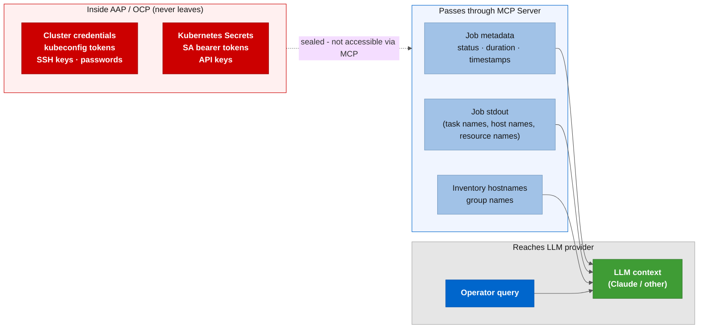

# Optional: AI agent access via AAP MCP server

This optional adds a read-only AI assistant layer to the collection. SREs and
platform engineers can connect Claude Code, VS Code, or Cursor to the Ansible
Automation Platform Controller API and ask questions about DR job history, spoke
topology, and platform health without opening the AAP UI.

No playbook, role, workflow, or variable in the main collection changes. This is
an add-on that reads existing data.

The MCP server is a Red Hat supported component of AAP 2.6 and later, deployed as
a pod in the `ansible-automation-platform` namespace by the AAP operator.

---

## How it works

The MCP server acts as a bridge between your AI client and AAP. The client speaks the
Model Context Protocol over HTTPS. The MCP server translates that into Controller API
calls and enforces RBAC on the way through.

```mermaid
%%{init: {"theme": "base", "themeVariables": {"lineColor": "#555555"}, "flowchart": {"htmlLabels": true}}}%%
flowchart LR
    classDef primary   fill:#3f9c35,stroke:#357a2e,color:#fff,font-weight:bold
    classDef secondary fill:#a1c2e7,stroke:#7a9fc4,color:#151515
    classDef tertiary  fill:#fcce9a,stroke:#e0aa70,color:#151515
    classDef header    fill:#06c,stroke:#0055b3,color:#fff,font-weight:bold
    subgraph AI["AI Client"]
        CC["Claude Code"]:::header
        VS["VS Code<br/>Claude ext."]:::header
        CU["Cursor"]:::header
    end
    subgraph AAP["Ansible Automation Platform (ansible-automation-platform namespace)"]
        MCP(["<b>MCP Server</b><br/>OCP Route / HTTPS"]):::primary
        subgraph TOOLS["MCP Tools"]
            T1["job_management<br/>19 tools"]:::secondary
            T2["inventory_management<br/>5 tools"]:::secondary
            T3["system_monitoring<br/>11 tools"]:::secondary
        end
        MCP -. "internal" .-> TOOLS
    end
    subgraph INFRA["dfmateus.acm_dr automation"]
        WF01["WF-01 Hub Switchover<br/>⛔ approval gate"]:::secondary
        WF05["WF-05 Full DR Drill<br/>⛔ approval gate"]:::secondary
        JT["DR Readiness Check<br/>Diagnostics · Notify"]:::tertiary
    end
    AI -- "MCP protocol<br/>HTTPS + Bearer token" --> MCP
    TOOLS -- "AAP Controller API<br/>/api/controller/v2/" --> INFRA
    style AI fill:#e6e6e6,stroke:#ccc,color:#151515
    style AAP fill:#f0f5ff,stroke:#06c,color:#151515
    style TOOLS fill:#ffffff,stroke:#aaa,color:#151515
    style INFRA fill:#f5f5f5,stroke:#aaa,color:#151515
```



The AI client sends natural language queries. The MCP server calls the relevant toolset
against the Controller API. Credentials in the AAP credential system never leave AAP. Only job names, status, stdout, and inventory data reach the AI client.

The approval gates on WF-01 and WF-05 are enforced by the workflow itself, not by the
MCP server. The agent can read those workflows and, in read-write mode, launch them, but
it cannot approve the human approval node inside them.

---

## Is this optional worth it for you?

Depends on your situation. If your SREs get paged at 3am and need to understand
what went wrong in the last failover, the difference between typing one question and
navigating the AAP UI is roughly two minutes. In a real DR incident, that time
matters.

The harder question is about data. Two paths:

**External LLM (Claude, ChatGPT, Gemini):** cluster names, API URLs, job output,
and spoke topology leave your environment when the MCP server sends them to the
provider. Some organizations treat that as routine operational data. Others have
data residency policies or contractual restrictions that make it a non-starter.
Check before generating any token.

**Internal LLM (Ollama, vLLM, Red Hat OpenShift AI):** data stays inside your
environment. The MCP server does not know which provider the client is talking to.
If your organization already runs Red Hat OpenShift AI (RHOAI), you can point Cursor
and VS Code to the RHOAI inference endpoint instead of an external provider, and no
data leaves the cluster. See [docs/02-clients.md](docs/02-clients.md) for details.
This is the recommended configuration for organizations with strict data residency
requirements or those already running Red Hat AI on the platform.

The collection gives you the RBAC definitions, the setup script, and the client
templates. Whether you connect an LLM provider is your call and your security
team's call. If nobody generates a token for `aiops-readonly`, the setup costs
nothing.

**Before enabling, answer these questions:**

- Are you using an external or internal LLM? If external: where does the provider
  process the data, and is that region acceptable under your data residency policy?
- Does your support contract or compliance framework prohibit sending hostnames or
  IP addresses to external services?
- Who approves LLM usage in your organization: platform team, security, legal?
- Is read-only enough, or do you want the agent to launch jobs too?

If you cannot answer the second or third question, use an internal LLM or talk to
your security team before generating any token.

---

## What the agent can do (read-only, default)

With `allow_write_operations: false` on the server, the agent only queries. It
cannot launch jobs, modify inventory, or change any configuration.

Questions the agent answers without opening the AAP UI:

- "What happened in the last failover? Which node failed?"
- "Which spokes failed in the last onboarding batch, and what was the error?"
- "Is the readiness check green for the next drill?"
- "Which hub is currently active according to the last failover job?"

---

## Quick start

```bash
# Prerequisite: oc CLI with cluster-admin on the ansible-automation-platform namespace
# Step 1: add the aiops users via CasC (see examples/aap/controller_users.yml)
# Step 2: run the setup script
bash examples/scripts/mcp/setup-mcp-server.sh \
  --context <OCP_CONTEXT> \
  --aap-cr-name aap \
  --apply

# Step 3: generate the token for aiops-readonly (the script prints instructions)
# Step 4: configure your client (see docs/02-clients.md)
```

Full step-by-step instructions: [docs/01-setup.md](docs/01-setup.md)

---

## Documentation index

| Document | What it covers |
|---|---|
| [docs/01-setup.md](docs/01-setup.md) | MCP server deploy, token creation, toolset reference, removal |
| [docs/02-clients.md](docs/02-clients.md) | Claude Code, VS Code, Cursor, and Red Hat AI config |
| [docs/03-read-write.md](docs/03-read-write.md) | Read-write mode: what you gain, risks, RBAC details |

---

## Files in this optional

| File | Purpose | Included in Galaxy artifact? |
|---|---|---|
| `examples/mcp/README.md` | This file | Yes |
| `examples/mcp/docs/01-setup.md` | Deploy and token guide | Yes |
| `examples/mcp/docs/02-clients.md` | Client config guide | Yes |
| `examples/mcp/docs/03-read-write.md` | Read-write mode guide | Yes |
| `examples/mcp/claude-code-mcp.json.example` | Claude Code MCP config template | Yes |
| `examples/mcp/cursor-mcp.json.example` | Cursor MCP config template | Yes |
| `examples/mcp/vscode-ansible-ai.json.example` | VS Code AI assistant notes | Yes |
| `examples/scripts/mcp/setup-mcp-server.sh` | Setup script | No (`build_ignore`) |
| `examples/aap/controller_users.yml` | aiops-readonly and aiops-operator users | No (`build_ignore`) |
| `examples/aap/controller_roles.yml` | RBAC for both agent users | No (`build_ignore`) |

---

## Data that reaches the LLM

The AAP credential system (passwords, SSH keys, kubeconfig tokens) never reaches
the MCP server. Only job metadata and output fields are exposed.

| Data | Where it appears |
|---|---|
| Cluster names | Job extra vars, survey answers |
| Cluster API URLs | Extra vars, output of `check-dr-readiness.yml` |
| Spoke cluster names | Inventory host names |
| Diagnostics report | stdout of `diagnose-failover-state.yml` |
| RPO and BSL status | stdout of `check-dr-readiness.yml` |
| Survey action (failover / failback) | Job detail via API |

Do not store passwords, tokens, or keys in inventory variables, extra vars, or job
output. The Red Hat AAP documentation recommends using the credential system for
all secrets.



---

## Related optionals

- [examples/terraform/azure/aro-lab-hub/](../terraform/aro-lab-hub/) - ARO lab hub
  provisioning via Terraform (separate optional, no dependency on this one)
- `examples/rhoai/` - Red Hat OpenShift AI setup for on-prem LLM inference
  (planned; see [docs/02-clients.md](docs/02-clients.md) for current guidance)
