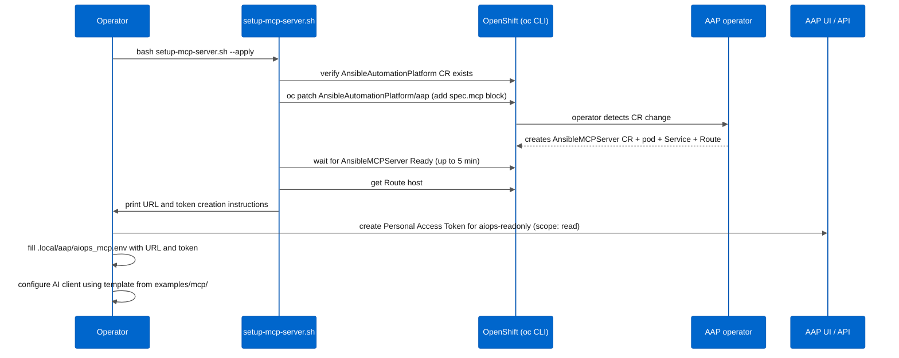

# MCP server setup

This document covers deploying the AAP MCP server, creating the agent token, and
removing the server when no longer needed.

**Prerequisite:** the `aiops-readonly` user must exist in AAP before you generate a
token. Create it by running `setup-aap-from-casc.yml` with the entries from
[../../aap-config/controller_users.yml](../../aap-config/controller_users.yml).

---

## How the deploy works



The operator handles the pod, Service, and Route. You do not create those objects
manually.

---

## Run the setup script

```bash
# Dry-run first - shows what the script would do without changing anything
bash examples/scripts/mcp/setup-mcp-server.sh \
  --context <OCP_CONTEXT> \
  --aap-cr-name aap

# Apply when ready
bash examples/scripts/mcp/setup-mcp-server.sh \
  --context <OCP_CONTEXT> \
  --aap-cr-name aap \
  --apply
```

The script confirms the context before acting:

```
🔎 Context: aiops-readonly@hub-01
   AAP CR: aap | Mode: read-only
```

If `--aap-cr-name` is omitted it defaults to `aap`. Use `--mode read-write` to
enable write operations (see [03-read-write.md](03-read-write.md) first).

---

## What the script patches into the CR

```yaml
spec:
  mcp:
    disabled: false
    allow_write_operations: false   # read-only: agent cannot launch jobs
    extra_settings:
      - setting: IGNORE_CERTIFICATE_ERRORS
        value: true   # required for lab ARO with self-signed cert
```

For production environments with a valid CA, remove the `extra_settings` block.
The operator reconciles the CR and creates the **`AnsibleMCPServer`** object within one to two minutes. The pod comes up in another two to three minutes.

---

## Create the agent token

The script prints instructions after the Route is available. Two methods:

**Via AAP UI:**

1. Access Management > Users > `aiops-readonly`
2. Tokens tab > Create token
3. Application: leave blank (Personal Access Token)
4. Scope: Read
5. Copy the token. It appears once.

**Via API:**

AAP 2.7 Gateway manages tokens through the Gateway API, not the Controller API.
Use `/api/gateway/v1/tokens/` instead of `/api/controller/v2/users/<id>/tokens/`
(the latter returns HTTP 404 in AAP 2.7).

```bash
source .local/aap/aap_token.env   # provides AAP_URL and AAP_TOKEN (admin token)

# Get the user ID from the Gateway API
USER_ID=$(curl -sk \
  "${AAP_URL}/api/gateway/v1/users/?username=aiops-readonly" \
  -H "Authorization: Bearer ${AAP_TOKEN}" \
  | jq -r '.results[0].id // empty')

# Create the Personal Access Token via the Gateway API
curl -sk -X POST \
  "${AAP_URL}/api/gateway/v1/tokens/" \
  -H "Authorization: Bearer ${AAP_TOKEN}" \
  -H "Content-Type: application/json" \
  -d "{\"description\": \"AIOps MCP read-only\", \"user\": ${USER_ID}, \"scope\": \"read\"}" \
  | jq -r '.token // empty'
```

Paste the token into `.local/aap/aiops_mcp.env` under `AIOPS_TOKEN=`.

---

## Toolsets

The MCP server exposes six toolsets. The client templates in this optional configure
three:

| Toolset | Included | Why |
|---|---|---|
| `job_management` | Yes | Job history, stdout, status for DR triage |
| `inventory_management` | Yes | Host and group data (spoke topology) |
| `system_monitoring` | Yes | AAP platform health |
| `user_management` | No | DR operators do not need this via the agent |
| `security_compliance` | No | DR operators do not need this via the agent |
| `platform_configuration` | No | DR operators do not need this via the agent |

Using fewer toolsets reduces the amount of data that reaches the LLM on each query.

The MCP URL format per toolset is:

```
https://<MCP_SERVER_ROUTE>/<toolset>/mcp
```

For example:
- `https://<MCP_SERVER_ROUTE>/job_management/mcp`
- `https://<MCP_SERVER_ROUTE>/inventory_management/mcp`
- `https://<MCP_SERVER_ROUTE>/system_monitoring/mcp`

---

## Verify the server is running

```bash
# Check the AnsibleMCPServer CR status
oc get ansiblemcpserver -n ansible-automation-platform \
  --context <OCP_CONTEXT>

# Get the Route
oc get route -n ansible-automation-platform \
  --context <OCP_CONTEXT> | grep mcp

# Quick connectivity test (replace placeholders)
curl -s -o /dev/null -w "%{http_code}" \
  -H "Authorization: Bearer ${AIOPS_TOKEN}" \
  "https://<MCP_SERVER_ROUTE>/job_management/mcp"
# Expected: 200 or 405 (method not allowed on GET - that is normal for MCP endpoints)
```

---

## Remove the MCP server

To remove the server:

1. Open the AAP UI (or API).
2. Delete the **`AnsibleMCPServer`** CR for this instance (the name follows the pattern `<aap-cr-name>-mcp`, typically `aap-mcp`).
3. The operator removes the pod, Service, and Route automatically.

To prevent the operator from recreating it, patch the CR back:

```bash
oc patch aap aap \
  -n ansible-automation-platform \
  --context <OCP_CONTEXT> \
  --type merge -p '{"spec": {"mcp": {"disabled": true}}}'
```

**Note:** changing `allow_write_operations` also requires deleting the **`AnsibleMCPServer`** CR first. The operator recreates it with the new setting after the patch. You cannot switch modes without a CR delete cycle.

---

## Troubleshooting

| Symptom | Check |
|---|---|
| **`AnsibleMCPServer`** not created after patch | `oc get csv -n ansible-automation-platform`: confirm the operator CSV is in Succeeded state |
| Pod stuck in `Pending` | Node resources; the MCP server pod requests ~256Mi RAM |
| HTTP 401 from MCP endpoint | Token scope must be `read`, not `write`; confirm with `oc get ... -o yaml` on the token object |
| HTTP 403 from MCP endpoint | The `aiops-readonly` user lacks the `read` role on the AAP objects; re-run the CasC roles import |
| Self-signed cert error in client | Set `IGNORE_CERTIFICATE_ERRORS: true` in `extra_settings` (already set by the script for lab) |
| Route not found after Ready | Run `oc get route -n ansible-automation-platform` and look for a route with `-mcp` in the name |
