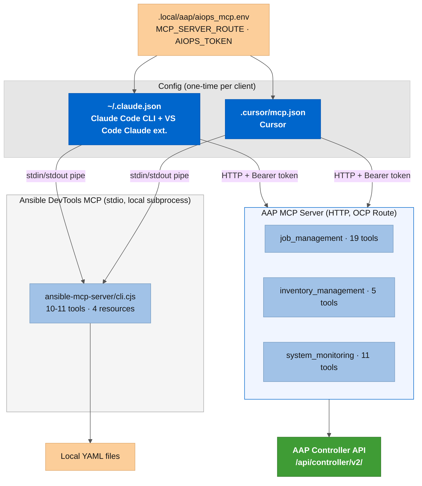
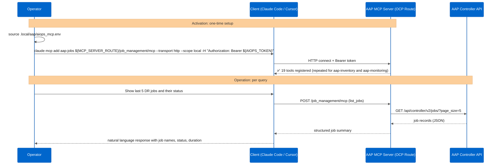
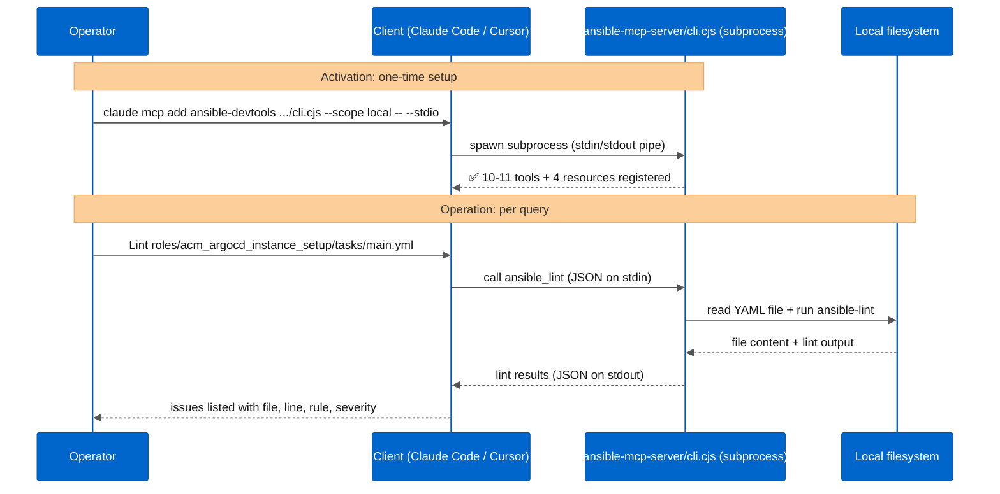

# Configuring AI clients

This document covers connecting Claude Code, VS Code, and Cursor to the MCP server,
and how to use Red Hat OpenShift AI as an internal LLM provider.

**Before starting:** you need the MCP server Route and a token for `aiops-readonly`.
Both come from [01-setup.md](01-setup.md). Source the env file first:

```bash
source .local/aap/aiops_mcp.env
# provides: MCP_SERVER_ROUTE, AIOPS_TOKEN
```

---

## Overview

Two MCP servers are available for this collection. They use different transports and serve different use cases:

| Server | Transport | Use case | Tools |
|---|---|---|---|
| AAP MCP Server (OCP Route) | HTTP + Bearer token | DR triage, job history, inventory queries | 35 (19 + 5 + 11) |
| Ansible DevTools MCP (local) | stdio subprocess | Playbook authoring, linting | 10-11 tools + 4 resources |



---

## End-to-end flows

### AAP MCP Server: HTTP transport



### Ansible DevTools MCP: stdio transport



---

## Claude Code (CLI and VS Code plugin)

Template file: [../claude-code-mcp.json.example](../claude-code-mcp.json.example)

Claude Code v2.x reads MCP server config from `~/.claude.json` (local scope) or `.mcp.json`
in the project root (project scope). The `mcpServers` key in `.claude/settings.json` has no
effect on MCP registration. Use `claude mcp add` to register servers.

**Local scope (recommended):** stores in `~/.claude.json` under the project path. No files
land in the project directory. The VS Code Claude extension reads from the same place.

```bash
source .local/aap/aiops_mcp.env   # provides MCP_SERVER_ROUTE and AIOPS_TOKEN

claude mcp add aap-jobs \
  "${MCP_SERVER_ROUTE}/job_management/mcp" \
  --transport http --scope local \
  -H "Authorization: Bearer ${AIOPS_TOKEN}"

claude mcp add aap-inventory \
  "${MCP_SERVER_ROUTE}/inventory_management/mcp" \
  --transport http --scope local \
  -H "Authorization: Bearer ${AIOPS_TOKEN}"

claude mcp add aap-monitoring \
  "${MCP_SERVER_ROUTE}/system_monitoring/mcp" \
  --transport http --scope local \
  -H "Authorization: Bearer ${AIOPS_TOKEN}"
```

Verify the servers connected:

```bash
claude mcp list
# Expected:
# aap-jobs: https://.../job_management/mcp (HTTP) - ✔ Connected
# aap-inventory: https://.../inventory_management/mcp (HTTP) - ✔ Connected
# aap-monitoring: https://.../system_monitoring/mcp (HTTP) - ✔ Connected
```

Each MCP server name has a 20-character limit in Claude Code.

**Project scope (alternative):** writes to `.mcp.json` in the project root. That file is
gitignored. Use `--scope project` in place of `--scope local` if you prefer the config to
live in the project directory rather than in `~/.claude.json`.

The template file [../claude-code-mcp.json.example](../claude-code-mcp.json.example)
documents the `.mcp.json` format for reference.

---

## Cursor

Template file: [../cursor-mcp.json.example](../cursor-mcp.json.example)

Cursor reads MCP config from `.cursor/mcp.json` (project scope) or `~/.cursor/mcp.json`
(global). The file format is the same as the Claude Code `.mcp.json`.

```bash
mkdir -p .cursor
cp examples/mcp/cursor-mcp.json.example .cursor/mcp.json
# edit .cursor/mcp.json: replace <MCP_SERVER_ROUTE> and the bearer token
```

The `.cursor/mcp.json` file is gitignored (the token is stored there literally). After editing,
open Cursor in the project directory.

Go to **Settings > Customize > MCPs** (or `Ctrl+Shift+P` > "MCP: List servers"). The three
servers appear as "Connected" but **Disabled** on first load. Click each one and enable it.
After enabling, open a chat in **Agent** mode (not Normal) and run your query. Cursor only
invokes MCP tools in Agent mode.

---

## VS Code with Automation intelligent assistant (Red Hat)

Template file: [../vscode-ansible-ai.json.example](../vscode-ansible-ai.json.example)

The Red Hat Ansible extension for VS Code uses a different connection path than the
standard `mcp.json`. The specific settings depend on how your organization deployed
the extension and whether you use the hosted or self-managed Automation intelligent
assistant.

Consult the Red Hat documentation before configuring:

- [Configuring the VS Code containerized install](https://docs.redhat.com) -
  `extend-proc_configure_vs_code_containerized_install`
- [Enabling the VS Code extension AI assistant](https://docs.redhat.com) -
  `extend-enable_the_vs_code_extension_ai_assistant`

The template file documents the starting point and which settings to verify in the
docs for your deployment type.

---

## Using Red Hat OpenShift AI as an internal LLM

> **Note:** this configuration has not been validated in this lab. The collection's
> `examples/rhoai/` optional (planned) will cover the full RHOAI setup. Use this
> section as a starting point and consult the RHOAI documentation for your environment.

If your organization runs Red Hat OpenShift AI (RHOAI) with an active inference
service, you can point Cursor and VS Code Copilot to the RHOAI endpoint instead of
an external provider. The MCP server does not change. Only the client's LLM provider
setting changes.

With this setup: the MCP server reads data from AAP and sends it to the client. The
client sends that data to the RHOAI inference service inside your cluster. No data
leaves the environment.

The RHOAI inference service exposes an OpenAI-compatible API at:

```
https://<inference-service-route>/v1
```

**In Cursor:**
Settings > Models > OpenAI API Base > enter the RHOAI endpoint URL.

**In VS Code with GitHub Copilot:**
The endpoint override depends on the extension. Check the extension documentation
for `openai.baseUrl` or equivalent setting.

**Discover the inference service endpoint:**

```bash
# If using KServe InferenceService
oc get inferenceservice -A --context <OCP_CONTEXT>

# If exposed as a Route
oc get route -n <rhoai-namespace> --context <OCP_CONTEXT>
```

Recommended models for lab use without GPU (CPU-only inference):
- `granite-3.1-2b-instruct` (faster, lower quality)
- `llama-3.2-3b-instruct` (slightly larger, better reasoning)

For production use with GPU nodes, `granite-3.1-8b-instruct` gives noticeably better
results for technical queries.

---

## Validate after configuring

Open a new chat in your client and ask:

> "What MCP tools are available for my Ansible Automation Platform?"

The agent should list tools from the `job_management`, `inventory_management`, and
`system_monitoring` toolsets. If it lists nothing, check:

1. The MCP server Route URL has no trailing slash.
2. `AIOPS_TOKEN` is exported in the shell where the client is running.
3. The MCP server pod is in `Running` state: `oc get pod -n ansible-automation-platform --context <OCP_CONTEXT> | grep mcp`
4. The `aiops-readonly` user has the `read` role on the AAP objects (re-run the
   CasC roles import if in doubt).
5. TLS rejection error from the client: the MCP server route uses a self-signed certificate
   (lab ARO). If the client rejects it, add this to `~/.claude/settings.json` (Claude Code)
   or the equivalent client env setting:

   ```json
   { "env": { "NODE_TLS_REJECT_UNAUTHORIZED": "0" } }
   ```

   The server-side `IGNORE_CERTIFICATE_ERRORS: true` in the AAP CR handles the server's
   outbound calls; the client-side env var handles the client's TLS verification.

Then test a real query:

> "Show me the last 5 DR jobs and their status."

---

## Lab validation status

Validated in the lab (ARO Classic cluster, AAP 2.7, Claude Code v2.1.241):

| Client | Method | Result |
|---|---|---|
| Claude Code CLI | `claude mcp add --scope local` (HTTP) | ✅ Validated: 35 tools connected (19 aap-jobs, 11 aap-monitoring, 5 aap-inventory) |
| Claude Code CLI | `claude mcp add --scope local` (stdio) | ✅ Validated: ansible-devtools connected (10 tools, Ansible authoring) |
| VS Code Claude extension | same `~/.claude.json` scope | ✅ Validated: 3 AAP servers + ansible-devtools connected (10 tools); reads the same `~/.claude.json` project entry, no extra config needed |
| Cursor | `.cursor/mcp.json` (HTTP) | ✅ Validated: AAP servers load from project `.cursor/mcp.json`; must enable manually in Settings > MCPs |
| Cursor | `.cursor/mcp.json` (stdio) | ✅ Validated: ansible-devtools connected (11 tools, 4 resources; Cursor exposes MCP resources, Claude Code does not) |

**Observed behavior (Claude Code CLI):**

- The agent correctly reads job history, status, duration, and who launched each job.
- Job stdout larger than roughly 3 MB returns HTTP 406 via the `txt` format. The agent falls
  back to JSON event queries automatically.
- The `ACM DR - LAB` inventory shows 0 hosts. This is correct: the playbooks target the
  Kubernetes API via kubeconfig credentials, not SSH inventory hosts.

**Known gotcha (Claude Code v2.x):**

The `mcpServers` key in `.claude/settings.json` has no effect in Claude Code v2.x. Use
`claude mcp add` instead. Scope options:
- `--scope local`: stores in `~/.claude.json` under the project path (preferred, nothing lands in the repo)
- `--scope project`: writes to `.mcp.json` in the project root (gitignored; useful if you want the config portable within the team via a secrets manager)

---

## Ansible VS Code extension development tools (optional add-on)

The Red Hat Ansible VS Code extension bundles a local MCP server called
**Ansible Development Tools MCP Server**. It exposes 10 tools for Ansible authoring
assistance: linting, syntax check, and playbook run. The server is a Node.js stdio
process and connects to Claude Code CLI and Cursor directly, without GitHub Copilot.

### Enable in VS Code

VS Code command palette > `Ansible: Enable Ansible Development Tools MCP Server`.
Then `MCP: List servers` > select **Ansible Development Tools MCP Server** > Start Server.
Verify with `Discovered 10 tools` in the VS Code output window.

### Connect to Claude Code CLI

The server binary is bundled in the extension. Register it with Claude Code via stdio:

```bash
claude mcp add ansible-devtools \
  ~/.vscode/extensions/redhat.ansible-<version>/packages/ansible-mcp-server/dist/cli.cjs \
  --scope local \
  -- --stdio
```

Replace `<version>` with the installed version (e.g., `redhat.ansible-26.6.0`). Verify:

```bash
claude mcp list
# ansible-devtools: /home/.../.vscode/extensions/redhat.ansible-26.6.0/.../cli.cjs --stdio - ✔ Connected
```

### Connect to Cursor

Add to `.cursor/mcp.json` alongside the AAP servers:

```json
{
  "mcpServers": {
    "ansible-devtools": {
      "command": "/home/<user>/.vscode/extensions/redhat.ansible-<version>/packages/ansible-mcp-server/dist/cli.cjs",
      "args": ["--stdio"]
    }
  }
}
```

Use the full absolute path. The server loads as Disabled on first load; enable it in
Cursor Settings > MCPs.

### Comparison with the AAP MCP server

| | AAP MCP Server (this optional) | Ansible DevTools MCP Server |
|---|---|---|
| Data source | AAP Controller API | Local VS Code tools |
| Use case | DR triage, job history, inventory | Playbook authoring, linting |
| Requires | OCP cluster with AAP | Red Hat Ansible VS Code extension |
| Transport | HTTP (Bearer token) | stdio (no auth) |
| Client | Claude Code, Cursor, Copilot | Claude Code, Cursor, Copilot |

The two run simultaneously. Use the AAP MCP for operational queries and the Ansible
DevTools MCP for writing new playbooks in the same Claude Code session.
