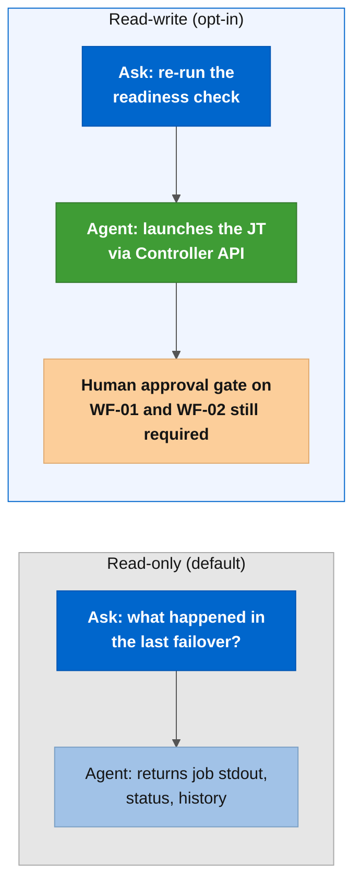
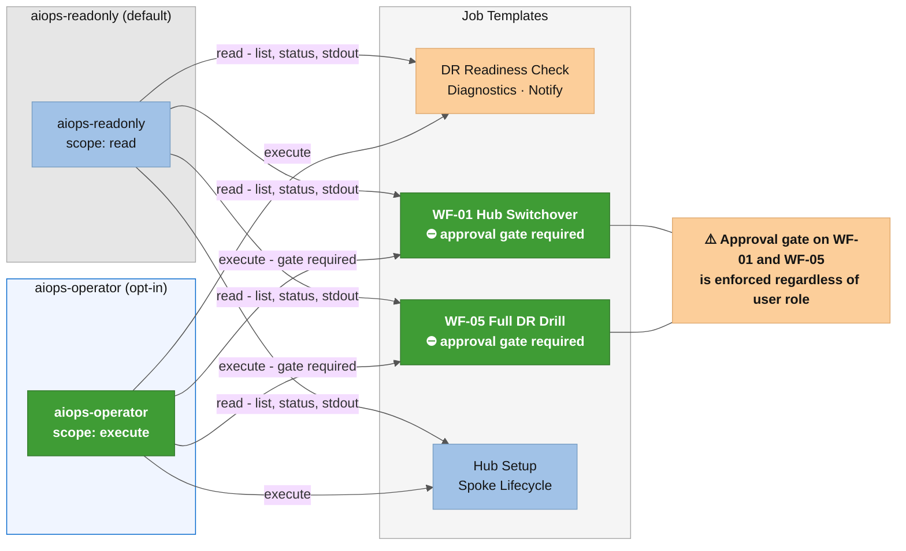

# Read-write mode

By default the MCP server runs in read-only mode: the agent can query jobs,
inventory, and platform health, but cannot launch anything. Read-write mode adds
the ability for the agent to launch jobs and modify resources.

This document explains what you gain, what the risks are, and how the RBAC
limits the blast radius.

---

## Read-only vs read-write



The approval gates on WF-01 (Hub Switchover) and WF-02 (Planned Maintenance) stay in
place regardless of mode. The agent can launch the workflow, but it cannot approve
the human approval node inside it. The risk with read-write is not bypassing the
gate: it is the LLM starting the workflow when the operator did not intend that.

---

## Is read-write worth it for you?

Three questions to answer first:

- Do you spend more time in the AAP UI re-launching failed jobs than investigating
  why they failed?
- Is your team comfortable with the possibility that a misinterpreted prompt could
  cause the agent to launch a DR job unintentionally?
- Do you trust the RBAC on the `aiops-operator` user to limit what the agent can
  do, even with the server in write mode?

If the answer to the second question is no, read-only is the right mode for your
team.

---

## What the agent can do in read-write mode

| Action | JT / WJT | Risk level | Approval gate preserved? |
|---|---|---|---|
| Re-run the readiness check | `JT - ACM DR - LAB - DR Readiness Check` | Low | N/A |
| Launch the Full DR Drill | `WF - ACM DR - LAB - Full DR Drill` | Controlled | Yes |
| Re-onboard a failed spoke | `JT - ACM DR - LAB - Spoke Onboarding` | Low | N/A |
| Send a DR event notification | `JT - ACM DR - LAB - Notify Workflow Event` | Minimal | N/A |
| Launch the production failover | `WF - ACM DR - LAB - Hub Switchover` | Not recommended via agent | Gate exists, but LLM can start it without operator intent |

WF-01 (`WF - ACM DR - LAB - Hub Switchover`) and WF-02 (`WF - ACM DR - LAB - Planned Maintenance Switchover`)
are explicitly excluded from the `aiops-operator` RBAC. The Controller returns HTTP 403
if the agent tries to launch them. The agent physically cannot start a production failover.

---

## RBAC for the aiops-operator user

The `aiops-operator` user has `execute` permission only on the low-risk JTs:

- `JT - ACM DR - LAB - DR Readiness Check`
- `JT - ACM DR - LAB - Notify Workflow Event`
- `JT - ACM DR - LAB - Spoke Onboarding`
- `WF - ACM DR - LAB - Full DR Drill` (has a human approval gate)

It has `read` permission on everything else, including WF-01 and WF-02. The
RBAC is defined in
[../../aap-config/controller_roles.yml](../../aap-config/controller_roles.yml).



---

## How to enable read-write mode

Read-write mode requires deleting the **`AnsibleMCPServer`** CR first. The operator recreates it with the new setting after you patch the parent CR. You cannot switch modes without a delete cycle.

**Step 1:** delete the current **`AnsibleMCPServer`** instance.

```bash
# Get the name (typically aap-mcp)
oc get ansiblemcpserver -n ansible-automation-platform \
  --context <OCP_CONTEXT>

# Delete it
oc delete ansiblemcpserver aap-mcp \
  -n ansible-automation-platform \
  --context <OCP_CONTEXT>
```

**Step 2:** run the setup script in read-write mode.

```bash
bash examples/scripts/mcp/setup-mcp-server.sh \
  --context <OCP_CONTEXT> \
  --aap-cr-name aap \
  --mode read-write \
  --apply
```

**Step 3:** generate a token for `aiops-operator` (not `aiops-readonly`).

AAP 2.7 Gateway manages Personal Access Tokens through the Gateway API. Use
`/api/gateway/v1/tokens/` (the Controller API path `/api/controller/v2/users/<id>/tokens/`
returns HTTP 404 in AAP 2.7).

```bash
source .local/aap/aap_token.env   # provides AAP_URL and AAP_TOKEN (admin token)

USER_ID=$(curl -sk \
  "${AAP_URL}/api/gateway/v1/users/?username=aiops-operator" \
  -H "Authorization: Bearer ${AAP_TOKEN}" \
  | jq -r '.results[0].id // empty')

curl -sk -X POST \
  "${AAP_URL}/api/gateway/v1/tokens/" \
  -H "Authorization: Bearer ${AAP_TOKEN}" \
  -H "Content-Type: application/json" \
  -d "{\"description\": \"AIOps MCP read-write\", \"user\": ${USER_ID}, \"scope\": \"write\"}" \
  | jq -r '.token // empty'
```

**Step 4:** update `.local/aap/aiops_mcp.env` with the new token and
`MCP_MODE=read-write`.

**Step 5:** update the `AIOPS_TOKEN` export in your shell and restart the AI client.

---

## Reverting to read-only

Same process: delete the **`AnsibleMCPServer`** CR, re-run the script without `--mode read-write`, and switch back to the `aiops-readonly` token.

---

## One mode per server instance

The server has one mode at a time. You cannot serve read-only to some clients and
read-write to others from the same instance. If you need both, you would need two
separate **`AnsibleMCPServer`** instances, which requires customization outside the
scope of this optional.

For most teams: run read-only by default, switch to read-write for a specific
session when you need to trigger a drill or re-run a job, then switch back.
