# 🎭 Ansible role: RHACM DR failover manager (acm_dr_failover_manager)

This role implements the core **Disaster Recovery (DR)** failover and failback orchestration engine for Red Hat Advanced Cluster Management for Kubernetes (RHACM) 2.10+ instances.

The role performs the controlled transition of **ManagedCluster** fleet management between two control Hubs (**acm-primary-hub** and **acm-dr-hub**), for logical isolation (fencing), **RHACM** control plane restoration via **Red Hat OADP / Velero**, and post-migration compliance audit.

Hub clusters can be either **ARO Classic** (**`controlPlaneTopology: HighlyAvailable`**) or **ARO HCP** (**`controlPlaneTopology: External`**). The topology is auto-detected by the [*`acm_dr_kubeconfig_resolver`*](../acm_dr_kubeconfig_resolver) role. Version extraction in Stage 00 includes defensive guards for clusters where **`ClusterVersion`**, **`MultiClusterHub`**, or **`MultiClusterEngine`** CRs may be absent or have unexpected structure.

---

## 📂 Role file index

* [tasks/main.yml](tasks/main.yml): Entry point and stage chaining.
* [tasks/00_preflight_check.yml](tasks/00_preflight_check.yml): Security validation, contexts, and Fencing state.
* [tasks/01_discover_fleet.yml](tasks/01_discover_fleet.yml): Dynamic Spoke fleet discovery.
* [tasks/02_pause_schedule.yml](tasks/02_pause_schedule.yml): Fencing application on the source BackupSchedule.
* [tasks/03_activate_hub.yml](tasks/03_activate_hub.yml): Restore resource creation on the destination Hub.
* [tasks/04_verify_spokes.yml](tasks/04_verify_spokes.yml): Klusterlet agent re-registration validation.
* [tasks/05_create_schedule.yml](tasks/05_create_schedule.yml): BackupSchedule policy reactivation on the new leader.
* [tasks/06_detach_old_hub.yml](tasks/06_detach_old_hub.yml): Old Hub removal and detach.
* [tasks/07_sanitize_passive_hub.yml](tasks/07_sanitize_passive_hub.yml): Passive Hub sanitization.
* [tasks/08_postflight_check.yml](tasks/08_postflight_check.yml): Final compliance report generation.
* [defaults/main.yml](defaults/main.yml): Variables and retry parameters hub.
* [templates/reports/](templates/reports/): All banner and report textual content is centralized here (no task has inline report formatting). [stage_banner.j2](templates/reports/stage_banner.j2) is the generic template reused by all stage headers, [dr_compliance_report.j2](templates/reports/dr_compliance_report.j2) is the final corporate compliance report (Stage 08), [spoke_fleet_report.j2](templates/reports/spoke_fleet_report.j2) is the structured log of the discovered fleet (Stage 01), and [fleet_compatibility_report.j2](templates/reports/fleet_compatibility_report.j2) is the fleet-wide version compatibility assessment (Stage 01).

---

## 📋 Execution stages

> ⚠️ **Note on actual execution order**: the dispatcher in [tasks/main.yml](tasks/main.yml) fires the files in the order **`00 → 01 → 02 → [GATE] → 03 → 07 → 04 → 05 → 06 → 08`**. File numbering identifies the functional area, not the pipeline position. The table below already reflects the actual firing order.

* **Stage 00 - Preflight Check**: Verifies **cluster-admin** privileges and evaluates the **BackupSchedule** resource condition on the source. Validates that the **destination Hub** (**`passive_hub`**) already has the required DR infrastructure: **MultiClusterHub** in **`Running`**, **DataProtectionApplication** (OADP), and **BackupStorageLocation** in **`Available`**, blocking execution before any mutation if the destination is not ready (see "Destination Hub prerequisites" below). Enforces **four blocking version compatibility gates** (RHACM version range, RHACM/OCP compatibility, backward restore detection, and version gap) that halt the pipeline if an incompatibility is detected. See "Version compatibility gates" below. Also warns (without blocking) if there are **ArgoCD Applications** or **custom Grafana Dashboards** on the source without the backup label. See "GitOps backup coverage" and "Observability" below.
* **Stage 01 - Discover Fleet**: Inspects **ManagedCluster** objects on the source API Server, filtering out **local-cluster**. After discovery, performs a **fleet-wide version compatibility assessment** (when **`acm_dr_failover_manager_version_check`** is enabled): checks each Spoke's OCP version against the destination Hub's RHACM via the compatibility matrix, renders a detailed report, and blocks with a **Fleet Compatibility Gate** if any OCP-based Spoke runs a version not supported by the destination RHACM. See "Version compatibility gates" below.
* **Stage 02 - Pause Schedule**: Patches the source **BackupSchedule** (**`paused: true`**) to prevent **Split-Brain**.
* **[GATE]**: Interactive manual confirmation pause ("POINT OF NO RETURN") before destination Hub activation. Skippable via **`skip_gates: true`**.
* **Stage 03 - Activate Hub**: Explicitly resolves (by **`ClusterVersion.spec.clusterID`**, not by the **`latest`** string) the credentials/resources/managed-clusters backups actually originated from the source Hub, purges residual **`Restore`** objects, and applies a new **Restore** object (**`cleanupBeforeRestore: CleanupRestored`**) on the destination Hub. See "Real-world finding: explicit backup resolution" below.
* **Stage 07 - Sanitize Passive Hub**: Dynamically discovers (not by fixed name) the **`ManagedServiceAccount`** objects with **`TokenReported: False`** condition per Spoke on the destination Hub, and purges them along with their corresponding **`Secret`** objects, before invoking the [*`acm_dr_spoke_manager`*](../acm_dr_spoke_manager) role to reconnect the fleet. **[KCS 7039710](https://access.redhat.com/solutions/7039710)** mitigation. Fired immediately after Stage 03.
* **Stage 04 - Verify Spokes**: Waits (polling) until each Spoke reports **`ManagedClusterConditionAvailable: True`** on the destination Hub.
* **Stage 05 - Create Schedule**: Creates the **BackupSchedule** resource (**`paused: false`**) on the new leader Hub.
* **Stage 06 - Detach Old Hub**: Removes (**`state: absent`**) residual **`ManagedCluster`** objects on the source and forces **`finalizer`** removal (**`ManagedCluster`**, **`ObservabilityAddon`**, **`ManifestWork`**, **`KlusterletAddonConfig`**), as well as unblocking namespaces stuck in **`Terminating`**.
* **Stage 08 - Postflight Check**: Compiles the status of all subsystems (Add-ons, governance **Policies**, ArgoCD/GitOps **Applications**, **PlacementDecisions**, and custom Grafana **Dashboards**), detects residual **Split-Brain**, and renders the final report via Jinja2 template.

```mermaid
%%{init: {"theme": "base", "themeVariables": {"lineColor": "#555555"}, "flowchart": {"htmlLabels": true}}}%%
flowchart LR
    classDef primary   fill:#3f9c35,stroke:#357a2e,color:#fff,font-weight:bold
    classDef secondary fill:#a1c2e7,stroke:#7a9fc4,color:#151515
    classDef tertiary  fill:#fcce9a,stroke:#e0aa70,color:#151515
    classDef header    fill:#06c,stroke:#0055b3,color:#fff,font-weight:bold
    classDef decision  fill:#f5f5f5,stroke:#aaaaaa,color:#151515
    classDef success   fill:#3f9c35,stroke:#357a2e,color:#fff,font-weight:bold
    classDef danger    fill:#cc0000,stroke:#990000,color:#fff,font-weight:bold
    classDef warn      fill:#fcce9a,stroke:#e0aa70,color:#151515,font-weight:bold
    S00["<b>Stage 00</b><br/>Preflight<br/>Safety guard"]:::header
    S01["<b>Stage 01</b><br/>Discover fleet<br/>ManagedCluster list"]:::secondary
    S02["<b>Stage 02</b><br/>Logical fencing<br/>BackupSchedule paused"]:::warn
    GATE{"POINT OF NO RETURN<br/>Interactive approval"}:::decision
    S02a["<b>Stage 02a</b><br/>Pre-restore cleanup<br/>Terminating NS + stale Restores"]:::secondary
    S03["<b>Stage 03</b><br/>Activate Hub<br/>Restore CR - OP-11 rollback"]:::primary
    S04["<b>Stage 04</b><br/>Sanitize MSA tokens<br/>KCS 7039710"]:::secondary
    S05["<b>Stage 05</b><br/>Verify Spokes<br/>ManagedClusterAvailable poll"]:::secondary
    S06["<b>Stage 06</b><br/>Protect new leader<br/>BackupSchedule + collision guard"]:::primary
    S06a["<b>Stage 06a</b><br/>Recycle additional hubs<br/>N-passive topology"]:::tertiary
    S07["<b>Stage 07</b><br/>Isolate old Hub<br/>Detach + force finalizers"]:::secondary
    S07a["<b>Stage 07a</b><br/>Convergence wait<br/>Policies + ArgoCD"]:::secondary
    S08["<b>Stage 08</b><br/>Integrity audit<br/>Compliance report"]:::success
    S00 --> S01 --> S02 --> GATE
    GATE -->|approved| S02a
    GATE -->|"denied / timeout"| ABORT(["❌ Aborted"]):::danger
    S02a --> S03 --> S04 --> S05 --> S06
    S06 --> S06a
    S06 --> S07 --> S07a --> S08
```



---

## ⚙️ Configuration variables (defaults/main.yml)

* **failover_direction** (Required): Migration direction (**`acm-primary-hub_to_acm-dr-hub`** or reverse).
* **allow_fenced_origin** (Default: **`false`**): Authorizes execution even if the source Hub is already in Fenced mode.
* **acm_dr_failover_manager_dry_run** (Default: **`false`**): Rehearses the entire pipeline (00-08) via Kubernetes API **`check_mode`**/**`diff`**. No changes are persisted. See the "Dry-run mode" section below.
* **skip_gates** (Default: **`false`**): Skips interactive pauses for CI/CD automation.
* **acm_dr_failover_manager_backup_ns** (Default: **`"open-cluster-management-backup"`**): Namespace where OADP is deployed.
* **acm_dr_failover_manager_schedule_name** (Default: **`"schedule-acm-hub"`**): Name of the **BackupSchedule** resource.
* **acm_dr_failover_manager_restore_name** (Default: **`"restore-acm-activate"`**): Name of the **Restore** Custom Resource created on the destination Hub (Stage 03) to activate the RHACM control plane.
* **acm_dr_failover_manager_spoke_context_suffix** (Default: **`"-sa"`**): Suffix applied to the ManagedCluster name to derive the Kubeconfig context used to reconnect each Spoke.
* **acm_dr_failover_manager_spoke_context_map** (Default: **`{}`**): Exception map **`cluster-name: context-name`**, with priority over the suffix above. Use when the context does not follow the default convention.
* **acm_dr_failover_manager_observability_ns** (Default: **`"open-cluster-management-observability"`**): Namespace where MultiClusterObservability (Grafana) is deployed.
* **acm_dr_failover_manager_custom_dashboard_label** (Default: **`"grafana-custom-dashboard=true"`**): Label used to identify custom Grafana Dashboard ConfigMaps, distinguishing them from the operator's default dashboards.
* **acm_dr_failover_manager_resolve_explicit_backup** (Default: **`true`**): Enables explicit resolution of the actual source backup by **`clusterID`**, instead of trusting the ACM **`latest`** string. See "Real-world finding: explicit backup resolution" below.
* **acm_dr_failover_manager_credentials_schedule_name** / **_resources_schedule_name** / **_managed_clusters_schedule_name** (Default: **`"acm-credentials-schedule"`** / **`"acm-resources-schedule"`** / **`"acm-managed-clusters-schedule"`**): names of the Velero Schedules created by the ACM BackupSchedule controller. A fixed product convention, typically they do not need to be changed.
* **acm_dr_failover_manager_version_check** (Default: **`true`**): Enables version collection and compatibility checks (both blocking gates and informational warnings) during Stage 00 preflight.
* **acm_dr_failover_manager_skip_version_gate** (Default: **`false`**): Bypasses all four blocking version compatibility gates. See "Version compatibility gates" above.
* **acm_dr_failover_manager_supported_acm_versions** (Default: **`["2.10", ..., "2.17"]`**): RHACM minor versions known to this automation.
* **acm_dr_failover_manager_acm_ocp_matrix** (Default: see [*`defaults/main.yml`*](defaults/main.yml)): RHACM-to-OCP compatibility matrix.
* **acm_dr_failover_manager_max_acm_version_gap** (Default: **`1`**): Maximum RHACM minor-version gap allowed between the two Hubs.
* **acm_dr_failover_manager_target_acm_version** (Default: **`""`**): Target RHACM version for Planned Maintenance Failover upgrade validation. When set (e.g., **`"2.17"`**), the preflight validates that the upgrade is feasible: not already installed, in the supported list, OCP compatible on both Hubs, and all Spokes in the target version's supported range. The fleet compatibility check (Stage 01) then evaluates Spokes against this target version instead of the destination Hub's current RHACM. Leave empty for standard DR failover.

---

## 🚧 Destination Hub prerequisites (readiness gate)

Stage 00 validates, for **any** failover direction (since **`passive_hub`** is dynamically resolved from **`failover_direction`**), that the destination Hub already has the DR infrastructure provisioned:

* **MultiClusterHub** on the cluster, with **`status.phase: Running`**.
* **DataProtectionApplication** (OADP) present in the backup namespace (**`acm_dr_failover_manager_backup_ns`**).
* **BackupStorageLocation** (Velero) with **`status.phase: Available`**.

If any of these is missing, the pipeline **fails immediately at Stage 00**, before any fencing or mutation, with a message pointing to the exact command to provision the destination Hub via the [acm_dr_hub_setup](../acm_dr_hub_setup) role:

```bash
ansible-playbook playbooks/setup-acm-dr-hub.yml \
  -e k8s_target_context=<passive_hub> \
  -e is_primary_hub=<true|false>
```

---

## 🛡️ Version compatibility gates (Stage 00)

Stage 00 now enforces **four blocking version compatibility gates** after collecting OCP, RHACM, and MCE versions from both Hubs. Unlike the informational warnings that follow (version skew messages), these gates use **`ansible.builtin.assert`** and **halt the pipeline** if a version incompatibility is detected, before any fencing or mutation occurs.

All gates are overridable via **`-e acm_dr_failover_manager_skip_version_gate=true`** for operators who have independently validated their version combination.

| Gate | What It Catches | Example Scenario |
|:---|:---|:---|
| **Supported RHACM Range** | Either Hub runs an RHACM version outside the tested list (**`acm_dr_failover_manager_supported_acm_versions`**) | RHACM 2.9 (too old) or 2.18 (not yet validated) |
| **RHACM/OCP Compatibility** | A Hub's RHACM version does not support its own OCP version per the official matrix | RHACM 2.13 on OCP 4.20 (only supports up to 4.19) |
| **Backward Restore Detection** | Destination Hub runs an older RHACM than the source, so the Restore would apply a newer backup onto an older RHACM | Source on 2.16, Destination on 2.14 |
| **RHACM Version Gap** | The RHACM minor-version gap between Hubs exceeds the allowed threshold (default: 1) | Source on 2.14, Destination on 2.16 (gap = 2) |
| **Fleet Compatibility** (Stage 01) | A Spoke runs an OCP version outside the destination RHACM's supported range, so the destination Hub cannot manage it | Dest RHACM 2.16 (supports OCP 4.19+), Spoke on OCP 4.18 |
| **Target Already Installed** | The target RHACM version (**`acm_dr_failover_manager_target_acm_version`**) is the same as the destination Hub's current RHACM, so there is nothing to upgrade | Target 2.15, Dest already on 2.15 |
| **Target Unsupported** | The target RHACM version is not in the **`supported_acm_versions`** list | Target 2.18, not yet validated |
| **Target/OCP Incompatibility** | A Hub's OCP version is outside the target RHACM's supported range, so OCP must be upgraded first | Target RHACM 2.16, Hub on OCP 4.18 |

### Graceful degradation

If a version cannot be collected (API timeout, missing CRD, non-OpenShift cluster), the corresponding gate is **skipped**. The pipeline cannot block on data it doesn't have. The informational warnings (steps 0.3.5–0.3.8) remain unchanged and are always non-blocking.

### Configuration

* **acm_dr_failover_manager_skip_version_gate** (Default: **`false`**): bypass all four blocking gates.
* **acm_dr_failover_manager_supported_acm_versions** (Default: **`["2.10", ..., "2.17"]`**): list of RHACM minor versions known to this automation. Update when onboarding a new RHACM release after validation.
* **acm_dr_failover_manager_acm_ocp_matrix** (Default: see [*`defaults/main.yml`*](defaults/main.yml)): RHACM-to-OCP compatibility matrix. Each key is an RHACM minor version, each value is the list of supported OCP minor versions.
* **acm_dr_failover_manager_max_acm_version_gap** (Default: **`1`**): maximum allowed RHACM minor-version gap between Hubs. Set to **`2`** if you need to failover between non-adjacent versions (e.g., during a multi-step upgrade).

### Updating the matrix for new RHACM releases

When a new RHACM version is released (e.g., 2.18):

1. Add **`"2.18"`** to **`acm_dr_failover_manager_supported_acm_versions`**.
2. Add **`"2.18": ["4.21", "4.22", "4.23", "4.24"]`** (per the official support matrix) to **`acm_dr_failover_manager_acm_ocp_matrix`**.
3. Validate the automation with a dry-run against the new version.

Alternatively, pass the updated values via **`-e`** without modifying the defaults:

```bash
ansible-playbook playbooks/orchestrate-dr-failover.yml \
  -e '{"acm_dr_failover_manager_supported_acm_versions": ["2.10","2.11","2.12","2.13","2.14","2.15","2.16","2.17","2.18"]}' \
  -e '{"acm_dr_failover_manager_acm_ocp_matrix": {"2.18": ["4.21","4.22","4.23","4.24"]}}' \
  ...
```

---

## 🏷️ GitOps and Observability backup coverage (preflight warning)

The OADP/Velero Restore only brings back objects with the correct **`cluster.open-cluster-management.io/backup`** label. Stage 00 checks, on the source Hub:

* **ArgoCD Applications/ApplicationSets**: require the **`cluster.open-cluster-management.io/backup: cluster-activation`** label (see [Section 6](../../README.md#%EF%B8%8F-6-gitops-labeling-governance-argo-cd) of the main README). If Applications exist but **none** have this label, a warning is displayed.
* **Custom Grafana Dashboards** (identified by the **`acm_dr_failover_manager_custom_dashboard_label`** label, default **`grafana-custom-dashboard=true`**): require the **`cluster.open-cluster-management.io/backup: cluster`** label. If custom Dashboards exist but some lack this label, a warning is displayed (see [Section 6.1](../../README.md#61-observability-and-custom-grafana-dashboards) of the main README).

In both cases, the warning **does not block the pipeline**. GitOps and custom dashboards may legitimately be outside the DR scope of some environments.

## 🕵️ Post-failover audit: Governance, GitOps, Placement, and Observability (Stage 08)

Beyond connectivity and Add-ons, the final report also audits, on the destination Hub:

* **Policies** (root policies only, filtering per-cluster replicas via the **`policy.open-cluster-management.io/root-policy`** label): how many exist and how many are not **`Compliant`**.
* **ArgoCD Applications**: how many exist and how many are not simultaneously **`Synced`** and **`Healthy`**.
* **PlacementDecisions**: how many exist and how many have not resolved any cluster (**`status.decisions`** empty), a signal that the Placement may not be targeting correctly against the new Hub fleet.
* **Custom Grafana Dashboards**: how many exist (via the customization label) and how many lack the backup label, leaving them vulnerable to being lost in the next failover.

All sections are **best-effort**. If Policies/GitOps/Placement/Dashboards are not in use in the environment, the report shows **`N/A`** instead of forcing an artificial failure. In **dry-run** mode, these sections reflect the **already existing** state on the destination Hub (not a preview of what the Restore would bring), and the report makes this explicit.

---

## 🔬 Real-world finding: explicit backup resolution (why we do not trust **`latest`**)

**The problem**: the ACM **`Restore`** accepts **`latest`**, **`skip`**, or an explicit name for each backup category. **`latest`** selects the most recent backup **across all shared storage** (e.g., the same Azure Blob Storage used by both Hubs in the DR pair), without distinguishing which Hub produced it. This works well in the most common case (Primary always active, DR in cold-standby that never generated its own backup), but **silently breaks** as soon as both sides have produced a backup at some point (after a failover + failback cycle, or in frequent DR drills): the "most recent" backup may be a self-backup from the **destination Hub itself**, not from the source you want to restore.

**How we validated this in practice, against real clusters**:
1. We created a correctly labeled custom dashboard **`ConfigMap`** and confirmed, via **Velero pod logs**, that the backup captured the object.
2. We confirmed, via a raw Velero **`Restore`** pointing to the correct backup by name, that the restoration works perfectly when the backup is the correct one.
3. We isolated the problem: an ACM **`Restore`** with **`veleroCredentialsBackupName: latest`** resolved to a backup that **did not contain** the object, because, despite being the most recent in storage, it had been produced by the destination Hub, not the source.
4. We implemented and tested the fix below, re-ran the **same end-to-end test in real production**, and confirmed that the object survived and appeared correctly audited in the final report.

**The fix**: Stage 03 now, before creating the **`Restore`**:
1. Reads **`ClusterVersion.spec.clusterID`** from the source Hub, the identifier that we discovered, through testing, is what the ACM backup controller uses in the **`cluster.open-cluster-management.io/backup-cluster`** label (not the **`kube-system`** UID, our initial incorrect assumption).
2. Searches, by category, for **`Backup`** objects whose **`backup-cluster`** label matches this **`clusterID`** (backups genuinely produced by the source, not merely synchronized on shared storage).
3. Uses the explicit name of the most recent **`Completed`** backup in each category instead of the **`latest`** string.
4. Falls back to **`latest`** automatically if the resolution finds nothing (new environment, no bidirectional history).

Controllable via **`acm_dr_failover_manager_resolve_explicit_backup`** (default **`true`**).

---

## 🔎 Dry-run mode: safe full pipeline rehearsal

With **`acm_dr_failover_manager_dry_run: true`**, the pipeline runs in full (Stages 00-08) against real clusters, but **no changes are persisted**:

* Every mutating task (**`kubernetes.core.k8s`**, **`kubernetes.core.k8s_json_patch`**, **`shell`** tasks) runs with **`check_mode`** enabled. Verified in the collection source code that this triggers the Kubernetes API native **`dryRun=All`**: the change is validated by the server (and the diff is displayed) but never applied.
* The "REVERSE DIRECTION GUARD" assert (Stage 00) **is not weakened in dry-run**. It runs identically, with the same severity as a real execution.
* Steps that depend on state resulting from a real change (Restore polling, Spoke reconnection, **`include_role acm_dr_spoke_manager`**) are skipped with a **`🔎 [DRY-RUN]`** message explaining what would happen, instead of waiting for something that will never occur.
* The final report ([dr_compliance_report.j2](templates/reports/dr_compliance_report.j2)) identifies the execution mode at the top and does not treat residual Spoke presence on the old Hub as an anomaly when in dry-run (expected behavior, since nothing was actually removed).

```bash
ansible-playbook playbooks/orchestrate-dr-failover.yml \
  -e "failover_direction=acm-primary-hub_to_acm-dr-hub" \
  -e "acm_dr_failover_manager_dry_run=true" \
  -e "skip_gates=true"
```

---

## 🚀 Playbook usage example

```yaml
- name: Rehearse Failover in Dry-Run
  hosts: localhost
  connection: local
  roles:
    - role: acm_dr_failover_manager
      vars:
        failover_direction: "acm-primary-hub_to_acm-dr-hub"
        acm_dr_failover_manager_dry_run: true
        skip_gates: true

- name: Execute Disaster Recovery Failover (production)
  hosts: localhost
  connection: local
  roles:
    - role: acm_dr_failover_manager
      vars:
        failover_direction: "acm-primary-hub_to_acm-dr-hub"
        allow_fenced_origin: true
        skip_gates: true
```

---

## 📚 Official references
* [Red Hat ACM: Backup and Restore Architecture](https://docs.redhat.com/en/documentation/red_hat_advanced_cluster_management_for_kubernetes)
* [Red Hat KCS 7039710: ManagedServiceAccount token restore failure after OADP Restore](https://access.redhat.com/solutions/7039710)
* [Red Hat KCS 5950901: Graceful Removal and Detach of ManagedClusters](https://access.redhat.com/solutions/5950901)

---

Created and maintained by [Diego Felipe Mateus](https://github.com/dfmateus). See [CONTRIBUTORS.md](../../CONTRIBUTORS.md) for the list of contributors.
