# 🏗️ Ansible role: Red Hat ACM DR lab setup (acm_dr_hub_setup)

This **Red Hat Ansible Automation Platform** role provides end-to-end automation for the provisioning, preparation, and lifecycle management of **Disaster Recovery (DR)** based on **Red Hat Advanced Cluster Management for Kubernetes (RHACM) 2.10+**.

The framework was designed with a **Multi-Cloud** and **Multi-Distribution** architecture, and supports uniform onboarding and management of **OpenShift** and **Native Kubernetes** clusters, with production support and compatibility for **Kubernetes 1.24+**.

---

## 🚀 What this role does

* **Multi-Distribution K8s Support:** Native compatibility for mixed-distribution fleets (ARO, AKS, EKS, GKE, IKS).
* Supports ARO Classic (**`controlPlaneTopology: HighlyAvailable`**) and ARO HCP (**`controlPlaneTopology: External`**) as Hub clusters. Topology is auto-detected from the **`Infrastructure`** CR by the [*`acm_dr_kubeconfig_resolver`*](../acm_dr_kubeconfig_resolver) role. ARO HCP is in Public Preview (September 2026, GA November 2026).
* Creates **`Secret`** resources for **`ServiceAccount`**s declaratively, working around the auto-generated token deprecation in Kubernetes 1.24+.
* Extracts API server endpoints from the local kubeconfig, avoiding dependencies on cluster-specific Custom Resources.
* Handles stuck finalizers and sanitizes operational namespaces on graceful detachment ([KCS 5950901](https://access.redhat.com/solutions/5950901)).

---

## 🛠️ Workstation configuration and prerequisites

### 1. Python, Ansible, and CLI dependencies
Install the required Python libraries and collections:

```bash
pip install kubernetes PyYAML jsonpatch
ansible-galaxy collection install kubernetes.core --upgrade
```

### 2. KUBECONFIG context standardization (mandatory)
Adopt the semantic taxonomy for context aliases in your **KUBECONFIG**:

```bash
# Set the Primary Hub context
oc config rename-context $(oc config current-context) acm-primary-hub

# Add Azure Kubernetes Service (AKS) Spoke credentials securely via Azure CLI
az aks get-credentials --resource-group <RESOURCE_GROUP> --name <CLUSTER_NAME> --context aks-spoke-01 --overwrite-existing
```

### 3. Environment variable export

#### Azure (ARO Hubs)
The automation dynamically reads variables injected into the environment. Export the following parameters in your control terminal before running the playbook:

```bash
export GUID="00000" # Unique lab identifier
export SUBSCRIPTION="00000000-0000-0000-0000-000000000000" # Azure Subscription ID
export TENANT="00000000-0000-0000-0000-000000000000" # Azure Tenant ID
export CLIENT_ID="00000000-0000-0000-0000-000000000000" # Azure Service Principal ID
export PASSWORD="your_azure_secret" # Azure Service Principal password
export RESOURCEGROUP="xxxxxxx-xxxxxx" # Azure Resource Group where clusters are provisioned
export GITHUB_USER="xxxxxxx" # GitHub user with access to the corporate repositories
export GITHUB_PAT="github_pat_your_token" # GitHub PAT token with read permissions on repositories
```

#### AWS (ROSA HCP Hubs)
For ROSA HCP Hubs (**`acm_dr_hub_setup_cloud_provider=aws`**), replace the Azure variables above with the following:

```bash
export AWS_ACCESS_KEY_ID="AKIA..." # Static IAM key for OADP S3 and Thanos credentials
export AWS_SECRET_ACCESS_KEY="..." # Corresponding IAM secret key
export AWS_DEFAULT_REGION="us-east-1" # AWS region for S3 buckets (must match the ROSA cluster region)
export TF_VAR_token="eyJh..." # OCM offline token from console.redhat.com/openshift/token (Terraform ROSA provisioning)
export GITHUB_USER="xxxxxxx" # GitHub user with access to the corporate repositories
export GITHUB_PAT="github_pat_your_token" # GitHub PAT token with read permissions on repositories
```

Pass the S3 bucket names at playbook run time via extra-vars:

```bash
-e acm_dr_hub_setup_cloud_provider=aws \
-e acm_dr_hub_setup_aws_s3_bucket_backup=<backup-bucket-name> \
-e acm_dr_hub_setup_aws_s3_bucket_observability=<observability-bucket-name>
```

On AAP, use the built-in "Amazon Web Services" credential type instead of exporting **`AWS_ACCESS_KEY_ID`**/**`AWS_SECRET_ACCESS_KEY`** manually.

---

## 📋 Execution stage architecture

* **Stage 00 - Preflight & Safety Validation**: Validates binaries and **cluster-admin** privileges.
* **Stage 01 - Azure Storage Provisioning**: Provisions the **Storage Account** for **OADP** and **Thanos**.
* **Stage 02 - MultiClusterHub Install**: Installs the central **RHACM** operator.
* **Stage 03 - Observability Setup**: Deploys the **MultiClusterObservability** stack.
* **Stage 04 - GitOps & ArgoCD Setup**: Deploys the **GitOps** operator and establishes the trust relationship.
* **Stage 05 - OADP & DPA Configuration**: Waits for the OADP Operator (auto-provisioned by the MultiClusterHub **`cluster-backup`** component; see "Real-world finding" below) and instantiates the **DataProtectionApplication (DPA)** and the **BackupSchedule** (Primary Hub).
* **Stage 06 - Hub health and compliance audit**: Audits MultiClusterHub, GitOps, Observability, BSL, and BackupSchedule, and fails if any compliance criterion is not met.

> **Note**: Spoke onboarding (**`spoke_prep`**) and detachment (**`spoke_detach`**) **are not part of this role**. They are the responsibility of the [acm_dr_spoke_manager](../acm_dr_spoke_manager) role, triggered via [playbooks/manage-spoke.yml](../../playbooks/manage-spoke.yml). See the examples in the section below.

> 📂 **Report centralization**: all textual content for stage banners and completion panels is located in [templates/reports/](templates/reports/). No task has inline report formatting embedded. [stage_banner.j2](templates/reports/stage_banner.j2) is the generic template reused by all stage headers; the remaining files (**`0X_*_summary.j2`**) are the stage-specific completion panels, including the [Stage 06 consolidated panel](templates/reports/06_validate_hubs_summary.j2).

```mermaid
%%{init: {"theme": "base", "themeVariables": {"lineColor": "#555555"}, "flowchart": {"htmlLabels": true}}}%%
flowchart LR
    classDef primary   fill:#3f9c35,stroke:#357a2e,color:#fff,font-weight:bold
    classDef secondary fill:#a1c2e7,stroke:#7a9fc4,color:#151515
    classDef tertiary  fill:#fcce9a,stroke:#e0aa70,color:#151515
    classDef header    fill:#06c,stroke:#0055b3,color:#fff,font-weight:bold
    classDef decision  fill:#f5f5f5,stroke:#aaaaaa,color:#151515
    classDef success   fill:#3f9c35,stroke:#357a2e,color:#fff,font-weight:bold
    S00["<b>Stage 00</b><br/>Preflight<br/>Connectivity + prerequisites"]:::header
    S01D{"Cloud provider?"}:::decision
    S01A["<b>Stage 01 (azure)</b><br/>Azure Blob Storage<br/>Container + credentials"]:::secondary
    S01B["<b>Stage 01 (aws)</b><br/>AWS S3 Bucket<br/>Bucket + credentials"]:::secondary
    S02["<b>Stage 02</b><br/>MCH install<br/>MultiClusterHub CR"]:::primary
    S03["<b>Stage 03</b><br/>Observability<br/>Prometheus + Grafana stack"]:::secondary
    S04["<b>Stage 04</b><br/>GitOps / ArgoCD<br/>OpenShift GitOps operator"]:::secondary
    S05["<b>Stage 05</b><br/>OADP / DPA<br/>DataProtectionApplication + BSL"]:::primary
    S06["<b>Stage 06</b><br/>Validate<br/>BackupSchedule + passive sync Restore"]:::success
    S00 --> S01D
    S01D -- azure --> S01A --> S02
    S01D -- aws --> S01B --> S02
    S02 --> S03 --> S04 --> S05 --> S06
```



---

## 🔬 Real-world finding: OLM resolution conflict between acm_dr_hub_setup and the ACM cluster-backup component

✅ **Fixed and validated in this version.** Consistently reproduced across 3 distinct real executions (including a clean reinstallation), fixed, and successfully revalidated through a complete real failover + failback cycle.

During real full-cycle testing (complete cleanup via [acm_dr_hub_cleanup](../acm_dr_hub_cleanup) followed by reprovisioning via this role), Stage 05 consistently and reproducibly failed when attempting to install the OADP Operator, with the following OLM error:

```text
constraints not satisfiable: ... clusterserviceversion oadp-operator.v1.4.10 exists and is
not referenced by a subscription, subscription redhat-oadp-operator exists, subscription
redhat-oadp-operator requires at least one of ...
reason: ConstraintsNotSatisfiable
```

### Confirmed root cause
This role's **`MultiClusterHub`** enables **`spec.overrides.components: [{name: cluster-backup, enabled: true}]`**. This Red Hat ACM component **installs and manages its own copy of the OADP Operator** (namespace, **`OperatorGroup`**, and its own **`Subscription`**) within the **same namespace** (**`acm_dr_hub_setup_oadp_namespace`**, defaulting to **`open-cluster-management-backup`**) that this role's Stage 05 also uses for its own manual OADP installation (task **`5.1.5`**, Subscription **`redhat-oadp-operator`**).

We confirmed this by inspecting the namespace's actual **`OperatorGroup`**:

```bash
oc get operatorgroup -n open-cluster-management-backup -o yaml
# labels:
#   installer.name: multiclusterhub
#   installer.namespace: open-cluster-management
```

In other words: **this **`OperatorGroup`** belongs to the MultiClusterHub installer, not to our automation.** Task **`5.1.4b`** ("🧹 CLEANUP - Remove legacy OADP Subscriptions to avoid OLM conflict") was an earlier attempt to mitigate exactly this conflict, but it only addresses the symptom (removes the competing Subscription once), not the cause: the **`cluster-backup`** controller remains active and can recreate its own Subscription, or the shared **`OperatorGroup`** leaves the OLM resolver in an ambiguous state between "CSV already exists" and "new Subscription requesting installation".

### Real-world validation of the problem
1. We reproduced the failure three times consistently, including on a clean reinstallation (freshly created namespace, no residual state).
2. We isolated the cause by removing one of the two competing Subscriptions at a time. The conflict persisted even with only one Subscription present, confirming that the problem is structural (the shared **`OperatorGroup`**/namespace), not a simple race between two Subscriptions.
3. We confirmed, across all attempts, that the CSV and the OADP controller **`Deployment`** remained **healthy underneath** even with the **`Subscription`** stuck in **`ConstraintsNotSatisfiable`**, meaning the problem lies only in the Subscription status, not in the operator's actual functionality.

### Applied fix

Stage 05 **stopped creating its own OADP Subscription/OperatorGroup** (legacy tasks **`5.1.2a/b`**, **`5.1.3`**, **`5.1.4`**, **`5.1.4b`**, **`5.1.5`**, **`5.1.6a/b`**, **`5.1.7`**, **`5.1.8`**, **`5.1.9`** were removed). The namespace is still created (idempotent), but the operator installation itself is fully delegated to the ACM **`cluster-backup`** component, which already provisions it automatically. The new task **`5.1.2`** simply **waits for the **`openshift-adp-controller-manager`** **`Deployment`** to become ready**, a more reliable signal than the **`Subscription`** status, which was shown to get stuck in OLM resolution disputes even when the operator is fully functional underneath. The **`oadp/oadp_operator.yml.j2`** template (which created the competing Subscription) was removed since no task references it anymore.

### Fix validation

A complete clean reinstallation (**`acm-dr-hub-sa`**, with no residual state) was executed successfully: Stage 05 completed without errors, Stage 06 (audit) validated full compliance, and the resulting Subscription was unique, only the one managed by the ACM **`cluster-backup`** component, with no competition. Subsequently, a complete real **failover** cycle (**`acm-primary-hub-sa`** → **`acm-dr-hub-sa`**) and **failback** (**`acm-dr-hub-sa`** → **`acm-primary-hub-sa`**) was executed successfully (0 failures in both directions, no split-brain, Spoke fleet correctly reconnected in each direction), confirming that the fix did not break any other part of the DR pipeline.

> 📖 See also the [acm_dr_hub_cleanup README](../acm_dr_hub_cleanup#-real-finding-acms-cluster-backup-component-also-owns-the-oadp-namespace), which documents the related side effect (the same namespace being torn down in cascade when the MultiClusterHub is removed). This side effect itself **still exists** (it is ACM’s own behavior, outside the control of this role), but it is no longer masked by an additional bug on our end.

---

## 🔬 Real-world finding: chain of multi-tenancy gaps in ArgoCD AppDemo (Stage 04)

✅ **Fixed and validated in this version.** Discovered during a real failover test with a new Spoke, while investigating why the **`appdemo`**/**`appdemo2`** Applications were permanently stuck at **`sync=Unknown`**. There were 4 chained root causes, each exposed only after fixing the previous one, all in the ArgoCD AppDemo instance (**`openshift-gitops-appdemo`**), never in the Governance instance (which never needed to deal with any of them).

1. **Missing Git credentials Secret**: the credentials Secret creation task ([*`gitops_repo_secret.yml.j2`*](templates/gitops/gitops_repo_secret.yml.j2)) only ran for the Governance ArgoCD namespace, never for AppDemo. Each ArgoCD instance only sees Secrets in its own namespace, so AppDemo never authenticated to the repository ("authentication required: Repository not found"). **Fix**: new task **`4.3.0`** creates the same Secret in the AppDemo namespace as well.
2. **Missing cluster-scoped RBAC**: only the Governance instance had a **`cluster-admin`** **`ClusterRoleBinding`** for its **`application-controller`**. **Fix**: equivalent new binding for the AppDemo controller in [*`gitops_rbac.yml.j2`*](templates/gitops/gitops_rbac.yml.j2).
3. **`CreateNamespace=true` incompatible with "namespaced mode"**: the **`in-cluster`** Secret that the OpenShift GitOps operator auto-generates for any non-default ArgoCD instance restricts the **`gitops-engine`** to a "namespaced mode" that prohibits managing any cluster-scoped resource (such as **`Namespace`**), regardless of RBAC. The Governance instance never hits this because it only writes **`Policy`** (a namespaced resource) inside **`politica-ocp`**, a pre-existing namespace. **Fix**: the **`appdemo`**/**`appdemo2`** namespaces are now pre-created via Ansible in [*`gitops_namespaces.yml.j2`*](templates/gitops/gitops_namespaces.yml.j2) (same pattern as the rest of the role), with the **`argocd.argoproj.io/managed-by`** label so the operator automatically bootstraps the required namespaced RBAC.
4. **Content of the sample repository itself** (**`AppDemo/namespace.yaml`**, **`AppDemo2/namespace.yaml`**) declares the **`Namespace`** as a resource managed by the Application, so even with the namespace pre-created, ArgoCD always attempted to reconcile it and hit the same restriction from item 3. **Fix**: **`resourceExclusions`** in the AppDemo ArgoCD CR ([*`gitops_appdemo_argocd_cr.yml.j2`*](templates/gitops/gitops_appdemo_argocd_cr.yml.j2)) excluding **`kind: Namespace`** from the scope managed by this instance. The remaining resources (Route, Service, Deployment) continue syncing normally.

### Fix validation

After the 4 fixes, **`appdemo`** and **`appdemo2`** reached **`Synced`**/**`Healthy`** with real resources deployed (Deployment 2/2, Service, Route). Validated on a real active Hub (**`acm-dr-hub-sa`**, post-failover), with no impact on the Governance instance (which continued operating throughout the entire process).

---

## Operations guide and trigger commands

### 1. Provision the Primary Hub (active cluster)

```bash
ansible-playbook playbooks/setup-acm-dr-hub.yml \
  -e k8s_target_context="acm-primary-hub" \
  -e is_primary_hub=true
```

### 1a. Running against a Hub that already has ACM and DPA installed

When the primary Hub already runs MCH and OADP/DPA (common when activating DR on an existing production cluster), use **`allow_existing_dr=true`** to bypass the topology safety gate, and pass **`--tags stage00,stage01,stage05`** to skip the stages that don't apply:

```bash
ansible-playbook playbooks/setup-acm-dr-hub.yml \
  -e k8s_target_context="acm-primary-hub" \
  -e is_primary_hub=true \
  -e acm_dr_hub_setup_allow_existing_dr=true \
  -e acm_dr_hub_setup_azure_resource_group="<rg>" \
  -e acm_dr_hub_setup_azure_storage_account_name="<sa_name>" \
  --tags stage00,stage01,stage05
```

What each stage does in this path:

```
Stage 00  (stage00)  - Creates automation SA + RBAC. Idempotent; topology gate bypassed.
Stage 01  (stage01)  - Provisions Azure Blob Storage. No-ops if the container already exists.
Stage 02  (skipped)  - MCH is already Running. The stage has a full guard: all install tasks
                       are gated on `when: not acm_dr_hub_setup_already_installed`, so they
                       are safe to skip. MCH is not touched.
Stage 03  (skipped)  - Observability. Not needed for DR activation on an existing hub.
Stage 04  (skipped)  - GitOps/ArgoCD. Not needed for DR activation on an existing hub.
Stage 05  (stage05)  - Re-applies cloud credentials Secret, DPA, and BackupSchedule via
                       state: present. If the rendered spec matches the live DPA, this is
                       a no-op. If it differs, Kubernetes patches the running DPA.
Stage 06  (skipped)  - Run the readiness check separately after setup completes.
```

> ⚠️ **DPA ownership warning**: Stage 05 patches the live DPA without a resource-level guard. Before running, confirm that **`acm_dr_hub_setup_oadp_*`** variables match your existing DPA spec, or accept that this role will own the DPA configuration from that point forward. A spec mismatch can interrupt a backup in progress.

### 2. OpenShift Spoke (ARO) onboarding, via acm_dr_spoke_manager role

```bash
ansible-playbook playbooks/manage-spoke.yml \
  -e k8s_target_context="acm-primary-hub" \
  -e acm_dr_spoke_manager_spoke_k8s_context="aro-spoke-01" \
  -e acm_dr_spoke_manager_cluster_name="aro-spoke-01" \
  --tags spoke_prep
```

### 3. Native Kubernetes Spoke (Azure Kubernetes Service / AKS v1.24+) onboarding, via acm_dr_spoke_manager role

```bash
ansible-playbook playbooks/manage-spoke.yml \
  -e k8s_target_context="acm-primary-hub" \
  -e acm_dr_spoke_manager_spoke_k8s_context="aks-spoke-01" \
  -e acm_dr_spoke_manager_cluster_name="aks-spoke-01" \
  --tags spoke_prep
```

### 4. Graceful detachment (prophylactic detach), via acm_dr_spoke_manager role

```bash
ansible-playbook playbooks/manage-spoke.yml \
  -e k8s_target_context="acm-primary-hub" \
  -e acm_dr_spoke_manager_spoke_k8s_context="aks-spoke-01" \
  -e acm_dr_spoke_manager_cluster_name="aks-spoke-01" \
  -e acm_dr_spoke_manager_action="detach" \
  --tags spoke_detach
```

---

## 🔎 Note on dry-run

This role does not have a dry-run mode (infrastructure provisioning is always real). After the environment is provisioned, **safe failover rehearsal** between Hubs is available in the [acm_dr_failover_manager](../acm_dr_failover_manager) role via **`-e acm_dr_failover_manager_dry_run=true`**. See the "Dry-run mode" section in its README.

---

## 📚 Official references
* [Red Hat Advanced Cluster Management: Importing Managed Clusters](https://access.redhat.com/documentation/en-us/red_hat_advanced_cluster_management_for_kubernetes)
* [Red Hat KCS 7039710: ManagedServiceAccount token restore failure after OADP Restore](https://access.redhat.com/solutions/7039710)
* [Red Hat KCS 5950901: Graceful Removal and Detach of ManagedClusters](https://access.redhat.com/solutions/5950901)

---

Created and maintained by [Diego Felipe Mateus](https://github.com/dfmateus). See [CONTRIBUTORS.md](../../CONTRIBUTORS.md) for the list of contributors.
