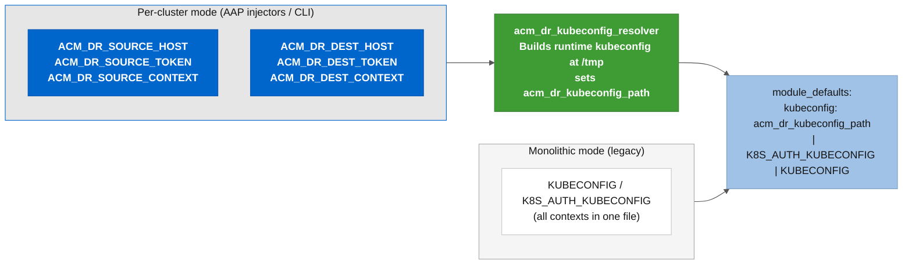

# 🔐 Ansible role: RHACM kubeconfig resolver (acm_dr_kubeconfig_resolver)

Lightweight pre-tasks role that detects per-cluster env vars injected by AAP custom credential types (or exported locally via [*`examples/scripts/lib/load_cluster_env.sh`*](../../examples/scripts/lib/load_cluster_env.sh)) and assembles a single runtime kubeconfig file from them. Every playbook in this project includes this role in its **`pre_tasks`** block (tagged **`always`** so it runs regardless of **`--tags`** filtering). When no per-cluster env vars are detected, the role does nothing and the playbook falls back to the legacy monolithic **`KUBECONFIG`** / **`K8S_AUTH_KUBECONFIG`** env vars.

---

## 📂 Role file links

* [tasks/main.yml](tasks/main.yml): Entry point. Scans env vars, reads fleet kubeconfig (file or Hub Secret), renders the runtime kubeconfig, and sets the **`acm_dr_kubeconfig_path`** fact.
* [defaults/main.yml](defaults/main.yml): All configurable variables (tempfile path, cluster prefixes, fleet settings, TLS behavior, Hub Secret auto-read).
* [templates/runtime_kubeconfig.yml.j2](templates/runtime_kubeconfig.yml.j2): Jinja2 template that merges per-cluster entries and fleet contexts into a valid multi-context kubeconfig.
* [meta/main.yml](meta/main.yml): Galaxy metadata and dependencies.
* [meta/argument_specs.yml](meta/argument_specs.yml): Formal argument specifications for all role variables.

---

## 🛠️ What this role does

* **Per-cluster env var scanning**: reads **`<PREFIX>_HOST`**, **`<PREFIX>_TOKEN`**, **`<PREFIX>_CA_DATA`** (optional), and **`<PREFIX>_CONTEXT`** for each prefix in **`acm_dr_kubeconfig_resolver_cluster_prefixes`**. Empty strings (AAP injects these for unfilled optional fields) are treated as absent.
* When the failover orchestrator needs contexts for dynamically discovered Spokes, merges them from either a file (**`ACM_DR_SPOKE_FLEET_KUBECONFIG`** env var) or a Secret stored on the Source Hub cluster ([*`03_build_spoke_fleet.sh --push-secret`*](../../examples/scripts/cluster-onboarding/03_build_spoke_fleet.sh)).
* When no fleet kubeconfig file is provided and Source Hub credentials exist, reads the **`spoke-fleet-kubeconfig`** Secret from the Hub's **`ansible-automation`** namespace directly via **`kubernetes.core.k8s_info`** (the runtime kubeconfig is not written yet at that point).
* Writes a multi-context kubeconfig at **`/tmp/acm_dr_runtime_kubeconfig.yml`** (mode **`0600`**, **`no_log: true`** on every task touching tokens).
* When no per-cluster env vars are detected, the role is a complete no-op. The playbook's **`module_defaults`** picks up the legacy **`K8S_AUTH_KUBECONFIG`** / **`KUBECONFIG`** env var as before.

---

## 🔄 Dual credential model

Two ways to deliver SA tokens to the playbooks:

1. Per-cluster credentials (primary, recommended for AAP and multi-cluster CLI): each cluster's API host, bearer token, CA data, and context name live in individual **`.env`** files under **`~/.kube/clusters/`** and get loaded as role-prefixed env vars. On AAP, custom credential types inject the same env vars directly into the execution environment (see [*`examples/aap-config/controller_credential_types.yml`*](../../examples/aap-config/controller_credential_types.yml)).

2. Monolithic kubeconfig (legacy fallback): all cluster contexts in a single **`KUBECONFIG`** file. Still fully supported; every playbook falls back to **`K8S_AUTH_KUBECONFIG`** / **`KUBECONFIG`** when no per-cluster env vars are detected.



---

## ⚙️ Configuration variables ([defaults/main.yml](defaults/main.yml))

### Cosmetic and logging

| Variable | Default | Description |
|---|---|---|
| **`acm_dr_kubeconfig_resolver_separator_char`** | **`"="`** | Separator character for banner messages in verbose/AAP job output. |
| **`acm_dr_kubeconfig_resolver_debug_no_log`** | **`true`** | Suppresses task output for security-sensitive operations. Set to **`false`** to reveal hidden output during troubleshooting. |

### Runtime kubeconfig file location

| Variable | Default | Description |
|---|---|---|
| **`acm_dr_kubeconfig_resolver_tempfile_path`** | **`"/tmp/acm_dr_runtime_kubeconfig.yml"`** | Path where the resolver writes the assembled kubeconfig. Created with mode **`0600`** because it contains bearer tokens. |

### Per-cluster env var prefixes

| Variable | Default | Description |
|---|---|---|
| **`acm_dr_kubeconfig_resolver_cluster_prefixes`** | **`["ACM_DR_TARGET", "ACM_DR_SOURCE", "ACM_DR_DEST", "ACM_DR_SPOKE"]`** | Env var prefix families to scan. Adding a new prefix here extends support without any task logic changes. |

### Spoke fleet kubeconfig

| Variable | Default | Description |
|---|---|---|
| **`acm_dr_kubeconfig_resolver_spoke_fleet_env_var`** | **`"ACM_DR_SPOKE_FLEET_KUBECONFIG"`** | Name of the env var holding the path to a multi-Spoke kubeconfig file used by the failover orchestrator. |

### TLS verification

| Variable | Default | Description |
|---|---|---|
| **`acm_dr_kubeconfig_resolver_skip_tls_when_no_ca`** | **`true`** | When CA data is not provided, the resolver sets **`insecure-skip-tls-verify: true`**. Acceptable for ARO/public-CA clusters in lab environments. Production should provide CA data and set this to **`false`**. |

### Spoke fleet Secret on Hub

| Variable | Default | Description |
|---|---|---|
| **`acm_dr_kubeconfig_resolver_fleet_secret_name`** | **`"spoke-fleet-kubeconfig"`** | Name of the Secret on the Hub holding the Spoke fleet kubeconfig. |
| **`acm_dr_kubeconfig_resolver_fleet_secret_namespace`** | **`"ansible-automation"`** | Namespace where the automation SA and fleet Secret live. |
| **`acm_dr_kubeconfig_resolver_fleet_secret_key`** | **`"kubeconfig"`** | Data key inside the Secret that holds the kubeconfig YAML. |
| **`acm_dr_kubeconfig_resolver_fleet_secret_enabled`** | **`true`** | Enables Hub Secret auto-read. Set to **`false`** to rely only on the file-based fleet or the legacy monolithic kubeconfig. |

---

## 📋 Per-cluster env var convention

Each prefix maps to a cluster role in the automation:

| Prefix | Purpose | Playbooks |
|---|---|---|
| **`ACM_DR_TARGET_`** | Single-target operations | Lab Setup, Lab Cleanup, ArgoCD, Spoke Manager (Hub side) |
| **`ACM_DR_SOURCE_`** | Failover origin Hub (currently ACTIVE) | Failover Orchestrator |
| **`ACM_DR_DEST_`** | Failover destination Hub (currently PASSIVE) | Failover Orchestrator |
| **`ACM_DR_SPOKE_`** | Individual Spoke cluster | Spoke Manager (Spoke side) |

Fields per prefix: **`_HOST`** (API URL), **`_TOKEN`** (SA bearer token), **`_CA_DATA`** (base64 PEM, optional), **`_CONTEXT`** (name that tasks use to select the cluster).

### Fleet discovery priority

The resolver reads Spoke fleet contexts in this order:

1. **`ACM_DR_SPOKE_FLEET_KUBECONFIG`** env var (file path, from AAP credential or local export)
2. Hub Secret auto-read (from Source Hub's **`ansible-automation`** namespace)
3. No fleet (Spoke contexts not available; Stage 07 sanitize will skip)

---

## 📦 Dependencies

None. This role uses only **`ansible.builtin.*`** and **`kubernetes.core.k8s_info`** (already in [*`collections/requirements.yml`*](../../collections/requirements.yml)).

---

## 🚀 Usage

This role is not called directly. Every playbook includes it as a pre-tasks role:

```yaml
  pre_tasks:
    - name: "Resolve per-cluster credentials into a runtime kubeconfig"
      ansible.builtin.include_role:
        name: acm_dr_kubeconfig_resolver
      tags:
        - always
```

The role sets the fact **`acm_dr_kubeconfig_path`**, which **`module_defaults`** picks up via lazy Jinja2 evaluation:

```yaml
  module_defaults:
    kubernetes.core.k8s:
      kubeconfig: >-
        {{ acm_dr_kubeconfig_path
           | default(lookup('ansible.builtin.env', 'K8S_AUTH_KUBECONFIG')
           | default(lookup('ansible.builtin.env', 'KUBECONFIG')
           | default('~/.kube/config'))) }}
```

### CLI with per-cluster credentials

```bash
# Load Source Hub credentials
source examples/scripts/lib/load_cluster_env.sh source ~/.kube/clusters/acm-primary-hub-sa.env

# Load Destination Hub credentials
source examples/scripts/lib/load_cluster_env.sh dest ~/.kube/clusters/acm-dr-hub-sa.env

# The resolver detects ACM_DR_SOURCE_* and ACM_DR_DEST_* and builds the runtime kubeconfig
ansible-playbook playbooks/orchestrate-dr-failover.yml \
  -e active_hub="acm-primary-hub-sa" \
  -e passive_hub="acm-dr-hub-sa"
```

### Legacy monolithic kubeconfig (no resolver needed)

```bash
export KUBECONFIG=~/.kube/config-acm-lab-dr
ansible-playbook playbooks/orchestrate-dr-failover.yml \
  -e active_hub="acm-primary-hub-sa" \
  -e passive_hub="acm-dr-hub-sa"
```

---

## 📄 License

GPL-3.0-or-later

---

Created and maintained by [Diego Felipe Mateus](https://github.com/dfmateus). See [CONTRIBUTORS.md](../../CONTRIBUTORS.md) for the list of contributors.
