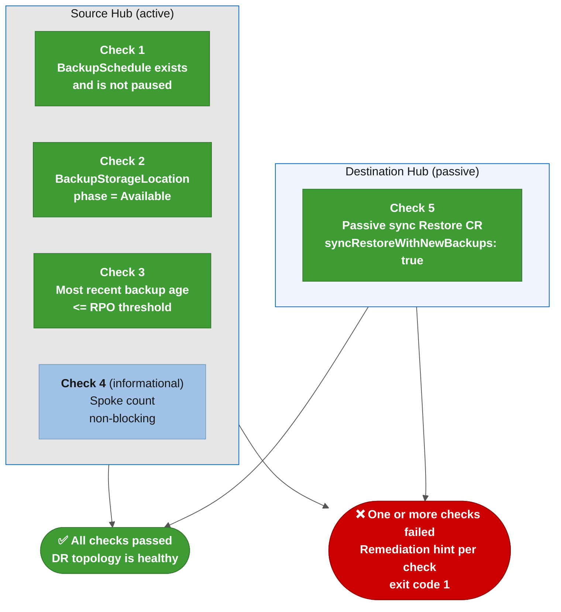

# Ansible role: RHACM DR Readiness Check (acm_dr_readiness_check)

A read-only health check role that validates both Hub clusters are ready for a failover before one starts. It runs five checks against real clusters. No state is modified. Use it as a pre-flight gate before any failover, failback, or DR drill, and as a recurring AAP scheduled job to surface drift between drills.

---

## When to use

- Before running **`orchestrate-dr-failover.yml`** to confirm the source Hub is actively backing up and the destination Hub is pre-positioned with recent data.
- As a scheduled AAP job (weekly or daily) to detect backup staleness or a missing passive Restore before they become an incident.
- After any Hub or OADP maintenance to confirm the DR posture is intact.
- During a DR readiness drill to confirm conditions without triggering a real failover.

This role never modifies cluster state. Re-running it is always safe.

---

## Role file links

- [tasks/main.yml](tasks/main.yml): all five checks in sequence, with the summary report at the end
- [defaults/main.yml](defaults/main.yml): all configurable thresholds and behavior flags

---

## Checks

The role runs these checks in order. All five are read-only API calls:



| Check | What it tests | Blocking? |
|-------|---------------|-----------|
| 1: BackupSchedule | Exists in **`open-cluster-management-backup`** and **`spec.paused=false`** | ❌ Always blocking |
| 2: BackupStorageLocation | At least one BSL is **`phase=Available`** | ❌ Always blocking |
| 3: Backup freshness | Latest completed backup age ≤ RPO threshold | Controlled by **`acm_dr_readiness_check_fail_on_stale_backup`** |
| 4: Spoke count | Fleet size vs. **`acm_dr_readiness_check_min_spoke_count`** | ⚠️ Always non-blocking (informational) |
| 5: Passive Restore | Sync Restore with **`syncRestoreWithNewBackups: true`** on destination Hub | Controlled by **`acm_dr_readiness_check_fail_on_missing_restore`** |

---

## Configuration variables

All variables are declared in [defaults/main.yml](defaults/main.yml) with inline comments. Override via **`-e`** or the AAP Survey.

| Variable | Default | Description |
|----------|---------|-------------|
| **`acm_dr_readiness_check_backup_namespace`** | **`open-cluster-management-backup`** | Namespace where OADP and ACM backup resources live on both Hubs |
| **`acm_dr_readiness_check_backup_schedule_name`** | **`""`** (auto-detect) | Name of the BackupSchedule to inspect; empty means use the first one found |
| **`acm_dr_readiness_check_rpo_seconds`** | **`25200`** (7 hours) | Maximum acceptable age of the latest completed backup; matches the default BackupSchedule interval |
| **`acm_dr_readiness_check_min_spoke_count`** | **`0`** (skip) | Minimum Spoke count expected on the source Hub (excluding **`local-cluster`**). Set to **`0`** to disable the check |
| **`acm_dr_readiness_check_fail_on_stale_backup`** | **`false`** | When **`true`**, a stale backup causes the role to fail instead of warning. Default **`false`** because labs often have low backup activity during quiet periods |
| **`acm_dr_readiness_check_fail_on_missing_restore`** | **`true`** | When **`true`**, absence of the passive sync Restore on the destination Hub is a blocking failure. Always set **`true`** in production readiness gates |

These two context variables are required and come from the playbook's **`-e`** flags (or AAP credential injection via [acm_dr_kubeconfig_resolver](../acm_dr_kubeconfig_resolver/)):

| Variable | Source | Description |
|----------|--------|-------------|
| **`k8s_source_context`** | **`-e`** or **`ACM_DR_SOURCE_CONTEXT`** | Kubeconfig context of the active Hub being checked |
| **`k8s_dest_context`** | **`-e`** or **`ACM_DR_DEST_CONTEXT`** | Kubeconfig context of the passive Hub being checked |

---

## Usage

### CLI: monolithic kubeconfig mode

```bash
export K8S_AUTH_KUBECONFIG="${HOME}/.kube/config-acm-lab-dr"
export KUBECONFIG="${K8S_AUTH_KUBECONFIG}"

ansible-playbook playbooks/orchestrate-dr-failover.yml \
  --tags readiness_check \
  -e k8s_source_context=your-hub-01-sa \
  -e k8s_dest_context=your-hub-02-sa \
  -v
```

The playbook [orchestrate-dr-failover.yml](../../playbooks/orchestrate-dr-failover.yml) includes the readiness check as its Stage 00 pre-flight gate. To run the check standalone without proceeding to the failover:

```bash
ansible-playbook playbooks/orchestrate-dr-failover.yml \
  --tags readiness_check \
  -e k8s_source_context=your-hub-01-sa \
  -e k8s_dest_context=your-hub-02-sa \
  -e acm_dr_failover_manager_dry_run=true \
  -e skip_gates=true \
  -v
```

### CLI: per-cluster credential mode

```bash
source examples/scripts/lib/load_cluster_env.sh source ~/.kube/clusters/your-hub-01-sa.env
source examples/scripts/lib/load_cluster_env.sh dest   ~/.kube/clusters/your-hub-02-sa.env

ansible-playbook playbooks/orchestrate-dr-failover.yml \
  --tags readiness_check \
  -v
```

### Tightening thresholds for production

```bash
# Fail if backup is older than 4 hours, fail if passive Restore is missing
ansible-playbook playbooks/orchestrate-dr-failover.yml \
  --tags readiness_check \
  -e k8s_source_context=acmdr-aro-prd-hub-01-sa \
  -e k8s_dest_context=acmdr-aro-prd-hub-02-sa \
  -e acm_dr_readiness_check_rpo_seconds=14400 \
  -e acm_dr_readiness_check_fail_on_stale_backup=true \
  -e acm_dr_readiness_check_fail_on_missing_restore=true \
  -e acm_dr_readiness_check_min_spoke_count=3 \
  -v
```

---

## Output

The summary task **`[READINESS 6.1]`** prints a one-line status for all checks. Look for it in the AAP job output or in the **`-v`** terminal output:

```
[READINESS 6.1] | Print readiness summary
ok: [localhost] => {
    "msg": "🔎 READINESS SUMMARY for failover direction 'your-hub-01-sa → your-hub-02-sa':
            Check 1 (BackupSchedule): ✅ |
            Check 2 (BSL Available): ✅ |
            Check 3 (Backup age): ✅ |
            Check 4 (Spoke count): 7 Spoke(s) |
            Check 5 (Passive Restore): ✅"
}
```

A failing check prints **`❌ FAILED! Oh. No! =>`** with a specific remediation hint before aborting.

---

## Lint

```bash
ansible-lint roles/acm_dr_readiness_check
```

No molecule tests exist for this role. Validation against real clusters is the only test path. The role is inherently safe to run against production clusters because it makes no mutations.

---

## External references

- [RHACM 2.17 Business Continuity: BackupSchedule](https://docs.redhat.com/en/documentation/red_hat_advanced_cluster_management_for_kubernetes/2.17/html-single/business_continuity/index#schedule-backup): official BackupSchedule and Restore documentation
- [docs/runbook/backup-collision-recovery.md](../../docs/runbook/backup-collision-recovery.md): if the readiness check fails on Check 1 with **`phase=BackupCollision`**
- [docs/runbook/stage03-restore-hangs.md](../../docs/runbook/stage03-restore-hangs.md): if Check 2 shows BSL unavailable and you suspect storage connectivity
