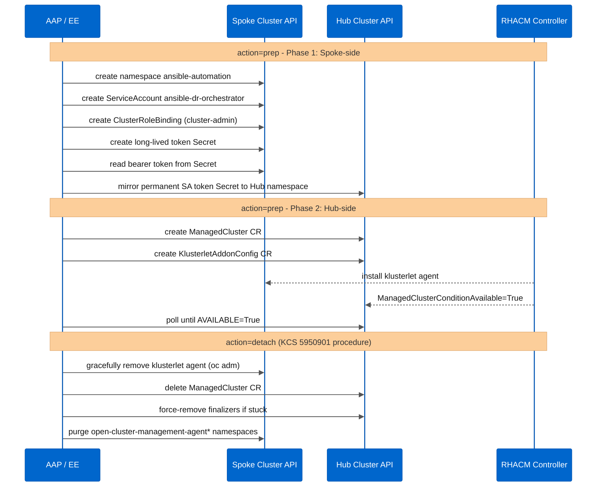

# 🔌 Ansible role: RHACM spoke manager (acm_dr_spoke_manager)

This Ansible role manages the lifecycle of integration (Onboarding / Prep) and detachment (Detach / Purge) of managed clusters (**ManagedClusters**) in **Red Hat Advanced Cluster Management for Kubernetes (RHACM) 2.10+** safely and idempotently.

The role natively supports **any Kubernetes distribution**: **Red Hat OpenShift (ARO)**, **Azure Kubernetes Service (AKS)**, **Amazon Elastic Kubernetes Service (Amazon EKS)**, **Google Kubernetes Engine (GKE)**, **IBM Cloud Kubernetes Service (IKS)**, and vanilla **Kubernetes 1.24+**. Cloud provider (**`cloud`** label) and vendor (**`vendor`** label) are auto-detected for OpenShift Spokes and fully configurable via extra vars for non-OCP Spokes.

---

## 📂 Role file links

* [tasks/main.yml](tasks/main.yml): Entry point and tag-based routing (**spoke_prep** and **spoke_detach**).
* [tasks/01_spoke_prep.yml](tasks/01_spoke_prep.yml): Onboarding tasks, ServiceAccount creation, and auto-import secret injection (defined inline in the task).
* [tasks/02_spoke_detach.yml](tasks/02_spoke_detach.yml): Graceful removal tasks based on [KCS 5950901](https://access.redhat.com/solutions/5950901) and finalizer cleanup.
* [defaults/main.yml](defaults/main.yml): Role default settings.
* [templates/reports/](templates/reports/): Banners and completion panels centralized here. No task has inline report formatting. [stage_banner.j2](templates/reports/stage_banner.j2) is the generic template reused by all stage headers and completion banners.

---

## 🛠️ What this role does

* **Kubernetes 1.24+ Support**: Explicit creation of **Secret** objects of type **`kubernetes.io/service-account-token`** for bootstrap ServiceAccounts, working around the deprecation of auto-generated tokens in Kubernetes 1.24+.
* Injects the **`auto-import-secret`** Secret into the ManagedCluster namespace on the Hub, with no manual intervention needed.
* Removes the ManagedCluster CR on the Hub (**`state: absent`**), clears stuck finalizers on the Spoke's **`Klusterlet`**, and purges **`open-cluster-management-agent*`** namespaces, following [KCS 5950901](https://access.redhat.com/solutions/5950901).
* Removes temporary bootstrap credentials from the Spoke as soon as the agent handshake completes.

---

## ⚙️ Configuration variables (defaults/main.yml)

* **k8s_target_context** (no own default; hub context fallback **`"acm-primary-hub"`**): Hub context in the kubeconfig.
* **`acm_dr_spoke_manager_spoke_k8s_context`** (default: env var **`SPOKE_K8S_CONTEXT`**): Spoke context in the kubeconfig.
* **`acm_dr_spoke_manager_cluster_name`** (default: env var **`SPOKE_CLUSTER_NAME`**): ManagedCluster name in RHACM.
* **`acm_dr_spoke_manager_cluster_cloud`** (default: **`""`**, auto-detect): Cloud provider label applied to the **`ManagedCluster`**. For OpenShift Spokes, auto-detected from **`Infrastructure.status.platform`** (Azure, AWS, GCP, IBMCloud, etc.). For non-OCP Spokes, pass via **`-e acm_dr_spoke_manager_cluster_cloud=Amazon`** (or **`Google`**, **`IBM`**, **`Other`**). Falls back to **`Other`** if empty and auto-detection is unavailable.
* **`acm_dr_spoke_manager_cluster_environment`** (default: **`"lab"`**): Environment label applied to the **`ManagedCluster`**. Override via **`-e`** for non-lab deployments (e.g., **`dev`**, **`staging`**, **`production`**).
* **`acm_dr_spoke_manager_cleanup_bootstrap_sa`** (default: **`true`**): Removes bootstrap credentials after re-import.
* **`acm_dr_spoke_manager_action`** (default: **`"prep"`**): Selects the flow the role runs (**`prep`** or **`detach`**). The **`spoke_prep`**/**`spoke_detach`** tags alone are not sufficient: you must also pass **`-e acm_dr_spoke_manager_action=detach`** for the detach flow to execute (the task checks this variable, not just the tag).

---

## 🔬 Real-world finding: hardcoded **`vendor`** label set to **`OpenShift`** for all Spokes

✅ **Fixed and validated.** Discovered while onboarding a new ARO Spoke and testing a real failover with the full fleet (ARO + AKS).

The **`ManagedCluster`** declaration task (**`1.2.3`**) was writing **`vendor: OpenShift`** as a **hardcoded value**, regardless of whether the Spoke was actually OpenShift/ARO or native Kubernetes/AKS. The example Policies repository used by **`acm_dr_hub_setup`** (Stage 04) uses a Placement (**`ocp-azure-placement`**) filtered by **`vendor: OpenShift`** to restrict OpenShift-exclusive Policies (namespace **`openshift-config`**, StorageClass **`managed-csi`**, etc.) to clusters that are actually OpenShift. With the incorrect label, the AKS Spoke was included in that Placement and received Policies that would never converge on it (permanent **`NonCompliant`**; the **`openshift-config`** namespace will never exist on an AKS cluster).

### Applied fix

New tasks **`1.2.2b`**/**`1.2.2c`** query the **`Infrastructure`** CR (**`config.openshift.io/v1`**, only exists on OpenShift) in the Spoke's own context before declaring the **`ManagedCluster`**, and populate the **`vendor`** label with the actual detected value (**`OpenShift`** or **`Kubernetes`**). When no **`acm_dr_spoke_manager_spoke_k8s_context`** is provided (manual token flow), the previous behavior (**`OpenShift`**) is preserved as a safe fallback.

### Fix validation

Real re-onboarding of the existing AKS Spoke: the label changed to **`vendor=Kubernetes`**, the cluster was removed from the **`ocp-azure-placement`** Placement, and the Policies that were previously **`NonCompliant`** only on that cluster (**`policy-htpasswd`**, **`policy-storageclass-managed-csi`**) became **`Compliant`** across the entire fleet.

---

## 🔬 Real-world finding: hardcoded **`cloud: Azure`** label for all Spokes

✅ **Fixed in this version.** Discovered during a full multi-distribution audit.

The same **`ManagedCluster`** declaration task (**`1.2.3`**) was writing **`cloud: Azure`** as a **hardcoded value** for all Spokes, regardless of where the cluster actually runs. An EKS Spoke would be labeled **`cloud: Azure`** instead of **`cloud: Amazon`**, a GKE Spoke would not get **`cloud: Google`**, etc. This label is used by RHACM **Placements** and **Policies** to target clusters by cloud provider. The wrong value would cause incorrect cluster selection or exclusion.

Additionally, the **`environment: lab`** label was hardcoded with no override path.

### Applied fix

1. New task **`1.2.2d`** auto-detects the cloud provider from **`Infrastructure.status.platform`** (OCP Spokes), the same CR already queried for vendor detection. For non-OCP Spokes where the **`Infrastructure`** CR is absent, falls back to the user-supplied **`-e acm_dr_spoke_manager_cluster_cloud=<provider>`** or **`Other`**.
2. New default variables **`acm_dr_spoke_manager_cluster_cloud`** (empty = auto-detect) and **`acm_dr_spoke_manager_cluster_environment`** (**`lab`**) in **`defaults/main.yml`**.
3. The API URL extraction task (**`1.1.6`**) was changed from **`oc config view`** to **`kubectl config view`** to remove the OpenShift CLI dependency for Spoke-facing operations.
4. Playbook examples and error messages updated to show multi-distribution patterns (ARO, EKS, AKS).

---

## 🚀 Execution examples via dedicated playbook

```bash
# OpenShift (ARO) Spoke Onboarding - cloud/vendor auto-detected
ansible-playbook playbooks/manage-spoke.yml \
  -e k8s_target_context="acm-primary-hub-sa" \
  -e acm_dr_spoke_manager_spoke_k8s_context="aro-spoke-01-sa" \
  -e acm_dr_spoke_manager_cluster_name="aro-spoke-01" \
  --tags "spoke_prep"

# Amazon EKS Spoke Onboarding - pass cloud label explicitly (non-OCP)
ansible-playbook playbooks/manage-spoke.yml \
  -e k8s_target_context="acm-primary-hub-sa" \
  -e acm_dr_spoke_manager_spoke_k8s_context="eks-spoke-01-sa" \
  -e acm_dr_spoke_manager_cluster_name="eks-spoke-01" \
  -e acm_dr_spoke_manager_cluster_cloud="Amazon" \
  --tags "spoke_prep"

# Google GKE Spoke Onboarding (non-OCP)
ansible-playbook playbooks/manage-spoke.yml \
  -e k8s_target_context="acm-primary-hub-sa" \
  -e acm_dr_spoke_manager_spoke_k8s_context="gke-spoke-01-sa" \
  -e acm_dr_spoke_manager_cluster_name="gke-spoke-01" \
  -e acm_dr_spoke_manager_cluster_cloud="Google" \
  --tags "spoke_prep"

# Graceful Detach (any distribution, KCS 5950901 - https://access.redhat.com/solutions/5950901)
ansible-playbook playbooks/manage-spoke.yml \
  -e k8s_target_context="acm-primary-hub-sa" \
  -e acm_dr_spoke_manager_spoke_k8s_context="aks-spoke-01-sa" \
  -e acm_dr_spoke_manager_cluster_name="aks-spoke-01" \
  -e acm_dr_spoke_manager_action="detach" \
  --tags "spoke_detach"
```



---

## 🔎 Dry-run note

This role does not have its own dry-run mode. When invoked by the [acm_dr_failover_manager](../acm_dr_failover_manager) role (Stage 04, fleet reconnection), the step that calls **`acm_dr_spoke_manager`** is **skipped entirely in dry-run** (with a **`🔎 [DRY-RUN]`** message explaining what would happen) instead of being simulated via **`check_mode`**, since it depends on credentials generated at runtime and Klusterlet reconnection polling (3-7 minutes) that would not exist in a simulated execution.

---

## 📚 Official references
* [Red Hat ACM: Auto-import Managed Clusters](https://docs.redhat.com/en/documentation/red_hat_advanced_cluster_management_for_kubernetes)
* [Red Hat KCS 7039710: ManagedServiceAccount token restore failure after OADP Restore](https://access.redhat.com/solutions/7039710)
* [Red Hat KCS 5950901: Graceful Removal and Detach of ManagedClusters](https://access.redhat.com/solutions/5950901)

---

Created and maintained by [Diego Felipe Mateus](https://github.com/dfmateus). See [CONTRIBUTORS.md](../../CONTRIBUTORS.md) for the list of contributors.
