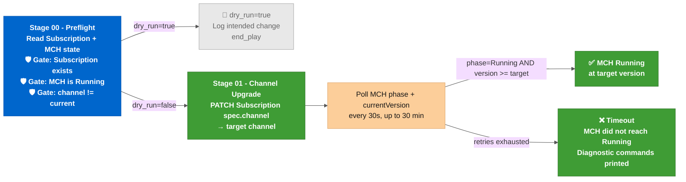

# Ansible role: RHACM ACM Channel Upgrade (acm_dr_upgrade_manager)

Patches the ACM OLM Subscription to a new channel and waits for the **MultiClusterHub** to reach `Running` at the target version. Use it to roll a Hub cluster from one RHACM minor version to the next before or after a planned DR switchover.

---

## When to use

- As part of **`WF - ACM DR - LAB - Planned Maintenance Switchover`** via **`JT - ACM DR - LAB - Hub ACM Channel Upgrade`** - the workflow upgrades the passive Hub before switching active roles, so both hubs run the same version after switchover.
- Standalone: upgrade any Hub cluster in a maintenance window without a DR switchover attached.

The role targets one Hub per run. Run it twice (once per Hub) to upgrade both.

---

## Role file links

- [**`tasks/main.yml`**](tasks/main.yml): dispatch to Stage 00 and Stage 01
- [**`tasks/00_preflight.yml`**](tasks/00_preflight.yml): reads current state, validates the Subscription exists, gates on MCH Running and channel delta
- [**`tasks/01_channel_upgrade.yml`**](tasks/01_channel_upgrade.yml): patches the Subscription channel and polls for MCH Running at the target version
- [**`defaults/main.yml`**](defaults/main.yml): all configurable variables

---

## How it works



OLM typically takes 1-3 minutes to resolve the new CSV before the **MultiClusterHub** enters `Updating`. The full minor-version upgrade (OLM resolution + operator rolling update + MCH reconciliation) runs 10-20 minutes in lab environments. The default timeout is 30 minutes (60 retries × 30 seconds).

---

## Configuration variables

All variables are declared in [**`defaults/main.yml`**](defaults/main.yml) with inline comments.

| Variable | Default | Description |
|---|---|---|
| **`acm_dr_upgrade_manager_target_acm_version`** | _(from `acm_dr_failover_manager_target_acm_version`)_ | Target RHACM version as `major.minor` (e.g., `"2.16"`) or full semver - the role normalizes to major.minor. Required; no fallback when both sources are empty |
| **`acm_dr_upgrade_manager_target_channel`** | Derived from target version | OLM channel computed at runtime (`release-2.16` from `2.16.x`). Do not override directly |
| **`acm_dr_upgrade_manager_acm_namespace`** | `open-cluster-management` | Namespace where the ACM Subscription and **MultiClusterHub** live |
| **`acm_dr_upgrade_manager_subscription_name`** | `advanced-cluster-management` | Name of the OLM Subscription object |
| **`acm_dr_upgrade_manager_mch_name`** | `multiclusterhub` | Name of the **MultiClusterHub** CR |
| **`acm_dr_upgrade_manager_mch_wait_retries`** | `60` | Poll retry count. Default 60 × 30s = 30 minutes maximum wait |
| **`acm_dr_upgrade_manager_mch_wait_delay`** | `30` (seconds) | Seconds between MCH phase polls |
| **`acm_dr_upgrade_manager_dry_run`** | `false` | When `true`, Stage 01 is skipped; preflight still runs and logs the intended channel change |

The target context comes from the required cross-role variable **`k8s_target_context`**, passed via **`-e`** or injected by [**`acm_dr_kubeconfig_resolver`**](../acm_dr_kubeconfig_resolver/).

---

## Dry-run mode

When `acm_dr_upgrade_manager_dry_run: true`, the role exits after Stage 00. The preflight logs the current channel and the intended target channel without patching anything. Use this to preview an upgrade path before a maintenance window.

---

## Requirements

- **`kubernetes.core`** collection (version declared in `collections/requirements.yml`)
- A KUBECONFIG or `k8s_target_context` pointing at the Hub being upgraded
- RHACM installed via OLM on the target cluster

---

## Example playbook

```yaml
- name: "Upgrade ACM channel on Hub Primary"
  hosts: localhost
  gather_facts: false
  roles:
    - role: "{{ playbook_dir }}/../roles/acm_dr_hub_setup"
      vars:
        k8s_target_context: "hub-primary-sa"
        acm_dr_upgrade_manager_target_acm_version: "2.16"
        acm_dr_upgrade_manager_dry_run: false
```

For production use, invoke via [**`upgrade-hub-acm-channel.yml`**](../../playbooks/upgrade-hub-acm-channel.yml), which calls [**`acm_dr_kubeconfig_resolver`**](../acm_dr_kubeconfig_resolver/) first to assemble the runtime kubeconfig from AAP credential injection.
